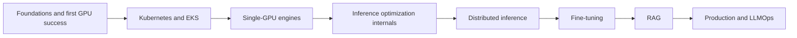

# Open Model Systems: From One GPU to a Distributed Platform

This repository is a lesson-by-lesson learning path for understanding, deploying,
optimizing, distributing, fine-tuning, augmenting, and operating open-weight
language models on Kubernetes.

It is written for a learner who:

- understands some LLM and transformer concepts;
- knows basic Python, shell, and Git;
- is new to Kubernetes, EKS, GPU serving engines, distributed inference,
  fine-tuning, RAG, and LLMOps;
- wants to understand mechanisms under the hood, not merely copy commands.

The default AWS lab profile is intentionally modest:

- one NVIDIA GPU with roughly 24 GB of VRAM for the single-GPU path;
- three separate one-GPU G-series nodes for distributed experiments;
- no NVLink or EFA requirement for the core curriculum.

The slow-network distributed labs are deliberate. They make communication,
pipeline bubbles, collectives, memory pressure, scheduling, and failure modes
visible.

## Learning method

Every lesson follows the same loop:

```text
predict -> run -> measure -> explain -> change one variable -> re-measure -> clean up
```

A configuration change is not considered an optimization until the learner can:

1. explain its mechanism;
2. show controlled measurements;
3. verify output quality or correctness;
4. identify the trade-off it introduced;
5. prove that expensive cloud resources were removed afterward.

## Roadmap



The core path contains 50 lessons:

| Phase | Lessons | Outcome |
|---|---:|---|
| Foundations | 00–04 | Trace inference, budget GPU memory, build a GPU container, run the first EKS workload |
| Kubernetes/EKS | 05–10 | Deploy, schedule, expose, package, debug, and clean up a GPU model service |
| Inference engines | 11–16 | Compare Transformers, vLLM, SGLang, and llama.cpp fairly |
| Optimization internals | 17–23 | Explain and measure memory, batching, kernels, caching, quantization, and speculative execution |
| Distributed inference | 24–31 | Learn NCCL, Ray/KubeRay, DP, TP, PP, and run a large quantized model across G-series nodes |
| Fine-tuning | 32–39 | Build datasets, evaluate, run SFT/LoRA/QLoRA, study distributed training, and serve the result |
| RAG | 40–44 | Build, evaluate, secure, and deploy a retrieval-augmented system |
| Production/LLMOps | 45–49 | Observe, scale, secure, release, roll back, and operate the complete platform |

See [ROADMAP.md](ROADMAP.md) for the full sequence and acceptance gates.

## Compute lanes

- `local-cpu`: reading, tokenization, tiny correctness tests, Kubernetes object
  exercises, and much of the RAG work.
- `g1`: one approximately 24 GB NVIDIA GPU. The tested AWS target is a
  `g5.2xlarge`-class node.
- `g3`: three separate `g1` nodes in one Availability Zone.
- `advanced`: optional 4+ GPU, EFA, NVLink, MoE, multimodal, or disaggregated
  serving work.

Lessons must declare their lane and expected GPU-minutes before asking the learner
to launch anything.

## Repository status

The repository is under active development:

- lessons 00–10 are detailed practical drafts with runnable code, scripts,
  Kubernetes manifests, Helm charts, guided failure drills, verification, and
  cleanup;
- lessons 11–49 remain visible as roadmap outlines and must not be mistaken for
  finished teaching material;
- all practical drafts receive repository-level static validation in CI;
- Docker, GPU, and EKS labs remain `draft` until they are completed from clean
  learner environments and independently reviewed.

CI checks structure, lesson metadata, source syntax, JSON, relative links,
script permissions, and likely credential material. It does not prove that an
image builds, a manifest applies, a Helm release installs, a GPU is visible, an
EKS request succeeds, or cleanup removes cloud resources. Those claims require
the lesson's documented runtime validation and review.

Publishing shallow tutorials as “complete” would undermine the course. The
release plan remains:

- `v0.1`: lessons 00–16, first useful one-GPU system;
- `v0.2`: lessons 17–31, optimization and distributed systems;
- `v0.3`: lessons 32–44, model adaptation and RAG;
- `v1.0`: lessons 45–49, production platform and contributor-quality polish.

See [docs/publication-plan.md](docs/publication-plan.md).

## How to use the repository

1. Read [docs/prerequisites.md](docs/prerequisites.md).
2. Read [docs/cost-and-cleanup-safety.md](docs/cost-and-cleanup-safety.md).
3. Read [docs/running-labs.md](docs/running-labs.md).
4. Select a compute profile under [profiles/](profiles/README.md).
5. Begin with lesson `00`; do not skip phase gates.
6. Save every experiment as raw JSON plus a short report.
7. Run `make validate` before committing.

```bash
make list
make validate
```

## Public-repository rules

- Never commit credentials, account IDs, cluster endpoints, generated
  kubeconfigs, access tokens, private data, or model weights.
- Pin model and dataset revisions rather than referring only to `main` or
  `latest`.
- Use immutable image digests in validated lesson solutions.
- Record licenses and provenance for every model and dataset.
- Default services to `ClusterIP` and port-forwarding until the security lessons.
- Treat cleanup as a mandatory lab step.

## Contributing

Read [CONTRIBUTING.md](CONTRIBUTING.md) and use the lesson template under
[templates/lesson/](templates/lesson/README.md). A lesson is publishable only
after another learner has completed it from a clean environment.
