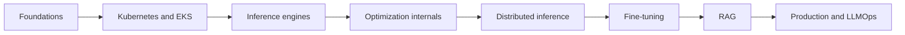
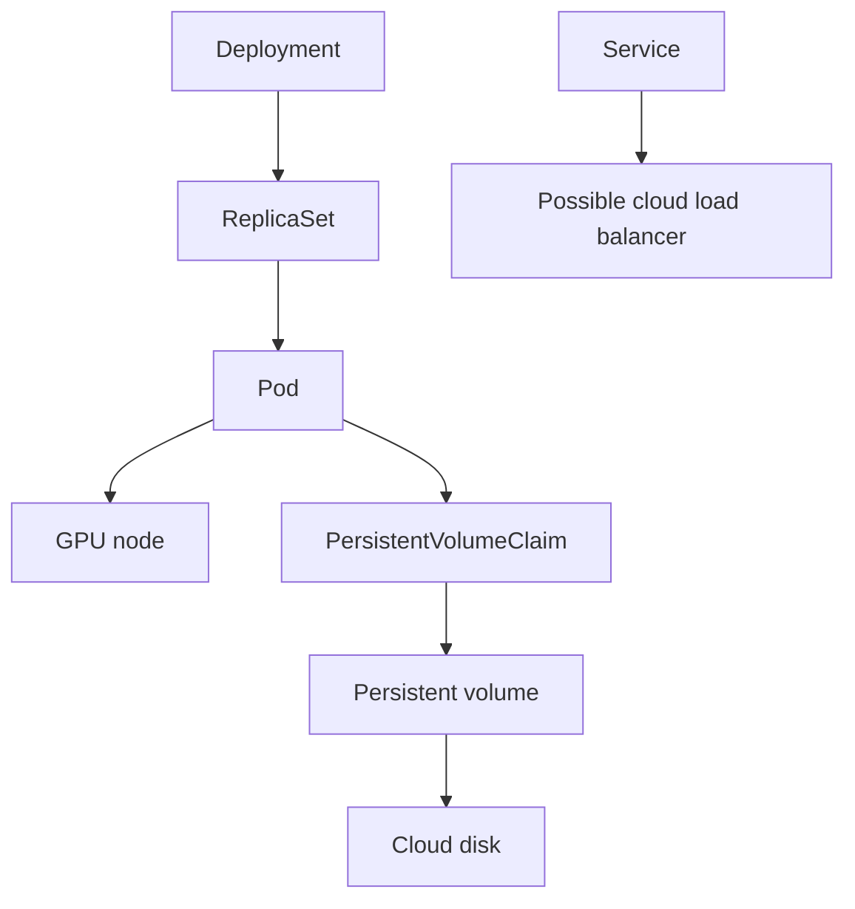

# 00 — Course map, reproducibility, and cost safety

**Status:** draft
**Estimated time:** 2–3 hours
**Compute profile:** `local-cpu`; optional read-only AWS inspection
**Estimated GPU-minutes:** 0
**Prerequisites:** basic Python, shell, and Git

## Why this matters

An experiment is useful only when you can answer two questions:

1. **What exactly ran?**
2. **What is still running and costing money?**

LLM systems have more moving pieces than a typical Python program. A result can
change because the model revision moved, a tokenizer changed, a container tag
was overwritten, a GPU kernel took a different path, a serving engine selected
different defaults, or the request mix changed. “I ran model X on a GPU” is not
enough information to reproduce a result.

Cloud cleanup is similarly part of correctness. Deleting a Pod does not
necessarily delete its node, disk, load balancer, or snapshot. A successful lab
that leaves an expensive GPU node running is an unsuccessful lab.

This lesson creates the habits used in every later lesson:

```text
predict -> identify immutable inputs -> run -> collect evidence
        -> explain -> clean up -> verify cleanup
```

Nothing in this lesson scales or creates AWS resources. The AWS scripts are
read-only.

## Learning outcomes

By the end, you can:

- explain the eight course phases and why they are ordered this way;
- distinguish a human-friendly name from an immutable identifier;
- create an experiment record containing code, software, model, hardware, and
  workload fingerprints;
- calculate planned node-hours and GPU-hours before starting a cloud lab;
- inspect an EKS managed node group without changing it;
- prove that a lesson namespace is absent and managed GPU capacity is zero;
- identify secrets and account-specific values that must never be committed.

## What you will build

A private experiment notebook entry, a GPU-hour budget, and two machine-readable
cleanup gates. The local gate is safe to break on purpose. The optional cloud
gate reads your EKS state but never creates, scales, or deletes anything.

## Course map



| Phase | Question it answers |
|---|---|
| Foundations | What happens when a model generates a token, and what does the GPU contribute? |
| Kubernetes/EKS | How does desired state become a running, networked, recoverable process? |
| Engines | How do serving runtimes expose and schedule the generation loop? |
| Optimization | Which bytes, kernels, and queues does each optimization change? |
| Distributed inference | What moves between GPUs and nodes, and where does waiting occur? |
| Fine-tuning | How are weights or adapters changed safely and evaluated? |
| RAG | How can external knowledge enter a request without changing base weights? |
| Production | How do we observe, release, secure, scale, and recover the system? |

Do not interpret this sequence as “memorize Kubernetes before touching a
model.” Lesson 04 gives an early end-to-end success. Lessons 05–10 unpack every
Kubernetes mechanism you just used.

## Under the hood

### The five fingerprints

Think of an experiment as a function:

```text
result = F(code, software, model/data, hardware, workload)
```

If one input is unknown, the result is not fully reconstructable.

1. **Code:** Git commit, clean/dirty state, exact command.
2. **Software:** package versions, image digest, driver, CUDA, engine.
3. **Model/data:** repository, immutable revision, tokenizer, preprocessing.
4. **Hardware:** CPU, RAM, GPU, VRAM, topology, network, instance type.
5. **Workload:** prompts, token lengths, batch, concurrency, seed, warm-up.

Human-friendly identifiers often move:

```text
model "main"          -> may point to a new commit tomorrow
image "server:latest" -> may contain different bytes tomorrow
Git branch "main"     -> moves whenever code is merged
```

Content identifiers do not:

```text
Git commit:       fcf2034...
model revision:   5f91d94...
OCI image digest: sha256:2b7e...
```

### Desired state creates cost shadows



Deleting the Pod affects only one vertex. A Deployment can replace it, a node
group can remain at desired capacity one, and disks or load balancers can
outlive the process. Cleanup therefore means:

1. issue the intended deletion/scale action;
2. independently inspect the resulting state.

### Cost arithmetic

```text
node-hours = node count × elapsed minutes / 60
GPU-hours  = node count × GPUs per node × elapsed minutes / 60
estimated compute cost = node-hours × current node price per hour
```

Three one-GPU nodes for 35 minutes consume 1.75 node-hours and 1.75 GPU-hours.
Cloud bills also include storage, networking, load balancers, and other
services. Check your current regional price immediately before a lab.

## Files in this lesson

```text
.
├── README.md
├── SOLUTIONS.md
└── scripts
    ├── cloud-audit.sh
    ├── estimate_gpu_hours.py
    ├── new-experiment.sh
    ├── preflight.sh
    ├── verify-cloud-cleanup.sh
    └── verify-local-cleanup.sh
```

Generated records go under ignored `runs/`.

## Prerequisites and preflight

From the repository root:

```bash
make list
make validate
cd lessons/phase-00-foundations/00-course-map-cost-safety
chmod +x scripts/*.sh
./scripts/preflight.sh
```

Representative output:

```text
[ok] bash: 3.2 or newer
[ok] python3: Python 3.x.x
[ok] git: git version 2.x.x
[info] kubectl: not found (optional in lesson 00)
[info] aws: not found (optional in lesson 00)
[ok] repository worktree detected
Preflight passed for lesson 00.
```

Missing optional tools are fine here. Missing Python, Git, or a Git worktree is
a failure.

## Cost and safety

This lesson creates no cloud resources and consumes zero GPU-minutes. The AWS
commands are read-only. Never save credentials, account IDs, cluster endpoints,
or kubeconfig contents in the generated report. If the identity or Kubernetes
context is unexpected, stop before running any later lesson.

## Predict before running

Write down your answers:

1. Does a Git commit capture untracked files?
2. If a Deployment owns a Pod, will deleting only that Pod stop the workload?
3. Does deleting a namespace scale an EKS node group to zero?
4. How many GPU-hours are three one-GPU nodes running for 20 minutes?
5. Which can be committed: AWS account ID, model commit, token, image digest?

## Lab outline

1. Establish the local tool baseline.
2. Generate an experiment record.
3. Calculate a hypothetical GPU budget.
4. Optionally inspect EKS using read-only calls.
5. Break and repair a synthetic cleanup gate.

## Step-by-step lab

### 1. Create an experiment record

```bash
./scripts/new-experiment.sh first-baseline
run_dir="$(find runs -mindepth 1 -maxdepth 1 -type d -name '*-first-baseline' | sort | tail -1)"
find "$run_dir" -maxdepth 1 -type f -print
python3 -m json.tool "$run_dir/metadata.json"
```

Expected first lines:

```text
Created runs/YYYYMMDDTHHMMSSZ-first-baseline
Next: edit runs/YYYYMMDDTHHMMSSZ-first-baseline/report.md
```

The record includes UTC ID, Git commit and dirty state, OS, architecture, and
Python version. It provides blank fields for immutable model/image identifiers
and workload parameters. It deliberately does not dump environment variables,
which may contain credentials.

If two learners report the same commit but one has uncommitted edits, their code
is not actually identical. That is why dirty state is evidence, not clutter.

### 2. Estimate a budget

```bash
python3 scripts/estimate_gpu_hours.py \
  --nodes 3 \
  --gpus-per-node 1 \
  --minutes 35
```

Expected:

```text
nodes:             3
GPUs per node:     1
planned minutes:   35.00
node-hours:        1.7500
GPU-hours:         1.7500
currency estimate: omitted (pass --hourly-node-price with a current regional price)
```

You may add a current price:

```bash
python3 scripts/estimate_gpu_hours.py \
  --nodes 1 --gpus-per-node 1 --minutes 60 \
  --hourly-node-price 1.23
```

`1.23` is only a placeholder, not an AWS price quote.

### 3. Optional read-only EKS audit

Never put these values in a tracked file:

```bash
export AWS_REGION='YOUR_REGION'
export EKS_CLUSTER_NAME='YOUR_CLUSTER'
export GPU_NODEGROUP_NAME='YOUR_GPU_NODEGROUP'
export LAB_NAMESPACE='open-models-l04'

aws sts get-caller-identity
kubectl config current-context
./scripts/cloud-audit.sh
```

Representative output:

```text
== Managed node group ==
status   desired  min  max  instance-types
ACTIVE   0        0    1    g5.2xlarge

== Lesson namespace ==
namespace/open-models-l04 not found
```

Read the script. It calls only `describe` and `get`. It is for EKS managed node
groups; Karpenter and self-managed groups require different checks. It also
compares the active kubeconfig API endpoint with the endpoint returned for
`EKS_CLUSTER_NAME`. A mismatch or API/RBAC error fails the audit instead of
being reported as an empty cluster.

## Deliberate failure

Break the local cleanup check with synthetic input:

```bash
set +e
EXPECTED_GPU_DESIRED=1 ./scripts/verify-local-cleanup.sh
exit_code=$?
set -e
printf 'exit status: %s\n' "$exit_code"
```

Expected:

```text
[fail] expected GPU desired capacity 0, received 1
Cleanup verification failed.
exit status: 1
```

Repair it:

```bash
EXPECTED_GPU_DESIRED=0 ./scripts/verify-local-cleanup.sh
```

A reliable cleanup gate exits non-zero when resources remain. A green-looking
message with exit status zero cannot protect automation.

## Evidence to collect

Complete the generated `report.md` with:

- prediction answers;
- preflight output;
- planned node-hours and GPU-hours;
- Git commit plus worktree state;
- optional cloud audit;
- deliberate failure and explanation;
- final cleanup verification.

Do not commit the private record if it contains account metadata.

## Verification

```bash
python3 -m py_compile scripts/estimate_gpu_hours.py
bash -n scripts/*.sh
EXPECTED_GPU_DESIRED=0 ./scripts/verify-local-cleanup.sh
git status --short
```

If AWS was configured, also run:

```bash
./scripts/verify-cloud-cleanup.sh
```

It fails unless the namespace is absent, managed-node-group desired and minimum
capacity are both zero, no Kubernetes Node object from that group remains, and
kubectl targets the named EKS cluster. The namespace check uses
`--ignore-not-found`; authentication, authorization, and network errors still
fail the script rather than being mistaken for successful cleanup.

## Completion gate

- [ ] Preflight exits zero.
- [ ] You created and inspected an experiment record.
- [ ] You can explain mutable names versus immutable identifiers.
- [ ] You calculated node-hours and GPU-hours.
- [ ] You made cleanup verification fail and then pass.
- [ ] If using AWS, you confirmed identity and context first.
- [ ] No secrets or private identifiers entered Git.
- [ ] This lesson launched zero GPU resources.

## Cleanup

Lesson 00 creates only ignored local records. Keep them privately or remove one
after reviewing its exact path:

```bash
printf 'Review before removing: %s\n' "$run_dir"
rm -r -- "$run_dir"
```

Never run that with an empty or unreviewed variable. The optional AWS audit was
read-only, so this lesson provides no cloud deletion command.

## Troubleshooting

### Script is not executable

```bash
chmod +x scripts/*.sh
```

### `fatal: not a git repository`

Run inside the cloned course repository.

### Node group is not found

Inspect names read-only:

```bash
aws eks list-clusters --region "$AWS_REGION"
aws eks list-nodegroups \
  --region "$AWS_REGION" \
  --cluster-name "$EKS_CLUSTER_NAME"
```

### Wrong Kubernetes context

Stop before changing anything:

```bash
kubectl config get-contexts
kubectl config current-context
```

## Exercises

1. Calculate hours for two nodes, four GPUs per node, for 45 minutes.
2. Explain why `pip freeze` alone cannot reproduce a GPU run.
3. Classify `server:v1`, `sha256:abcd`, model `main`, and model commit
   `5f91d94` as mutable or immutable.
4. Name four resources that can outlive a deleted Pod.
5. Add a quality-check field to your private report.

See [SOLUTIONS.md](SOLUTIONS.md) after attempting them.

## Primary references

- Git documentation on revisions and object IDs.
- OCI Image Specification on manifests and content-addressable digests.
- Kubernetes documentation on object ownership and namespaces.
- AWS EKS documentation on managed node-group scaling.

Last locally validated: 2026-10-21. AWS output is profile-dependent.
