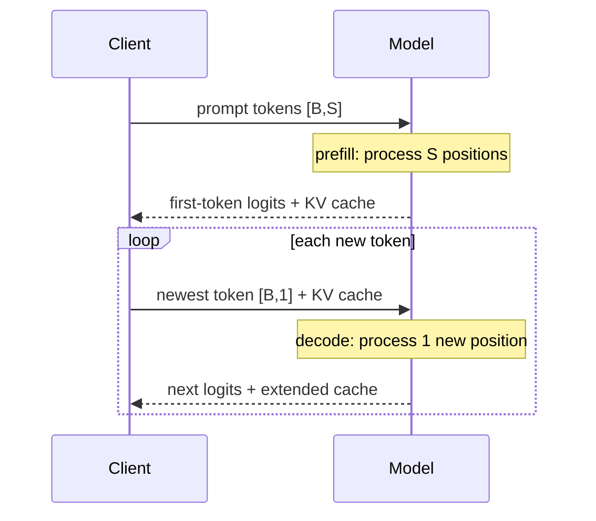

# 01 — From tokens to generated text

**Status:** draft
**Estimated time:** 4–5 hours
**Compute profile:** `local-cpu`; optional CUDA GPU
**Estimated GPU-minutes:** 0 required
**Prerequisites:** lesson 00, basic Python, conceptual transformer awareness

## Why this matters

Every inference engine in this course ultimately repeats the same operation:

> Given all tokens seen so far, compute scores for the next token, choose one,
> append it, and repeat.

High-level APIs hide this loop behind one call such as `model.generate()`.
Serving engines make the same loop faster through batching, KV-cache management,
specialized kernels, scheduling, quantization, and parallelism. You cannot reason
about those optimizations until you can trace the unoptimized path.

This lesson uses a deliberately tiny GPT-2 model. It is not useful for factual
answers; it is useful because the same tensors and cache contract appear in
much larger decoder-only language models while running comfortably on a CPU.

## Learning outcomes

By the end, you can:

- explain text encoding, token IDs, embeddings, logits, probabilities, and text
  decoding without treating them as one opaque step;
- annotate the important tensor shapes for a decoder-only model;
- distinguish prefill from decode;
- explain what the key/value (KV) cache stores and why decode normally feeds one
  new token at a time;
- implement greedy, temperature, top-k, and top-p selection;
- make a sampled run reproducible with a seed;
- compare a hand-written loop against `transformers.generate`;
- diagnose a deliberately broken KV-cache input contract;
- interpret time-to-first-token and per-token decode timing.

## What you will build

A command-line generator that:

1. loads a pinned tiny model and tokenizer;
2. tokenizes a prompt and prints token pieces;
3. performs the first forward pass over the entire prompt;
4. reuses `past_key_values` for one-token decode iterations;
5. applies greedy or sampled token selection;
6. writes a machine-readable generation trace;
7. optionally checks the result against the high-level generation API.

## Under the hood

### 1. Text becomes token IDs

A tokenizer maps text to integer IDs from a fixed vocabulary:

```text
"Hello world"
      |
      v
tokenizer
      |
      v
[15496, 995]
```

Tokens are not necessarily words. They may be word pieces, spaces joined to
words, punctuation, bytes, or special control symbols. Decoding reverses IDs to
text, but one token does not always correspond to one printable character.

For batch size `B` and prompt sequence length `S`:

```text
input_ids shape      = [B, S]
attention_mask shape = [B, S]
```

This lab uses `B = 1`.

### 2. IDs become vectors

Each integer indexes an embedding table:

```text
embedding table shape = [vocabulary_size, hidden_size]
hidden states shape   = [B, S, hidden_size]
```

Transformer blocks mix information across token positions with attention and
transform each position through feed-forward layers. The final language-model
head projects each position to one score per vocabulary entry:

```text
logits shape = [B, S, vocabulary_size]
```

To choose the next token, only the logits at the final prompt position are
needed:

```python
next_token_logits = logits[:, -1, :]  # [B, vocabulary_size]
```

Logits are unnormalized scores. Softmax turns them into probabilities:

```math
p_i = \frac{\exp(z_i)}{\sum_j \exp(z_j)}
```

Subtracting the largest logit before exponentiation is a numerical-stability
technique; PyTorch's softmax already handles this.

### 3. Prefill versus decode



- **Prefill** processes every prompt token. Attention work grows strongly with
  prompt length and can use large matrix operations efficiently.
- **Decode** processes one newly selected token per sequence per iteration.
  It repeatedly reads existing keys and values, so memory bandwidth and
  scheduling are often critical.

Time to first token includes tokenization, queueing, model loading if cold, and
prefill. Inter-token latency describes decode. Throughput alone can hide a poor
interactive experience.

### 4. What the KV cache saves

Self-attention derives query, key, and value vectors at each layer. Past keys
and values do not change when a new token arrives. Without a cache, generation
recomputes them from the entire sequence every step:

```text
step 1: process S positions
step 2: process S+1 positions
step 3: process S+2 positions
```

With the cache:

```text
prefill: process S positions and retain K/V
decode:  process 1 new position and append its K/V
decode:  process 1 new position and append its K/V
```

A simplified cache shape per layer is:

```text
key/value: [batch, attention_heads, cached_sequence_length, head_dimension]
```

Architectures vary: grouped-query and multi-query attention use fewer KV heads
than query heads. Later lessons calculate the resulting memory savings.

The cache avoids repeated compute; it does **not** make attention free. Each new
query still attends to prior cached positions, and the cache consumes GPU memory.

### 5. Selection policies

**Greedy decoding**

```text
token = argmax(logits)
```

It is deterministic for a deterministic model execution, but it may become
repetitive and does not search globally for the most likely whole sequence.

**Temperature**

```math
p = softmax(logits / T)
```

- `T < 1`: sharper distribution;
- `T > 1`: flatter distribution;
- `T = 0`: undefined division, so APIs conventionally use greedy decoding
  instead of sampling.

**Top-k** keeps only the `k` highest-logit candidates.

**Top-p** sorts candidates and keeps the smallest prefix whose cumulative
probability reaches `p`. Its candidate count adapts to distribution shape.

Sampling draws from the filtered distribution. A seed reproduces the random
number stream only when relevant software, hardware, inputs, and execution path
are also controlled.

## Files in this lesson

```text
.
├── README.md
├── SOLUTIONS.md
├── requirements.txt
├── scripts
│   ├── preflight.sh
│   ├── run-lab.sh
│   └── verify-results.py
└── src
    └── generate.py
```

Generated model caches, virtual environments, and results are ignored.

## Prerequisites and preflight

From this lesson directory:

```bash
cd lessons/phase-00-foundations/01-tokens-to-generated-text
chmod +x scripts/*.sh
./scripts/preflight.sh
```

Create an isolated environment:

```bash
python3 -m venv .venv
source .venv/bin/activate
python -m pip install --upgrade pip==26.0.1
python -m pip install -r requirements.txt
```

The pinned teaching stack is validated with CPython 3.9–3.12. If your default
Python is 3.13 or newer, create the virtual environment with an installed
3.9–3.12 interpreter instead of assuming these older pinned wheels exist:

```bash
python3.12 -m venv .venv
```

`requirements.txt` locks both the direct teaching stack and its portable
transitive dependencies. Linux-only CUDA packages are fixed by PyTorch's own
platform metadata. Exact versions improve reproducibility; they do not remove
the need to review dependencies before adopting them in production.

The first model load downloads a small public model from Hugging Face. If you
are offline, run once while connected and preserve the cache. The model revision
is pinned in the source rather than following a moving `main`.

Confirm versions:

```bash
python - <<'PY'
import torch
import transformers
print("torch", torch.__version__)
print("transformers", transformers.__version__)
print("CUDA available", torch.cuda.is_available())
PY
```

CPU output is valid:

```text
torch 2.5.1
transformers 4.46.3
CUDA available False
```

## Cost and safety

The required path is CPU-only and uses zero cloud resources. The download is a
tiny public test model, but it still executes remote model repository code only
through standard Transformers classes; `trust_remote_code` is never enabled.
Do not paste a Hugging Face token into a command or commit it. If you optionally
use a cloud GPU, set a short time budget and apply lesson 00's cleanup gate.

## Predict before running

For a prompt of 7 tokens, batch size 1, vocabulary 50,257, and hidden size 2:

1. What is the shape of `input_ids`?
2. What is the shape of the final hidden states?
3. What is the shape of the model's logits?
4. Which logit slice selects the first generated token?
5. On the first cached decode step, how many token IDs should be passed as new
   model input?
6. Does a lower temperature make the model know more facts?

## Lab outline

1. Inspect tokenization and a greedy baseline.
2. Trace prefill and cached decode.
3. Compare the explicit loop with the high-level API.
4. Change one selection policy and measure it.
5. Violate the cache contract and diagnose the failure.

## Step-by-step lab

### 1. Inspect the CLI

```bash
python src/generate.py --help
```

The code intentionally uses model forward calls directly. Read the central loop:

```bash
sed -n '170,300p' src/generate.py
```

### 2. Run deterministic greedy generation

```bash
mkdir -p results
python src/generate.py \
  --prompt 'The capital of France is' \
  --max-new-tokens 8 \
  --mode greedy \
  --compare-high-level \
  --output results/greedy.json
```

Representative output:

```text
device: cpu
model: sshleifer/tiny-gpt2 @ 5f91d94...
input_ids: [1, N]
logits: [1, N, 50257]
step 00 phase=prefill input_tokens=N selected_id=... forward_ms=...
step 01 phase=decode  input_tokens=1 selected_id=... forward_ms=...
...
manual/high-level token IDs match: True
result written to results/greedy.json
```

The exact text may look poor or repetitive. That is expected from a tiny test
model. The invariant that matters is:

```text
manual greedy token IDs == high-level greedy token IDs
```

Inspect the trace:

```bash
python -m json.tool results/greedy.json | sed -n '1,240p'
```

Find:

- prompt token IDs and printable token pieces;
- tensor shapes;
- prefill duration;
- one entry per selected token;
- decode input length of one after prefill;
- stopped reason;
- generated text.

### 3. Explain the first two iterations

If the prompt has `S` tokens:

```text
iteration 0:
  model input       [1, S]
  returned logits   [1, S, V]
  use logits        [1, V] from position -1
  selected token    [1, 1]
  returned cache    contains S positions

iteration 1:
  model input       [1, 1]
  attention mask    [1, S+1]
  returned logits   [1, 1, V]
  returned cache    contains S+1 positions
```

The attention mask describes all valid positions, while `input_ids` describes
only new uncached positions.

### 4. Compare sampling policies

Run a reproducible top-k/top-p sample:

```bash
python src/generate.py \
  --prompt 'Once upon a time' \
  --max-new-tokens 20 \
  --mode sample \
  --temperature 0.8 \
  --top-k 40 \
  --top-p 0.9 \
  --seed 123 \
  --output results/sample-a.json
```

Repeat the identical command with a different output:

```bash
python src/generate.py \
  --prompt 'Once upon a time' \
  --max-new-tokens 20 \
  --mode sample \
  --temperature 0.8 \
  --top-k 40 \
  --top-p 0.9 \
  --seed 123 \
  --output results/sample-b.json
```

Compare generated token IDs:

```bash
python - <<'PY'
import json
a = json.load(open("results/sample-a.json", encoding="utf-8"))
b = json.load(open("results/sample-b.json", encoding="utf-8"))
print(a["generation"]["generated_token_ids"] == b["generation"]["generated_token_ids"])
PY
```

Expected:

```text
True
```

Now change only `--seed` to `124`. A different result is likely, although two
random runs can theoretically choose the same tokens.

### 5. Run the packaged lab

```bash
./scripts/run-lab.sh
```

It produces:

```text
results/greedy.json
results/sample-a.json
results/sample-b.json
```

Then:

```bash
python scripts/verify-results.py results
```

Expected ending:

```text
[ok] greedy result has prefill and cached decode
[ok] manual greedy output matches high-level output
[ok] fixed-seed sampling is reproducible
All lesson 01 result checks passed.
```

Timing differs by machine. Do not compare a cold first run to a warm second run
and claim an optimization: model downloads, filesystem cache, framework startup,
and CPU frequency may differ.

## Deliberate failure

Pass the full sequence while also supplying a cache:

```bash
set +e
python src/generate.py \
  --prompt 'Cache contracts matter' \
  --max-new-tokens 3 \
  --mode greedy \
  --inject-cache-bug
exit_code=$?
set -e
printf 'exit status: %s\n' "$exit_code"
```

Expected ending:

```text
RuntimeError: intentional cache-contract failure: past_key_values already ...
exit status: 1
```

The cache already represents the prompt. Passing the prompt again as new input
would duplicate work and corrupt position/cache accounting. Some architectures
fail with a shape error; others may accept the call and silently compute the
wrong sequence. The explicit guard makes this invariant visible.

Repair: omit `--inject-cache-bug`. Confirm every decode trace has
`model_input_tokens: 1`.

## Evidence to collect

- `results/greedy.json`;
- one pair of fixed-seed sampling traces;
- tensor-shape annotations for the first two iterations;
- your cache-failure error and explanation;
- a short comparison of prefill time and median decode time;
- `python -m pip freeze` stored in your private experiment record.

## Verification

Static checks:

```bash
python -m py_compile src/generate.py scripts/verify-results.py
bash -n scripts/*.sh
```

Runtime checks after installing dependencies:

```bash
./scripts/run-lab.sh
python scripts/verify-results.py results
```

## Completion gate

- [ ] You can trace text → IDs → hidden states → logits → selected ID → text.
- [ ] You can state the shapes `[B,S]`, `[B,S,H]`, and `[B,S,V]`.
- [ ] Your hand-written greedy result matches `generate()`.
- [ ] Your trace contains one prefill and at least one decode step.
- [ ] Every cached decode call consumes one new token.
- [ ] Fixed-seed sampling reproduces token IDs.
- [ ] You caused and explained the intentional cache failure.
- [ ] You can explain why this tiny model's bad prose does not invalidate the
      systems experiment.

## Cleanup

No cloud resource is used. Deactivate the environment:

```bash
deactivate
```

Keep results for evidence. To reclaim local storage, inspect first:

```bash
du -sh .venv results "${HF_HOME:-$HOME/.cache/huggingface}" 2>/dev/null || true
```

Remove only lesson-local generated files:

```bash
rm -rf -- .venv results
```

The shared Hugging Face cache may serve other projects. Delete it only after
reviewing its path and deciding that redownload cost is acceptable.

## Troubleshooting

### Model download fails

Check internet/proxy access and retry. The source pins a real commit. Do not
“fix” the error by removing `revision=...` and silently following `main`.

### PyTorch installation fails

Confirm Python and architecture:

```bash
python --version
python -c 'import platform; print(platform.machine())'
```

Use a supported Python version in a fresh virtual environment. Lesson 03 uses a
Linux container to make the GPU software stack explicit.

### `NotOpenSSLWarning` on macOS

Apple's Command Line Tools Python may be linked to LibreSSL rather than the
OpenSSL version expected by current `urllib3`. The CPU lab can still work, but
use a current Python 3.9–3.12 installation from python.org, Homebrew, or your
approved environment manager if HTTPS downloads emit this warning. Create a new
virtual environment with that interpreter instead of suppressing TLS warnings.

### `CUDA out of memory`

This tiny model should fit easily. Another process may occupy the GPU:

```bash
nvidia-smi
```

Run with `--device cpu` to finish the conceptual lab, then investigate GPU
process ownership rather than killing unknown processes.

### Greedy comparison does not match

Check that the model revision, package versions, prompt, max tokens, and special
token settings are unchanged. Inspect the two token-ID arrays before comparing
decoded strings.

### Generated text is nonsense

Expected. `sshleifer/tiny-gpt2` is a tiny testing model. This lesson evaluates
execution correctness, not knowledge quality.

## Exercises

1. For `B=4`, `S=128`, `H=4096`, `V=32000`, write all major tensor shapes.
2. Add `--stop-token-id` support before viewing the solution guidance.
3. Compare temperatures 0.5 and 1.5 with the same prompt/seed. Record the first
   step's top-five probabilities.
4. Disable the cache in a copy of the loop and record how model input length
   changes each step.
5. Explain why batching decode requests with different sequence lengths is a
   scheduling and memory-management problem.

See [SOLUTIONS.md](SOLUTIONS.md).

## Primary references

- Hugging Face Transformers documentation: generation and cache behavior.
- PyTorch documentation: `softmax`, `multinomial`, inference mode, seeding.
- GPT-2 paper and model documentation.

Pinned teaching stack: PyTorch 2.5.1, Transformers 4.46.3, model revision
`5f91d94bd9cd7190a9f3216ff93cd1dd95f2c7be`. Last static validation:
2026-10-21.
