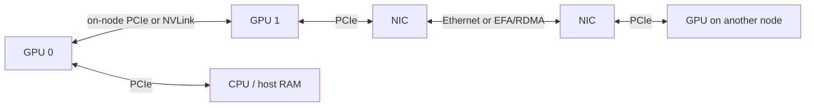

# 02 — GPU systems for LLMs

**Status:** draft
**Estimated time:** 4–5 hours
**Compute profile:** `local-cpu`; optional `aws-g5-single`
**Estimated GPU-minutes:** 0 required; 15–25 optional
**Prerequisites:** lessons 00–01

## Why this matters

“The model has 7 billion parameters” does not tell you whether it fits, how
quickly it generates, or whether adding another GPU helps. You also need to know:

- bytes per stored weight and quantization metadata;
- temporary activation and workspace memory;
- KV-cache size per active sequence;
- memory bandwidth and compute throughput;
- how GPUs are connected;
- what must cross each connection during a parallel algorithm.

LLM serving frequently moves enormous amounts of data to perform each token's
calculation. A GPU can have enough arithmetic units but spend time waiting for
weights or cache data to arrive. Multiple GPUs can have enough combined VRAM but
spend time waiting for communication. This lesson gives you a hierarchy-first
mental model rather than treating “GPU” as a magic accelerator.

## Learning outcomes

By the end, you can:

- distinguish storage, host RAM, GPU VRAM, caches, arithmetic throughput, and
  memory bandwidth;
- estimate weight and KV-cache memory in bytes and GiB;
- explain why available VRAM must exceed weight size;
- distinguish latency from throughput and compute-bound from bandwidth-bound;
- interpret a simple matrix-multiply and memory-copy benchmark;
- explain PCIe, NVLink/NVSwitch, ordinary Ethernet/VPC networking, and
  RDMA/EFA without conflating them;
- inspect rather than assume a node's GPU topology;
- explain why modest G-series nodes remain useful for learning distributed
  inference even without NVLink.

## What you will build

Three small tools:

1. `memory_budget.py` predicts weight and KV-cache memory and returns a failing
   exit status when the configuration exceeds a VRAM budget.
2. `hardware_report.py` records the actual PyTorch device and optional NVIDIA
   topology.
3. `benchmark.py` measures matrix multiplication and memory copy on CPU or CUDA,
   emitting JSON for later comparison.

These are educational microbenchmarks, not replacements for Nsight Systems,
Nsight Compute, DCGM, or production engine benchmarks.

## Under the hood

### The memory hierarchy

```text
slower / larger / cheaper per byte

object storage or model registry
          |
local SSD / EBS
          |
host RAM  <---- CPU
          |
       PCIe bus
          |
GPU VRAM  <---- streaming multiprocessors / tensor cores
          |
on-chip L2, shared memory, registers

faster / smaller / more expensive per byte
```

Model startup typically reads files from storage into host memory and then
copies tensors into VRAM. During inference, GPU kernels repeatedly read weights,
activations, and cache entries from VRAM into smaller on-chip storage.

Important distinctions:

- **Capacity** answers “how many bytes fit?”
- **Bandwidth** answers “how many bytes can move per second?”
- **Latency** answers “how long before a transfer begins/completes?”
- **Compute throughput** answers “how many arithmetic operations per second?”

A system may have high capacity but low bandwidth, or high peak FLOPS but too
little data movement to keep arithmetic units busy.

### Weight-memory arithmetic

Ignoring metadata:

```math
weight\ bytes = parameter\ count \times bits\ per\ weight / 8
```

For seven billion parameters:

| Representation | Raw bytes | Approximate GiB |
|---|---:|---:|
| FP32 | 28,000,000,000 | 26.08 |
| FP16/BF16 | 14,000,000,000 | 13.04 |
| INT8 | 7,000,000,000 | 6.52 |
| 4-bit | 3,500,000,000 | 3.26 |

`GB` uses powers of 1,000; `GiB` uses powers of 1,024. GPU tools commonly report
MiB or GiB, so mixing units creates misleading fit claims.

Quantized models need scales, and sometimes zero points, per tensor/channel/group.
Libraries may pad matrices or retain some layers at higher precision. Therefore
“4-bit” is not exactly `0.5 × parameters` in real memory.

### Why weights fitting is not enough

VRAM also holds:

- framework/CUDA context;
- temporary kernel workspaces;
- activations;
- KV cache;
- allocator-reserved but currently unused blocks;
- request buffers and engine bookkeeping;
- graph-capture pools or compilation artifacts.

Leave a margin. The calculator defaults to reserving 10% of VRAM before deciding
whether a planned configuration fits. Production engines often expose a memory
utilization target for this reason.

### KV-cache arithmetic

A simplified decoder-only cache size is:

```math
bytes = 2 \times L \times B \times S \times H_{kv} \times D_h \times bytes_{kv}
```

where:

- `2` means keys plus values;
- `L` is layer count;
- `B` is active sequence count;
- `S` is cached tokens per sequence;
- `H_kv` is KV-head count;
- `D_h` is head dimension;
- `bytes_kv` is bytes per cache element.

For ordinary multi-head attention, `H_kv` equals attention-head count.
Grouped-query attention uses fewer KV heads, reducing cache size. Real engines
allocate cache in blocks/pages, so fragmentation and partially filled blocks add
overhead.

KV memory scales linearly with batch/concurrency and context length. A model
whose weights fit may still reject long prompts or many simultaneous requests.

### Compute-bound versus bandwidth-bound

A rough diagnostic is **arithmetic intensity**:

```math
arithmetic\ intensity = operations / bytes\ moved
```

Compare it with the machine's ratio:

```math
peak\ FLOPS / peak\ memory\ bandwidth
```

If an operation performs too few calculations per byte relative to that ratio,
it tends to be bandwidth-bound. Large prefill matrix multiplications can reuse
data and achieve high arithmetic intensity. Single-token decode often uses thin
matrices and repeatedly streams weights/cache, so it is commonly more sensitive
to memory bandwidth.

This is a mental model, not proof. Kernel fusion, cache behavior, precision,
batch size, shapes, and implementation determine the measured result.

### The interconnect hierarchy



- **PCIe** connects devices within a host. GPU-to-GPU traffic may traverse PCIe
  switches and sometimes host/NUMA paths.
- **NVLink** is NVIDIA's higher-bandwidth GPU interconnect on supported
  hardware. **NVSwitch** connects multiple NVLink-capable GPUs as a fabric.
- **Ethernet/VPC networking** connects hosts. Normal socket traffic involves
  protocol and software overhead.
- **RDMA** lets data move with less CPU involvement and fewer copies.
- **EFA** is AWS's network interface for supported high-performance instances;
  software such as NCCL can use it through the appropriate provider stack.

These are not interchangeable checkboxes. NVLink is generally an on-node GPU
fabric. EFA is a network interface for inter-node communication. An instance
may support one, both, or neither. Always check the exact instance generation,
size, AMI, placement, drivers, and libraries.

### Are G-series nodes useful without NVLink?

Yes—for this course’s learning goals:

- one-GPU nodes teach scheduling, serving, memory budgeting, and profiling;
- several one-GPU nodes make network costs and synchronization visible;
- slow communication is useful when learning data, tensor, and pipeline
  parallel trade-offs;
- small quantized or toy models make experiments affordable.

They are not a substitute for measuring production performance on the intended
hardware. Tensor parallelism that communicates every layer can be painfully
slow over ordinary networking. That is a result to measure and explain, not a
reason the experiment has no educational value.

## Files in this lesson

```text
.
├── README.md
├── SOLUTIONS.md
├── requirements.txt
├── scripts
│   ├── preflight.sh
│   ├── run-lab.sh
│   └── verify-results.py
└── src
    ├── benchmark.py
    ├── hardware_report.py
    └── memory_budget.py
```

## Prerequisites and preflight

CPU path:

```bash
cd lessons/phase-00-foundations/02-gpu-systems-for-llms
chmod +x scripts/*.sh
./scripts/preflight.sh
python3 -m venv .venv
source .venv/bin/activate
python -m pip install --upgrade pip==26.0.1
python -m pip install -r requirements.txt
```

The PyTorch wheel and its portable transitive dependencies are pinned and
validated with CPython 3.9–3.12. Linux CUDA packages are fixed by PyTorch's
platform metadata. Use one of those interpreters for the virtual environment.

Optional GPU path: run on a machine whose PyTorch installation can use CUDA.
Lesson 03 explains the driver/runtime contract. Do not install or replace a
driver merely because this lesson reports no CUDA device.

Check:

```bash
python src/hardware_report.py --output results/hardware.json
```

On CPU:

```text
torch CUDA available: False
selected benchmark device: cpu
```

On an NVIDIA GPU:

```text
torch CUDA available: True
GPU 0: NVIDIA ...
VRAM total: ... GiB
nvidia-smi topology succeeded: True
```

The report distinguishes “the `nvidia-smi` executable exists” from “the
topology query succeeded.” A failed query is retained with its return code and
stderr so a broken driver path is not recorded as successful evidence.

## Cost and safety

The required lab uses no cloud resources. For the optional AWS run:

- use one already-authorized lab GPU node;
- budget at most 25 GPU-minutes;
- do not start a multi-node group;
- record the exact node-group scale-down command before scaling up;
- finish lesson 00's cleanup verification afterward.

The benchmark defaults are intentionally small. Do not arbitrarily increase
allocation sizes until the process OOMs; shared machines may host other work.
The deliberate “does not fit” exercise is arithmetic-only and allocates no GPU
memory.

## Predict before running

1. How much raw memory do 13 billion FP16 weights need in GiB?
2. Will they safely fit in a nominal 24 GiB GPU after reserving 10%?
3. If context length doubles, what happens to simplified KV-cache size?
4. Does a high matrix-multiply GFLOP/s result imply high one-token decode speed?
5. Does “two GPUs in the same instance” prove they have NVLink?

## Lab outline

1. Calculate weight-only memory.
2. Add cache and safety reserve.
3. record the actual device/topology.
4. measure matrix multiplication and copy bandwidth.
5. compare prediction with observation.
6. cause a safe budget failure.

## Step-by-step lab

### 1. Calculate a seven-billion-parameter baseline

```bash
mkdir -p results
python src/memory_budget.py \
  --params-billion 7 \
  --weight-bits 16 \
  --layers 32 \
  --kv-heads 32 \
  --head-dim 128 \
  --sequences 1 \
  --tokens-per-sequence 2048 \
  --kv-bits 16 \
  --vram-gib 24 \
  --output results/memory-7b.json
```

Representative output:

```text
raw weight memory:         13.039 GiB
estimated KV cache:         1.000 GiB
estimated subtotal:        14.039 GiB
usable VRAM after reserve: 21.600 GiB
headroom before overhead:   7.561 GiB
fit prediction: YES
```

“YES” means these simplified components fit under the reserve, not that every
engine/configuration is guaranteed to start.

Change `--sequences 1` to `--sequences 8`. Predict before running. Cache memory
should multiply by eight because all other terms remain constant.

### 2. Compare precisions

```bash
for bits in 32 16 8 4; do
  python src/memory_budget.py \
    --params-billion 7 \
    --weight-bits "$bits" \
    --vram-gib 24 \
    --label "7b-${bits}bit"
done
```

The tool adds no quantization metadata unless you pass
`--quant-overhead-percent`. Try 8%:

```bash
python src/memory_budget.py \
  --params-billion 7 \
  --weight-bits 4 \
  --quant-overhead-percent 8 \
  --vram-gib 24
```

Do not interpret 8% as universal. Measure the chosen format and engine later.

### 3. Capture hardware

```bash
python src/hardware_report.py --output results/hardware.json
python -m json.tool results/hardware.json
```

On an NVIDIA machine, also inspect directly:

```bash
nvidia-smi
nvidia-smi topo -m
```

Common topology labels include `PIX`, `PXB`, `PHB`, `NODE`, `SYS`, and `NV#`.
Their exact meanings are documented by `nvidia-smi topo -m` help and depend on
the machine. An `NV#` connection is direct evidence of NVLink lanes; instance
marketing assumptions are not.

For multiple nodes, topology output covers only the local host. Inspect the
network separately. In later AWS labs, confirm whether the exact instance type
supports EFA and whether the EFA device/plugin/provider are actually present.

### 4. Run controlled microbenchmarks

CPU-safe defaults:

```bash
python src/benchmark.py \
  --device cpu \
  --matrix-size 1024 \
  --copy-mebibytes 64 \
  --warmup 3 \
  --iterations 10 \
  --output results/benchmark-cpu.json
```

Optional CUDA:

```bash
python src/benchmark.py \
  --device cuda \
  --matrix-size 4096 \
  --copy-mebibytes 256 \
  --warmup 5 \
  --iterations 20 \
  --output results/benchmark-cuda.json
```

The tool measures:

- `A @ B` for square FP32 matrices;
- device-to-device copy of one contiguous FP32 tensor;
- median timings after warm-up;
- approximate achieved GFLOP/s and GB/s.

Example schema:

```json
{
  "device": {"type": "cpu", "name": "..."},
  "matmul": {
    "matrix_size": 1024,
    "median_ms": 12.3,
    "approx_gflops": 174.6
  },
  "copy": {
    "mebibytes": 64,
    "median_ms": 5.1,
    "approx_gigabytes_per_second": 13.2
  }
}
```

Your numbers will differ. The copy calculation reports payload bytes divided by
time. Some bandwidth conventions count both read and write traffic and would
report twice that number; always state the convention.

### 5. Change one variable

Run matrix sizes 512, 1024, and 2048 while holding every other setting fixed:

```bash
for n in 512 1024 2048; do
  python src/benchmark.py \
    --device cpu \
    --matrix-size "$n" \
    --copy-mebibytes 64 \
    --warmup 3 \
    --iterations 10 \
    --output "results/benchmark-cpu-${n}.json"
done
```

Small operations may not reach high throughput because launch/threading and
cache overhead dominate. Larger operations may use arithmetic units more
efficiently but take longer in absolute milliseconds. Throughput and latency
answer different questions.

### 6. Run and verify the packaged lab

```bash
./scripts/run-lab.sh
python scripts/verify-results.py results
```

Expected ending:

```text
[ok] 7B FP16 weight calculation is approximately 13.04 GiB
[ok] KV cache grows linearly with sequence count
[ok] benchmark timings and rates are positive
All lesson 02 result checks passed.
```

## Deliberate failure

Predict 13B FP16 weights on 24 GiB:

```bash
set +e
python src/memory_budget.py \
  --params-billion 13 \
  --weight-bits 16 \
  --vram-gib 24 \
  --reserve-percent 10
exit_code=$?
set -e
printf 'exit status: %s\n' "$exit_code"
```

Expected:

```text
raw weight memory:         24.214 GiB
usable VRAM after reserve: 21.600 GiB
fit prediction: NO
exit status: 3
```

No allocation occurred. The tool failed at planning time, which is preferable
to downloading a large model and crashing a GPU process.

Three possible repairs demonstrate different trade-offs:

- use lower-bit weights, accepting format/kernel/quality considerations;
- choose more VRAM;
- partition the model, accepting communication and orchestration costs.

Reducing reserve to zero is not a real repair: raw weights already exceed the
nominal capacity, and runtime memory is still needed.

## Evidence to collect

- `memory-7b.json`;
- one-sequence versus eight-sequence cache comparison;
- `hardware.json` and, on GPU, sanitized topology output;
- CPU benchmark JSON and optional CUDA benchmark JSON;
- deliberate fit failure and proposed repair;
- a short statement of benchmark conventions and limitations.

## Verification

```bash
python -m py_compile src/*.py scripts/verify-results.py
bash -n scripts/*.sh
./scripts/run-lab.sh
python scripts/verify-results.py results
```

## Completion gate

- [ ] You calculate weight memory without confusing GB and GiB.
- [ ] You name at least four non-weight VRAM consumers.
- [ ] You calculate simplified KV-cache memory.
- [ ] You explain prefill/decode tendencies using arithmetic intensity.
- [ ] You inspected actual topology rather than assuming NVLink.
- [ ] You measured copy and matmul with warm-up/repetition.
- [ ] You safely failed an oversized memory plan.
- [ ] You can explain what G-series hardware can teach and what it cannot
      validate for a production target.

## Cleanup

Required CPU path:

```bash
deactivate
rm -rf -- .venv
```

Keep `results/` as evidence or remove it after inspection:

```bash
du -sh results
rm -rf -- results
```

If you used an AWS GPU, stop all lesson processes, confirm no lesson Pod/Job is
running, and scale your dedicated managed node group to zero using the
account-specific command you recorded before starting. Then run lesson 00's
`verify-cloud-cleanup.sh`. This lesson does not guess your node-group identity
or run infrastructure mutations automatically.

## Troubleshooting

### CUDA requested but unavailable

Do not immediately install a driver:

```bash
nvidia-smi
python -c 'import torch; print(torch.__version__, torch.version.cuda, torch.cuda.is_available())'
```

`nvidia-smi` failing suggests host/device/driver exposure. `nvidia-smi` working
while PyTorch reports false suggests a user-space PyTorch/CUDA installation
issue. Lesson 03 separates these layers.

### Benchmark is unexpectedly slow

Check power/thermal state, competing processes, CPU thread count, warm-up,
matrix shape, precision, and whether synchronization brackets the measurement.
The script synchronizes CUDA before and after timed work.

### Process is killed on CPU

The OS may have terminated it for host-RAM pressure. Reduce `--matrix-size` or
`--copy-mebibytes`. The program prints planned tensor sizes before allocation.

### Topology has no `NV` labels

That likely means this host is using PCIe paths between visible GPUs. It is not
a software error that can be fixed by installing NVLink.

## Exercises

1. Estimate raw 70B weight memory for FP16, INT8, and 4-bit.
2. Calculate KV cache for 32 layers, 8 KV heads, head dimension 128, BF16,
   16 sequences, and 8,192 cached tokens.
3. Explain why four separate 24 GiB nodes do not automatically behave like one
   96 GiB GPU.
4. Add `--workspace-gib` to the calculator.
5. Research your intended AWS instance in current official documentation. Record
   GPU count/VRAM, on-node topology evidence, network bandwidth, and EFA support.

See [SOLUTIONS.md](SOLUTIONS.md).

## Primary references

- NVIDIA CUDA programming guide: memory hierarchy and execution.
- NVIDIA `nvidia-smi` documentation: topology reporting.
- PyTorch CUDA semantics and benchmarking guidance.
- AWS EC2 accelerated-computing and EFA documentation for exact current
  instance capabilities.
- Roofline model literature for arithmetic-intensity reasoning.

Last static/CPU validation: 2026-10-21. Cloud hardware capabilities must be
rechecked against current official documentation.
