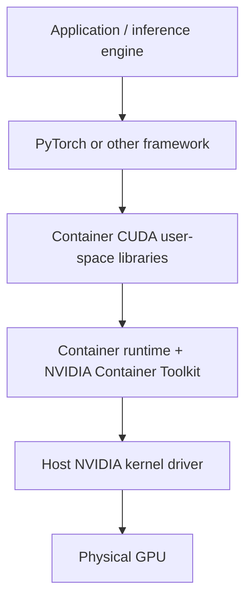

# 03 — Containers and the CUDA contract

**Status:** draft
**Estimated time:** 4–6 hours
**Compute profile:** container-capable local machine; `aws-g5-single` for GPU proof
**Estimated GPU-minutes:** 15–25
**Prerequisites:** lessons 00 and 02; basic Docker commands

## Why this matters

A container image is not a virtual GPU machine. It packages the application and
user-space libraries, but it does not contain the physical GPU or normally
replace the host's NVIDIA kernel driver.

This distinction explains a common failure:

```text
The image builds.
Python starts.
PyTorch imports.
But torch.cuda.is_available() is False.
```

The application can be correct while the runtime failed to expose devices. The
device can be exposed while the container's CUDA libraries are incompatible.
`nvidia-smi` can work while a framework or engine still fails because those
checks touch different layers.

## Learning outcomes

By the end, you can:

- explain an OCI image, immutable layer, tag, manifest, and digest;
- separate host kernel driver, NVIDIA container runtime integration, container
  CUDA user-space, framework, and application;
- build and inspect a pinned GPU-capable image;
- run the same image without and with GPU injection;
- collect host and container evidence without dumping secrets;
- explain what `--gpus all` changes;
- diagnose “driver present but framework unavailable” systematically;
- connect the local container path to containerd and the NVIDIA device plugin on
  EKS.

## What you will build

A small image containing a GPU probe. The probe reports:

- PyTorch version and CUDA build version;
- whether CUDA initialization succeeds;
- visible GPU count/name/VRAM/capability;
- selected `NVIDIA_*` environment variables;
- optional `nvidia-smi` output;
- a verified CUDA tensor calculation.

You will run exactly the same image twice. The first run intentionally hides the
GPU and fails a requirement check. The second asks the NVIDIA container runtime
to expose it and succeeds.

## Under the hood

### The five-layer contract



1. **Physical GPU:** hardware on the host.
2. **Host NVIDIA driver:** kernel modules and user-facing driver interfaces that
   control the device. Containers share the host kernel.
3. **Runtime integration:** NVIDIA Container Toolkit configures an OCI runtime
   hook/runtime so selected device nodes and driver libraries enter the
   container.
4. **Container user-space:** CUDA runtime, cuBLAS, cuDNN, NCCL, and framework
   libraries selected by the image.
5. **Application:** your model server and its configuration.

A failure at one layer can leave lower layers healthy.

### What the image contains

The human-readable upstream source tag is:

```text
pytorch/pytorch:2.5.1-cuda12.4-cudnn9-runtime
```

Tags can move. The checked-in Dockerfile therefore uses the Linux/AMD64
manifest digest resolved from Docker Hub's registry API on 2026-10-21:

```dockerfile
ARG BASE_IMAGE=pytorch/pytorch@sha256:c8268a92a69bd500f8be0e665b2630ee006dadaf7bfbc24249141b15ff622755
FROM ${BASE_IMAGE}
```

The digest is the immutable build input; the tag above explains which release
it was resolved from. Re-resolve from the registry you trust before deliberately
upgrading, verify the intended platform, review the change, and record the new
digest. The build script rejects tag-only `BASE_IMAGE` overrides.

An OCI image is a content-addressed manifest referencing read-only filesystem
layers plus configuration. Starting a container adds a thin writable layer.
Deleting the container discards that writable layer but not the image.

### What `--gpus all` does

Conceptually, Docker asks the NVIDIA runtime to:

- select GPUs;
- expose `/dev/nvidia*` device nodes;
- mount compatible host driver libraries/utilities;
- set visibility/capability environment values;
- update the container's device permissions.

The CUDA toolkit already inside the image is not a substitute for those host
resources. Conversely, device nodes alone do not provide a matching framework.

Compare:

```text
docker run IMAGE
  -> ordinary container, no GPU request

docker run --gpus all IMAGE
  -> runtime injects selected NVIDIA devices/driver-facing pieces
```

### The confusing `nvidia-smi` “CUDA Version”

`nvidia-smi` primarily talks to the driver. Its displayed CUDA version indicates
the maximum CUDA version supported by that driver, not necessarily the exact
CUDA runtime used by PyTorch in the image.

Use:

```python
torch.version.cuda
```

to see the CUDA version against which that PyTorch build was compiled. Use
framework initialization and an actual tensor operation to test the complete
path.

### Driver/runtime compatibility

Newer NVIDIA drivers are generally backward-compatible with applications built
against older CUDA toolkits. A container built for a newer CUDA user-space than
the host driver supports may fail initialization. Compatibility packages and
specific feature constraints complicate the boundary, so use NVIDIA's current
compatibility tables for the exact versions rather than memorizing one number.

### From Docker to EKS

EKS nodes commonly use containerd:

```mermaid
flowchart LR
    API[Kubernetes API] --> S[Scheduler]
    S --> K[Kubelet on node]
    K --> CRI[containerd via CRI]
    DP[NVIDIA device plugin] --> K
    CRI --> NCT[NVIDIA runtime integration]
    NCT --> DEV[/dev/nvidia devices + driver libs]
    DEV --> P[Container process]
```

The NVIDIA Kubernetes device plugin discovers healthy GPUs and advertises the
extended resource `nvidia.com/gpu` through the kubelet. When a Pod requests that
resource, the scheduler chooses a node with capacity and the device plugin
participates in allocation.

AWS accelerated EKS-optimized AMIs include the required NVIDIA drivers/kernel
modules for supported accelerated instances. Do not follow a random tutorial to
replace drivers on such a node. Verify the AMI and AWS documentation first.

## Files in this lesson

```text
.
├── Dockerfile
├── README.md
├── SOLUTIONS.md
├── .dockerignore
├── scripts
│   ├── build.sh
│   ├── inspect-image.sh
│   ├── preflight.sh
│   ├── run-gpu.sh
│   ├── run-without-gpu.sh
│   └── verify-result.py
└── src
    └── gpu_probe.py
```

## Prerequisites and preflight

You need:

- Docker Engine with Linux containers, or a compatible client/runtime;
- internet access to pull the pinned teaching base digest;
- for the GPU run, an NVIDIA GPU, compatible host driver, and NVIDIA Container
  Toolkit/runtime integration;
- roughly several GB of free local image storage.

From this lesson:

```bash
cd lessons/phase-00-foundations/03-containers-cuda-contract
chmod +x scripts/*.sh
./scripts/preflight.sh
```

CPU-only host output:

```text
[ok] docker client found
[ok] docker daemon reachable
[info] nvidia-smi not found; no-GPU path still works
```

GPU host output should also show a driver/GPU summary from `nvidia-smi`.

If the Docker daemon is unreachable, fix your normal Docker setup. Do not use
`sudo chmod 666 /var/run/docker.sock`; that grants broad host-control capability.

## Cost and safety

- Building locally uses disk and download bandwidth, not AWS GPU time.
- Budget 25 GPU-minutes if starting an AWS GPU node.
- Record the scale-down command before scale-up.
- Use a dedicated lab node group; never drain or modify an unknown shared node.
- This lesson never installs drivers on a host.
- Image inspection may reveal build metadata but should not include credentials.
  Never pass registry tokens through Dockerfile `ARG` or commit them.
- Remove only the image tag created by this lesson.

## Predict before running

1. Does `FROM ...cuda...` give a container access to a physical GPU?
2. Which layer owns the kernel driver?
3. Can `nvidia-smi` succeed while `torch.cuda.is_available()` is false?
4. Is an image tag content-immutable?
5. What Kubernetes resource name represents an NVIDIA GPU?

## Lab outline

1. Inspect host/runtime prerequisites.
2. Build and fingerprint the image.
3. Run a non-required probe without GPU access.
4. Require a GPU but omit runtime injection; diagnose failure.
5. Run with GPU injection and verify a tensor operation.
6. inspect immutable image metadata.

## Step-by-step lab

### 1. Read the complete application

```bash
sed -n '1,300p' src/gpu_probe.py
sed -n '1,220p' Dockerfile
```

The probe avoids importing an inference engine. It narrows the test to the
container/CUDA/framework contract.

### 2. Build

```bash
./scripts/build.sh
```

Representative ending:

```text
Successfully tagged open-models/cuda-contract:lesson03
image ID: sha256:...
repo digest: unavailable until the image is pushed/pulled by digest
metadata written to results/image.json
```

The base image is large. A slow first pull is normal. Later builds reuse
unchanged layers.

You can override the base only with an explicitly reviewed digest. This example
uses the checked-in value:

```bash
BASE_IMAGE='pytorch/pytorch@sha256:c8268a92a69bd500f8be0e665b2630ee006dadaf7bfbc24249141b15ff622755' \
  ./scripts/build.sh
```

Changing the base invalidates comparisons and must be recorded.

### 3. Run without requesting a GPU

First allow CPU/no-device mode:

```bash
./scripts/run-without-gpu.sh
python3 scripts/verify-result.py results/no-gpu.json --expect no-gpu
```

Expected:

```text
torch CUDA build: 12.4
torch CUDA available: False
visible GPU count: 0
requirement: GPU optional, probe completed
[ok] result correctly reports no visible GPU
```

This proves the image and framework import work. It does not prove GPU access.

### 4. Inspect device exposure

Without GPU injection:

```bash
docker run --rm --entrypoint /bin/bash \
  open-models/cuda-contract:lesson03 \
  -lc 'ls -l /dev/nvidia* 2>/dev/null || echo "no NVIDIA device nodes"'
```

Expected:

```text
no NVIDIA device nodes
```

On a configured GPU host, compare:

```bash
docker run --rm --gpus all --entrypoint /bin/bash \
  open-models/cuda-contract:lesson03 \
  -lc 'ls -l /dev/nvidia*; nvidia-smi --query-gpu=name,memory.total --format=csv'
```

Do not depend on exact minor device numbers; they vary.

### 5. Run the real GPU proof

On the GPU host:

```bash
./scripts/run-gpu.sh
python3 scripts/verify-result.py results/gpu.json --expect gpu
```

Representative output:

```text
torch CUDA build: 12.4
torch CUDA available: True
visible GPU count: 1
GPU 0: NVIDIA ...
tensor check: [11.0]
requirement: GPU present, probe completed
[ok] result contains a successful CUDA tensor check
```

The tensor check allocates tensors on `cuda:0`, multiplies/adds them, and copies
the answer back to host memory. This traverses more of the stack than merely
executing `nvidia-smi`.

### 6. Inspect image identity and layers

```bash
./scripts/inspect-image.sh
```

Then inspect directly:

```bash
docker image inspect open-models/cuda-contract:lesson03 \
  --format 'id={{.Id}} repo_digests={{json .RepoDigests}}'
docker history --no-trunc open-models/cuda-contract:lesson03
```

Local image ID is content-derived. A registry repo digest appears after
push/pull and names the registry manifest. Record both context and platform;
multi-architecture tags can resolve to a manifest list and platform-specific
manifest.

## Deliberate failure

Require a GPU but intentionally omit `--gpus`:

```bash
set +e
docker run --rm \
  open-models/cuda-contract:lesson03 \
  --require-gpu --output /tmp/intentional-failure.json
exit_code=$?
set -e
printf 'exit status: %s\n' "$exit_code"
```

Expected:

```text
torch CUDA available: False
ERROR: GPU was required but PyTorch sees no CUDA device.
exit status: 3
```

Diagnosis:

1. The image ran, so image pull and basic process startup work.
2. PyTorch imported, so packaged Python/framework libraries work.
3. The run command did not request a GPU.
4. Therefore no NVIDIA device/runtime injection was expected.

Repair:

```bash
docker run --rm --gpus all \
  open-models/cuda-contract:lesson03 \
  --require-gpu
```

If repair still fails, use the troubleshooting decision tree below instead of
changing several layers at once.

## Evidence to collect

- `results/image.json`;
- `results/no-gpu.json`;
- `results/gpu.json` from a GPU machine;
- host `nvidia-smi` summary and container framework summary;
- image ID/repo digest;
- deliberate failure exit status and diagnosis;
- exact base image and host driver versions.

## Verification

Static checks:

```bash
python3 -m py_compile src/gpu_probe.py scripts/verify-result.py
bash -n scripts/*.sh
```

Container checks:

```bash
./scripts/build.sh
./scripts/run-without-gpu.sh
python3 scripts/verify-result.py results/no-gpu.json --expect no-gpu
```

GPU acceptance:

```bash
./scripts/run-gpu.sh
python3 scripts/verify-result.py results/gpu.json --expect gpu
```

## Completion gate

- [ ] You identify all five contract layers.
- [ ] You built the image and recorded an image ID.
- [ ] The image works without GPU injection and reports zero GPUs.
- [ ] The intentional required-GPU run fails with exit 3.
- [ ] On a GPU host, `--gpus all` produces a successful CUDA tensor check.
- [ ] You explain why `nvidia-smi` and framework initialization test different
      paths.
- [ ] You did not replace an EKS optimized AMI driver.
- [ ] Any cloud GPU capacity is back at zero.

## Cleanup

Remove generated result files:

```bash
rm -rf -- results
```

Remove only this lesson's image:

```bash
docker image rm open-models/cuda-contract:lesson03
```

Docker may keep shared base layers used by other images; that is expected. Do
not run a global system prune on a shared machine.

For AWS, first stop/delete the workload that uses the node, scale the dedicated
GPU managed node group to zero with your reviewed account-specific command, and
run lesson 00's cleanup verifier.

## Troubleshooting

Use the narrowest failing layer:

```text
Does host nvidia-smi work?
  no  -> host hardware/driver/instance/AMI problem
  yes -> does docker run --gpus all ... nvidia-smi work?
           no  -> container runtime/toolkit/device exposure problem
           yes -> does torch.cuda.is_available() return true?
                    no  -> framework/CUDA library/compatibility problem
                    yes -> does tensor check or engine start?
                             no -> application/library/kernel/config problem
```

### Docker rejects `--gpus`

The engine may lack NVIDIA Container Toolkit integration or use a non-NVIDIA
host. Follow the current official NVIDIA Container Toolkit installation guide
for your OS/runtime. Do not install host packages from inside the container.

### `could not select device driver "" with capabilities: [[gpu]]`

Docker did not find a configured runtime capable of serving the GPU request.
Verify toolkit installation and restart/configuration steps from official docs.

### `CUDA driver version is insufficient for CUDA runtime version`

Record host driver, `nvidia-smi` supported CUDA, image CUDA runtime, and PyTorch
build. Select a compatible image or approved newer host AMI/driver. Do not patch
a managed EKS node in place without understanding lifecycle replacement.

### Image platform mismatch on Apple Silicon

The CUDA image targets Linux architectures supported by its publisher. An ARM
laptop may need `--platform linux/amd64` emulation for the no-GPU build, which
is slow and still cannot expose an Apple GPU as CUDA. Prefer performing this
lesson on the intended Linux GPU node.

## Exercises

1. Explain which layer changes when adding `--gpus all`.
2. Explain why installing `cuda-toolkit` inside an image cannot repair a missing
   physical GPU.
3. Add an exit check requiring a minimum compute capability.
4. Use `--gpus '"device=0"'` on a multi-GPU host and verify only one is visible.
5. Map each local Docker layer to its Kubernetes/EKS counterpart.

See [SOLUTIONS.md](SOLUTIONS.md).

## Primary references

- OCI Image and Runtime Specifications.
- NVIDIA Container Toolkit installation and architecture documentation.
- NVIDIA CUDA compatibility documentation.
- PyTorch CUDA semantics.
- Kubernetes device plugin documentation.
- AWS EKS optimized accelerated AMI documentation.

Teaching base manifest digest resolved and statically validated: 2026-10-21.
GPU runtime compatibility still requires validation on the target host.
