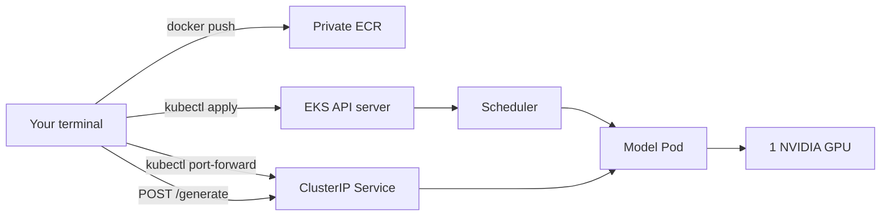

# 04 — Guided first inference on EKS

**Status:** draft
**Estimated time:** 5–7 hours the first time
**Compute profile:** `aws-g5-single`
**Estimated GPU-minutes:** 45–75, including image pull and troubleshooting
**Prerequisites:** lessons 00–03; an existing EKS cluster and dedicated managed GPU node group

## Why this matters

This is the first complete system:

```text
source -> container image -> registry -> Kubernetes desired state
       -> scheduler -> GPU node -> model server -> private Service
       -> port-forward -> streamed tokens -> evidence -> cleanup
```

You are not expected to understand every Kubernetes field yet. The purpose is
to give later Kubernetes lessons a concrete system to explain. You will inspect
each transition, deliberately create an unschedulable Pod, and prove that the
expensive capacity is gone afterward.

The model is tiny and its prose is poor. Success means correct orchestration,
GPU use, request flow, and cleanup—not answer quality.

## Learning outcomes

By the end, you can:

- confirm AWS identity, cluster, context, and node-group names before mutation;
- build a Linux/AMD64 GPU image containing a pinned tiny model;
- push it to a private ECR repository and deploy by immutable digest;
- scale a dedicated managed GPU node group with an explicit cost guard;
- explain Pod scheduling and `nvidia.com/gpu` allocation at a high level;
- deploy a GPU model server, readiness probes, and private `ClusterIP` Service;
- port-forward without creating a public load balancer;
- stream newline-delimited JSON tokens and prove CUDA use;
- diagnose an intentionally unschedulable two-GPU request;
- delete the namespace, restore the saved idle node-group configuration, and
  independently verify that no GPU node remains.

## What you will build



The server exposes:

| Endpoint | Purpose |
|---|---|
| `GET /healthz` | process is alive |
| `GET /readyz` | model is loaded and CUDA-ready |
| `GET /info` | sanitized model/device/runtime evidence |
| `POST /generate` | streamed NDJSON token events |

The image downloads the pinned model during build and enables offline mode at
runtime. Startup therefore does not depend on Hugging Face availability.

## Under the hood

### From YAML to a running process

1. `kubectl apply` sends objects to the API server.
2. The API server authenticates/authorizes, validates, and stores desired state.
3. A Deployment controller creates a ReplicaSet; it creates a Pod.
4. The scheduler filters nodes by:
   - node selector;
   - taints/tolerations;
   - requested CPU/memory;
   - extended resource `nvidia.com/gpu: 1`;
   - other scheduling rules.
5. The scheduler binds the Pod to one node.
6. Kubelet asks the container runtime to pull the exact image digest.
7. The NVIDIA device plugin participates in device allocation.
8. The runtime exposes the selected GPU/driver boundary to the container.
9. The process loads model weights into VRAM.
10. Startup/readiness probes begin succeeding.
11. The Service selects the ready Pod by label.

```mermaid
sequenceDiagram
    participant U as kubectl
    participant A as API server
    participant C as Controllers
    participant S as Scheduler
    participant K as Kubelet
    participant R as containerd/NVIDIA runtime
    participant P as Model process
    U->>A: apply Deployment + Service
    A->>C: desired replicas = 1
    C->>A: create Pod
    A->>S: unscheduled Pod
    S->>A: bind to matching GPU node
    A->>K: Pod assigned
    K->>R: pull image digest; allocate GPU
    R->>P: start process
    P->>P: load pinned model into CUDA
    K->>P: startup/readiness probes
    P-->>K: 200 ready
```

### Requests and limits

This manifest declares:

```yaml
resources:
  requests:
    cpu: "1"
    memory: 2Gi
  limits:
    cpu: "2"
    memory: 4Gi
    nvidia.com/gpu: "1"
```

Kubernetes uses requests for scheduling. NVIDIA GPU extended resources are
integer devices and are normally declared as limits; when only a limit is
specified, Kubernetes treats the request equivalently for this resource.

The GPU is not fractionally shared here. Later lessons discuss time-slicing,
MIG, and why “one GPU” does not imply one request at a time.

### Labels and selectors

The Service does not know a Pod IP ahead of time. It selects Pods with:

```yaml
selector:
  app.kubernetes.io/name: tiny-gpt2
```

The Deployment's Pod template carries the same label. Kubernetes maintains
EndpointSlices for matching ready Pods. Port-forward asks the API/kubelet path
to tunnel local traffic; it does not create an internet-facing listener.

### Three probe meanings

- **Startup probe:** “Has slow initialization completed?” Until it succeeds,
  liveness/readiness failures do not kill the startup.
- **Readiness probe:** “Should this Pod receive Service traffic now?”
- **Liveness probe:** “Is the process stuck and should kubelet restart it?”

A model may be alive while weights are still loading, so health and readiness
must not be identical in meaning.

### Why deploy an image digest

The build uses a convenient tag, then ECR returns a digest:

```text
ACCOUNT.dkr.ecr.REGION.amazonaws.com/REPO@sha256:...
```

The rendered Deployment uses that digest. Even if someone moves/reuses a tag,
the kubelet pulls the recorded bytes. The generated URI contains your account
ID, so it stays in ignored `.lab/`, not the public repository.

The application image also starts from an immutable Linux/AMD64 PyTorch
manifest:

```text
pytorch/pytorch@sha256:c8268a92a69bd500f8be0e665b2630ee006dadaf7bfbc24249141b15ff622755
```

That digest was resolved from the human-readable
`2.5.1-cuda12.4-cudnn9-runtime` tag on 2026-10-21. The model revision and direct
plus portable transitive Python dependencies are pinned as well. Changing any
of these inputs is an explicit upgrade, not a silent rebuild.

### Streaming path

`POST /generate` responds as `application/x-ndjson`:

```json
{"event":"token","index":0,"token_id":123,"text":" hello"}
{"event":"token","index":1,"token_id":456,"text":" world"}
{"event":"complete","generated_text":"...","tokens":2}
```

Each line is independent valid JSON. `curl --no-buffer` displays lines as the
server flushes them. This is simpler than production SSE/WebSocket protocols but
makes token-by-token decode visible.

## Files in this lesson

```text
.
├── Dockerfile
├── README.md
├── SOLUTIONS.md
├── requirements.txt
├── app/server.py
├── k8s/workload.yaml.tpl
├── k8s/failure-two-gpus.yaml.tpl
└── scripts
    ├── assert-target.sh
    ├── build-push.sh
    ├── check-gpu-node.sh
    ├── cleanup-namespace.sh
    ├── collect-evidence.sh
    ├── deploy.sh
    ├── ensure-ecr-repository.sh
    ├── preflight.sh
    ├── render-manifests.py
    ├── request.sh
    ├── scale-nodegroup.sh
    └── verify-cleanup.sh
```

`.lab/` contains private rendered values and `results/` contains local evidence;
both are ignored.

## Prerequisites and preflight

You need:

- an existing EKS cluster;
- a dedicated **managed** GPU node group using a one-GPU instance type, idle at
  minimum zero and desired zero before the lab;
- permission for read/scale operations on that node group;
- an accelerated EKS-optimized node AMI or equivalent correctly configured
  NVIDIA driver;
- NVIDIA device plugin installed in the cluster and exposing one whole,
  non-time-sliced GPU on the selected node;
- AWS CLI v2, `kubectl`, Docker with Linux/AMD64 build support, Python 3.9–3.12,
  and `curl`;
- permissions for a private ECR repository and push;
- outbound network during image build.

Export values in your shell. Do not save them to tracked files:

```bash
cd lessons/phase-00-foundations/04-first-inference-on-eks

export AWS_REGION='YOUR_REGION'
export EKS_CLUSTER_NAME='YOUR_CLUSTER'
export GPU_NODEGROUP_NAME='YOUR_DEDICATED_GPU_NODEGROUP'
export ECR_REPOSITORY='open-models-learning'
export LAB_NAMESPACE='open-models-l04'
export IMAGE_TAG="lesson04-$(git rev-parse --short HEAD)"

chmod +x scripts/*.sh
./scripts/preflight.sh
```

The namespace must begin with `open-models-`. The preflight is read-only. It
prints AWS ARN, cluster status, node-group scaling state, and tools. It also
compares the API endpoint in the active kubeconfig context with the endpoint
returned by EKS for `EKS_CLUSTER_NAME`; a matching-looking context name alone is
not accepted. Confirm every value manually.

If kubeconfig is missing, update it explicitly:

```bash
aws eks update-kubeconfig \
  --region "$AWS_REGION" \
  --name "$EKS_CLUSTER_NAME" \
  --alias "open-models-$EKS_CLUSTER_NAME"
kubectl config current-context
```

This modifies your local kubeconfig, not the cluster. Run preflight again.

## Cost and safety

Before scaling:

```text
node count:          1
GPUs per node:       1
maximum elapsed:     75 minutes
planned GPU-hours:   1.25
public load balancer: none
persistent volumes: none
cleanup: namespace deletion, then restore saved idle scaling baseline
```

The scale script saves the starting scaling configuration in ignored
`.lab/nodegroup-before.json`, temporarily caps the node group at exactly one
node, and restores the saved configuration during cleanup. A fresh run is
accepted only when the dedicated group starts at `min=0, desired=0`; this keeps
“restore” and “stop GPU cost” equivalent while preserving its original maximum.

Retrieve the current instance price for your region before starting. The course
does not hard-code a stale currency estimate.

Safety rules:

- use only a dedicated lab node group;
- verify AWS identity and Kubernetes context first;
- type the exact node-group name again in `CONFIRM_GPU_NODEGROUP`;
- scale up only with `I_UNDERSTAND_GPU_COSTS=yes`;
- use `ClusterIP`, never `LoadBalancer`, in this lesson;
- deploy no PVC; model bytes live in the image;
- keep the terminal open and set your own timer;
- delete workload before scaling the node away;
- never paste AWS, GitHub, registry, or model tokens into YAML/Dockerfile;
- do not change host drivers on an EKS optimized accelerated AMI.

The ECR repository is configured with immutable tags. Registry storage may incur
a small charge after compute cleanup; an explicit retention choice appears at
the end.

## Predict before running

1. If desired GPU node capacity is zero, what state should the Pod enter?
2. If a Pod asks for two GPUs but every eligible node has one, will Kubernetes
   split that Pod across two nodes?
3. Does a `ClusterIP` Service create an AWS load balancer?
4. Why can the liveness endpoint succeed before readiness?
5. Which identifier appears in the final Deployment: tag or digest?

## Lab outline

1. Confirm identity/context and immutable inputs.
2. create/reuse a private ECR repository.
3. build, push, and resolve an image digest.
4. scale one dedicated GPU node.
5. confirm `nvidia.com/gpu` capacity.
6. render, inspect, and apply manifests.
7. stream inference and collect GPU evidence.
8. create/diagnose/delete an unschedulable Pod.
9. delete the namespace, restore the saved node-group baseline, and verify.

## Step-by-step lab

### 1. Confirm identity and current state

```bash
./scripts/preflight.sh
```

Representative output:

```text
[ok] AWS caller: arn:aws:iam::...:role/...
[ok] EKS cluster status: ACTIVE
[ok] required local tools found
[ok] kubectl context open-models-YOUR_CLUSTER matches EKS cluster YOUR_CLUSTER
[ok] namespace is absent and available for this lab: open-models-l04
[info] node group: ACTIVE desired=0 min=0 max=...
Preflight complete. Manually confirm identity/context before mutations.
```

If desired capacity is already non-zero, find out why. Do not assume it is safe
to modify a shared group. The scale script refuses to adopt that capacity as a
new lab run.

### 2. Create or reuse ECR

Inspect the script:

```bash
sed -n '1,240p' scripts/ensure-ecr-repository.sh
```

Create only if absent:

```bash
CONFIRM_ECR_REPOSITORY='open-models-learning' \
  I_UNDERSTAND_ECR_CHANGES=yes \
  ./scripts/ensure-ecr-repository.sh
```

It enables immutable tags and scan-on-push. If the repository exists, the script
only describes it and fails if those safeguards are absent. Authentication or
network errors are not mistaken for “repository absent.”

### 3. Build and push

```bash
./scripts/build-push.sh
```

This may take time on the first run. It builds for `linux/amd64`, downloads the
pinned tiny model into the image, authenticates Docker to your regional ECR,
pushes the tag, resolves its digest, and writes:

```text
.lab/image.env
```

The ECR login uses a temporary Docker configuration directory, so the
short-lived registry credential is not added to your normal Docker config.

Inspect without committing:

```bash
sed -n '1,20p' .lab/image.env
```

Expected shape:

```text
IMAGE_URI_WITH_DIGEST=ACCOUNT.dkr.ecr.REGION.amazonaws.com/REPO@sha256:...
IMAGE_URI_WITH_TAG=ACCOUNT.dkr.ecr.REGION.amazonaws.com/REPO:lesson04-...
```

If immutable ECR already contains the same tag, either reuse its recorded digest
after verifying it or select a new explicit `IMAGE_TAG`. Do not make tags
mutable merely to bypass the safeguard.

### 4. Scale one GPU node

Review the exact target one more time:

```bash
printf 'region=%s cluster=%s nodegroup=%s\n' \
  "$AWS_REGION" "$EKS_CLUSTER_NAME" "$GPU_NODEGROUP_NAME"
```

Scale:

```bash
CONFIRM_GPU_NODEGROUP='YOUR_DEDICATED_GPU_NODEGROUP' \
  I_UNDERSTAND_GPU_COSTS=yes \
  ./scripts/scale-nodegroup.sh up
```

Type the real name rather than leaving the placeholder. The script verifies the
kube target, records account/region/cluster/node-group plus the complete starting
scaling configuration, and refuses a non-idle starting group. During the lab it
sets `min=0, max=1, desired=1`; this prevents an autoscaler or accidental second
workload from expanding the lab group. It waits for the specific EKS update to
succeed and for a Ready Kubernetes node.

### 5. Confirm the GPU resource

```bash
./scripts/check-gpu-node.sh
```

Expected pattern:

```text
node: ip-...
ready: True
instance type: g5...
capacity nvidia.com/gpu: 1
allocatable nvidia.com/gpu: 1
[ok] exactly one Ready node advertises exactly one allocatable NVIDIA GPU
```

If the node is Ready but capacity is absent, stop the lab timer and troubleshoot
the accelerated AMI/device plugin. A GPU visible to EC2 but not advertised to
Kubernetes cannot satisfy the Pod resource request. This introductory failure
exercise also requires exactly one allocatable GPU on the node; use a one-GPU
instance size rather than letting a two-GPU request schedule successfully.

### 6. Render manifests

```bash
set -a
source .lab/image.env
set +a
python3 scripts/render-manifests.py
```

Inspect every private rendered value:

```bash
sed -n '1,300p' .lab/workload.yaml
sed -n '1,180p' .lab/failure-two-gpus.yaml
```

Check:

- namespace is exactly your lab namespace;
- image includes `@sha256:`;
- node selector names only the dedicated group;
- GPU request is one in the workload and two in the failure Pod;
- Service type is `ClusterIP`;
- there are no Secrets, PVCs, host paths, privileged mode, or load balancers.

### 7. Deploy

```bash
./scripts/deploy.sh
```

Watch transition:

```bash
kubectl get pods -n "$LAB_NAMESPACE" -w
```

Typical states:

```text
Pending -> ContainerCreating -> Running (READY 0/1) -> Running (READY 1/1)
```

In another terminal:

```bash
kubectl describe pod -n "$LAB_NAMESPACE" \
  -l app.kubernetes.io/name=tiny-gpt2
kubectl logs -n "$LAB_NAMESPACE" \
  -l app.kubernetes.io/name=tiny-gpt2 --tail=100
```

Expected server log includes:

```text
server listening on 0.0.0.0:8080; model loading
loading model from /opt/model on cuda
CUDA device: NVIDIA ...
model load complete; readiness enabled
```

The HTTP server starts before model loading. `/healthz` can therefore report a
live process while `/readyz` remains 503. The startup probe watches readiness and
prevents liveness/readiness probes from interfering during initialization.

### 8. Send a private streamed request

```bash
./scripts/request.sh
```

The script starts a local port-forward, waits for readiness, saves `/info`, sends
a generation request with `curl --no-buffer`, and terminates the port-forward.

Representative token stream:

```json
{"event":"token","index":0,"token_id":..., "text":" ..."}
{"event":"token","index":1,"token_id":..., "text":" ..."}
{"event":"complete","tokens":12,"finish_reason":"length","generated_text":"...","total_ms":...}
```

Inspect device evidence:

```bash
python3 -m json.tool results/info.json
```

Required fields:

```json
{
  "ready": true,
  "device": "cuda",
  "cuda_available": true,
  "gpu_name": "NVIDIA ...",
  "model_revision": "5f91d94..."
}
```

The server serializes generation with a lock. This is intentionally simple;
continuous batching and concurrent scheduling arrive in engine lessons.

### 9. Collect evidence

```bash
./scripts/collect-evidence.sh
find results -maxdepth 1 -type f -print
```

It saves Pod/Deployment/Service descriptions, events, logs, node resource
summary, and generated response. Review before sharing: infrastructure output
can contain account-specific names, private IPs, and image registry paths.

## Deliberate failure

Apply a Pod requesting two GPUs on your one-GPU node:

```bash
./scripts/assert-target.sh
kubectl apply -f .lab/failure-two-gpus.yaml
kubectl get pod -n "$LAB_NAMESPACE" intentional-two-gpus
kubectl describe pod -n "$LAB_NAMESPACE" intentional-two-gpus
```

Expected:

```text
NAME                    READY   STATUS    ...
intentional-two-gpus    0/1     Pending   ...
```

Events should contain a scheduling reason similar to:

```text
0/N nodes are available: ... Insufficient nvidia.com/gpu ...
```

Kubernetes cannot combine one GPU from node A and one GPU from node B for a
single Pod. Resource requests must fit one eligible node. Distributed inference
uses multiple Pods/processes with explicit communication, not a multi-node Pod.

Delete the failure immediately:

```bash
kubectl delete pod -n "$LAB_NAMESPACE" intentional-two-gpus --wait=true
```

If it unexpectedly schedules, your selected node has at least two allocatable
GPUs or another eligible node matched. Delete it and update your topology
assumptions. The failure container exits after five minutes as a backstop, but
you should still delete it immediately.

## Evidence to collect

- image tag and immutable digest;
- rendered manifest stored privately;
- Pod scheduling events;
- startup/readiness transition;
- `/info` CUDA/model evidence;
- streamed NDJSON response;
- server log and node GPU capacity;
- intentional Pending Pod event;
- namespace deletion, restored scaling configuration, and absent-node proof.

## Verification

Before cleanup:

```bash
kubectl get deployment,pod,service -n "$LAB_NAMESPACE" -o wide
kubectl get service -n "$LAB_NAMESPACE" \
  -o custom-columns='NAME:.metadata.name,TYPE:.spec.type'
python3 -m json.tool results/info.json
```

Expected Service type: only `ClusterIP`. Expected info device: `cuda`.

Static repository checks:

```bash
python3 -m py_compile app/server.py scripts/render-manifests.py
bash -n scripts/*.sh
```

## Completion gate

- [ ] You verified caller identity, context, cluster, and dedicated node group.
- [ ] ECR holds the image and you recorded a digest.
- [ ] The Deployment uses `@sha256`, not only a tag.
- [ ] Exactly one Ready node advertises exactly one `nvidia.com/gpu`.
- [ ] The model Pod is Ready and requests one GPU.
- [ ] Service type is `ClusterIP`.
- [ ] `/info` proves CUDA and the pinned model revision.
- [ ] You observed streamed token events.
- [ ] You created, diagnosed, and deleted the two-GPU Pending Pod.
- [ ] Namespace is absent, the saved node-group configuration is restored, and
      no node from that group remains.

## Cleanup

Order matters: delete workload first, then capacity.

```bash
./scripts/cleanup-namespace.sh
CONFIRM_GPU_NODEGROUP='YOUR_DEDICATED_GPU_NODEGROUP' \
  ./scripts/scale-nodegroup.sh down
./scripts/verify-cleanup.sh
```

Expected ending:

```text
[ok] namespace absent: open-models-l04
[ok] node-group scaling restored: desired=0 min=0 max=...
[ok] no Kubernetes node object remains for the GPU node group
Cleanup verification passed.
```

The down command refuses to guess if `.lab/nodegroup-before.json` is missing or
belongs to another account/region/cluster/node group. Keep `.lab/` until
verification passes. If the file is lost, inspect the managed node group and
perform a deliberate, account-specific recovery instead of running a generic
destructive command.

If the Kubernetes API is temporarily unavailable or the namespace still exists,
the down command still restores the saved idle AWS scaling configuration to stop
GPU cost, then exits non-zero because application cleanup remains unverified.
Reconnect, remove the namespace, and run the verifier; never interpret
“capacity restored” as proof that all desired Kubernetes state was removed.

Check cluster-wide lesson leftovers:

```bash
kubectl get all --all-namespaces \
  -l app.kubernetes.io/part-of=open-model-systems-learning
```

ECR retention is separate from compute cleanup. Keeping the image avoids another
large build/push. To remove a specific image, first inspect:

```bash
aws ecr describe-images \
  --region "$AWS_REGION" \
  --repository-name "$ECR_REPOSITORY"
```

Delete only a reviewed digest if that is your decision:

```bash
aws ecr batch-delete-image \
  --region "$AWS_REGION" \
  --repository-name "$ECR_REPOSITORY" \
  --image-ids imageDigest='sha256:REVIEWED_DIGEST'
```

Do not delete a shared repository or broad image set.

Remove private local render/evidence after retaining what you need:

```bash
rm -rf -- .lab results
```

## Troubleshooting

### Pod stays Pending

```bash
kubectl describe pod -n "$LAB_NAMESPACE" \
  -l app.kubernetes.io/name=tiny-gpt2
kubectl get events -n "$LAB_NAMESPACE" --sort-by=.lastTimestamp
```

Interpret the scheduler message:

- `Insufficient nvidia.com/gpu`: device plugin/capacity/allocation issue;
- node selector mismatch: wrong managed-node-group label/name;
- untolerated taint: inspect node taints and add only the intended toleration;
- insufficient CPU/memory: compare Pod requests with allocatable resources.

Do not randomly add broad tolerations or remove selectors.

### `ImagePullBackOff`

```bash
kubectl describe pod -n "$LAB_NAMESPACE" \
  -l app.kubernetes.io/name=tiny-gpt2
```

Check exact ECR URI/digest, region/account, repository policy, and node IAM
permissions for ECR pull. Same-account EKS worker roles normally need standard
ECR read actions.

### Pod runs but never becomes Ready

```bash
kubectl logs -n "$LAB_NAMESPACE" \
  -l app.kubernetes.io/name=tiny-gpt2 --previous
kubectl logs -n "$LAB_NAMESPACE" \
  -l app.kubernetes.io/name=tiny-gpt2
kubectl describe pod -n "$LAB_NAMESPACE" \
  -l app.kubernetes.io/name=tiny-gpt2
```

Look for CUDA initialization, model load, OOM, permission, or probe failures.
The startup probe allows ten minutes by default.

### Server says CUDA unavailable

Check the chain:

```bash
./scripts/check-gpu-node.sh
kubectl get pod -n "$LAB_NAMESPACE" \
  -o jsonpath='{.items[0].spec.containers[0].resources}'
kubectl logs -n "$LAB_NAMESPACE" \
  -l app.kubernetes.io/name=tiny-gpt2
```

Confirm accelerated AMI/driver, device-plugin health, GPU resource request, and
container CUDA compatibility. Do not install drivers inside the Pod.

### Port-forward exits

The Pod may have restarted or local port 18080 may be used:

```bash
LOCAL_PORT=18081 ./scripts/request.sh
kubectl get pods -n "$LAB_NAMESPACE"
```

### Node group scale command is rejected

The script supports EKS managed node groups only. Confirm permissions, status,
scaling bounds, exact `CONFIRM_GPU_NODEGROUP` value, and the saved
`.lab/nodegroup-before.json` baseline:

```bash
aws eks describe-nodegroup \
  --region "$AWS_REGION" \
  --cluster-name "$EKS_CLUSTER_NAME" \
  --nodegroup-name "$GPU_NODEGROUP_NAME" \
  --query 'nodegroup.[status,scalingConfig]' \
  --output json
```

## Exercises

1. Draw ownership from Deployment to Pod and request flow from Service to Pod.
2. Change only `max_new_tokens` from 12 to 24. Compare total time, first-token
   time, and token count.
3. Temporarily change the Service selector to a non-matching label, observe
   EndpointSlices/request failure, then restore it.
4. Explain why scaling the node group down before deleting the Deployment leads
   to a Pending replacement Pod.
5. Add a `/metrics` endpoint with request count and generated-token count, then
   add a verification assertion.

See [SOLUTIONS.md](SOLUTIONS.md).

## Primary references

- Kubernetes documentation: Pods, Deployments, Services, probes, resources,
  scheduling, device plugins, port-forwarding.
- AWS EKS documentation: managed node groups, kubeconfig, accelerated optimized
  AMIs.
- Amazon ECR documentation: authentication, immutable tags, image digests.
- NVIDIA Kubernetes device plugin documentation.
- OCI image specification.

Pinned model revision:
`5f91d94bd9cd7190a9f3216ff93cd1dd95f2c7be`. Last static validation:
2026-10-21. AWS runtime validation remains account/profile-dependent.
