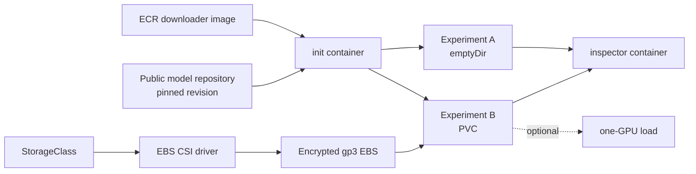
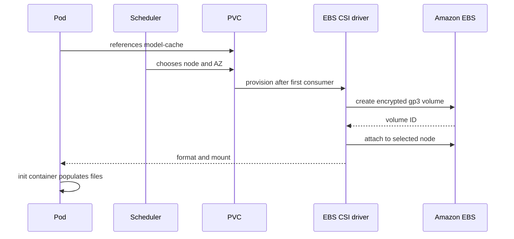

# 08 — Model artifacts, storage, and caches

**Status:** draft
**Estimated time:** 5–7 hours
**Compute profile:** CPU for the core lab; optional `g1` for one GPU load
**Estimated GPU-minutes:** 20–40 optional minutes
**Estimated cloud cost:** one temporary 20 GiB gp3 volume plus optional GPU-node
time; use your Region's current prices and stop at the cleanup gate
**Prerequisites:** lessons 05–07, an EKS lab cluster, ECR push permission, Docker,
AWS CLI, and `kubectl`
**Last validated:** 2026-10-21, static checks only; clean EKS run pending
**Validated with:** manifests and scripts checked locally; cluster, CSI-driver,
GPU-image, and runtime validation still required before publication

## Why this matters

A model server is not just a container. It is a container **plus** model files,
tokenizer files, configuration, caches, host memory, and GPU memory. Even a small
model can contain hundreds of megabytes of files; large models can contain tens
or hundreds of gigabytes.

If every Pod downloads weights from the internet, startup is slow and depends
on an external service. If weights are baked into the application image, the
image becomes enormous and every model update becomes an image rebuild. If
weights are cached on one node, startup is fast until Kubernetes moves the Pod.

This lesson turns those trade-offs into measurements. The shared model for
lessons 08–10 is public and small enough for an NVIDIA A10G:

```text
Repository: Qwen/Qwen2.5-0.5B-Instruct
Revision:   7ae557604adf67be50417f59c2c2f167def9a775
License:    Apache-2.0
```

That revision is a Git commit, not the mutable name `main`. This repository does
not contain model weights or credentials. `Apache-2.0` is the license declared
by the model repository at the reviewed commit; inspect the pinned `LICENSE` and
model card for your use case. A technical pin is not legal advice.

## Learning outcomes

By the end, you can:

- distinguish image layers, `emptyDir`, node-local disk, EBS, EFS, S3, host RAM,
  and GPU VRAM;
- explain PersistentVolumes, PersistentVolumeClaims, StorageClasses, CSI
  drivers, access modes, reclaim policies, and binding modes;
- pin a model revision and record artifact provenance;
- prove which cache survives a container restart and Pod replacement, and
  explain what node replacement changes;
- measure cold-cache and warm-cache initialization;
- choose an EKS storage path from durability, sharing, startup, and cost
  requirements; and
- remove the PVC and optional GPU capacity after the experiment.

## What you will build

You will build a small model-downloader image and run it as an init container.
First its target is Pod-scoped `emptyDir`; then its target is an EBS-backed PVC.



The observable result is JSON saying whether the immutable snapshot was a cache
hit. Deleting and recreating the `emptyDir` Pod produces another miss. Deleting
and recreating the PVC-backed Pod produces a hit.

## Files in this lesson

```text
08-model-artifacts-storage-caches/
├── README.md
├── downloader/
│   ├── Dockerfile                  # non-root downloader image
│   ├── download_model.py           # pinned snapshot + provenance logic
│   └── requirements.txt            # pinned Hub client
├── manifests/
│   ├── 00-namespace.yaml
│   ├── 01a-storageclass-standard-ebs-csi.yaml
│   ├── 01b-storageclass-eks-auto-mode.yaml
│   ├── 02-model-cache-pvc.yaml
│   ├── 03-emptydir-cache-pod.yaml
│   ├── 04-pvc-cache-pod.yaml
│   └── 05-optional-gpu-load-pod.yaml
├── scripts/
│   ├── build-push-downloader.sh
│   ├── check-prerequisites.sh
│   ├── cleanup.sh
│   └── run-cache-experiment.sh
└── storage-decision-record.md
```

The two StorageClasses are alternatives:

- `01a` is the baseline for an existing EKS cluster with the standard Amazon EBS
  CSI add-on (`ebs.csi.aws.com`);
- `01b` is only for EKS Auto Mode
  (`ebs.csi.eks.amazonaws.com`); it restricts provisioning to nodes labeled
  `eks.amazonaws.com/compute-type=auto`, as recommended by AWS.

Do not apply both and assume their volumes are interchangeable. Choose the
provisioner actually used by your cluster. A workload using the Auto Mode class
must be schedulable on an Auto Mode node.

## Concepts and mental model

### Storage layers answer different questions

| Layer | What it stores | Survives container restart? | Survives Pod replacement? | Survives node loss? |
|---|---|---:|---:|---:|
| Container writable layer | accidental runtime writes | only in that container | no | no |
| Image layer | files built into image | yes | yes after another pull | registry remains authoritative |
| `emptyDir` | Pod scratch/cache | yes | no | no |
| Node-local NVMe | fast node data | usually | only with deliberate node-cache design | no |
| EBS PVC | mounted block-volume filesystem | yes | yes | yes in its AZ |
| EFS PVC | shared network filesystem | yes | yes | yes through EFS mount targets |
| S3 | objects, not a POSIX filesystem | yes | yes | yes |
| Host page cache | recently read file pages in RAM | process-independent | maybe on same node | no |
| GPU VRAM | active tensors and KV cache | no | no | no |

“Survives” does not mean “is immediately warm.” A new node may still pull the
image, attach a volume, download objects, populate the Linux page cache, and copy
tensors into VRAM.

### A library analogy

- The model registry or S3 is the library archive.
- EBS or local NVMe is a nearby shelf holding a replaceable copy.
- RAM is the open book on your desk.
- GPU VRAM is the small set of pages and notes currently used for computation.

The analogy stops at access semantics: EBS is a block device mounted through a
filesystem, EFS is a network filesystem, and S3 is an object API.

### Core Kubernetes vocabulary

- **PersistentVolumeClaim (PVC):** a namespaced request for capacity and access
  semantics.
- **PersistentVolume (PV):** the cluster object representing provisioned
  storage.
- **StorageClass:** a cluster-scoped provisioning policy.
- **CSI driver:** the component translating Kubernetes volume operations into
  provider operations.
- **Access mode:** how Kubernetes may mount the volume.
- **Reclaim policy:** what happens to the PV and cloud storage after release.
- **Volume binding mode:** when provisioning/binding occurs.

`ReadWriteOnce` means read-write mounting by one **node**, not literally one
Pod. `ReadWriteMany` allows multiple nodes and is commonly provided by EFS, not
an ordinary EBS filesystem.

## Under the hood

### PVC provisioning and attachment

A claim says:

> I need 20 GiB with one-node read/write access from this storage class.

The StorageClass says:

> Ask this CSI provisioner for encrypted gp3 storage and delete it when the
> dynamically created PV is released.



EBS volumes are zonal. `WaitForFirstConsumer` lets scheduling constraints
influence the AZ before dynamic provisioning, avoiding a class of
“volume is in AZ A, GPU node is in AZ B” failures.

Both paths need AWS authorization in addition to Kubernetes objects. With the
standard EBS CSI add-on, the controller normally receives an IAM role. With EKS
Auto Mode, the storage capability is managed by EKS and relies on the
Auto Mode cluster IAM configuration. Kubernetes RBAC alone cannot authorize EC2
API calls.

### Init-container ordering

Kubelet runs init containers sequentially and requires each to succeed before
starting application containers. Both containers mount the same volume:

```text
populate-cache exits 0
        |
        v
inspector or model server starts
```

This is a clean way to separate artifact preparation from serving. The serving
container can mount the model directory read-only.

### Artifact provenance and cache keys

The downloader writes `.course-model-ready.json` beside the snapshot with:

- repository ID;
- immutable revision;
- UTC download time;
- local byte count; and
- downloader-library version.

It calls a run a hit only when the target exists, repository/revision match, and
the current total file size matches the completed download. Before replacing a
snapshot, it removes the marker so a failed download cannot bless a partial
directory.

This marker is a practical completion and cache-key check, not a cryptographic
audit of every byte at rest. The immutable Hub commit fixes the source version;
a production artifact pipeline should additionally verify a signed manifest or
per-file hashes before promotion. A mutable cache key such as `main` makes even
the source version ambiguous.

### Cold start is several clocks

Measure these separately:

1. Pending/scheduling time;
2. image-pull time;
3. volume provisioning/attach/mount time;
4. artifact download time;
5. file reads and parsing into host RAM;
6. tensor transfer to GPU VRAM; and
7. application readiness.

One unexplained “startup took 90 seconds” cannot tell you what to optimize.

## Prerequisites and preflight

Run from:

```bash
cd lessons/phase-01-kubernetes/08-model-artifacts-storage-caches
```

Set non-secret environment variables:

```bash
export AWS_REGION=us-east-1
export EKS_CLUSTER=replace-with-your-lab-cluster
export GPU_NODEGROUP=replace-with-your-lab-gpu-nodegroup
export AWS_ACCOUNT_ID="$(
  aws sts get-caller-identity --query Account --output text
)"

printf 'account=%s region=%s cluster=%s nodegroup=%s\n' \
  "$AWS_ACCOUNT_ID" "$AWS_REGION" "$EKS_CLUSTER" "$GPU_NODEGROUP"
```

Confirm identity and contexts before creating anything:

```bash
aws sts get-caller-identity
aws eks describe-cluster \
  --region "$AWS_REGION" \
  --name "$EKS_CLUSTER" \
  --query 'cluster.{name:name,status:status,version:version}' \
  --output table
kubectl config current-context
kubectl cluster-info
./scripts/check-prerequisites.sh
```

Inspect the storage contract:

```bash
kubectl get storageclass
kubectl get csidrivers

# Standard EBS CSI add-on only:
kubectl -n kube-system get pods \
  -l 'app.kubernetes.io/name=aws-ebs-csi-driver' -o wide

# EKS Auto Mode only:
kubectl get nodes \
  -l 'eks.amazonaws.com/compute-type=auto' -o wide
```

Answer before continuing:

1. Which StorageClass is default?
2. Which EBS CSI provisioner exists?
3. Does the selected class use `WaitForFirstConsumer`?
4. Is its reclaim policy `Delete` or `Retain`?
5. For the standard add-on, are the CSI controller/node Pods healthy?
6. For Auto Mode, is an eligible Auto Mode node available?

Expected shape:

```text
NAME            PROVISIONER       RECLAIMPOLICY   VOLUMEBINDINGMODE
gp3 (default)   ebs.csi.aws.com   Delete          WaitForFirstConsumer
```

Names vary. Auto Mode manages its controller; do not wait for an
`aws-ebs-csi-controller` Pod on that path. If no matching CSI driver exists,
stop and ask a cluster administrator to follow the official EKS installation
and IAM guide.

## Cost and safety

- Core cost: a temporary 20 GiB gp3 EBS volume and ordinary CPU-node use.
- Optional cost: one GPU node for 20–40 minutes.
- No Service or load balancer is created.
- The model is public; no Hugging Face token is required.
- Never paste AWS keys, registry passwords, or tokens into manifests.
- The ECR login password is passed to Docker over stdin.
- The lab StorageClass uses `Delete`, but you still verify the cloud volume is
  gone.
- The optional GPU Pod deliberately uses version tags and installs Python
  packages at startup to expose the mechanism. It is not reproducible evidence;
  lesson 10 replaces that shortcut with a built image deployed by digest.

Stop immediately if the context is a production/shared cluster, the selected
StorageClass has unexpected retention behavior, or GPU capacity exceeds one
node.

If the GPU node group is not in use, keep it at zero until the optional lab:

```bash
aws eks update-nodegroup-config \
  --region "$AWS_REGION" \
  --cluster-name "$EKS_CLUSTER" \
  --nodegroup-name "$GPU_NODEGROUP" \
  --scaling-config minSize=0,maxSize=1,desiredSize=0
```

That changes real infrastructure. Re-read all four variables first.

## Predict before running

Write answers in `artifacts/expected-vs-observed.md`:

1. Will an `emptyDir` survive an init-container exit?
2. Will it survive deleting the Pod?
3. Will a PVC remain after deleting only its consumer Pod?
4. Why might a PVC with `WaitForFirstConsumer` remain Pending before a Pod
   exists?
5. Which step do you expect to dominate the first run?
6. Is a warm-cache run a fair EBS throughput benchmark? Why?

Do not change predictions after seeing results; append observations beside them.

## Lab outline

1. Establish the immutable downloader-image baseline.
2. Populate and replace an `emptyDir` Pod.
3. Provision an EBS PVC and populate it.
4. Replace the consumer Pod without deleting the claim.
5. Compare cache evidence.
6. Break one storage configuration, diagnose it, and repair it.
7. Optionally load the cached snapshot on one GPU.
8. clean up Kubernetes, EBS, ECR policy-dependent artifacts, and GPU capacity.

## Step-by-step lab

### Step 1 — Build and push the downloader

```bash
export ECR_REPOSITORY=open-model-course/model-downloader
./scripts/build-push-downloader.sh
```

The script creates the repository if needed, logs in, builds for `linux/amd64`,
pushes, resolves the ECR digest, and prints:

```text
Use this immutable reference:
export DOWNLOADER_IMAGE=123456789012.dkr.ecr.../model-downloader@sha256:...
```

Copy that one export into your shell and verify it is digest-pinned:

```bash
export DOWNLOADER_IMAGE='copy-the-printed-reference'
case "$DOWNLOADER_IMAGE" in
  *@sha256:*) echo 'immutable image reference: OK' ;;
  *) echo 'expected image@sha256 reference'; exit 1 ;;
esac
```

If Docker cannot push, distinguish ECR authentication from authorization:

```bash
aws ecr describe-repositories \
  --region "$AWS_REGION" \
  --repository-names "$ECR_REPOSITORY"
docker version
```

### Step 2 — Measure `emptyDir`

```bash
kubectl apply -f manifests/00-namespace.yaml
sed "s|REPLACE_DOWNLOADER_IMAGE|$DOWNLOADER_IMAGE|g" \
  manifests/03-emptydir-cache-pod.yaml |
  kubectl apply -f -
kubectl -n model-storage-lab wait \
  --for=condition=Initialized pod/model-cache-emptydir --timeout=20m
```

Follow only the init container:

```bash
mkdir -p artifacts
kubectl -n model-storage-lab logs \
  model-cache-emptydir -c populate-cache -f |
  tee artifacts/emptydir-cold.log
```

Expected final event shape:

```json
{"cache_hit": false, "event": "model_ready", "revision": "7ae557...", "seconds": 40.123, "total_bytes": 988000000}
```

Exact time and bytes vary. Inspect from the application container:

```bash
kubectl -n model-storage-lab exec model-cache-emptydir -c inspector -- \
  sh -c 'cat /models/.course-model-ready.json; du -sh /models'
```

Delete and recreate the **Pod**:

```bash
kubectl -n model-storage-lab delete pod model-cache-emptydir
sed "s|REPLACE_DOWNLOADER_IMAGE|$DOWNLOADER_IMAGE|g" \
  manifests/03-emptydir-cache-pod.yaml |
  kubectl apply -f -
kubectl -n model-storage-lab wait \
  --for=condition=Initialized pod/model-cache-emptydir --timeout=20m
kubectl -n model-storage-lab logs \
  model-cache-emptydir -c populate-cache -f |
  tee artifacts/emptydir-after-pod-replacement.log
```

Expected: another `"cache_hit": false`. `emptyDir` belonged to the old Pod, not
to its name.

```bash
kubectl -n model-storage-lab delete pod model-cache-emptydir
```

### Step 3 — Choose one EBS provisioner path

For the standard EBS CSI add-on:

```bash
kubectl apply -f manifests/01a-storageclass-standard-ebs-csi.yaml
export MODEL_STORAGE_CLASS=model-cache-gp3
```

For EKS Auto Mode only:

```bash
kubectl apply -f manifests/01b-storageclass-eks-auto-mode.yaml
export MODEL_STORAGE_CLASS=model-cache-gp3-auto
```

Confirm the exact class before provisioning:

```bash
kubectl get storageclass "$MODEL_STORAGE_CLASS" -o yaml
```

### Step 4 — Provision and populate the PVC

```bash
sed "s|REPLACE_STORAGE_CLASS|$MODEL_STORAGE_CLASS|g" \
  manifests/02-model-cache-pvc.yaml |
  kubectl apply -f -
kubectl -n model-storage-lab get pvc model-cache
```

It may remain Pending until a consumer exists. Create the consumer:

```bash
sed "s|REPLACE_DOWNLOADER_IMAGE|$DOWNLOADER_IMAGE|g" \
  manifests/04-pvc-cache-pod.yaml |
  kubectl apply -f -
kubectl -n model-storage-lab get pod,pvc -w
```

If either object remains Pending, collect evidence before editing:

```bash
kubectl -n model-storage-lab describe pod model-cache-pvc
kubectl -n model-storage-lab describe pvc model-cache
kubectl -n model-storage-lab get events \
  --sort-by=.metadata.creationTimestamp | tail -30
```

Save the cold log:

```bash
kubectl -n model-storage-lab wait \
  --for=condition=Initialized pod/model-cache-pvc --timeout=20m
kubectl -n model-storage-lab logs model-cache-pvc -c populate-cache -f |
  tee artifacts/pvc-cold.log
```

Map Kubernetes objects to the cloud volume:

```bash
PV_NAME="$(
  kubectl -n model-storage-lab get pvc model-cache \
    -o jsonpath='{.spec.volumeName}'
)"
EBS_VOLUME_ID="$(
  kubectl get pv "$PV_NAME" -o jsonpath='{.spec.csi.volumeHandle}'
)"
printf 'pv=%s\n' "$PV_NAME"
printf 'ebs_volume=%s\n' "$EBS_VOLUME_ID"
kubectl get pv "$PV_NAME" -o jsonpath='reclaim={.spec.persistentVolumeReclaimPolicy}{"\n"}'
```

### Step 5 — Prove the warm-cache behavior

Delete the Pod only:

```bash
kubectl -n model-storage-lab delete pod model-cache-pvc
kubectl -n model-storage-lab get pvc model-cache
```

Recreate the same consumer:

```bash
sed "s|REPLACE_DOWNLOADER_IMAGE|$DOWNLOADER_IMAGE|g" \
  manifests/04-pvc-cache-pod.yaml |
  kubectl apply -f -
kubectl -n model-storage-lab wait \
  --for=condition=Initialized pod/model-cache-pvc --timeout=20m
kubectl -n model-storage-lab logs model-cache-pvc -c populate-cache -f |
  tee artifacts/pvc-warm.log
```

Expected:

```json
{"cache_hit": true, "event": "model_ready", "revision": "7ae557...", "seconds": 0.0}
```

The helper can repeat both PVC runs:

```bash
DOWNLOADER_IMAGE="$DOWNLOADER_IMAGE" \
MODEL_STORAGE_CLASS="$MODEL_STORAGE_CLASS" \
  ./scripts/run-cache-experiment.sh
```

### Step 6 — Optional one-GPU file-to-VRAM load

Scale one GPU node up using the method established in lesson 07. Confirm the
device plugin advertises capacity:

```bash
kubectl get nodes -L node.kubernetes.io/instance-type
kubectl get nodes -L topology.kubernetes.io/zone
kubectl describe nodes | grep -A4 -B2 'nvidia.com/gpu'
```

The EBS claim is already bound to the Availability Zone selected for its first
CPU consumer. Before applying the GPU Pod, confirm at least one eligible GPU
node is in that same zone. An Auto Mode volume additionally requires an Auto
Mode node. If those constraints do not overlap, create a fresh claim whose first
consumer is the intended GPU workload; an EBS volume cannot attach across AZs.

Apply the optional Pod:

```bash
sed "s|REPLACE_DOWNLOADER_IMAGE|$DOWNLOADER_IMAGE|g" \
  manifests/05-optional-gpu-load-pod.yaml |
  kubectl apply -f -
kubectl -n model-storage-lab get pod model-gpu-load -w
kubectl -n model-storage-lab logs model-gpu-load -c load-model -f |
  tee artifacts/gpu-load.log
```

Expected shape:

```text
cuda_available=True
device=NVIDIA A10G
model_device=cuda:0
allocated_mib=...
reply='cache works...'
```

The optional manifest installs Transformers at runtime so the mechanism stays
visible. Lesson 10 replaces that teaching shortcut with a built image.

```bash
kubectl -n model-storage-lab delete pod model-gpu-load
```

## Inspect what happened

Use all four layers:

```bash
# Kubernetes desired/observed state
kubectl -n model-storage-lab get pod,pvc -o wide

# Recent control-plane and kubelet evidence
kubectl -n model-storage-lab get events \
  --sort-by=.metadata.creationTimestamp

# Storage binding and cloud handle
kubectl get pv "$PV_NAME" -o yaml

# Artifact-level provenance
kubectl -n model-storage-lab exec model-cache-pvc -c inspector -- \
  cat /models/.course-model-ready.json
```

Build a timeline with scheduling, image-pull, volume, download, and Ready
timestamps. Do not collapse them into one unlabeled duration.

## Deliberate failure

### Break: request a nonexistent StorageClass

First remove the lesson claim and consumer:

```bash
kubectl -n model-storage-lab delete pod model-cache-pvc --ignore-not-found
kubectl -n model-storage-lab delete pvc model-cache
sed 's|REPLACE_STORAGE_CLASS|this-class-does-not-exist|g' \
  manifests/02-model-cache-pvc.yaml |
  kubectl apply -f -
```

Predict the object state, then inspect:

```bash
kubectl -n model-storage-lab get pvc model-cache
kubectl -n model-storage-lab describe pvc model-cache
kubectl -n model-storage-lab get events \
  --sort-by=.metadata.creationTimestamp | tail -20
```

Expected evidence mentions that the StorageClass is not found. The PVC remains
Pending; no Pod log can solve this because failure occurred at provisioning.

Repair by recreating the claim with the valid immutable field:

```bash
kubectl -n model-storage-lab delete pvc model-cache
sed "s|REPLACE_STORAGE_CLASS|$MODEL_STORAGE_CLASS|g" \
  manifests/02-model-cache-pvc.yaml |
  kubectl apply -f -
sed "s|REPLACE_DOWNLOADER_IMAGE|$DOWNLOADER_IMAGE|g" \
  manifests/04-pvc-cache-pod.yaml |
  kubectl apply -f -
```

Wait and verify the cache is repopulated:

```bash
kubectl -n model-storage-lab wait \
  --for=condition=Initialized pod/model-cache-pvc --timeout=20m
kubectl -n model-storage-lab logs model-cache-pvc -c populate-cache
```

## Controlled experiment

Compare lifecycle semantics, not raw storage speed:

| Run | Backing storage | New Pod? | Same claim? | Cache hit? | Download seconds |
|---|---|---:|---:|---:|---:|
| A | `emptyDir` | yes | n/a | no | |
| B | `emptyDir` | yes | n/a | no | |
| C | EBS PVC | yes | yes | no | |
| D | EBS PVC | yes | yes | yes | |

Only backing lifecycle changes. The model ID, revision, image digest, cluster,
and downloader code stay fixed.

Do not conclude “EBS is faster.” The warm run skipped the download. A real
storage benchmark must control file set, Linux page cache, I/O sizes, node,
volume initialization, and concurrency.

Complete [storage-decision-record.md](storage-decision-record.md) using your
measurements.

## Verification

These checks are behavioral:

```bash
grep -R '7ae557604adf67be50417f59c2c2f167def9a775' \
  downloader manifests

kubectl -n model-storage-lab get pvc model-cache \
  -o jsonpath='{.status.phase}{"\n"}' |
  grep '^Bound$'

kubectl -n model-storage-lab logs model-cache-pvc -c populate-cache |
  grep '"event": "model_ready"'
```

After a warm run, require:

```bash
kubectl -n model-storage-lab logs model-cache-pvc -c populate-cache |
  grep '"cache_hit": true'
```

If you recreated the PVC during the failure lab, run the Pod a second time
before the final warm-cache assertion.

## Expected result

You should observe:

- two cold misses from two different `emptyDir` Pod lifetimes;
- one cold population of a new EBS claim;
- one hit after replacing only the PVC consumer;
- a PV whose `volumeHandle` maps to an EBS volume;
- a provisioning failure visible in PVC events, followed by repair; and
- optionally, CUDA availability and model parameters on `cuda:0`.

Generated names, volume IDs, timestamps, sizes, and seconds differ.

## Troubleshooting

| Symptom | First evidence | Likely layer | Next check |
|---|---|---|---|
| PVC Pending, no consumer yet | `kubectl get pvc` | expected binding behavior | create consumer for `WaitForFirstConsumer` |
| PVC Pending with consumer | PVC events | StorageClass/CSI/IAM/AZ | CSI controller logs and selected class |
| Pod Pending | Pod events | scheduling/resources/volume topology | node labels, taints, GPU capacity |
| `ErrImagePull` | Pod events | ECR name/auth/node IAM | image reference and ECR pull permission |
| init `CrashLoopBackOff` | init logs | download/network/filesystem | `kubectl logs -c populate-cache` |
| `PermissionError` | init logs | volume ownership | Pod `fsGroup` and container UID |
| warm run downloads again | provenance JSON | model ID/revision mismatch | compare env and ready file |
| PVC deleted but EBS remains | PV and EC2 volume | reclaim/finalizer/CSI | reclaim policy and CSI events |
| GPU Pod Pending | Pod events | GPU scheduler | lesson 07 scheduling checks |
| CUDA false | application log | device plugin/runtime | allocatable GPU and runtime image |

Work from the highest failed layer downward. Application logs cannot fix an
unbound PVC; changing the StorageClass cannot fix an ECR pull denial.

## Evidence to collect

Keep local, sanitized evidence in `artifacts/`:

```text
artifacts/
├── expected-vs-observed.md
├── emptydir-cold.log
├── emptydir-after-pod-replacement.log
├── pvc-cold.log
├── pvc-warm.log
├── objects.txt
├── events.txt
├── gpu-load.log                  # optional
├── storage-before-cleanup.tsv
└── storage-decision-record.md
```

Copy the template before editing:

```bash
cp storage-decision-record.md artifacts/storage-decision-record.md
```

Review evidence before publishing; it can contain account IDs, registry paths,
cluster names, IAM details, node names, volume IDs, and internal addresses.

## Knowledge check

1. Why can `emptyDir` survive an application-container restart but not Pod
   replacement?
2. What decides the AZ for a dynamically provisioned EBS volume with
   `WaitForFirstConsumer`?
3. Why is `ReadWriteOnce` not identical to “one Pod”?
4. What is the difference between a PVC and a PV?
5. Why does the EBS CSI driver need both Kubernetes integration and AWS IAM?
6. What remains billable after deleting only a Pod?
7. Why is `main` a bad model revision in a reproducibility report?
8. When might EFS be preferable to one EBS volume per replica?
9. Why is GPU VRAM not a durable model cache?
10. Which evidence distinguishes a storage provisioning failure from a model
    loading failure?

## Exercises

### Guided exercise — Show a provenance invalidation

In a temporary rendered copy, change `MODEL_REVISION` to `main`. Predict whether
the existing pinned snapshot is accepted as a hit. Run once, collect the
downloader event, then restore the immutable commit.

<details>
<summary>Solution and explanation</summary>

The downloader compares requested model ID and revision with the ready file.
`main` differs from the pinned commit, so it removes the stale target and
downloads. This is intentional: silently treating different revisions as the
same cache entry would serve unknown bytes. In production, prefer a separate
directory/key for each immutable revision rather than deleting in place.

</details>

### Independent challenge — Design for three replicas

Assume three replicas may run in different AZs, cold start must be under five
minutes, and the authoritative model lives in private S3. Choose among EBS per
replica, EFS, and S3-to-local-NVMe caching. Draw the data path and fill the
decision record. Include failure recovery and cost.

There is no universal answer. Your solution passes when every trade-off follows
from stated requirements and you identify the cache invalidation key.

## Completion gate

Pass only when:

- the downloader image is referenced by ECR digest;
- all model downloads use the exact pinned revision;
- you captured two `emptyDir` misses;
- you captured a PVC cold population and warm hit;
- you mapped PVC → PV → CSI volume handle;
- you predicted, diagnosed, and repaired the bad-StorageClass failure from
  events;
- optional GPU work was deleted immediately;
- the decision record uses measured evidence; and
- namespace, StorageClasses, EBS volume, and GPU capacity are gone or restored.

You must also explain why a warm-cache experiment is not automatically an EBS
throughput benchmark.

## Cleanup

Inspect before deleting:

```bash
kubectl -n model-storage-lab get all,pvc
kubectl get pv \
  -o custom-columns=NAME:.metadata.name,CLAIM:.spec.claimRef.name,RECLAIM:.spec.persistentVolumeReclaimPolicy
```

Delete lesson resources:

```bash
./scripts/cleanup.sh
```

The script captures PVC → PV → CSI volume-handle mappings in
`artifacts/storage-before-cleanup.tsv` and waits briefly for each PV object to
disappear before deleting the lesson StorageClasses. A retained/stuck PV makes
cleanup fail so you inspect it rather than assuming the EBS volume is gone.

Prove Kubernetes cleanup:

```bash
kubectl get namespace model-storage-lab
kubectl get storageclass model-cache-gp3 model-cache-gp3-auto
kubectl get pv | grep model-storage-lab || true
```

Verify the captured lesson volume no longer remains:

```bash
while IFS=$'\t' read -r _pvc _pv volume_id; do
  [[ -n "$volume_id" ]] || continue
  aws ec2 describe-volumes \
    --region "$AWS_REGION" \
    --filters "Name=volume-id,Values=$volume_id" \
    --query 'Volumes[].{id:VolumeId,state:State,size:Size}' \
    --output table
done <artifacts/storage-before-cleanup.tsv
```

Empty tables are the expected final result. Querying captured volume IDs is
more reliable than assuming the standard CSI and Auto Mode provisioners attach
the same tag set.

Return the optional GPU group to zero if it began at zero:

```bash
aws eks update-nodegroup-config \
  --region "$AWS_REGION" \
  --cluster-name "$EKS_CLUSTER" \
  --nodegroup-name "$GPU_NODEGROUP" \
  --scaling-config minSize=0,maxSize=1,desiredSize=0
```

Deleting the namespace does not guarantee deletion of storage with a `Retain`
policy, EC2 nodes, ECR images, snapshots, NAT gateways, or load balancers. Check
the AWS console/CLI and your budget alarms.

The downloader image also remains in ECR unless a lifecycle policy removes it.
If this repository and digest are lab-owned and no later lesson uses them, an
optional explicit cleanup is:

```bash
DOWNLOADER_DIGEST="${DOWNLOADER_IMAGE##*@}"
aws ecr batch-delete-image \
  --region "$AWS_REGION" \
  --repository-name "$ECR_REPOSITORY" \
  --image-ids imageDigest="$DOWNLOADER_DIGEST"
```

## Primary references

Required, official documentation:

- [Kubernetes Volumes](https://kubernetes.io/docs/concepts/storage/volumes/)
- [Kubernetes Persistent Volumes](https://kubernetes.io/docs/concepts/storage/persistent-volumes/)
- [Kubernetes Storage Classes](https://kubernetes.io/docs/concepts/storage/storage-classes/)
- [Kubernetes init containers](https://kubernetes.io/docs/concepts/workloads/pods/init-containers/)
- [Amazon EKS: use Kubernetes volume storage with Amazon EBS](https://docs.aws.amazon.com/eks/latest/userguide/ebs-csi.html)
- [Amazon EKS Auto Mode: EBS CSI](https://docs.aws.amazon.com/eks/latest/userguide/ebs-csi.html#ebs-csi-migrate-auto)
- [Amazon EKS: use Amazon EFS CSI](https://docs.aws.amazon.com/eks/latest/userguide/efs-csi.html)
- [Hugging Face Hub download guide](https://huggingface.co/docs/huggingface_hub/guides/download)
- [Qwen2.5-0.5B-Instruct model card](https://huggingface.co/Qwen/Qwen2.5-0.5B-Instruct)

Optional depth:

- [Amazon EBS volume types](https://docs.aws.amazon.com/ebs/latest/userguide/ebs-volume-types.html)
- [Amazon S3 data consistency model](https://docs.aws.amazon.com/AmazonS3/latest/userguide/Welcome.html#ConsistencyModel)

References and the immutable model revision were reviewed on 2026-10-21.
