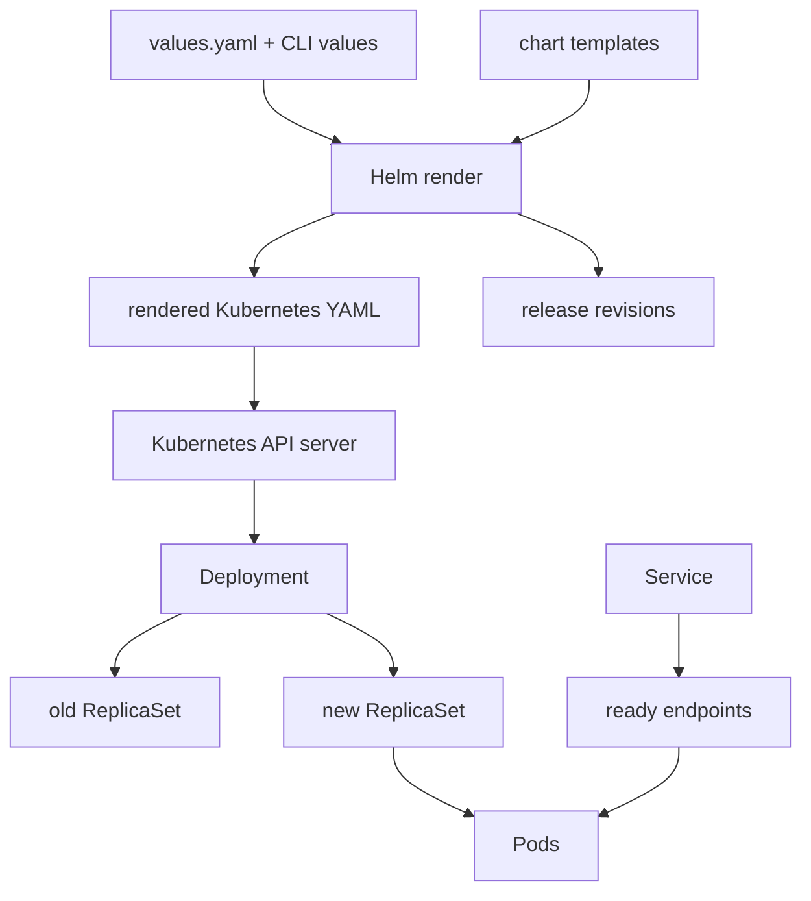

# 09 — Packaging, releases, and debugging

**Status:** draft
**Estimated time:** 6–8 hours
**Compute profile:** local CPU Kubernetes cluster recommended; EKS CPU nodes
also work; no GPU is required
**Estimated GPU-minutes:** 0
**Estimated cloud cost:** free on a local cluster; on EKS, ordinary node and
control-plane/network costs already associated with the cluster
**Prerequisites:** lessons 05–08, Docker, `kubectl`, Helm 3.14+ or 4, `curl`,
Python 3, and either a local Kubernetes cluster or an EKS lab cluster
**Last validated:** 2026-10-21, static checks only; clean cluster run pending
**Validated with:** Python 3.9 syntax, Bash syntax, and JSON parsing after the
latest review; the updated chart still requires Helm lint/render and independent
local/EKS runs

## Why this matters

Copying YAML is easy. Maintaining ten almost-identical copies is not.

A model service has an image, ports, probes, resources, configuration, storage,
GPU scheduling rules, and release history. Hand-editing each manifest creates
drift: a probe fix reaches one environment but not another, selectors stop
matching, or someone deploys a mutable image tag they cannot later reproduce.

Helm packages related Kubernetes objects and exposes intentional differences as
values. Helm does **not** replace Kubernetes knowledge. When a release fails,
you still debug Deployments, ReplicaSets, Pods, Services, endpoints, events,
probes, and logs.

This lesson starts with readable raw manifests, converts them into a real chart,
renders the chart before installing it, creates several release revisions,
breaks a rollout, and recovers it.

## Learning outcomes

By the end, you can:

- distinguish chart, template, values, rendered manifest, release, and release
  revision;
- convert raw YAML into a reusable Helm chart without hiding Kubernetes;
- use a container-image digest for an immutable deployment;
- explain labels, selectors, ownership, ConfigMap rollout checksums, and rolling
  update settings;
- use `helm lint`, `helm template`, client/server dry-runs, `helm get`, and
  `helm history`;
- diagnose Pending, `CrashLoopBackOff`, Unready, and rollout timeout states;
- distinguish `kubectl rollout undo` from `helm rollback`; and
- verify behavior and remove the release and namespace.

## What you will build

You will package a tiny HTTP service that deliberately supports safe fault
injection:

```text
GET /                 -> message, version, fault mode
GET /health/live      -> process liveness
GET /health/ready     -> readiness
GET /version          -> application version
```



The finished baseline has a private `ClusterIP` Service, one or two ready Pods,
an immutable ECR image reference, a Helm test, and a rollback history you can
explain object by object.

## Files in this lesson

```text
09-packaging-releases-debugging/
├── README.md
├── app/
│   ├── Dockerfile                    # non-root service image
│   └── server.py                     # HTTP service + deliberate fault modes
├── raw/
│   ├── 00-namespace.yaml
│   ├── 01-configmap.yaml
│   ├── 02-deployment.yaml
│   └── 03-service.yaml
├── chart/lesson-service/
│   ├── Chart.yaml
│   ├── values.schema.json          # reject unsafe/invalid value shapes
│   ├── values.yaml
│   ├── values-local.yaml
│   └── templates/
│       ├── _helpers.tpl
│       ├── configmap.yaml
│       ├── deployment.yaml
│       ├── service.yaml
│       ├── serviceaccount.yaml
│       ├── NOTES.txt
│       └── tests/test-connection.yaml
└── scripts/
    ├── assert-target.sh
    ├── build-push-image.sh
    ├── check-prerequisites.sh
    ├── cleanup.sh
    ├── install.sh
    ├── render.sh
    └── smoke-test.sh
```

The raw and templated objects intentionally describe the same service. Read the
raw files first; then locate each field's template/value equivalent.

## Concepts and mental model

### Chart, release, and revision are not synonyms

- A **chart** is a versioned package of templates, default values, and metadata.
- A **rendered manifest** is ordinary YAML produced from templates plus values.
- A **release** is one installation of a chart in a namespace.
- A **release revision** is a point in that release's Helm history.
- An **application version** describes the app, but Helm does not enforce its
  meaning.
- A **chart version** describes the packaging contract.

One chart can create releases named `dev`, `staging`, and `course`; each has
independent values and history.

### Helm is a manifest generator plus release manager

A useful mental model:

```text
templates + values --helm template--> YAML --Kubernetes API--> objects
                                      \
                                       \--helm upgrade--> release history
```

Kubernetes never executes Go template expressions. Helm renders them before
submitting YAML. If the rendered selector is wrong, Kubernetes sees only the
wrong selector.

### Values are a public configuration interface

Good values represent supported choices:

- replica count;
- immutable image repository and digest;
- application message/version;
- resource requests/limits;
- probes;
- placement constraints.

Do not template every character merely because Helm can. Fields that must stay
consistent for safety—container port names, core labels, and security defaults—
can remain fixed.

### Digest versus tag

`repository:tag` is a lookup name that a registry can repoint.
`repository@sha256:digest` identifies exact image content. The chart supports
tags for local learning and digests for EKS/reproducible evidence.

That deployment digest freezes the built application image. This lesson also
pins the Dockerfile base and Helm-test image by digest. Even so, an immutable
base plus exact top-level dependencies is not automatically a fully
hash-locked transitive dependency graph. Strict production supply-chain
reproducibility also uses reviewed lockfiles and build provenance. This draft
does not claim that rebuilding source later will produce identical bytes.

### Rollout versus rollback

A Deployment rollout creates a new ReplicaSet when its Pod template changes.
`kubectl rollout undo deployment/...` works at the Deployment-controller layer.

`helm rollback RELEASE REVISION` restores the previous Helm release manifest
and values, potentially affecting multiple objects. Use Helm rollback for a
Helm-managed release unless you deliberately want controller-only intervention
and understand the resulting drift.

## Under the hood

### Ownership chain

```text
Helm release
  ├── ConfigMap
  ├── ServiceAccount
  ├── Service
  └── Deployment
        └── ReplicaSet
              └── Pod
```

Helm labels/annotations identify managed objects and stores release information
in the cluster. The Deployment controller owns ReplicaSets; ReplicaSets own
Pods. Helm does not create each replacement Pod itself.

Inspect the chain:

```bash
kubectl -n packaging-lab get deployment,replicaset,pod \
  -o custom-columns=KIND:.kind,NAME:.metadata.name,OWNER:.metadata.ownerReferences[0].kind,OWNER_NAME:.metadata.ownerReferences[0].name
```

### Why a ConfigMap checksum is in the Pod template

Environment variables sourced from a ConfigMap are read when a container
starts. Changing the ConfigMap does not rewrite a running process's
environment.

The chart computes a SHA-256 checksum of rendered ConfigMap content and stores
it as a Pod-template annotation:

```yaml
checksum/config: <rendered ConfigMap hash>
```

When configuration changes, the annotation changes. That changes the Pod
template, so the Deployment controller creates a new ReplicaSet. The checksum
is not magic; it turns config change into desired Pod-template change.

### Rolling update arithmetic

This chart defaults to:

```yaml
maxUnavailable: 0
maxSurge: 1
```

For two replicas, Kubernetes may create one extra new Pod but should keep both
desired replicas available while it replaces them. A bad new Pod can remain
alongside the working old ReplicaSet, which preserves service while producing
clear rollout evidence.

The startup probe uses `/health/live`, not `/health/ready`. Startup therefore
confirms that the HTTP process came up; the deliberate `unready` mode can then
fail readiness without being killed merely for being Unready. Liveness,
readiness, and startup are separate contracts.

### What Helm rollback actually submits

Helm reads a previous release revision, renders/restores that revision's
resources, and sends changes to the API server. Controllers then reconcile.
Rollback completion still depends on scheduling, image pulls, probes, and
application startup. A successful Helm command is not proof the endpoint works;
run a behavioral test.

## Prerequisites and preflight

Run from:

```bash
cd lessons/phase-01-kubernetes/09-packaging-releases-debugging
```

Confirm the active context:

```bash
kubectl config current-context
kubectl cluster-info
```

For a local cluster, build and load the tagged image:

```bash
./scripts/check-prerequisites.sh
docker build -t lesson-service:lesson-09-v1 app

# kind:
kind load docker-image lesson-service:lesson-09-v1

# Or minikube:
minikube image load lesson-service:lesson-09-v1
```

For EKS, configure non-secret variables:

```bash
export AWS_REGION=us-east-1
export EKS_CLUSTER=replace-with-your-approved-lab-cluster
export AWS_ACCOUNT_ID="$(
  aws sts get-caller-identity --query Account --output text
)"
export ECR_REPOSITORY=open-model-course/lesson-service
export I_UNDERSTAND_ECR_CHANGES=yes
export CONFIRM_ECR_REPOSITORY="$ECR_REPOSITORY"

aws sts get-caller-identity
./scripts/check-prerequisites.sh
./scripts/build-push-image.sh
```

Copy the three `export` lines printed by the script. Verify:

```bash
printf 'repository=%s\ndigest=%s\nreference=%s\n' \
  "$IMAGE_REPOSITORY" "$IMAGE_DIGEST" "$IMAGE_REFERENCE"
```

If the current context is shared or production, stop. Use a disposable local
cluster or explicitly approved lab EKS cluster.

## Cost and safety

- No GPU is requested.
- The Service type is `ClusterIP`; access uses `kubectl port-forward`.
- The local track has no cloud-workload charge.
- The EKS track builds one small ECR image and uses existing CPU-node capacity.
- Do not change the Service to `LoadBalancer` for this lesson.
- Do not store registry credentials in values or manifests.
- Every fault is scoped to release `course` in namespace `packaging-lab`.

Stop if a render contains `type: LoadBalancer`, the target namespace is shared,
or the image reference points at an untrusted/mutable production artifact.

## Predict before running

Write predictions in `artifacts/expected-vs-observed.md`:

1. Which raw fields become values, and which remain fixed?
2. Does changing a ConfigMap automatically change environment variables inside
   an existing process?
3. Which object creates a replacement Pod?
4. With `maxUnavailable: 0`, what happens when every new Pod is Unready?
5. Will readiness failure restart a container?
6. What does Helm know that `kubectl rollout undo` does not?

## Lab outline

1. Run the image directly and verify its fault modes.
2. deploy the readable raw manifests.
3. map raw fields to chart values/templates.
4. lint and render before installation.
5. install revision 1 and run a behavioral test.
6. upgrade configuration and inspect the new ReplicaSet.
7. create release history and perform an explicit rollback.
8. introduce an Unready release, diagnose it, and use atomic recovery.
9. test, collect evidence, and clean up.

## Step-by-step lab

### Step 1 — Test the container before Kubernetes

```bash
docker build -t lesson-service:lesson-09-v1 app
docker run --rm -d --name lesson-service-local \
  -p 127.0.0.1:18080:8080 \
  -e APP_MESSAGE='hello before Kubernetes' \
  -e APP_VERSION='container-v1' \
  lesson-service:lesson-09-v1
curl -fsS http://127.0.0.1:18080/
docker logs lesson-service-local
docker stop lesson-service-local
```

Expected response shape:

```json
{"fault_mode":"none","message":"hello before Kubernetes","version":"container-v1"}
```

If this fails, fix the image/application layer before adding Kubernetes.

### Step 2 — Deploy raw manifests

Set the correct image for your track:

```bash
# Local kind/minikube:
export IMAGE_REFERENCE=lesson-service:lesson-09-v1

# EKS: use the digest printed by build-push-image.sh instead.
printf '%s\n' "$IMAGE_REFERENCE"
```

Apply:

```bash
kubectl apply -f raw/00-namespace.yaml
kubectl apply -f raw/01-configmap.yaml
sed "s|REPLACE_IMAGE|$IMAGE_REFERENCE|g" raw/02-deployment.yaml |
  kubectl apply -f -
kubectl apply -f raw/03-service.yaml
kubectl -n packaging-lab rollout status deployment/lesson-service \
  --timeout=3m
kubectl -n packaging-lab get deployment,replicaset,pod,service,endpoints
```

Forward and test:

```bash
kubectl -n packaging-lab port-forward service/lesson-service 18080:80
```

In another terminal:

```bash
curl -fsS http://127.0.0.1:18080/
curl -fsS http://127.0.0.1:18080/health/ready
```

Delete the raw workload before Helm takes ownership:

```bash
kubectl delete -f raw/03-service.yaml
kubectl delete -f raw/02-deployment.yaml --ignore-not-found
kubectl delete -f raw/01-configmap.yaml
```

The second command cannot use the placeholder file to identify the live object
reliably in all validation modes, so delete explicitly if needed:

```bash
kubectl -n packaging-lab delete deployment lesson-service --ignore-not-found
```

### Step 3 — Read the chart as a transformation

Compare:

```bash
diff -u raw/02-deployment.yaml \
  chart/lesson-service/templates/deployment.yaml || true
sed -n '1,240p' chart/lesson-service/values.yaml
sed -n '1,260p' chart/lesson-service/templates/deployment.yaml
```

Find:

- `.Values.replicaCount`;
- the helper that constructs the image reference;
- selector labels shared by Deployment and Pod;
- the ConfigMap checksum;
- probes and resources;
- placement settings.

### Step 4 — Render before installing

For EKS/digest mode:

```bash
./scripts/render.sh
sed -n '1,260p' artifacts/rendered.yaml
```

For local tag mode:

```bash
mkdir -p artifacts
helm lint chart/lesson-service
helm template course chart/lesson-service \
  --namespace packaging-lab \
  -f chart/lesson-service/values-local.yaml \
  >artifacts/rendered-local.yaml
kubectl apply --dry-run=client -f artifacts/rendered-local.yaml
```

`helm lint` checks chart structure and some template mistakes. `helm template`
proves what YAML Helm will produce. Client dry-run asks `kubectl` to parse the
objects but does not create them. Depending on client flags and configuration,
`kubectl` can still contact the active API server for discovery or schema
validation; “client dry-run” means no write, not guaranteed offline operation.

Search the render:

```bash
grep -nE 'kind:|image:|type: LoadBalancer|nvidia.com/gpu|checksum/config' \
  artifacts/rendered*.yaml
```

The safety check should find no load balancer and no GPU.

### Step 5 — Install revision 1

For EKS:

```bash
./scripts/install.sh
```

For local:

```bash
kubectl apply -f raw/00-namespace.yaml
helm upgrade --install course chart/lesson-service \
  --namespace packaging-lab \
  -f chart/lesson-service/values-local.yaml \
  --wait \
  --timeout 3m
```

Inspect Helm and Kubernetes:

```bash
helm list -n packaging-lab
helm status course -n packaging-lab
helm get values course -n packaging-lab --all
helm get manifest course -n packaging-lab >artifacts/installed-revision-1.yaml
helm history course -n packaging-lab
kubectl -n packaging-lab get deployment,replicaset,pod,service,endpoints
./scripts/smoke-test.sh
helm test course -n packaging-lab --logs
```

Expected release state:

```text
REVISION  STATUS     CHART                 DESCRIPTION
1         deployed   lesson-service-0.1.0  Install complete
```

### Step 6 — Upgrade configuration and watch reconciliation

```bash
helm upgrade course chart/lesson-service \
  --namespace packaging-lab \
  --reuse-values \
  --set-string app.message='hello from revision two' \
  --set-string app.version='helm-v2' \
  --wait \
  --timeout 3m
kubectl -n packaging-lab rollout status \
  deployment/course-lesson-service
kubectl -n packaging-lab get replicasets \
  --sort-by=.metadata.creationTimestamp
helm history course -n packaging-lab
./scripts/smoke-test.sh
```

Inspect why a new ReplicaSet appeared:

```bash
kubectl -n packaging-lab get deployment course-lesson-service \
  -o jsonpath='{.spec.template.metadata.annotations.checksum/config}{"\n"}'
kubectl -n packaging-lab get configmap course-lesson-service -o yaml
```

### Step 7 — Make a third good revision, then roll back

```bash
helm upgrade course chart/lesson-service \
  --namespace packaging-lab \
  --reuse-values \
  --set-string app.message='temporary revision three' \
  --set-string app.version='helm-v3' \
  --wait \
  --timeout 3m
helm history course -n packaging-lab
./scripts/smoke-test.sh
```

Roll back to revision 2:

```bash
helm rollback course 2 \
  --namespace packaging-lab \
  --wait \
  --timeout 3m
helm history course -n packaging-lab
EXPECTED_MESSAGE='hello from revision two' \
EXPECTED_VERSION='helm-v2' \
  ./scripts/smoke-test.sh
```

Rollback creates another release revision; it does not erase history. The
response should again contain the revision-two message/version.

## Inspect what happened

Capture the three views:

```bash
# Package/release view
helm history course -n packaging-lab
helm get values course -n packaging-lab --all
helm get manifest course -n packaging-lab

# Controller view
kubectl -n packaging-lab describe deployment course-lesson-service
kubectl -n packaging-lab get replicasets -o wide
kubectl -n packaging-lab rollout history deployment/course-lesson-service

# Runtime/network view
kubectl -n packaging-lab get pods,endpoints -o wide
kubectl -n packaging-lab logs \
  -l app.kubernetes.io/instance=course --tail=50 --prefix
```

Explain each state transition:

```text
Helm changes desired manifests
  -> API stores a changed Deployment Pod template
  -> Deployment creates a ReplicaSet
  -> scheduler places Pods
  -> kubelet starts containers
  -> readiness adds Pod IPs to Service endpoints
```

## Deliberate failure

### Break: deploy an application that is alive but never ready

Predict:

- Does the liveness probe pass?
- Does readiness pass?
- Does the new Pod join Service endpoints?
- Do old Pods remain available?
- What will `--atomic` do after timeout?

Run the bad upgrade and preserve its nonzero exit code:

```bash
set +e
helm upgrade course chart/lesson-service \
  --namespace packaging-lab \
  --reuse-values \
  --set-string app.faultMode=unready \
  --set-string app.version=broken-unready \
  --atomic \
  --timeout 90s
upgrade_status=$?
set -e
printf 'upgrade exit=%s\n' "$upgrade_status"
```

While it waits, inspect in another terminal:

```bash
kubectl -n packaging-lab get pods -w
kubectl -n packaging-lab get endpoints course-lesson-service -w
```

After failure:

```bash
helm history course -n packaging-lab
kubectl -n packaging-lab get deployment,replicaset,pod,endpoints
kubectl -n packaging-lab describe deployment course-lesson-service
kubectl -n packaging-lab logs \
  -l app.kubernetes.io/instance=course --tail=100 --prefix
```

Diagnosis:

- process starts, so the container is not necessarily crashing;
- the startup probe to `/health/live` succeeds;
- `/health/live` returns 200;
- `/health/ready` returns 503;
- Unready Pods are excluded from Service endpoints;
- the new Deployment revision cannot become available;
- `--atomic` waits and restores the prior release on failure.

Verify recovery behavior, not just Helm status:

```bash
./scripts/smoke-test.sh
helm test course -n packaging-lab --logs
```

If you omit `--atomic`, repair explicitly:

```bash
helm history course -n packaging-lab
helm rollback course REPLACE_WITH_LAST_GOOD_REVISION \
  -n packaging-lab --wait --timeout 3m
```

### Optional second failure: unschedulable placement

```bash
helm upgrade course chart/lesson-service \
  -n packaging-lab \
  --reuse-values \
  --set-string nodeSelector.lesson\\.open-model-course/never=true
kubectl -n packaging-lab get pods
kubectl -n packaging-lab describe pod \
  -l app.kubernetes.io/instance=course
```

Repair by removing the unsupported override using a clean upgrade with your
known-good values or rollback. The scheduler event, not application logs,
contains the cause.

## Controlled experiment

Prove that a direct ConfigMap edit does not update an existing process:

```bash
PODS_BEFORE="$(
  kubectl -n packaging-lab get pod \
    -l app.kubernetes.io/instance=course \
    -o name | sort
)"
kubectl -n packaging-lab patch configmap course-lesson-service \
  --type merge \
  -p '{"data":{"APP_MESSAGE":"direct drift edit"}}'
PODS_AFTER="$(
  kubectl -n packaging-lab get pod \
    -l app.kubernetes.io/instance=course \
    -o name | sort
)"
printf 'before:\n%s\nafter:\n%s\n' "$PODS_BEFORE" "$PODS_AFTER"
test "$PODS_BEFORE" = "$PODS_AFTER"
./scripts/smoke-test.sh
```

The Pod set and process environments stay unchanged. Now reconcile through Helm:

```bash
helm upgrade course chart/lesson-service \
  -n packaging-lab \
  --reuse-values \
  --set-string app.message='checksum-triggered update' \
  --wait --timeout 3m
kubectl -n packaging-lab get replicasets \
  --sort-by=.metadata.creationTimestamp
./scripts/smoke-test.sh
```

The checksum annotation changed the Pod template, so a new ReplicaSet appeared.
This experiment changes one important mechanism: whether desired config is
connected to Pod-template reconciliation.

## Verification

Static package verification:

```bash
helm lint chart/lesson-service
helm template course chart/lesson-service \
  -n packaging-lab |
  kubectl apply --dry-run=client -f -
```

Release verification:

```bash
kubectl -n packaging-lab rollout status \
  deployment/course-lesson-service --timeout=2m
kubectl -n packaging-lab get endpoints course-lesson-service \
  -o jsonpath='{.subsets[0].addresses[0].ip}{"\n"}'
./scripts/smoke-test.sh
helm test course -n packaging-lab --logs
```

Image immutability check on EKS:

```bash
kubectl -n packaging-lab get deployment course-lesson-service \
  -o jsonpath='{.spec.template.spec.containers[0].image}{"\n"}' |
  grep '@sha256:'
```

“Pod Running” alone does not pass. The Service must have a ready endpoint and
return the expected JSON contract.

## Expected result

You should have:

- raw manifests that work;
- a rendered chart manifest you can read;
- an installed release with a private Service;
- a new ReplicaSet after an intentional config change;
- multiple Helm revisions;
- a rollback that restores response content;
- an Unready rollout diagnosed from probes/endpoints/events; and
- a passing Helm test and external smoke test after recovery.

Names, Pod hashes, cluster IPs, ages, digest, and revision count may differ.

## Troubleshooting

| Symptom | First command | Layer | Typical cause |
|---|---|---|---|
| template error | `helm template --debug` | Helm render | wrong value type/path/template syntax |
| API rejects manifest | `kubectl apply --dry-run=server` | API/schema/admission | invalid or forbidden field |
| Helm release Pending | `helm status`, `helm history` | release operation | interrupted operation or waiting hook |
| Pod Pending | `kubectl describe pod` | scheduler | resource, nodeSelector, taint, affinity |
| `ErrImagePull` | Pod events | registry | wrong digest, pull IAM, architecture |
| `CrashLoopBackOff` | `kubectl logs --previous` | process | command exits, missing file, application fault |
| Running but 0/1 Ready | probe + app logs | application/readiness | wrong path/port or deliberate `unready` |
| Ready Pod but no endpoint | Service/endpoints/labels | network selection | selector mismatch |
| Config changed, Pod unchanged | compare Pod name/checksum | reconciliation | edit bypassed Pod-template checksum |
| rollback says success, API fails | smoke test | behavior | wrong revision or external dependency |

Useful command order:

```bash
helm status course -n packaging-lab
helm get manifest course -n packaging-lab
kubectl -n packaging-lab get all,endpoints
kubectl -n packaging-lab describe deployment course-lesson-service
kubectl -n packaging-lab describe pod POD_NAME
kubectl -n packaging-lab logs POD_NAME --previous
kubectl -n packaging-lab get events \
  --sort-by=.metadata.creationTimestamp
```

## Evidence to collect

Save:

```text
artifacts/
├── expected-vs-observed.md
├── rendered.yaml
├── installed-revision-1.yaml
├── helm-history.txt
├── rollout-history.txt
├── bad-upgrade.txt
├── events.txt
├── smoke-response.json
└── release-report.md
```

Suggested capture commands:

```bash
helm history course -n packaging-lab >artifacts/helm-history.txt
kubectl -n packaging-lab rollout history deployment/course-lesson-service \
  >artifacts/rollout-history.txt
kubectl -n packaging-lab get events \
  --sort-by=.metadata.creationTimestamp >artifacts/events.txt
```

Sanitize account IDs, ECR paths, cluster names, node names, and internal
addresses before publishing evidence.

## Knowledge check

1. Where does Helm templating execute?
2. What is the difference between chart version, application version, and
   release revision?
3. Why must selector labels remain stable?
4. Which controller creates a replacement Pod?
5. Why does a ConfigMap checksum trigger a rollout?
6. Why can a Pod be Running but absent from Service endpoints?
7. What does `maxUnavailable: 0` protect during a bad rollout?
8. When is `helm rollback` more complete than `kubectl rollout undo`?
9. Why is `image@sha256:...` better evidence than an image tag?
10. What behavioral check must follow rollback?

## Exercises

### Guided exercise — CrashLoopBackOff

Upgrade with `--set-string app.faultMode=crash` without `--atomic`. Capture:

```bash
kubectl -n packaging-lab get pods
kubectl -n packaging-lab describe pod POD_NAME
kubectl -n packaging-lab logs POD_NAME --previous
```

Then roll back to the last good release revision and run the smoke test.

<details>
<summary>Solution and explanation</summary>

The process exits with code 42 before starting the HTTP server. Kubelet restarts
it according to the Pod restart policy, producing `CrashLoopBackOff`. The useful
evidence is the current/previous container status and previous log containing
`deliberate_crash`. A readiness-only failure would not show repeated process
exit. Use `helm history`, roll back to the last `deployed` revision, wait for
the Deployment, and run both `smoke-test.sh` and `helm test`.

</details>

### Independent challenge — Two releases, one chart

Install releases `blue` and `green` in the same namespace with different
messages and replica counts. Prove their selectors, Services, and histories do
not overlap. Then delete only `green` and prove `blue` still works.

### Independent challenge — Extend values validation

The supplied `values.schema.json` permits only `none`, `crash`, and `unready`
for `app.faultMode`, requires a positive replica count, and rejects a
non-`ClusterIP` Service. Extend it with a policy suitable for your environment,
such as a replica ceiling or approved image-repository prefix. Demonstrate one
failing `helm lint` and explain the rejected value.

## Completion gate

Pass when:

- the image works before Kubernetes;
- raw manifests return the expected API response;
- `helm lint`, render, and dry-run pass;
- EKS evidence uses an image digest;
- you can map every template to its values and rendered fields;
- at least three Helm revisions exist;
- explicit rollback restores response content;
- you diagnose Unready from readiness/endpoints instead of calling it a crash;
- a Helm test and smoke test pass after repair;
- you explain Helm rollback versus Deployment undo; and
- cleanup proof shows no lesson namespace/release remains.

## Cleanup

Inspect first:

```bash
helm list -n packaging-lab
kubectl -n packaging-lab get all,configmap,serviceaccount
```

Remove the Helm release and namespace:

```bash
./scripts/cleanup.sh
```

The install, smoke-test, and cleanup scripts re-check the active target. The
course context `kind-llm-lab` is accepted directly. After inspecting another
disposable kind, minikube, or Docker Desktop context, opt in for that command
with `ALLOW_NON_COURSE_LOCAL_CONTEXT=1`. For EKS, the active API endpoint must
match `AWS_REGION` and `EKS_CLUSTER`. Cleanup also requires the lesson
ownership labels before it can delete the namespace.

Prove removal:

```bash
helm list --all-namespaces | grep lesson-service || true
kubectl get namespace packaging-lab
kubectl get service --all-namespaces \
  -o custom-columns=NAMESPACE:.metadata.namespace,NAME:.metadata.name,TYPE:.spec.type |
  grep packaging-lab || true
```

Remove the local image only if you no longer need it:

```bash
docker image rm lesson-service:lesson-09-v1
```

ECR image deletion is optional and governed by your repository lifecycle
policy. No GPU node was required. Verify no accidental `LoadBalancer` Service
or cloud volume was created.

## Primary references

Required official documentation:

- [Helm: Charts](https://helm.sh/docs/topics/charts/)
- [Helm: Chart template guide](https://helm.sh/docs/chart_template_guide/)
- [Helm upgrade](https://helm.sh/docs/helm/helm_upgrade/)
- [Helm rollback](https://helm.sh/docs/helm/helm_rollback/)
- [Helm debugging templates](https://helm.sh/docs/chart_template_guide/debugging/)
- [Kubernetes Deployments](https://kubernetes.io/docs/concepts/workloads/controllers/deployment/)
- [Kubernetes rolling back a Deployment](https://kubernetes.io/docs/concepts/workloads/controllers/deployment/#rolling-back-a-deployment)
- [Kubernetes debugging Pods](https://kubernetes.io/docs/tasks/debug/debug-application/debug-pods/)
- [Kubernetes probes](https://kubernetes.io/docs/concepts/configuration/liveness-readiness-startup-probes/)

Optional depth:

- [Helm chart tests](https://helm.sh/docs/topics/chart_tests/)
- [Kubernetes recommended labels](https://kubernetes.io/docs/concepts/overview/working-with-objects/common-labels/)

References were reviewed on 2026-10-21.
