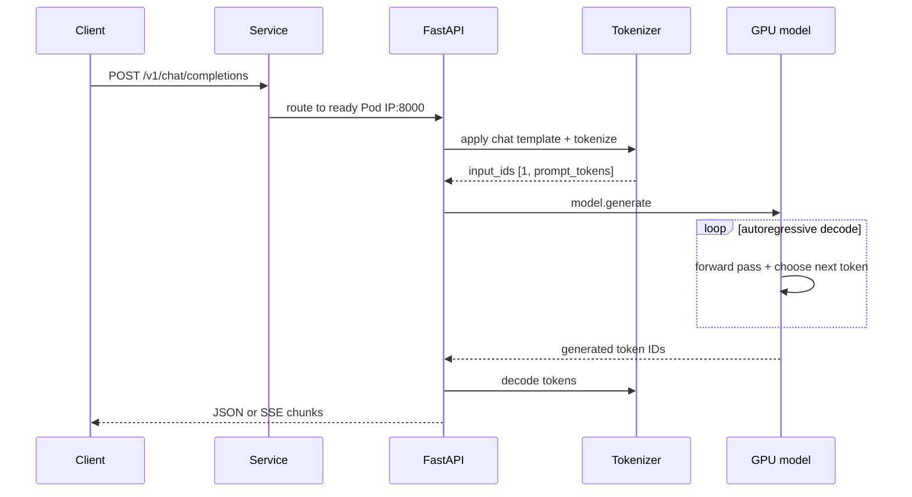

# 10 — Capstone: rebuild a one-GPU model API

**Status:** draft
**Estimated time:** 1–2 days, including reading and failure drills
**Compute profile:** one EKS GPU node with at least one NVIDIA GPU; an A10G
(`g5.xlarge` or larger) is ample for the supplied model
**Estimated GPU-minutes:** 60–120 for a careful first run
**Estimated cloud cost:** GPU-node runtime, a temporary 20 GiB EBS volume, ECR
storage, and any standing EKS/network costs; calculate with current Regional
prices before scaling up
**Prerequisites:** lessons 05–09, a working EKS GPU node group and NVIDIA device
plugin, standard EBS CSI or a compatible StorageClass, Docker with Buildx, AWS
CLI, `kubectl`, Helm 3.14+ or 4, `curl`, and Python 3
**Last validated:** 2026-10-21, static checks only; clean A10G/EKS run pending
**Validated with:** Python 3.9 syntax, Bash syntax, and JSON parsing after the
latest review; Helm lint/render, image build, GPU load, EBS lifecycle, and the
end-to-end API still need two independent clean runs before publication

## Why this matters

The previous lessons taught individual Kubernetes mechanisms. This capstone
connects them into a real system:

- source code becomes a container image;
- a digest makes the deployed image immutable and exactly identifiable;
- an init container stages a pinned model;
- a PVC keeps the model cache across Pod replacement;
- the scheduler reserves exactly one GPU;
- startup/readiness/liveness probes express different health states;
- a private Service gives the Pod a stable address;
- Helm records configuration and release history;
- an HTTP client exercises an OpenAI-shaped API;
- logs, events, endpoints, and `nvidia-smi` prove what happened; and
- teardown returns expensive capacity to zero.

This server is intentionally transparent, not highly optimized. It serializes
generation through one lock so you can read the complete path. Later lessons
replace it with vLLM, SGLang, and other engines and explain continuous batching,
paged KV caches, kernel selection, and throughput tuning.

## Learning outcomes

By the end, you can:

- explain every source, image, chart, Kubernetes, storage, network, and GPU layer
  in a one-GPU deployment;
- build and push an image, then deploy by immutable digest;
- stage an exact public model revision without committing weights;
- schedule one GPU and diagnose a Pending Pod from events;
- explain why this chart uses `Recreate` rather than a normal rolling surge;
- trace non-streaming and streaming chat-completion requests;
- distinguish startup, readiness, and liveness failures;
- prove warm-cache recovery after Pod deletion;
- perform and verify a Helm rollback;
- write a runbook another learner can execute; and
- prove the namespace, volume, and optional GPU capacity are gone.

## What you will build

The API implements a small, documented subset of the OpenAI chat-completions
shape:

```text
GET  /health/live
GET  /health/ready
GET  /v1/models
POST /v1/chat/completions      stream=false or stream=true
GET  /metrics
```

It uses:

```text
Model:    Qwen/Qwen2.5-0.5B-Instruct
Revision: 7ae557604adf67be50417f59c2c2f167def9a775
License:  Apache-2.0 as declared by the repository at this reviewed commit
Dtype:    float16
GPU:      exactly one nvidia.com/gpu
```

Inspect the pinned model card and `LICENSE` for your intended use. The repository
metadata is evidence to review, not legal advice.

```mermaid
flowchart LR
    Client[curl / SDK-shaped client] -->|kubectl port-forward| Svc[ClusterIP Service]
    Svc -->|ready endpoint only| API[FastAPI + Transformers Pod]
    subgraph Pod
      Init[init: download exact revision] --> Cache[/models snapshot]
      Cache --> API
      API --> CUDA[PyTorch CUDA]
    end
    PVC[20 GiB PVC] --> Cache
    SC[StorageClass] --> CSI[EBS CSI]
    CSI --> EBS[encrypted EBS volume]
    Device[NVIDIA device plugin] --> Scheduler
    Scheduler -->|assign one GPU node| Pod
    ECR[ECR image@sha256] --> Init
    ECR --> API
```

The default endpoint is not exposed to the internet. You reach it temporarily
through your authenticated Kubernetes connection. `ClusterIP` is network
scoping, not user authentication; do not treat this teaching API as a
production security boundary.

## Files in this lesson

```text
10-capstone-one-gpu-api/
├── README.md
├── Makefile
├── runbook-template.md
├── app/
│   ├── Dockerfile                 # CUDA/PyTorch application image
│   ├── requirements.txt           # pinned serving dependencies
│   ├── download_model.py          # init-container artifact staging
│   └── server.py                  # transparent model/API implementation
├── requests/
│   ├── chat-completion.json       # deterministic non-stream request
│   └── chat-stream.json           # server-sent-event request
├── chart/one-gpu-api/
│   ├── Chart.yaml
│   ├── values.yaml
│   ├── values-ephemeral.yaml
│   ├── values.schema.json         # safety and reproducibility constraints
│   └── templates/
│       ├── _helpers.tpl
│       ├── deployment.yaml
│       ├── pvc.yaml
│       ├── service.yaml
│       ├── serviceaccount.yaml
│       ├── NOTES.txt
│       └── tests/test-ready.yaml
└── scripts/
    ├── assert-target.sh
    ├── build-push-image.sh
    ├── check-prerequisites.sh
    ├── cleanup.sh
    ├── deploy.sh
    ├── failure-drill.sh
    ├── observe.sh
    ├── port-forward.sh
    ├── render.sh
    ├── test-api.sh
    └── wait-ready.sh
```

Read `app/server.py` before deploying. The capstone goal is understanding, not
blindly running a black box.

## Concepts and mental model

### Parameter memory is only the first term

The supplied model has roughly half a billion parameters. A rough FP16 weight
estimate is:

```text
0.5 billion parameters × 2 bytes ≈ 1.0 GB
```

Actual runtime memory also includes CUDA context, allocator reservations,
temporary activations, token tensors, and KV cache. An A10G's 24 GiB provides
comfortable teaching headroom. Do not use that headroom as evidence that a
larger model will fit; later lessons calculate each term.

### Desired state versus startup work

The Deployment says one Pod should exist. It does not download the model or load
CUDA itself. Controllers and node components cooperate:

```text
Helm -> API server -> Deployment -> ReplicaSet -> scheduler -> kubelet
                                                    |
                                                    v
                                     init download -> API load -> probes
```

### Health states

- **Process exists:** container runtime started the process.
- **Live:** restart is unlikely to help because the process responds.
- **Ready:** the model is loaded and requests may be routed.
- **Reachable:** Service selection, endpoints, DNS/port, and client path work.
- **Correct:** the API contract and output checks pass.

A Running Pod can fail every state after “process exists.”

### This is an OpenAI-compatible subset

The route and core response shape match chat completions, including basic SSE
chunks. This teaching server does not implement every field, authentication,
tool calls, log probabilities, multi-model routing, production concurrency, or
all finish reasons. Say “OpenAI-shaped teaching subset,” not “drop-in production
replacement.”

### Three different reproducibility promises

Do not collapse these into one idea:

1. **Immutable deployment:** Kubernetes runs the application image by ECR
   digest.
2. **Immutable model source:** the downloader asks the Hub for a 40-character
   model commit.
3. **Reproducible rebuild:** rebuilding the Dockerfile later produces identical
   bytes.

This lab enforces the first two. It also resolves the PyTorch base image to a
digest before building and writes `pip freeze --all` into
`/app/dependency-versions.txt`. The top-level Python requirements are exactly
pinned, but their transitive dependencies do not use a reviewed hash-locked
file, so the source tree alone does not yet promise a byte-identical future
rebuild. The pushed ECR digest remains the authoritative runnable artifact for
the experiment.

The Helm test uses a small curl image. The deployment scripts require you to
resolve that tag to a digest too; the repository deliberately does not hard-code
a registry digest that could later become unavailable.

### Why generation is serialized

`server.py` uses one process and a lock around `model.generate`. A second request
waits while the first runs. This makes behavior safe enough for the lesson and
easy to trace, but wastes batching opportunities. Engine lessons show why
production servers use request schedulers rather than a global lock.

## Under the hood

### Scheduling and device allocation

Both GPU request and limit are `nvidia.com/gpu: "1"`. The NVIDIA device plugin
advertises this extended resource on eligible nodes. The scheduler filters nodes
that lack free GPU capacity or violate labels/taints. After placement, the
device-plugin/runtime path exposes an assigned device inside the container.

The process then checks:

```python
torch.cuda.is_available()
torch.cuda.get_device_name(0)
```

A successful schedule does not guarantee PyTorch/CUDA compatibility, so the
application still verifies the runtime.

### Init container, PVC, and offline serving

The init container and API use the same image but different commands:

```text
init: python /app/download_model.py
main: uvicorn server:app ...
```

The init container mounts `/models` read-write and records the exact revision.
The main container mounts it read-only and sets `HF_HUB_OFFLINE=1`. Serving
therefore cannot silently fetch a different file after startup.

The completion marker records model ID, revision, and total snapshot bytes. The
init container rejects a marker if those fields or current byte count differ,
and removes the marker before replacing a snapshot. The API independently
checks that marker before loading.

This catches incomplete or obviously changed caches; it is not a cryptographic
rehash of every model byte. Pinning the Hub commit fixes the source version. A
production promotion pipeline should additionally verify signed provenance or
a reviewed per-file hash manifest.

With persistence enabled, the dynamically provisioned PVC survives Pod
replacement. With `values-ephemeral.yaml`, `emptyDir` forces a download in each
new Pod lifetime.

### Why the Deployment strategy is `Recreate`

A normal RollingUpdate with `maxSurge: 1` tries to start the new Pod while the
old one still holds:

- the only free GPU; and
- potentially a single-node EBS attachment.

The new Pod can remain Pending forever while the old Pod waits to be replaced.
`Recreate` stops the old Pod first, releases resources, and then starts the new
one. The downside is deliberate downtime during upgrades. Later production
lessons add spare capacity, multiple claims/caches, and safe rolling strategies.

### Request path



For `stream=true`, `TextIteratorStreamer` turns decoded fragments into
server-sent events. Streaming improves time-to-first-visible-text, not total
compute required.

### Probes during slow model load

Uvicorn completes the FastAPI lifespan startup only after CUDA model load and
warmup. The startup probe grants up to 20 minutes. Once it succeeds:

- readiness determines Service endpoint membership;
- liveness detects a stuck/unresponsive server.

Making liveness too aggressive during load creates a restart loop. A startup
probe prevents liveness from judging the application too early.

### Termination

On deletion:

1. the endpoint becomes unavailable during termination;
2. the `preStop` hook gives routing state time to update;
3. Kubernetes sends SIGTERM;
4. Uvicorn stops accepting work and executes lifespan shutdown;
5. the Pod releases the GPU and volume;
6. the Deployment may create a replacement.

This single-replica capstone can have downtime; it is not an HA design.

## Prerequisites and preflight

Run from:

```bash
cd lessons/phase-01-kubernetes/10-capstone-one-gpu-api
```

Set and print non-secret identifiers:

```bash
mkdir -p artifacts
export AWS_REGION=us-east-1
export EKS_CLUSTER=replace-with-lab-cluster
export GPU_NODEGROUP=replace-with-lab-gpu-nodegroup
export AWS_ACCOUNT_ID="$(
  aws sts get-caller-identity --query Account --output text
)"
export ECR_REPOSITORY=open-model-course/one-gpu-api
export I_UNDERSTAND_ECR_CHANGES=yes
export CONFIRM_ECR_REPOSITORY="$ECR_REPOSITORY"

printf 'account=%s region=%s cluster=%s nodegroup=%s\n' \
  "$AWS_ACCOUNT_ID" "$AWS_REGION" "$EKS_CLUSTER" "$GPU_NODEGROUP"
```

Resolve both third-party image tags to registry digests. `Digest:` is the
manifest-list digest; `--platform linux/amd64` later selects its AMD64 child
manifest:

```bash
export BASE_IMAGE_TAG=pytorch/pytorch:2.5.1-cuda12.4-cudnn9-runtime
export BASE_IMAGE_DIGEST="$(
  docker buildx imagetools inspect "$BASE_IMAGE_TAG" |
    sed -n 's/^Digest:[[:space:]]*//p' |
    head -1
)"
export BASE_IMAGE="pytorch/pytorch@${BASE_IMAGE_DIGEST}"

export TEST_IMAGE_TAG=curlimages/curl:8.11.1
export TEST_IMAGE_DIGEST="$(
  docker buildx imagetools inspect "$TEST_IMAGE_TAG" |
    sed -n 's/^Digest:[[:space:]]*//p' |
    head -1
)"

case "$BASE_IMAGE" in
  *@sha256:*) ;;
  *) echo 'failed to resolve BASE_IMAGE digest'; exit 1 ;;
esac
case "$TEST_IMAGE_DIGEST" in
  sha256:*) ;;
  *) echo 'failed to resolve TEST_IMAGE_DIGEST'; exit 1 ;;
esac

printf 'base=%s\ntest_digest=%s\n' \
  "$BASE_IMAGE" "$TEST_IMAGE_DIGEST" |
  tee artifacts/third-party-image-digests.txt
```

These commands read registry metadata; they do not pull or run the images.
Record both resolved digests in the evidence bundle.

Record the starting node-group capacity so cleanup can restore it:

```bash
aws eks describe-nodegroup \
  --region "$AWS_REGION" \
  --cluster-name "$EKS_CLUSTER" \
  --nodegroup-name "$GPU_NODEGROUP" \
  --query 'nodegroup.{status:status,instanceTypes:instanceTypes,scaling:scalingConfig}' \
  --output yaml |
  tee artifacts/nodegroup-before.yaml
```

Run preflight while capacity is still at its inexpensive baseline:

```bash
./scripts/check-prerequisites.sh
kubectl get storageclass
kubectl get nodes --show-labels
kubectl get nodes \
  -o custom-columns=NAME:.metadata.name,INSTANCE:.metadata.labels.node\\.kubernetes\\.io/instance-type,GPU:.status.allocatable.nvidia\\.com/gpu
```

Choose a working StorageClass. For the standard EBS CSI path from lesson 08:

```bash
export MODEL_STORAGE_CLASS=model-cache-gp3
kubectl get storageclass "$MODEL_STORAGE_CLASS" -o yaml
```

If lesson 08 cleanup deleted it, either recreate that reviewed StorageClass or
use an existing administrator-approved `WaitForFirstConsumer` class.

Choose a node label observed on your GPU nodes. Managed node groups normally
expose a node-group label, but inspect instead of assuming:

```bash
export GPU_NODE_SELECTOR_KEY=eks.amazonaws.com/nodegroup
export GPU_NODE_SELECTOR_VALUE="$GPU_NODEGROUP"
```

If the GPU nodes are tainted, record the actual key:

```bash
kubectl describe node GPU_NODE_NAME | sed -n '/Taints:/,/Unschedulable:/p'
export GPU_TAINT_KEY=replace-with-observed-key
```

Leave `GPU_TAINT_KEY` unset when no toleration is needed.

## Cost and safety

Before scaling up, write:

```text
instance type × current on-demand hourly rate × planned hours
+ EBS capacity/time
+ existing EKS/NAT/other standing cost
= experiment budget
```

Guardrails:

- one replica and exactly one GPU;
- one GPU node maximum for this capstone;
- one 20 GiB PVC with `keepOnDelete: false`;
- `ClusterIP` only, enforced by the chart schema;
- no model-provider token because the model is public;
- no credentials in Git, values, Pod environment, or shell transcripts;
- image digest and model commit recorded in evidence;
- base-image and Helm-test-image digests recorded in evidence;
- scale down immediately after the final check.

Stop if:

- context/account/cluster/node group is not the intended lab;
- scaling would exceed one GPU node;
- a rendered Service is public;
- the model license/revision is not understood;
- the image lacks an immutable digest;
- the Pod requests more than one GPU; or
- cleanup leaves a volume/node you cannot identify.

## Predict before running

Create `artifacts/expected-vs-observed.md` and answer:

1. Which phase will be slowest on the first deployment: scheduling, image pull,
   model download, or GPU load?
2. Will the PVC bind before the GPU Pod is scheduled when its class uses
   `WaitForFirstConsumer`?
3. What happens if a RollingUpdate tries to surge on a one-GPU cluster?
4. Which log proves the model revision was a cache hit?
5. Does deleting a Pod delete its PVC?
6. Can a live process be Unready?
7. Which component removes an Unready Pod from Service endpoints?
8. What must be true before scaling the GPU node group back to zero?

## Lab outline

1. Read and statically validate source/chart.
2. build and push an immutable CUDA image.
3. render and inspect the exact release.
4. scale one GPU node up and verify advertised capacity.
5. deploy the pinned model and private API.
6. test model listing, non-streaming completion, streaming, and metrics.
7. delete the Pod and prove warm-cache recovery.
8. break readiness, diagnose the failure, and verify rollback.
9. complete the runbook and evidence bundle.
10. uninstall, verify volume deletion, and return capacity to baseline.

## Step-by-step lab

### Step 1 — Read and validate before spending GPU time

```bash
python3 -m py_compile app/download_model.py app/server.py
python3 -m json.tool chart/one-gpu-api/values.schema.json >/dev/null
python3 -m json.tool requests/chat-completion.json >/dev/null
python3 -m json.tool requests/chat-stream.json >/dev/null
helm lint chart/one-gpu-api
helm template one-gpu chart/one-gpu-api \
  --namespace one-gpu-api \
  --set-string image.repository=example.invalid/one-gpu-api \
  --set-string image.digest="sha256:$(printf '0%.0s' {1..64})" \
  --set-string cache.persistence.storageClassName=example-storage-class \
  --set-string test.image.digest="sha256:$(printf '1%.0s' {1..64})" \
  >artifacts/render-static-example.yaml
```

Inspect safety-critical fields:

```bash
grep -nE \
  'image:|nvidia.com/gpu|type: Recreate|type: ClusterIP|MODEL_REVISION|storageClassName' \
  artifacts/render-static-example.yaml
```

The all-zero/all-one digests are syntax-only placeholders under the reserved
`example.invalid` repository; do not deploy this static render.

Read:

```bash
sed -n '1,260p' app/server.py
sed -n '1,300p' chart/one-gpu-api/templates/deployment.yaml
```

### Step 2 — Build and push by digest

```bash
./scripts/build-push-image.sh
```

The build script refuses a tag-only `BASE_IMAGE`. It builds the AMD64 image,
pushes it, resolves the ECR digest, and prints three export lines. If the ECR
repository is absent, the two confirmation variables authorize creation of
that exact repository with immutable tags and scan-on-push. An existing
repository must already satisfy both controls. Copy the printed exports:

```bash
export IMAGE_REPOSITORY='123456789012.dkr.ecr.REGION.amazonaws.com/open-model-course/one-gpu-api'
export IMAGE_DIGEST='sha256:...'
export BASE_IMAGE_USED='pytorch/pytorch@sha256:...'
```

Verify ECR:

```bash
aws ecr describe-images \
  --region "$AWS_REGION" \
  --repository-name "$ECR_REPOSITORY" \
  --image-ids imageDigest="$IMAGE_DIGEST" \
  --query 'imageDetails[0].{digest:imageDigest,size:imageSizeInBytes,pushed:imagePushedAt}' \
  --output table
```

The CUDA/PyTorch base makes this image large. A first pull can take several
minutes. That time is image distribution, not model loading. The image contains
`/app/dependency-versions.txt`, recording the exact transitive versions
installed into this immutable build.

### Step 3 — Render the exact release

```bash
./scripts/render.sh
grep -nE 'image:|nvidia.com/gpu|storageClassName|type: ClusterIP|type: Recreate' \
  artifacts/rendered.yaml
```

Optional server-side validation, if permitted:

```bash
kubectl apply --dry-run=server -f artifacts/rendered.yaml
```

The script's client dry-run performs no write, but `kubectl` can still contact
the active API server for discovery or schema information. Use it only after
confirming the context.

The render must contain:

- `image: ...@sha256:...`;
- a digest-pinned Helm-test image;
- the 40-character model revision;
- one GPU request and limit;
- one replica;
- `Recreate`;
- your StorageClass; and
- `ClusterIP`, never `LoadBalancer`.

### Step 4 — Scale exactly one GPU node up

Review the target one final time:

```bash
printf 'cluster=%s nodegroup=%s region=%s\n' \
  "$EKS_CLUSTER" "$GPU_NODEGROUP" "$AWS_REGION"
```

For a managed node group configured to allow zero or one:

```bash
aws eks update-nodegroup-config \
  --region "$AWS_REGION" \
  --cluster-name "$EKS_CLUSTER" \
  --nodegroup-name "$GPU_NODEGROUP" \
  --scaling-config minSize=0,maxSize=1,desiredSize=1
```

Wait until the node is Ready and advertises a GPU:

```bash
kubectl get nodes -w
REQUIRE_GPU_READY=1 ./scripts/check-prerequisites.sh
```

If capacity stays absent, do not deploy repeatedly. Check node-group activity,
EC2 capacity, node registration, the GPU AMI/runtime, and NVIDIA device-plugin
Pods.

### Step 5 — Deploy

```bash
./scripts/deploy.sh
```

Because `--wait` waits for readiness, use a second terminal while it runs:

```bash
kubectl -n one-gpu-api get pod,pvc -w
```

The deploy script re-verifies the EKS API endpoint, creates the dedicated
namespace with lesson ownership labels if it is absent, and refuses an
unexpected existing namespace.

When the Pod appears:

```bash
POD="$(
  kubectl -n one-gpu-api get pod \
    -l app.kubernetes.io/instance=one-gpu \
    -o jsonpath='{.items[0].metadata.name}'
)"
kubectl -n one-gpu-api logs "$POD" -c download-model -f
kubectl -n one-gpu-api logs "$POD" -c api -f
```

Expected init events:

```json
{"event":"model_download_started","revision":"7ae557..."}
{"event":"model_download_finished","seconds":...,"total_bytes":...}
```

Expected API event:

```json
{"event":"model_ready","gpu":"NVIDIA A10G","allocated_mib":...}
```

After deployment:

```bash
./scripts/wait-ready.sh
helm status one-gpu -n one-gpu-api
kubectl -n one-gpu-api get pod,pvc,service,endpoints -o wide
```

### Step 6 — Test the API contract

Automated test:

```bash
./scripts/test-api.sh
helm test one-gpu -n one-gpu-api --logs
```

The script validates:

- `/v1/models` contains the exact model ID;
- non-streaming JSON has an assistant message and positive token usage;
- streaming output contains SSE `data:` records and `[DONE]`; and
- metrics contain request counters.

For manual exploration, keep a port-forward open:

```bash
./scripts/port-forward.sh
```

In another terminal:

```bash
curl -fsS http://127.0.0.1:18000/health/ready
curl -fsS http://127.0.0.1:18000/v1/models
curl -fsS \
  -H 'Content-Type: application/json' \
  --data @requests/chat-completion.json \
  http://127.0.0.1:18000/v1/chat/completions |
  python3 -m json.tool
curl -N \
  -H 'Content-Type: application/json' \
  --data @requests/chat-stream.json \
  http://127.0.0.1:18000/v1/chat/completions
curl -fsS http://127.0.0.1:18000/metrics
```

### Step 7 — Observe all layers

```bash
./scripts/observe.sh
```

Live inspection:

```bash
kubectl -n one-gpu-api describe pod "$POD"
kubectl -n one-gpu-api exec "$POD" -c api -- nvidia-smi
kubectl -n one-gpu-api exec "$POD" -c api -- \
  cat /app/dependency-versions.txt |
  tee artifacts/dependency-versions.txt
kubectl -n one-gpu-api top pod 2>/dev/null || true
kubectl -n one-gpu-api get endpoints one-gpu-one-gpu-api -o yaml
```

Map the PVC to EBS:

```bash
PV_NAME="$(
  kubectl -n one-gpu-api get pvc one-gpu-one-gpu-api \
    -o jsonpath='{.spec.volumeName}'
)"
kubectl get pv "$PV_NAME" \
  -o jsonpath='volume={.spec.csi.volumeHandle} reclaim={.spec.persistentVolumeReclaimPolicy}{"\n"}'
```

### Step 8 — Delete the Pod and prove warm recovery

Record the old identity and initialization evidence:

```bash
OLD_POD="$POD"
kubectl -n one-gpu-api logs "$OLD_POD" -c download-model \
  >artifacts/first-start-downloader.log
kubectl -n one-gpu-api delete pod "$OLD_POD"
```

The ReplicaSet creates a replacement:

```bash
kubectl -n one-gpu-api get pods -w
```

Stop the watch after the new Pod appears. Then select the newest Pod rather
than assuming the first item returned is the replacement:

```bash
kubectl -n one-gpu-api wait \
  --for=delete "pod/$OLD_POD" --timeout=5m
NEW_POD=""
until [[ -n "$NEW_POD" && "$NEW_POD" != "$OLD_POD" ]]; do
  NEW_POD="$(
    kubectl -n one-gpu-api get pod \
      -l app.kubernetes.io/instance=one-gpu \
      --sort-by=.metadata.creationTimestamp \
      -o jsonpath='{.items[-1:].metadata.name}'
  )"
  [[ -n "$NEW_POD" && "$NEW_POD" != "$OLD_POD" ]] || sleep 2
done
printf 'old=%s new=%s\n' "$OLD_POD" "$NEW_POD"
kubectl -n one-gpu-api wait \
  --for=condition=Ready "pod/$NEW_POD" --timeout=20m
kubectl -n one-gpu-api logs "$NEW_POD" -c download-model |
  tee artifacts/recovery-downloader.log
```

Expected:

```json
{"event":"model_cache_hit","revision":"7ae557..."}
```

Then:

```bash
./scripts/test-api.sh
```

Pod identity changed; PVC/model revision stayed the same; behavior recovered.

## Inspect what happened

Connect every observation to a layer:

| Evidence | What it proves |
|---|---|
| `helm get manifest` | exact desired release objects |
| Deployment/ReplicaSet ownership | controller reconciliation |
| Pod scheduling events | why the GPU node was selected or rejected |
| PVC/PV/volume handle | persistent cache lifecycle |
| init log | immutable model revision and cache hit/miss |
| API `model_ready` log | CUDA load completed |
| endpoints object | readiness controls routing |
| `/v1/models` | served model identity |
| completion response | tokenizer → generation → decode works |
| SSE output | response fragments stream |
| `/metrics` | requests/tokens/memory are observable |
| `nvidia-smi` | GPU process and device memory |

Complete [runbook-template.md](runbook-template.md) with exact commands,
identifiers, and diagnosis branches.

## Deliberate failure

### Break readiness and recover through Helm

The failure script changes only the readiness path. Startup still succeeds and
the process remains live, but the Pod never joins Service endpoints.

Predict the Pod phase, Ready column, liveness result, endpoint count, Helm exit,
and downtime before running:

```bash
./scripts/failure-drill.sh
```

While it runs, inspect in another terminal:

```bash
kubectl -n one-gpu-api get pod,endpoints -w
```

Collect diagnosis:

```bash
helm history one-gpu -n one-gpu-api
kubectl -n one-gpu-api get pod,endpoints -o wide
kubectl -n one-gpu-api describe deployment one-gpu-one-gpu-api
kubectl -n one-gpu-api describe pod \
  -l app.kubernetes.io/instance=one-gpu
kubectl -n one-gpu-api get events \
  --sort-by=.metadata.creationTimestamp | tail -40
```

Expected mechanism:

1. Helm changes the Deployment Pod template.
2. `Recreate` terminates the old Pod and releases the GPU/EBS attachment.
3. The new process loads successfully.
4. readiness probes `/health/not-a-real-endpoint` and receive 404.
5. the endpoint set stays empty and upgrade times out.
6. `--atomic` restores the prior Helm revision.
7. another Pod starts with the good readiness path and warm cache.

Wait for restored readiness:

```bash
kubectl -n one-gpu-api rollout status \
  deployment/one-gpu-one-gpu-api --timeout=20m
./scripts/test-api.sh
```

If atomic recovery fails, find the last good revision:

```bash
helm history one-gpu -n one-gpu-api
helm rollback one-gpu REPLACE_WITH_GOOD_REVISION \
  -n one-gpu-api --wait --timeout 25m
./scripts/test-api.sh
```

The last command is essential: release status alone does not prove inference.

## Controlled experiment

Compare first start and replacement:

| Metric | First Pod | Replacement Pod |
|---|---:|---:|
| image pull duration | | |
| PVC provision/attach duration | | |
| model download/cache-check seconds | | |
| model load + warmup seconds | | |
| total until Ready | | |
| cache hit | false | true |
| first completion tokens | | |

Hold image digest, model revision, node group, chart values, prompt, and sampling
fixed. The controlled variable is whether the PVC already contains the exact
snapshot.

This measures end-to-end warm-cache recovery, not EBS throughput and not model
engine performance.

## Verification

Static checks:

```bash
python3 -m py_compile app/*.py
for file in requests/*.json chart/one-gpu-api/values.schema.json; do
  python3 -m json.tool "$file" >/dev/null
done
helm lint chart/one-gpu-api
./scripts/render.sh
```

Cluster checks:

```bash
kubectl -n one-gpu-api get deployment one-gpu-one-gpu-api \
  -o jsonpath='{.spec.template.spec.containers[0].image}{"\n"}' |
  grep '@sha256:'
kubectl -n one-gpu-api get pod \
  -l app.kubernetes.io/instance=one-gpu \
  -o jsonpath='{.items[0].spec.containers[0].resources.limits.nvidia\.com/gpu}{"\n"}' |
  grep '^1$'
kubectl -n one-gpu-api get endpoints one-gpu-one-gpu-api \
  -o jsonpath='{.subsets[0].addresses[0].ip}{"\n"}'
./scripts/test-api.sh
helm test one-gpu -n one-gpu-api --logs
```

Recovery check:

```bash
grep '"event": "model_cache_hit"' artifacts/recovery-downloader.log
```

Cleanup verification appears in the Cleanup section and is part of the gate.

## Expected result

The non-streaming response resembles:

```json
{
  "object": "chat.completion",
  "model": "Qwen/Qwen2.5-0.5B-Instruct",
  "choices": [
    {
      "message": {
        "role": "assistant",
        "content": "A Kubernetes Pod is ..."
      },
      "finish_reason": "stop"
    }
  ],
  "usage": {
    "prompt_tokens": 31,
    "completion_tokens": 18,
    "total_tokens": 49
  }
}
```

Text and token counts may vary across library/hardware changes even at
temperature zero; schema, nonempty content, pinned artifacts, and evidence are
the core checks.

Streaming resembles:

```text
data: {"object":"chat.completion.chunk","choices":[{"delta":{"role":"assistant"}}]}

data: {"object":"chat.completion.chunk","choices":[{"delta":{"content":"One"}}]}

data: [DONE]
```

## Troubleshooting

Work layer by layer:

| Symptom | Evidence first | Likely layer | Do not start with |
|---|---|---|---|
| Helm render fails | `helm template --debug` | chart/schema/value | Pod logs |
| PVC Pending | PVC events, StorageClass | CSI/IAM/topology | model code |
| Pod Pending | Pod events | GPU/label/taint/resources/volume | HTTP curl |
| `ErrImagePull` | Pod events | ECR digest/node pull IAM | probes |
| init failing | `logs -c download-model` | network/revision/write permission | API logs |
| API CrashLoop | `logs -c api --previous` | CUDA/dependency/model load | Service DNS |
| Running, not Ready | probe events + API logs | load or readiness path | ECR |
| Ready, no endpoint | Service selector/endpoints | labels/selection | generation settings |
| endpoint exists, curl fails | port-forward/Service ports | network path | GPU scheduler |
| HTTP 400 | response detail | request/token limit | CSI |
| HTTP 500 | API logs | generation/runtime | StorageClass |
| OOMKilled | Pod status + node/GPU memory | CPU RAM limit or GPU allocation | Service |
| rollback slow | Pod events + init logs | Recreate/load lifecycle | Helm templates only |

Useful commands:

```bash
helm status one-gpu -n one-gpu-api
helm history one-gpu -n one-gpu-api
kubectl -n one-gpu-api get all,pvc,endpoints
kubectl -n one-gpu-api describe pod POD_NAME
kubectl -n one-gpu-api logs POD_NAME -c download-model
kubectl -n one-gpu-api logs POD_NAME -c api --previous
kubectl -n one-gpu-api get events \
  --sort-by=.metadata.creationTimestamp
kubectl describe node NODE_NAME
```

Common fixes:

- **No free GPU:** scale the intended lab group to one, wait for Ready/device
  plugin, or remove an unrelated workload with authorization.
- **Untolerated taint:** set the observed `GPU_TAINT_KEY`; do not invent a broad
  toleration.
- **Wrong selector:** use a label actually present on the intended nodes.
- **PVC topology conflict:** use `WaitForFirstConsumer` and an AZ containing
  eligible GPU capacity.
- **CUDA unavailable:** check GPU allocation, NVIDIA runtime/device plugin, node
  AMI, and CUDA compatibility.
- **Model download denied:** confirm exact public model ID/revision and outbound
  connectivity; do not add a token unless access actually requires one.
- **Readiness 404:** compare rendered probe path with implemented routes.

## Evidence to collect

Keep evidence under ignored `artifacts/` and sanitize it:

```text
artifacts/
├── nodegroup-before.yaml
├── third-party-image-digests.txt
├── expected-vs-observed.md
├── rendered.yaml
├── downloader.log
├── api.log
├── dependency-versions.txt
├── nvidia-smi.txt
├── kubernetes-objects.txt
├── events.txt
├── helm-values.yaml
├── helm-manifest.yaml
├── models.json
├── chat-completion.json
├── chat-stream.txt
├── metrics.txt
├── first-start-downloader.log
├── recovery-downloader.log
├── failure-upgrade.txt
├── helm-history-after-failure.txt
├── storage-before-cleanup.tsv
├── pv-before-cleanup.yaml
├── runbook.md
└── cleanup-proof.txt
```

Copy and fill the runbook:

```bash
cp runbook-template.md artifacts/runbook.md
```

Evidence can expose account IDs, ECR paths, cluster/node names, IAM roles,
volume IDs, and internal IP addresses. Sanitize before sharing publicly.

## Knowledge check

1. Why does the init container need write access while the API can mount the
   same files read-only?
2. What evidence links the served snapshot to a known revision, and what
   at-rest integrity does that evidence not prove?
3. Why can a one-GPU RollingUpdate deadlock?
4. What availability cost comes with `Recreate`?
5. Why does the startup probe have a much larger budget than readiness?
6. What is different between host RAM, GPU VRAM, and an EBS cache?
7. Which object routes only to ready Pods?
8. What does the global generation lock simplify, and what performance does it
   sacrifice?
9. Why does streaming reduce perceived latency but not total model compute?
10. Why must an API request follow a successful Helm rollback?
11. What cloud resources can keep billing after Pod deletion?
12. Why is this endpoint private but not yet production-authenticated?

## Exercises

### Guided exercise — Compare persistent and ephemeral model storage

After saving persistent-cache evidence, uninstall and redeploy with:

```bash
helm upgrade --install one-gpu chart/one-gpu-api \
  -n one-gpu-api --create-namespace \
  -f chart/one-gpu-api/values-ephemeral.yaml \
  --set-string image.repository="$IMAGE_REPOSITORY" \
  --set-string image.digest="$IMAGE_DIGEST" \
  --set-string test.image.digest="$TEST_IMAGE_DIGEST" \
  --set-string "nodeSelector.${GPU_NODE_SELECTOR_KEY//./\\.}=${GPU_NODE_SELECTOR_VALUE}" \
  --wait --timeout 25m
```

Delete the Pod and compare its replacement init log.

<details>
<summary>Solution and explanation</summary>

The `emptyDir` replacement should download again because the volume belongs to
the deleted Pod. The persistent run should report `model_cache_hit`. Both still
load weights into host memory and GPU VRAM after each process start. Restore the
normal persistent values before the failure drill, or uninstall/reinstall with
`deploy.sh`.

</details>

### Guided exercise — Prove input protection

Create a request whose prompt exceeds `MAX_INPUT_TOKENS`. Confirm HTTP 400 and
the reported token count/limit. Explain why rejecting is safer than silently
truncating a system instruction.

<details>
<summary>Solution and explanation</summary>

Repeat a word several thousand times in a temporary JSON file and send it.
`build_inputs` tokenizes first, compares sequence length with the configured
limit, and raises HTTP 400. Silent left/right truncation could remove important
instructions or context and make correctness hard to reason about.

</details>

### Independent challenge — Add request identity

Accept an `X-Request-ID` header or generate one, include it in structured logs
and the response, and prove two concurrent client requests can be traced even
though generation is serialized. Do not log prompt content.

### Independent challenge — Design a zero-downtime successor

Without deploying extra resources, draw a design that permits rolling updates:
number of GPUs, PVC/cache layout, surge/unavailable settings, topology, and
readiness behavior. Calculate the temporary capacity cost.

## Completion gate

Another learner must be able to use only your repository and runbook to:

- build the exact image and resolve its digest;
- record digest-pinned base, application, and Helm-test images;
- render a release with one GPU, private Service, valid StorageClass, and pinned
  model commit;
- deploy and reach Ready;
- receive valid non-streaming and streaming responses;
- identify the model/GPU through API, logs, and `nvidia-smi`;
- delete the Pod and prove controller recovery plus cache hit;
- diagnose bad readiness from probes/endpoints rather than guessing;
- restore a working release and verify behavior;
- explain every object and the `Recreate` trade-off;
- inspect your sanitized evidence; and
- remove the namespace/PVC/EBS volume and return GPU capacity to its original
  value.

This draft becomes review/published only after the repository's independent-run
criteria are met.

## Cleanup

Record resources before deletion:

```bash
kubectl -n one-gpu-api get all,pvc -o wide
kubectl -n one-gpu-api get pvc \
  -o custom-columns=NAME:.metadata.name,PV:.spec.volumeName
PV_NAME="$(
  kubectl -n one-gpu-api get pvc one-gpu-one-gpu-api \
    -o jsonpath='{.spec.volumeName}'
)"
EBS_VOLUME_ID="$(
  kubectl get pv "$PV_NAME" -o jsonpath='{.spec.csi.volumeHandle}'
)"
kubectl get pv "$PV_NAME" -o yaml >artifacts/pv-before-cleanup.yaml
```

Uninstall and remove the namespace:

```bash
./scripts/cleanup.sh
```

The cleanup script captures PVC → PV → CSI volume-handle mappings in
`artifacts/storage-before-cleanup.tsv`. It refuses to delete the namespace if a
PVC remains after Helm uninstall. That protects an explicitly kept PVC or an
`existingClaim`; decide what should happen to that data and remove it explicitly
before rerunning cleanup. It also re-checks the EKS API endpoint and namespace
ownership labels, so a context switch or label mismatch stops deletion.

Prove Kubernetes cleanup:

```bash
{
  helm list --all-namespaces | grep one-gpu || true
  kubectl get namespace one-gpu-api
  kubectl get pv "$PV_NAME"
} | tee artifacts/cleanup-proof.txt
```

For the default chart values, the namespace and PV lookup should report NotFound
after CSI finalization. Then verify the EBS ID captured immediately before
cleanup no longer exists or is deleting:

```bash
aws ec2 describe-volumes \
  --region "$AWS_REGION" \
  --filters "Name=volume-id,Values=$EBS_VOLUME_ID" \
  --query 'Volumes[].{id:VolumeId,state:State,size:Size}' \
  --output table
```

An empty table is the expected final result.

Return the node group to the exact scaling values recorded at the beginning. If
it began at zero:

```bash
aws eks update-nodegroup-config \
  --region "$AWS_REGION" \
  --cluster-name "$EKS_CLUSTER" \
  --nodegroup-name "$GPU_NODEGROUP" \
  --scaling-config minSize=0,maxSize=1,desiredSize=0
```

Wait and verify:

```bash
aws eks describe-nodegroup \
  --region "$AWS_REGION" \
  --cluster-name "$EKS_CLUSTER" \
  --nodegroup-name "$GPU_NODEGROUP" \
  --query 'nodegroup.scalingConfig' \
  --output yaml
kubectl get nodes -L eks.amazonaws.com/nodegroup
```

Also check:

- no `LoadBalancer` Service was created;
- no lesson PVC/PV/snapshot remains;
- no GPU EC2 instance remains when desired capacity is zero;
- ECR lifecycle policy matches your retention decision;
- no port-forward process remains; and
- account budget/cost tools show no unexpected resource.

Do not delete a shared cluster, node group, StorageClass, or ECR repository as
part of this namespaced cleanup.

The namespaced cleanup does not delete the ECR image. If the image is lab-owned,
no later lesson uses it, and you have recorded the digest, optionally delete
that one image rather than the whole repository:

```bash
aws ecr batch-delete-image \
  --region "$AWS_REGION" \
  --repository-name "$ECR_REPOSITORY" \
  --image-ids imageDigest="$IMAGE_DIGEST"
```

Re-run `aws ecr describe-images` and your cost checks afterward. Repository
deletion is intentionally outside this lesson because a repository can be
shared.

## Primary references

Required official documentation:

- [Kubernetes: schedule GPUs](https://kubernetes.io/docs/tasks/manage-gpus/scheduling-gpus/)
- [Kubernetes device plugins](https://kubernetes.io/docs/concepts/extend-kubernetes/compute-storage-net/device-plugins/)
- [Kubernetes init containers](https://kubernetes.io/docs/concepts/workloads/pods/init-containers/)
- [Kubernetes liveness, readiness, and startup probes](https://kubernetes.io/docs/concepts/configuration/liveness-readiness-startup-probes/)
- [Kubernetes Deployments and strategies](https://kubernetes.io/docs/concepts/workloads/controllers/deployment/)
- [Kubernetes Services](https://kubernetes.io/docs/concepts/services-networking/service/)
- [Amazon EKS: EBS CSI](https://docs.aws.amazon.com/eks/latest/userguide/ebs-csi.html)
- [Amazon EKS: optimized accelerated AMIs](https://docs.aws.amazon.com/eks/latest/userguide/eks-optimized-ami.html)
- [Helm upgrade](https://helm.sh/docs/helm/helm_upgrade/)
- [Helm rollback](https://helm.sh/docs/helm/helm_rollback/)
- [Hugging Face `snapshot_download`](https://huggingface.co/docs/huggingface_hub/guides/download)
- [Transformers text generation](https://huggingface.co/docs/transformers/main_classes/text_generation)
- [Qwen2.5-0.5B-Instruct model card](https://huggingface.co/Qwen/Qwen2.5-0.5B-Instruct)
- [PyTorch CUDA semantics](https://pytorch.org/docs/stable/notes/cuda.html)

Optional depth:

- [FastAPI lifespan events](https://fastapi.tiangolo.com/advanced/events/)
- [Server-sent events format](https://html.spec.whatwg.org/multipage/server-sent-events.html)
- [Amazon ECR image digests](https://docs.aws.amazon.com/AmazonECR/latest/userguide/docker-push-ecr-image.html)

References and the model commit were reviewed on 2026-10-21.
