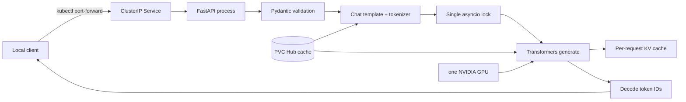

# 11 — A transparent Transformers baseline

**Status:** draft
**Estimated time:** 6–8 hours
**Compute profile:** one NVIDIA GPU Kubernetes node; an A10G-class 24 GiB GPU
has ample teaching headroom for the supplied 0.5B model
**Estimated GPU-minutes:** 60–90, including first model download and the queueing
experiment
**Estimated cloud cost:** one GPU node for the measured minutes, a 20 GiB
model-cache volume, ECR storage, and existing EKS/network charges; retrieve the
current price in your Region before scaling
**Prerequisites:** lessons 00–10; Docker Buildx, AWS CLI, `kubectl`, Python 3,
`curl`, an ECR repository, an approved `WaitForFirstConsumer` StorageClass, and
a dedicated EKS GPU node group
**Last validated:** 2026-10-21, source/static validation only; clean GPU/EKS run
pending
**Validated with:** Transformers 5.20.0 API documentation, model
`Qwen/Qwen2.5-0.5B-Instruct` revision
`7ae557604adf67be50417f59c2c2f167def9a775`, Python syntax checks, Bash syntax
checks, JSON parsing, and manifest-template rendering; no claim of a live A10G
or EKS execution is made

## Why this matters

An optimized inference engine can feel magical: give it a model name, and an
OpenAI-style endpoint appears. Magic is a poor debugging model. Before using
vLLM or SGLang, you will build the most readable useful server we can make with
Hugging Face Transformers.

This baseline exposes the complete path:

```text
HTTP JSON -> validation -> chat template -> tokenizer -> input_ids [1, S]
          -> model.generate(use_cache=True) -> output IDs -> decode -> JSON/SSE
```

It deliberately serializes generation with one lock. That makes it easy to
reason about and prevents two Python callers from independently driving the
same model at once, but it also demonstrates the main weakness: a second
request waits while the first request uses the GPU. There is no continuous
batch scheduler, paged KV-cache manager, admission policy, preemption, or
multi-process worker layer.

The goal is not to prove that Transformers is “slow.” The goal is to identify
exactly which responsibilities a serving engine adds, and to keep this readable
implementation as a correctness reference.

## Learning outcomes

By the end, you can:

- load a tokenizer and model from an immutable Hub commit;
- explain why a chat template is part of the model contract, not cosmetic
  formatting;
- trace tokenization, prefill, autoregressive decode, sampling, detokenization,
  and streaming;
- distinguish allocated CUDA memory from allocator-reserved memory;
- explain what `use_cache=True` stores and why it reduces repeated attention
  work during decode;
- test non-streaming and server-sent-event responses behaviorally;
- observe queue wait caused by a single generation lock;
- explain why disconnect cancellation is cooperative rather than instantaneous;
- diagnose image, scheduling, model-download, CUDA, readiness, and application
  failures from different evidence; and
- delete the namespace/PVC and return optional GPU capacity to its original
  baseline.

## What you will build



The observable result is a private API with health, model listing, chat
completion, runtime-debug, and Prometheus-metrics endpoints. Responses include
a small `teaching_trace` showing queue wait, elapsed time, input/output shapes,
and an output hash. This nonstandard field is for the course and must not be
assumed to exist in production engines.

## Files in this lesson

```text
11-transformers-baseline/
├── README.md
├── app/
│   ├── Dockerfile
│   ├── requirements.txt
│   └── server.py
├── k8s/workload.yaml.tpl
├── requests/
│   ├── chat.json
│   └── chat-stream.json
└── scripts/
    ├── cleanup.sh
    ├── deploy.sh
    ├── failure-drill.sh
    ├── observe.sh
    ├── preflight.sh
    ├── render.py
    └── test-api.sh
```

`server.py` is the lesson's central text. `render.py` substitutes only
non-secret environment-specific values and refuses a mutable image tag.
`test-api.sh` verifies returned content and token/shape fields rather than
stopping at “Pod Running.”

## Concepts and mental model

### A chat model is not called with raw prose

An instruct model was trained on a particular serialization of roles and
messages. `apply_chat_template` converts role/content objects into the control
tokens and text expected by that model. Applying the wrong template, applying
it twice, or adding special tokens again can reduce quality while every
infrastructure check remains green.

### Prefill and decode are different workloads

For a prompt of `S` tokens, prefill processes all prompt positions and creates
the first KV entries. Decode then executes one model step per generated token:

```text
prefill: [batch=1, sequence=S] -> logits for next token
decode:  [batch=1, sequence=1] + cached K/V -> next logits
```

Without a KV cache, every decode step would recompute attention keys and values
for the entire preceding sequence. The cache saves compute but consumes memory
that grows with active sequence length and request count.

### Sampling is a policy after the forward pass

The model produces logits. Greedy decoding selects the largest logit.
Temperature/top-p sampling transforms/selects from the distribution. At
`temperature=0`, this server sets `do_sample=False`; `top_p` then has no effect.
A seed helps reproduce sampling on the same stack, but it is not a universal
bit-for-bit guarantee across devices, kernels, or versions.

### Streaming does not make generation cheaper

Streaming sends decoded fragments as they become available, improving the
user's time to first visible text. The same model work still occurs. A chunk is
also not necessarily one token: tokenizer decoding and Unicode boundaries can
combine or split visible text.

## Under the hood

At startup, FastAPI's lifespan calls `load_runtime` in a worker thread.
`AutoTokenizer.from_pretrained` and `AutoModelForCausalLM.from_pretrained` use
the exact model revision. The model is moved to `cuda:0`, switched to evaluation
mode, and retained for the process lifetime.

For one request:

1. Pydantic rejects malformed roles, empty messages, excessive `max_tokens`,
   and a model name this server does not expose.
2. The tokenizer applies the chat template and produces integer `input_ids`
   shaped `[1, prompt_tokens]`.
3. The request waits for `generation_lock`. Queue time is measured separately
   from total server time.
4. `torch.inference_mode()` disables autograd bookkeeping.
5. `generate` runs prefill, chooses a token, then repeatedly decodes with
   `use_cache=True`.
6. Non-streaming returns after all output IDs exist. Streaming runs generation
   in a thread while `TextIteratorStreamer` transfers decoded fragments through
   a queue to the SSE response.
7. A client disconnect sets a thread-safe event. `DisconnectCriteria` checks it
   between generation iterations. It cannot interrupt a CUDA kernel already
   running, so cancellation has bounded delay.
8. Request counters, elapsed time, queue wait, and token totals are updated.
9. Per-request KV state becomes unreachable after `generate` returns and can be
   reclaimed by PyTorch. Model weights remain resident.

`torch.cuda.memory_allocated()` counts live tensor allocations known to
PyTorch. `memory_reserved()` includes memory held by the caching allocator for
reuse. Their difference is not necessarily a leak.

The lock is an admission mechanism, not a scheduler. A production scheduler
tracks many sequences, selects which tokens to advance each iteration, places
their KV blocks, and handles arrivals/completions without one Python call
owning the whole GPU.

## Prerequisites and preflight

Run commands from:

```bash
cd lessons/phase-02-engines/11-transformers-baseline
chmod +x scripts/*.sh scripts/render.py
```

Set non-secret identifiers:

```bash
export AWS_REGION=us-east-1
export EKS_CLUSTER=replace-with-lab-cluster
export GPU_NODEGROUP=replace-with-dedicated-gpu-nodegroup
export LAB_NAMESPACE=open-models-l11
export MODEL_STORAGE_CLASS=model-cache-gp3
export GPU_NODE_SELECTOR_KEY=eks.amazonaws.com/nodegroup
export GPU_NODE_SELECTOR_VALUE="$GPU_NODEGROUP"
```

Inspect actual node labels before choosing selector values:

```bash
kubectl get nodes --show-labels
kubectl get nodes \
  -o custom-columns=NAME:.metadata.name,TYPE:.metadata.labels.node\\.kubernetes\\.io/instance-type,GPU:.status.allocatable.nvidia\\.com/gpu
```

Resolve the base image tag to a digest before building:

```bash
export BASE_IMAGE_TAG=pytorch/pytorch:2.9.0-cuda13.0-cudnn9-runtime
export BASE_IMAGE_DIGEST="$(
  docker buildx imagetools inspect "$BASE_IMAGE_TAG" |
    sed -n 's/^Digest:[[:space:]]*//p' |
    head -1
)"
case "$BASE_IMAGE_DIGEST" in sha256:*) ;; *) exit 1 ;; esac
export BASE_IMAGE="pytorch/pytorch@${BASE_IMAGE_DIGEST}"
./scripts/preflight.sh
```

CUDA 13 images need a compatible host driver. If your accelerated AMI does not
meet that contract, choose a reviewed CUDA-12 PyTorch image and record its
digest rather than changing the host driver ad hoc. Preflight prints AWS
identity/context, verifies authorization/StorageClass/GPU capacity, and refuses
an existing namespace.

## Cost and safety

Record original node-group scaling before changing it:

```bash
mkdir -p artifacts
aws eks describe-nodegroup \
  --region "$AWS_REGION" \
  --cluster-name "$EKS_CLUSTER" \
  --nodegroup-name "$GPU_NODEGROUP" \
  --query 'nodegroup.scalingConfig' \
  --output json >artifacts/nodegroup-before.json
```

Budget:

```text
GPU nodes:       exactly 1
planned runtime: 1.5 hours maximum
GPU-hours:       1.5 × GPUs in selected instance
storage:         temporary 20 GiB PVC plus ECR image
public endpoint: none
```

Stop if identity/context is wrong, the node group is shared, the manifest
contains `LoadBalancer`, the image lacks `@sha256:`, the Pod requests more than
one GPU, or you cannot explain a chargeable leftover. The public model needs no
Hub token. Never place cloud/registry credentials in YAML or evidence.

## Predict before running

Write answers in `artifacts/expected-vs-observed.md`:

1. Which part dominates first startup: image pull, model download, or load?
2. Why is the input tensor `[1, S]` rather than `[S]`?
3. Which memory remains after a request: weights, KV cache, or both?
4. What happens to a second request while the first holds the lock?
5. Does streaming reduce total GPU work?
6. How quickly can disconnect cancellation take effect?
7. Why can CUDA be available while model loading still fails?
8. Which evidence separates scheduling from application failure?

## Lab outline

1. Read and statically check the implementation.
2. Build/push the image and record its immutable digest.
3. render and server-dry-run the private Kubernetes objects.
4. deploy one GPU process and wait for model readiness.
5. verify non-streaming, streaming, metrics, and CUDA memory.
6. observe serialized queueing with two simultaneous requests.
7. change only request concurrency and explain the result.
8. collect evidence, remove the namespace/PVC, and restore GPU capacity.

## Step-by-step lab

### 1. Inspect before building

```bash
sed -n '1,280p' app/server.py
python3 -m py_compile app/server.py scripts/render.py
python3 -m json.tool requests/chat.json >/dev/null
python3 -m json.tool requests/chat-stream.json >/dev/null
```

Expected: no output from syntax/JSON checks. Find `generation_lock`,
`use_cache`, `DisconnectCriteria`, and `TextIteratorStreamer` in source.

### 2. Build and push by digest

Use an existing private ECR repository:

```bash
export AWS_ACCOUNT_ID="$(aws sts get-caller-identity --query Account --output text)"
export ECR_REPOSITORY=open-model-course/transformers-baseline
export IMAGE_TAG="l11-$(git rev-parse --short HEAD)"
export IMAGE_WITH_TAG="${AWS_ACCOUNT_ID}.dkr.ecr.${AWS_REGION}.amazonaws.com/${ECR_REPOSITORY}:${IMAGE_TAG}"

aws ecr get-login-password --region "$AWS_REGION" |
  docker login --username AWS --password-stdin \
    "${AWS_ACCOUNT_ID}.dkr.ecr.${AWS_REGION}.amazonaws.com"
docker build --platform linux/amd64 \
  --build-arg "BASE_IMAGE=$BASE_IMAGE" \
  --tag "$IMAGE_WITH_TAG" app
docker push "$IMAGE_WITH_TAG"
```

Resolve what ECR stored:

```bash
export APP_DIGEST="$(
  aws ecr describe-images \
    --region "$AWS_REGION" \
    --repository-name "$ECR_REPOSITORY" \
    --image-ids imageTag="$IMAGE_TAG" \
    --query 'imageDetails[0].imageDigest' \
    --output text
)"
export IMAGE_URI="${IMAGE_WITH_TAG%:*}@${APP_DIGEST}"
case "$IMAGE_URI" in *@sha256:*) ;; *) exit 1 ;; esac
printf '%s\n' "$IMAGE_URI" >artifacts/image-digest.txt
```

### 3. Render and deploy

```bash
export SERIALIZE_GENERATION=true
python3 scripts/render.py
grep -E 'image:|nvidia.com/gpu|type:|MODEL_REVISION' artifacts/rendered.yaml
kubectl apply --dry-run=server -f artifacts/rendered.yaml
./scripts/deploy.sh
```

Expected: `deployment "transformers-baseline" successfully rolled out`.
If Pending, inspect events. If CrashLoopBackOff, inspect logs. If Running but
Unready, inspect startup-probe status and model-load logs.

### 4. Verify and inspect

```bash
./scripts/test-api.sh
python3 -m json.tool artifacts/chat-response.json | sed -n '1,180p'
python3 -m json.tool artifacts/runtime.json
./scripts/observe.sh
cat artifacts/nvidia-smi.csv
grep transformers_baseline artifacts/metrics.txt
```

Generated wording/timings differ. Invariants are valid schema, nonempty content,
positive token counts, batch dimension one, longer output tensor, pinned model,
and CUDA memory evidence.

### 5. Demonstrate the missing scheduler

Keep a port-forward active:

```bash
kubectl port-forward --address 127.0.0.1 \
  -n "$LAB_NAMESPACE" service/transformers-baseline 8000:8000
```

In another terminal from this directory:

```bash
./scripts/failure-drill.sh
```

At least one response should show material `server_queue_wait_ms`. This proves
the baseline serialized work; it does not prove another engine will be faster.

## Inspect what happened

```bash
kubectl get endpointslice -n "$LAB_NAMESPACE"
kubectl get pod -n "$LAB_NAMESPACE" -o wide
kubectl logs -n "$LAB_NAMESPACE" deployment/transformers-baseline --tail=100
curl --silent http://127.0.0.1:8000/debug/runtime | python3 -m json.tool
curl --silent http://127.0.0.1:8000/metrics | grep transformers_baseline
```

EndpointSlice proves routing membership; placement proves scheduler choice;
logs prove HTTP/application activity; runtime JSON proves CUDA/model identity;
metrics quantify admission and execution.

## Deliberate failure

The failure is overload by design: two requests arrive but the server advances
only one `generate` call. Predict whether Kubernetes events show an error. They
should not—queueing is inside the application.

```text
second request slow
├─ Pod Pending?                 -> scheduler/resources
├─ Service has no endpoint?     -> readiness/selector
├─ both HTTP requests admitted? -> API/logs
└─ queue_wait_ms high?          -> application generation lock
```

Repair means choosing a serving scheduler in later lessons, not simply removing
the lock and claiming arbitrary concurrent access is production-safe.

## Controlled experiment

Change only client concurrency. Send one fixed long request, then two
simultaneous copies. Keep prompt, model, revision, `max_tokens`, and temperature
fixed. Run two warmups first. Record wall time and queue wait. Predict that
throughput will not scale like a continuously batched engine because the lock
prevents overlapping generation. Lesson 12 supplies the rigorous harness.

## Verification

```bash
./scripts/test-api.sh
python3 - <<'PY'
import json
from pathlib import Path
r = json.loads(Path("artifacts/chat-response.json").read_text())
assert r["model"] == "course-model"
assert r["choices"][0]["message"]["content"].strip()
assert r["usage"]["completion_tokens"] > 0
assert r["teaching_trace"]["input_shape"][0] == 1
print("lesson 11 API verified")
PY
```

“Pod Running” alone is not acceptance.

## Expected result

```json
{
  "object": "chat.completion",
  "model": "course-model",
  "choices": [{"message": {"role": "assistant", "content": "..."}}],
  "usage": {"prompt_tokens": 39, "completion_tokens": 52},
  "teaching_trace": {
    "queue_wait_ms": 0.004,
    "e2e_ms": 1432.9,
    "input_shape": [1, 39],
    "output_shape": [1, 91]
  }
}
```

Counts, hashes, content, and times vary. Shape/token invariants must hold.

## Troubleshooting

| Symptom | Layer | Evidence |
|---|---|---|
| Pod Pending | scheduling | `describe pod`, events, GPU allocatable |
| ImagePullBackOff | image/registry | events, ECR digest, node permissions |
| startup slow | artifact/network | logs, PVC, Hub reachability |
| CUDA unavailable | driver/runtime | `nvidia-smi`, device plugin, image CUDA |
| OOM during load | model/memory | logs, `nvidia-smi`, limits, dtype |
| no Service endpoint | readiness | probe events and EndpointSlice |
| HTTP 422 | request schema | response body and fixture |
| empty/poor text | template/model | rendered prompt, revision, token IDs |
| second request stalls | application | queue-wait trace/metrics |

Do not install host drivers inside the Pod as a shortcut.

## Evidence to collect

Keep ignored local evidence:

```text
artifacts/
├── expected-vs-observed.md
├── image-digest.txt
├── rendered.yaml
├── chat-response.json
├── chat-stream.txt
├── runtime.json
├── metrics.txt
├── dependency-versions.txt
├── nvidia-smi.csv
├── events.txt
├── serialization-failure.json
├── results.json
└── report.md
```

`results.json` records immutable IDs, cold/warm observations, concurrency
results, and cleanup state. `report.md` explains which engine responsibilities
are absent. Sanitize account, cluster, registry, node, role, IP, and endpoint
details before sharing.

## Knowledge check

1. Why can a wrong chat template hurt quality without affecting readiness?
2. Why does KV-cache memory grow with active sequence tokens?
3. Why is an SSE chunk not a reliable token counter?
4. Why can cancellation wait for a CUDA operation?
5. Which metric distinguishes queueing from generation here?
6. Why can reserved memory stay high after a request?
7. What does a continuous scheduler own that this lock does not?

## Exercises

Guided: run one message with the correct chat template and one as raw text.
Record rendered prompts and outputs without changing other settings.

Independent: add `/debug/tokenize` returning token counts and a bounded prefix
of integer IDs, never raw arbitrary user text. Enforce a 400-token input limit
and test both sides.

<details>
<summary>Solution guidance</summary>

Use the existing tokenizer and validate before moving tensors to CUDA. A
character limit is not a token limit because segmentation varies. Do not expose
this debug endpoint unchanged in a public production service.

</details>

## Completion gate

Complete when you can explain every request stage; show successful stream and
non-stream checks; prove model/image identity and CUDA use; diagnose serialized
queueing without blaming Kubernetes; record a controlled concurrency result;
save sanitized evidence; and prove cleanup plus GPU-capacity restoration.

## Cleanup

```bash
./scripts/cleanup.sh
cat artifacts/nodegroup-before.json
aws eks update-nodegroup-config \
  --region "$AWS_REGION" \
  --cluster-name "$EKS_CLUSTER" \
  --nodegroup-name "$GPU_NODEGROUP" \
  --scaling-config minSize=0,maxSize=replace,desiredSize=0
```

Prove removal:

```bash
! kubectl get namespace "$LAB_NAMESPACE"
kubectl get pv
aws eks describe-nodegroup \
  --region "$AWS_REGION" \
  --cluster-name "$EKS_CLUSTER" \
  --nodegroup-name "$GPU_NODEGROUP" \
  --query 'nodegroup.scalingConfig'
```

ECR images/model caches remain only by explicit documented choice.

## Primary references

Required official sources reviewed 2026-10-21:

- [Transformers chat templates](https://huggingface.co/docs/transformers/chat_templating)
- [Transformers generation](https://huggingface.co/docs/transformers/main_classes/text_generation)
- [Transformers cache strategies](https://huggingface.co/docs/transformers/kv_cache)
- [Transformers streamers](https://huggingface.co/docs/transformers/internal/generation_utils)
- [PyTorch CUDA memory management](https://docs.pytorch.org/docs/stable/notes/cuda.html#cuda-memory-management)
- [FastAPI streaming responses](https://fastapi.tiangolo.com/advanced/custom-response/#streamingresponse)
- [Kubernetes GPU scheduling](https://kubernetes.io/docs/tasks/manage-gpus/scheduling-gpus/)
- [Pinned Qwen model](https://huggingface.co/Qwen/Qwen2.5-0.5B-Instruct/tree/7ae557604adf67be50417f59c2c2f167def9a775)

Optional depth:

- [Attention Is All You Need](https://arxiv.org/abs/1706.03762)
- [Generation strategies](https://huggingface.co/docs/transformers/generation_strategies)
