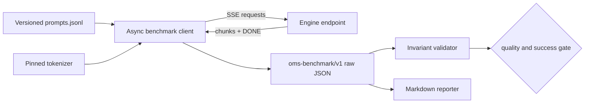

# 12 — Benchmarking without lying to yourself

**Status:** draft
**Estimated time:** 6–8 hours
**Compute profile:** local CPU for the harness self-test; one GPU server from
lesson 11 for real measurements
**Estimated GPU-minutes:** 60–90 for warmup, closed-loop sweeps, and one
open-loop saturation experiment
**Estimated cloud cost:** the already-deployed one-GPU server plus existing
cluster/storage charges; the benchmark client itself runs locally and is free
**Prerequisites:** lesson 11; Python 3.10+, `curl`, a reachable private
OpenAI-style chat endpoint, and enough local disk for ignored JSON evidence
**Last validated:** 2026-10-21, static and offline fake-server paths only; GPU
numbers have not been produced by the authors
**Validated with:** Python syntax/JSON checks, HTTPX 0.28.1 and Transformers
5.20.0 interfaces, `oms-benchmark/v1`, and an offline deterministic HTTP/SSE
server; real engine timing remains learner-generated evidence

## Why this matters

It is easy to produce impressive but meaningless inference numbers. Examples:

- include cold startup in one engine but not another;
- send shorter outputs to the “winner”;
- compare concurrency one against concurrency sixteen;
- measure only completed requests while silently dropping failures;
- call text chunks “tokens”;
- run a closed-loop client and claim it represents fixed-rate production
  arrivals;
- report average latency while hiding a terrible tail; or
- optimize until output becomes empty and call the throughput improvement real.

This lesson creates one auditable harness and result contract used by every
remaining engine lesson. It separates warmup from measurement, hashes the
prompt set, pins the tokenizer/model revision, captures every request including
errors, measures streaming timing at the client, and applies a small quality
gate.

A benchmark is not a number. It is:

```text
question + controlled workload + frozen artifacts + environment
+ raw observations + aggregation rule + uncertainty + interpretation
```

## Learning outcomes

By the end, you can:

- distinguish end-to-end latency, time to first token (TTFT), inter-token
  latency (ITL), time per output token (TPOT), request throughput, and output
  token throughput;
- explain closed-loop versus open-loop load and coordinated omission;
- keep cold start, warmup, steady state, and saturation as separate experiments;
- count tokens with the pinned model tokenizer rather than chunks/words;
- explain why client-observed TTFT includes network/serialization time;
- run concurrency and arrival-rate experiments reproducibly;
- validate success and output quality before comparing speed;
- read a per-request record instead of trusting a summary percentile; and
- produce `results.json` plus a clear `report.md`.

## What you will build



The same client can target Transformers, vLLM, SGLang, or llama.cpp. It records
warmups but excludes them from summaries. A dependency-free fake server lets
you test the load generator/report path without a model or GPU.

## Files in this lesson

```text
12-benchmarking-methodology/
├── README.md
├── schemas/result.schema.json
├── bench/
│   ├── benchmark.py
│   ├── fake_server.py
│   ├── prompts.jsonl
│   ├── report.py
│   ├── requirements.txt
│   └── validate_results.py
└── scripts/
    ├── cpu-self-test.sh
    ├── preflight.sh
    ├── run-closed.sh
    └── run-open.sh
```

`benchmark.py` is intentionally a few hundred readable lines rather than an
opaque industrial load tool. Later production work may use a specialized
benchmark, but it must preserve this experiment's semantics and evidence.

## Concepts and mental model

### Latency metrics answer different questions

- **E2E latency:** client start until complete response. This is the user's
  total wait.
- **TTFT:** client start until the first nonempty streamed content arrives. It
  includes client/network/API queueing, tokenization, scheduling, prefill,
  first decode, detokenization, and transport.
- **ITL:** time between observed nonempty content chunks. This harness records
  it but warns that chunks are not guaranteed one token each.
- **TPOT:** `(E2E - TTFT) / (output_tokens - 1)`. It is a coarse per-output-token
  decode estimate. It is not identical to server-side decode iteration time.
- **Throughput:** completed successful work divided by the measurement window.
  Report both requests/s and output tokens/s.

Use percentile distributions, not only means. p50 describes the middle request;
p95/p99 expose tail behavior but require enough samples. Twelve requests are a
teaching minimum, not production-grade statistical confidence.

### Closed-loop versus open-loop

In a closed loop, each virtual client sends a request, waits, then sends the
next. When the server slows, arrivals slow automatically. This is useful for a
concurrency-capacity sweep but can hide overload.

In an open loop, requests are scheduled at a fixed rate independent of previous
completion. If the server cannot keep up, concurrency and queueing grow. The
harness records **arrival lag**: how late the client actually began compared
with the requested schedule. If the load generator itself falls behind, you
cannot blame all latency on the server.

### Warmup is not deletion of inconvenient data

Warmup triggers lazy imports, model initialization, memory pools, kernel
selection, and caches. The harness completes warmup before starting the
measurement clock and retains warmup records with `warmup: true`. Cold-start
time should be a separate operational metric because users still experience it
after scale-up/restart.

### Quality gates prevent degenerate wins

The prompt file contains transparent checks: minimum output length, at least one
expected concept for selected questions, and forbidden refusal text. This is a
smoke gate, not a full model evaluation. A fast response that fails schema,
returns empty text, errors, or fails the gate cannot be treated as equivalent.

## Under the hood

At startup, the harness:

1. hashes the exact prompt-file bytes;
2. loads the exact model tokenizer revision;
3. calls `/v1/models` to fail before an expensive run if the endpoint is wrong;
4. performs warmups outside the measurement window;
5. creates either closed-loop workers or scheduled open-loop tasks;
6. requests `stream=true` and reads SSE lines incrementally;
7. timestamps the first nonempty `delta.content` and later chunks;
8. reconstructs text and counts output tokens with the pinned tokenizer;
9. applies quality checks and writes every raw request;
10. computes summary distributions only from successful measured requests.

The client semaphore bounds simultaneous HTTP operations. In closed mode, each
worker awaits completion before taking the next prompt. In open mode, arrival
times are `index / request_rate`; the semaphore acts as a load-generator safety
limit. A low limit at a high rate intentionally shifts queueing into the client,
which `arrival_lag_ms` reveals.

The result contains an engine configuration supplied by the operator. Treat it
as evidence, not truth: also save the deployed manifest/image digest and server
logs. `server_fingerprint` should be an immutable image digest or source build
commit.

## Prerequisites and preflight

From this lesson:

```bash
cd lessons/phase-02-engines/12-benchmarking-methodology
python3 -m venv .venv
source .venv/bin/activate
python -m pip install --upgrade pip
python -m pip install -r bench/requirements.txt
chmod +x scripts/*.sh bench/*.py
```

For the offline path, run:

```bash
./scripts/cpu-self-test.sh
```

It starts `fake_server.py` on loopback port 18000, runs four measured requests
with a clearly labelled whitespace test tokenizer, validates JSON, builds a
report, and stops the server. Results from `whitespace-self-test` are forbidden
in the capstone.

For a real engine:

```bash
export BENCH_BASE_URL=http://127.0.0.1:8000
curl --fail --silent "$BENCH_BASE_URL/v1/models" | python3 -m json.tool
./scripts/preflight.sh
```

Use `kubectl port-forward` from an engine lesson. Do not expose a public load
balancer merely to run the client.

## Cost and safety

The load generator can increase GPU work and latency dramatically. Guardrails:

- start at concurrency one;
- cap generated output at 64 tokens for the standard study;
- use 2 warmups and 12–40 measured requests while learning;
- stop if error rate rises, client arrival lag grows without bound, GPU
  temperature/health alarms appear, or the endpoint is shared;
- never benchmark a production endpoint without explicit authorization;
- keep prompts synthetic and free of secrets/personal data;
- keep raw evidence ignored until sanitized; and
- stop the model server and GPU node after the experiment.

Estimate:

```text
requests × maximum output tokens / observed output tokens per second
= lower-bound active generation seconds
```

Add prompt prefill, warmup, queueing, startup, troubleshooting, and repeats to
the time budget. Set a wall-clock timer.

## Predict before running

Write predictions:

1. Which metric rises first as concurrency increases: TTFT or TPOT?
2. Can request throughput rise while p95 latency worsens?
3. Why can closed-loop load hide a queueing problem?
4. What does high `arrival_lag_ms` say about the client?
5. Why might a warm first request still differ from request ten?
6. What happens to output-token throughput if outputs become shorter?
7. Why is a client text chunk not necessarily a token?
8. Which output-quality failures make a speed comparison invalid?

## Lab outline

1. Test the harness against the deterministic CPU fake server.
2. freeze prompts, tokenizer, sampling, engine configuration, and environment.
3. run warmup then a concurrency-one baseline.
4. sweep closed-loop concurrency 1, 2, 4, and 8.
5. run one safe open-loop rate below saturation.
6. deliberately overload the client/server and identify where queueing occurs.
7. validate results, inspect raw requests, and write the report.

## Step-by-step lab

### 1. Inspect and self-test

```bash
python3 -m py_compile bench/*.py
python3 -m json.tool schemas/result.schema.json >/dev/null
sed -n '1,6p' bench/prompts.jsonl
./scripts/cpu-self-test.sh
```

Expected:

```text
valid fake run: 4 requests, quality=...
CPU benchmark self-test passed
```

The fake timing is a plumbing test and must never appear in an engine decision.

### 2. Freeze the real environment

Start lesson 11's port-forward, then record:

```bash
export ENGINE_NAME=transformers
export ENGINE_VERSION=5.20.0-reference-server
export BENCH_BASE_URL=http://127.0.0.1:8000
curl --silent "$BENCH_BASE_URL/v1/models" >artifacts/server-models.json
curl --silent "$BENCH_BASE_URL/debug/runtime" >artifacts/server-runtime.json
sha256sum bench/prompts.jsonl >artifacts/prompt-set.sha256
./scripts/preflight.sh
```

### 3. Closed-loop baseline and sweep

```bash
for concurrency in 1 2 4 8; do
  CONCURRENCY="$concurrency" ./scripts/run-closed.sh
done
```

Each run completes warmup before measurement and writes a distinct JSON file.
Validate one:

```bash
python3 bench/validate_results.py artifacts/transformers-closed-c1.json \
  --require-quality-rate 0.8
python3 -m json.tool artifacts/transformers-closed-c1.json | sed -n '1,220p'
```

If quality is below 0.8, investigate outputs; do not lower the threshold merely
to obtain a green run.

### 4. Open-loop experiment

Choose a rate lower than measured concurrency-one capacity:

```bash
export REQUEST_RATE=0.5
export MAX_INFLIGHT=16
./scripts/run-open.sh
```

Then inspect queueing and load-generator lag:

```bash
python3 - <<'PY'
import json
d=json.load(open("artifacts/transformers-open-rps0.5.json"))
print(d["summary"]["arrival_lag_ms"])
print(d["summary"]["latency_ms"])
PY
```

### 5. Build a report

```bash
python3 bench/report.py \
  artifacts/transformers-closed-c1.json \
  artifacts/transformers-closed-c2.json \
  artifacts/transformers-closed-c4.json \
  artifacts/transformers-closed-c8.json \
  --output artifacts/report.md
sed -n '1,120p' artifacts/report.md
```

Add interpretation: saturation evidence, quality failures, uncertainty, cold
start, environment, and likely mechanism.

## Inspect what happened

Inspect a raw request:

```bash
python3 - <<'PY'
import json
d=json.load(open("artifacts/transformers-closed-c4.json"))
for r in d["requests"][:4]:
    print(r["warmup"], r["prompt_id"], r["status_code"],
          r["e2e_ms"], r["ttft_ms"], r["output_tokens"],
          r["quality_pass"], r["error"])
PY
```

Correlate client results with server metrics/logs and `nvidia-smi`. Client E2E
cannot tell you alone whether time was spent in network, API queue, prefill, or
decode.

## Deliberate failure

Create client-side overload:

```bash
export REQUEST_RATE=100
export MAX_INFLIGHT=2
./scripts/run-open.sh || true
```

Predict whether high latency is entirely server-side. Inspect:

```bash
python3 - <<'PY'
import json, glob
p=glob.glob("artifacts/transformers-open-rps100.json")[0]
d=json.load(open(p))
print(d["summary"]["arrival_lag_ms"])
print(d["summary"]["success_rate"])
PY
```

High arrival lag proves the generator could not start requests at the intended
schedule because the two-slot semaphore was saturated. Repair by selecting a
safe offered rate and sufficient client capacity—not by deleting inconvenient
requests.

## Controlled experiment

The controlled variable is concurrency. Keep endpoint, image/model revisions,
prompt hash, measured request count, max tokens, temperature, seed, and
hardware unchanged. Compare concurrency 1/2/4/8. Repeat any surprising point
three times. A valid conclusion sounds like:

> Under this frozen workload on this hardware, throughput stopped increasing
> after C while p95 TTFT increased; server queueing is the likely mechanism.

It does not claim a universal engine ranking.

## Verification

For every reported run:

```bash
for result in artifacts/*-closed-c*.json; do
  python3 bench/validate_results.py "$result" --require-quality-rate 0.8
done
grep -q '^# Benchmark report' artifacts/report.md
```

Also verify `tokenizer_mode` is `hf`, model revision has 40 hexadecimal
characters, all measured requests are present, success rate is 100%, and raw
files remain available.

## Expected result

Summary shape:

```json
{
  "successful_requests": 12,
  "success_rate": 1.0,
  "quality_pass_rate": 0.833333,
  "request_throughput_per_second": 0.91,
  "output_token_throughput_per_second": 49.2,
  "latency_ms": {"p50": 1130.4, "p95": 2190.8},
  "ttft_ms": {"p50": 84.2, "p95": 744.0},
  "tpot_ms": {"p50": 20.1}
}
```

These numbers are illustrative, not expected performance. Your generated
values depend on GPU, server, outputs, network, and load.

## Troubleshooting

| Symptom | Likely layer | Check |
|---|---|---|
| connection refused | port-forward/service | process, local port, endpoint |
| `/v1/models` fails | API compatibility | base URL/path/model server logs |
| tokenizer download fails | artifact/network | exact revision and cache |
| no TTFT | stream contract | SSE lines, nonempty `delta.content`, errors |
| output tokens zero | generation/parse | raw SSE, finish reason, text hash |
| low quality | model/template/config | prompt, served model, temperature |
| high arrival lag | load client | rate, semaphore, CPU/network |
| p95 unstable | insufficient samples/noise | repeats, competing workloads |
| throughput impossible | measurement math | window, successes, token counter |

## Evidence to collect

```text
artifacts/
├── fake.json
├── prompt-set.sha256
├── server-models.json
├── server-runtime.json
├── ENGINE-closed-cN.json
├── ENGINE-open-rpsN.json
├── results.json
└── report.md
```

`results.json` can be one canonical run copied without modification. The
Markdown report must link all raw records, state exclusions, and note whether
the endpoint/hardware was shared. Sanitize infrastructure identifiers.

## Knowledge check

1. How does coordinated omission make latency look better?
2. Why must warmup complete before the measurement clock?
3. Can TTFT increase while TPOT stays flat? Explain a mechanism.
4. Why report request throughput and output-token throughput together?
5. What does the prompt hash protect?
6. Why is a minimum quality gate not a full evaluation?
7. When does client arrival lag invalidate an open-loop claim?

## Exercises

Guided: add a prompt with transparent `required_any` criteria, rerun the fake
test and a model run, then inspect per-request quality reasons.

Independent: add bootstrap confidence intervals for p50 E2E without deleting
raw data. State why correlated requests and small samples limit interpretation.

<details>
<summary>Solution guidance</summary>

Resample measured request latencies with replacement many times using a fixed
analysis seed; compute the target percentile for each resample; report interval
bounds and method. Keep this separate from the serving seed.

</details>

## Completion gate

Complete when the offline self-test passes; a real endpoint has closed/open
records; warmups are excluded correctly; prompt/model/config/environment are
frozen; success and quality gates pass; a deliberate overload is diagnosed
from arrival lag; all raw requests are retained; and the server/GPU cleanup is
proved.

## Cleanup

Stop local processes:

```bash
pkill -f 'bench/fake_server.py' 2>/dev/null || true
deactivate 2>/dev/null || true
```

Then use the active engine lesson's cleanup and verify:

```bash
kubectl get namespace open-models-l11
```

After engine cleanup, that command must return NotFound and the dedicated GPU
node group must be restored to its recorded baseline. Keep sanitized benchmark
JSON; remove only evidence you intentionally no longer need.

## Primary references

Official/original sources reviewed 2026-10-21:

- [vLLM benchmark concepts and tools](https://docs.vllm.ai/en/latest/contributing/benchmarks/)
- [SGLang benchmark and profiling documentation](https://docs.sglang.ai/developer_guide/benchmark_and_profiling.html)
- [NVIDIA GenAI-Perf metrics definitions](https://docs.nvidia.com/nim/benchmarking/llm/latest/metrics.html)
- [Hugging Face tokenizer documentation](https://huggingface.co/docs/transformers/main_classes/tokenizer)
- [HTTPX asynchronous clients](https://www.python-httpx.org/async/)
- [Little's Law (original paper record)](https://pubsonline.informs.org/doi/10.1287/opre.9.3.383)
- [Coordinated omission explanation in HdrHistogram](https://github.com/HdrHistogram/HdrHistogram#coordinated-omission)
