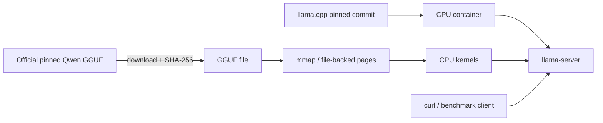

# 15 — llama.cpp and GGUF

**Status:** draft
**Estimated time:** 7–10 hours for CPU path; add 2–3 hours for optional EKS GPU
build/deployment
**Compute profile:** local CPU by default; optional one NVIDIA GPU node
**Estimated GPU-minutes:** zero for required path; 45–75 for optional CUDA/EKS
path
**Estimated cloud cost:** required local path has no cloud compute cost; optional
path uses one GPU node, a 5 GiB PVC, ECR storage, and existing EKS/network cost
**Prerequisites:** lesson 12; Docker with Buildx, Python 3, `curl`, at least 4
GiB free disk, and optional EKS GPU prerequisites from lessons 07–10
**Last validated:** 2026-10-21, artifact metadata/source/static paths only;
container compilation, local serving, and EKS GPU execution pending clean runs
**Validated with:** llama.cpp release `v0.5.0` peeled source commit
`7fe450e19305b828c199d602c23a8337aaa1f03b`; official Qwen GGUF repository
revision `9217f5db79a29953eb74d5343926648285ec7e67`; three recorded file sizes and
SHA-256 values; Python/Bash/JSON/template syntax checks

## Why this matters

PyTorch-oriented servers load tensors into a framework runtime and are usually
optimized for datacenter GPUs. llama.cpp starts from a different goal: portable
inference across CPUs and many accelerators, with a compact GGUF artifact and
explicit control over tensor placement, threads, context, and quantization.

This path teaches mechanisms hidden by “download model and run”:

- how model metadata, tokenizer data, and tensors are packaged in GGUF;
- how a file can be memory-mapped instead of eagerly copied as one giant Python
  object;
- how quantized weights trade representation precision for size/bandwidth;
- how quantized blocks are dequantized or consumed by specialized kernels;
- how layers/tensors can be assigned to CPU or GPU backends;
- why a portable local runtime may be the right choice even when it is not the
  highest-throughput server for a datacenter workload.

You will build llama.cpp from an exact source commit, verify official Qwen GGUF
bytes by SHA-256, serve the same source model family through an OpenAI-compatible
endpoint, compare Q4_K_M with Q8_0, and optionally run the CUDA build on EKS.

## Learning outcomes

By the end, you can:

- distinguish source model revision, conversion repository revision,
  quantization type, and file checksum;
- inspect why GGUF is more than “a compressed weights file”;
- explain memory mapping and page-fault-backed file access at a high level;
- estimate weight-file memory differences from exact artifact sizes;
- explain block quantization without claiming every weight becomes a standalone
  four-bit integer;
- build CPU and CUDA llama.cpp binaries from a pinned commit;
- run `llama-server` and verify an OpenAI-style chat response;
- use `llama-bench` for prompt-processing and generation measurements;
- compare Q4_K_M and Q8_0 with a controlled configuration;
- deliberately corrupt a copy and prove checksum verification stops it;
- optionally deploy a digest-pinned CUDA image/PVC to one EKS GPU; and
- clean up processes, namespaces, storage, images, and capacity deliberately.

## What you will build

Required local path:



Optional GPU path adds a CUDA backend, offloads layers with
`--n-gpu-layers 999`, and runs a private `ClusterIP` Service on EKS.

## Files in this lesson

```text
15-llama-cpp-gguf/
├── README.md
├── config/
│   ├── artifacts.json
│   └── build.json
├── docker/
│   ├── Dockerfile.cpu
│   └── Dockerfile.cuda
├── k8s/workload.yaml.tpl
├── requests/smoke.json
└── scripts/
    ├── bench.sh
    ├── build-cpu.sh
    ├── build-cuda.sh
    ├── cleanup.sh
    ├── deploy-k8s.sh
    ├── download.py
    ├── failure-drill.sh
    ├── render-k8s.py
    ├── run-local.sh
    └── smoke-test.sh
```

Model binaries are ignored under `artifacts/models/`; they are never committed.
`artifacts.json` is a small provenance manifest derived from the official
repository API on the validation date.

## Concepts and mental model

### Four identities, not one “model version”

For this lesson:

1. source Transformers model:
   `Qwen/Qwen2.5-0.5B-Instruct@7ae557...`;
2. official converted GGUF repository:
   `Qwen/Qwen2.5-0.5B-Instruct-GGUF@9217f5...`;
3. selected artifact:
   for example `qwen2.5-0.5b-instruct-q4_k_m.gguf`;
4. actual downloaded bytes:
   SHA-256 `74a4da...`.

A repository commit pins names/metadata. The file SHA-256 proves the bytes you
run. Record both.

### GGUF

GGUF is a binary format used by GGML/llama.cpp ecosystems. It stores a header,
typed key/value metadata, tensor descriptions, and aligned tensor data. Useful
metadata can include architecture, tokenizer vocabulary/special tokens, context
information, and chat template. Exact keys depend on the model/converter.

The file is not executable and does not contain the server. llama.cpp interprets
metadata and selects backend kernels for its tensors.

### Quantization

FP16 uses 16 bits per scalar before overhead. Quantization represents groups of
weights using fewer bits plus scale/other block metadata. A Q4 family is not
simply:

```text
every weight = one exact independent 4-bit number
```

Weights are grouped into blocks and reconstructed/consumed approximately by
kernels. Different families use different block layouts and metadata. Smaller
files often reduce memory capacity and bandwidth pressure, but quality and
kernel performance are empirical. “More bits always faster” and “fewer bits
always faster” are both unsafe assumptions.

The official file sizes in this lesson make the capacity effect concrete:

```text
FP16 GGUF: 1,266,425,696 bytes
Q8_0:       675,710,816 bytes
Q4_K_M:     491,400,032 bytes
```

Runtime memory also includes context/KV cache, compute buffers, backend state,
threads, and file-page residency.

### Memory mapping

With memory mapping, the process maps file ranges into virtual address space.
The operating system loads pages on demand and can share/reclaim clean pages.
This can reduce explicit copying and improve startup behavior. It does not mean
the model consumes zero physical memory; accessed pages must reside somewhere,
and I/O/page faults can affect cold performance.

### CPU/GPU placement

llama.cpp creates backend buffers for tensors according to build support and
offload settings. `--n-gpu-layers 0` keeps model layers on CPU. A large value
such as `999` requests as much supported layer offload as possible. Actual
placement and memory are shown in startup logs. “Layer offload” is not tensor
parallelism across Kubernetes nodes.

## Under the hood

The Docker build checks out exact llama.cpp commit
`7fe450e19305b828c199d602c23a8337aaa1f03b` and configures CMake with
`GGML_NATIVE=OFF` for portability. The CPU build disables CUDA; the GPU build
enables it. Both include `llama-server`, `llama-bench`, and `llama-cli`.

On server startup:

1. GGUF header/metadata/tensor descriptors are parsed;
2. tokenizer and chat template metadata are made available;
3. tensor storage is mapped/loaded and assigned to enabled backend(s);
4. context/KV/compute buffers are allocated for configured context/parallelism;
5. HTTP routes start accepting work after model initialization;
6. each request is templated/tokenized, prompt-processed, then decoded;
7. token IDs are detokenized into response text.

With `--parallel 4`, the server can maintain several slots/contexts subject to
memory. This is not identical to vLLM/SGLang scheduling. Compare behavior, not
flag names.

On the optional Kubernetes path, an init container downloads the exact Q4_K_M
URL into a PVC and verifies SHA-256. The main container mounts it read-only and
requests one GPU. The same built image is used for init tools, avoiding an
unpinned second utility image. The deployed image must be an ECR digest.

## Prerequisites and preflight

From:

```bash
cd lessons/phase-02-engines/15-llama-cpp-gguf
chmod +x scripts/*.sh scripts/*.py
python3 -m json.tool config/artifacts.json >/dev/null
python3 -m json.tool config/build.json >/dev/null
python3 -m py_compile scripts/*.py
docker version
df -h .
```

Plan at least 4 GiB free for source layers, images, and three model files.
Review model card/license and source release:

```bash
python3 -m json.tool config/artifacts.json
python3 -m json.tool config/build.json
```

Optional EKS variables:

```bash
export LAB_NAMESPACE=open-models-l15
export MODEL_STORAGE_CLASS=model-cache-gp3
export GPU_NODE_SELECTOR_KEY=eks.amazonaws.com/nodegroup
export GPU_NODE_SELECTOR_VALUE=replace-with-dedicated-nodegroup
```

## Cost and safety

The CPU path binds only `127.0.0.1:8000`; it is not remotely exposed. Model
files are public, but inspect their license. The downloader accepts only files
declared in `artifacts.json`, writes a temporary partial file, verifies size and
hash, then atomically renames.

For GPU:

- one replica/one GPU;
- private Service;
- 5 GiB PVC;
- digest-pinned custom image;
- exact model URL/hash in init;
- dedicated node group restored after run.

Compiling may consume substantial CPU/RAM. Do not run it on a production node.
Do not delete Docker images/model caches broadly; cleanup names exact resources
and retains files by default.

## Predict before running

1. Which file should need less storage, Q4_K_M or Q8_0?
2. Does a 491 MB file imply exactly 491 MB process memory?
3. Why verify SHA-256 after pinning the repository revision?
4. What changes between cold and warm mmap runs?
5. Can Q4_K_M be slower than Q8_0 on some hardware?
6. What remains on CPU when layers are offloaded?
7. Why might quantization change answer quality?
8. Which evidence proves CUDA tensors were offloaded?

## Lab outline

1. Inspect pinned source/artifact provenance.
2. download and hash-verify Q4_K_M.
3. build llama.cpp CPU image from exact source/base digest.
4. start loopback `llama-server` and behaviorally test chat.
5. download Q8_0 and compare with `llama-bench`.
6. corrupt a copy and prove verification rejects it.
7. optionally build/push CUDA image and deploy its digest on EKS.
8. clean processes/resources while retaining only intentional caches.

## Step-by-step lab

### 1. Download exact Q4_K_M

```bash
python3 scripts/download.py \
  --name qwen2.5-0.5b-instruct-q4_k_m.gguf
ls -lh artifacts/models/
```

Expected:

```text
downloaded and verified .../qwen2.5-0.5b-instruct-q4_k_m.gguf
```

Rerun to exercise verified cache hit:

```bash
python3 scripts/download.py \
  --name qwen2.5-0.5b-instruct-q4_k_m.gguf
```

### 2. Build CPU image

```bash
export CPU_IMAGE_TAG=open-models/llama-cpp:v0.5.0-cpu
./scripts/build-cpu.sh
docker run --rm --entrypoint llama-server "$CPU_IMAGE_TAG" --version
```

The script resolves `ubuntu:24.04` to a digest before build and records it in
output. The source commit is immutable; apt repositories/transitive packages
are not hash-locked, so the built image ID/digest is the authoritative artifact
for this experiment.

### 3. Serve locally

Terminal one:

```bash
./scripts/run-local.sh
```

Look for GGUF metadata, architecture, context, CPU feature/backend, memory
buffers, and listening address. Terminal two:

```bash
./scripts/smoke-test.sh
python3 -m json.tool artifacts/smoke-response.json
```

The response wording varies; schema and nonempty content must pass.

### 4. Inspect model/server

```bash
curl --silent http://127.0.0.1:8000/health | python3 -m json.tool
curl --silent http://127.0.0.1:8000/v1/models | python3 -m json.tool
docker stats --no-stream open-models-l15
```

Compare file size with container resident memory. Explain additional buffers and
page residency; do not equate them directly.

### 5. Quantization comparison

Stop server with Ctrl-C. Download Q8:

```bash
python3 scripts/download.py \
  --name qwen2.5-0.5b-instruct-q8_0.gguf
./scripts/bench.sh
```

`llama-bench` runs three prompt-processing/generation repetitions per artifact
with the same CPU threads, prompt tokens, generated tokens, and GPU offload
zero. Preserve raw JSON. Run in both orders on a quiet machine because thermal
state and filesystem cache can bias results.

### 6. Shared API benchmark

Restart one model, activate lesson 12 venv, then:

```bash
python3 ../12-benchmarking-methodology/bench/benchmark.py \
  --base-url http://127.0.0.1:8000 \
  --prompts ../12-benchmarking-methodology/bench/prompts.jsonl \
  --engine-name llama-cpp \
  --engine-version 0.5.0 \
  --engine-config-json '{"quantization":"Q4_K_M","n_gpu_layers":0,"threads":4}' \
  --artifact gguf-q4_k_m \
  --mode closed \
  --concurrency 1 \
  --warmup-requests 2 \
  --measured-requests 12 \
  --output artifacts/results.json
```

Validate output quality before comparing performance.

### 7. Optional CUDA/EKS

Build:

```bash
export CUDA_IMAGE_TAG=open-models/llama-cpp:v0.5.0-cuda12.4
./scripts/build-cuda.sh
```

Push it to an approved private ECR repository, resolve the resulting
`@sha256:` URI exactly as lesson 11, then:

```bash
export IMAGE_URI='YOUR_ECR_IMAGE@sha256:YOUR_DIGEST'
python3 scripts/render-k8s.py
grep -E 'image:|n-gpu-layers|nvidia.com/gpu|type:' artifacts/rendered-k8s.yaml
./scripts/deploy-k8s.sh
kubectl port-forward --address 127.0.0.1 \
  -n "$LAB_NAMESPACE" service/llama-cpp 8000:8000
```

Run `smoke-test.sh` and the shared benchmark. Capture startup logs showing
actual backend/offload; a successful GPU allocation alone does not prove model
tensors use CUDA.

## Inspect what happened

Local:

```bash
docker inspect open-models-l15 >artifacts/container-inspect.json
docker stats --no-stream open-models-l15 >artifacts/container-stats.txt
```

EKS:

```bash
kubectl logs -n "$LAB_NAMESPACE" deployment/llama-cpp \
  >artifacts/llama-cpp-gpu.log
kubectl exec -n "$LAB_NAMESPACE" deployment/llama-cpp -- nvidia-smi \
  >artifacts/nvidia-smi.txt
kubectl get all,pvc -n "$LAB_NAMESPACE" -o wide \
  >artifacts/kubernetes.txt
```

Search logs for backend, offloaded layers, buffer sizes, context, and mmap.
Interpret exact messages against v0.5.0 source/docs.

## Deliberate failure

Run:

```bash
./scripts/failure-drill.sh
```

It copies Q4_K_M, changes one byte, computes SHA-256 with Python, requires a
mismatch, then removes only the corrupted copy.

Diagnosis:

```text
artifact rejected
├─ expected hash differs -> bytes are not approved; do not run
├─ size differs          -> partial/wrong file
├─ repo revision differs -> provenance changed
└─ hash passes, load fails -> format/runtime/backend compatibility
```

Repair by redownloading the exact pinned URL and verifying; never update the
expected hash merely to accept unknown bytes.

## Controlled experiment

Controlled variable: GGUF quantization/artifact Q4_K_M versus Q8_0. Hold:

- source/conversion revisions;
- llama.cpp image/source commit;
- CPU threads and backend;
- prompt and generated token counts;
- context/settings;
- machine power/thermal conditions as well as practical;
- repetitions and ordering.

Compare exact size, prompt tokens/s, generation tokens/s, memory, and output
quality. Quantization changes both representation and possibly kernels, so
attribute carefully.

## Verification

```bash
python3 scripts/download.py \
  --name qwen2.5-0.5b-instruct-q4_k_m.gguf
./scripts/smoke-test.sh
./scripts/failure-drill.sh
python3 ../12-benchmarking-methodology/bench/validate_results.py \
  artifacts/results.json --require-quality-rate 0.8
```

Optional EKS acceptance additionally requires Ready endpoint, CUDA/offload logs,
one GPU allocation, digest image, and namespace/PV cleanup.

## Expected result

You should have:

- checksum-verified GGUF files with declared sizes;
- `llama-server` model listing and nonempty chat response;
- raw Q4/Q8 `llama-bench` JSON;
- shared `oms-benchmark/v1` result;
- corruption rejection evidence;
- optional GPU/offload evidence.

No universal tokens/second target is supplied. CPU architecture, memory
bandwidth, build flags, backend, thermal state, and quantization matter.

## Troubleshooting

| Symptom | Layer | Evidence/action |
|---|---|---|
| download mismatch | artifact | URL revision, size, SHA; delete partial only |
| Docker build fails | build | base digest/platform, commit fetch, CMake log |
| illegal instruction | portability | architecture/platform, `GGML_NATIVE` |
| server rejects model | format/runtime | exact GGUF metadata and source version |
| gibberish/poor output | template/quality | `--jinja`, model metadata, request |
| high cold latency | storage/mmap | page cache, disk, repeat warm run |
| no CUDA offload | build/runtime | `GGML_CUDA`, logs, driver, `nvidia-smi` |
| GPU OOM | context/offload | logs, context, parallel slots, layer count |
| API field rejected | compatibility | llama.cpp server docs/version |

## Evidence to collect

```text
artifacts/
├── models/*.gguf
├── cpu-image-repodigests.json
├── cuda-base-digests.txt
├── smoke-response.json
├── llama-bench-*.json
├── results.json
├── container-stats.txt
├── llama-cpp-gpu.log
├── nvidia-smi.txt
└── report.md
```

Do not upload GGUF binaries to the curriculum repository. Report file hashes,
source/build revisions, command flags, size, benchmark results, quality, and
limitations.

## Knowledge check

1. Why are repository revision and file SHA both needed?
2. What metadata besides tensors may GGUF contain?
3. Why is Q4_K_M not “every weight is exactly four bits”?
4. How can mmap improve startup yet create cold-run variability?
5. Why can smaller weights improve capacity without improving quality?
6. What proves model tensors actually reached the GPU?
7. Why isn't layer offload equivalent to multi-node parallelism?

## Exercises

Guided: download FP16 metadata/file only if disk budget permits; compare exact
sizes with Q4/Q8 and calculate ratios.

Independent: run Q4/Q8 in alternating order five times, capture resident memory
and quality responses, then explain whether differences exceed run noise.

<details>
<summary>Solution guidance</summary>

Do not average away order. Keep each raw repetition, report median/range, clear
whether filesystem cache was warm, and use the same prompt/output settings.
Quality needs a fixed rubric, not subjective cherry-picking.

</details>

## Completion gate

Complete when provenance/hashes are understood; CPU image/source are pinned;
chat behavior and shared benchmark validate; Q4/Q8 comparison is controlled;
corruption is rejected; mmap/quantization/offload are explained; optional GPU
claims have log/telemetry evidence; and all running/chargeable resources are
removed or explicitly retained.

## Cleanup

```bash
./scripts/cleanup.sh
```

This stops the named local container and optional lesson namespace but retains
models/images to avoid destructive surprises. Inspect before removing:

```bash
du -sh artifacts/models
docker images 'open-models/llama-cpp'
```

If intentionally deleting, remove exact files/tags—not broad caches. For EKS,
prove namespace/PV deletion and restore dedicated GPU capacity to recorded
baseline.

## Primary references

Official sources reviewed 2026-10-21:

- [llama.cpp repository and build/server usage](https://github.com/ggml-org/llama.cpp)
- [llama.cpp v0.5.0 release](https://github.com/ggml-org/llama.cpp/releases/tag/v0.5.0)
- [llama.cpp HTTP server documentation](https://github.com/ggml-org/llama.cpp/tree/master/tools/server)
- [GGUF specification](https://github.com/ggml-org/ggml/blob/master/docs/gguf.md)
- [llama.cpp quantization documentation](https://github.com/ggml-org/llama.cpp/tree/master/tools/quantize)
- [Official pinned Qwen GGUF repository](https://huggingface.co/Qwen/Qwen2.5-0.5B-Instruct-GGUF/tree/9217f5db79a29953eb74d5343926648285ec7e67)
- [Pinned source Qwen model](https://huggingface.co/Qwen/Qwen2.5-0.5B-Instruct/tree/7ae557604adf67be50417f59c2c2f167def9a775)
