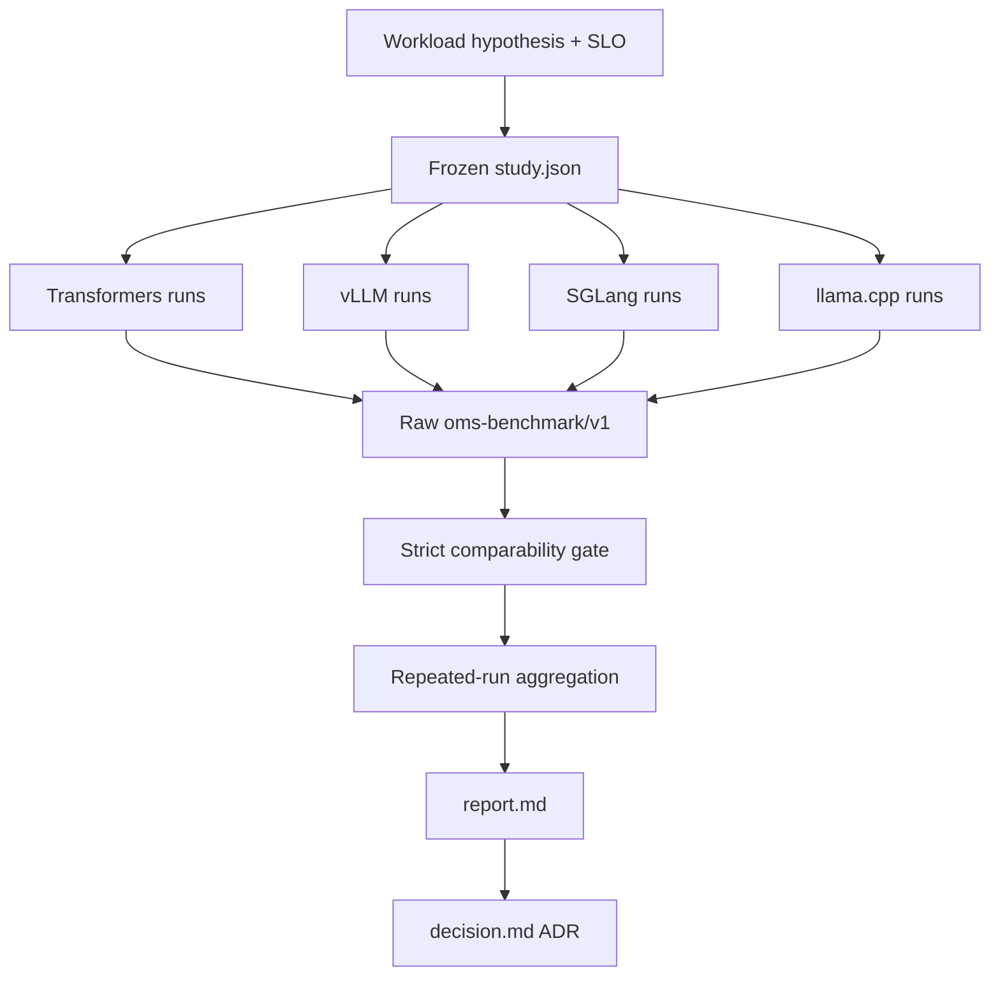

# 16 — Capstone: controlled engine shootout

**Status:** draft
**Estimated time:** 1–2 days, split across short GPU sessions
**Compute profile:** one fixed NVIDIA GPU node used by one engine at a time;
local CPU for analysis/report generation
**Estimated GPU-minutes:** plan 180–300 after a pilot; stop early if the pilot
shows the full matrix exceeds budget
**Estimated cloud cost:** GPU-node hours for four engines and repeated
treatments, model/PVC/ECR storage, and standing EKS/network costs; write a
current-price budget before starting
**Prerequisites:** lessons 11–15 completed with valid evidence; lesson 12 Python
environment; ability to deploy/clean each engine privately on the same hardware
**Last validated:** 2026-10-21, static and synthetic CPU contract tests only;
the course authors did not run or publish a GPU winner
**Validated with:** `oms-benchmark/v1`, immutable Qwen source revision
`7ae557604adf67be50417f59c2c2f167def9a775`, Transformers 5.20.0 reference,
vLLM 0.28.0, SGLang 0.5.21, llama.cpp v0.5.0, Python/Bash/JSON checks, and a
48-file synthetic comparison matrix

## Why this matters

Engine selection is an architecture decision, not a popularity contest.
Different workloads value different things:

- interactive chat may prioritize p95 TTFT;
- batch extraction may prioritize output tokens/s and cost;
- repeated long policies may benefit from prefix reuse;
- JSON extraction needs reliable constrained generation;
- edge/offline use may value CPU portability and compact artifacts;
- a platform team may value observability, upgrade behavior, and model
  compatibility more than a small synthetic speed difference.

A leaderboard usually differs from your model, prompts, output lengths,
concurrency, hardware, software versions, quality requirements, and operations.
This capstone freezes a question and runs four engines under a declared
contract. It preserves every request, repeats each point, rejects accidental
workload drift, aggregates without hiding raw values, and ends with an
architecture decision record (ADR).

There is deliberately no prewritten winner. Any claimed winner without your
evidence would defeat the lesson.

## Learning outcomes

By the end, you can:

- write a workload/SLO hypothesis before measuring;
- freeze source model, tokenizer, prompts, sampling, hardware, resources, and
  benchmark semantics;
- distinguish a controlled engine comparison from a quantization comparison;
- run Transformers, vLLM, SGLang, and llama.cpp one at a time on fixed hardware;
- capture three repetitions at concurrency 1, 4, 16 and open-loop 4 requests/s;
- reject results with changed prompt hash, temperature, seed, model, tokenizer
  mode, quality, success, or hardware;
- aggregate repeated results while retaining per-request evidence;
- evaluate latency, throughput, memory, correctness, compatibility,
  portability, and operability;
- explain observed differences using scheduler/cache/artifact mechanisms
  without overclaiming;
- write an ADR with consequences and revisit triggers; and
- remove every deployment/PVC and return GPU capacity to baseline.

## What you will build



The final evidence bundle contains 48 standard runs by default:

```text
4 engines × 4 workloads × 3 repeats = 48 raw records
```

Run a smaller pilot first. The full matrix is a study plan, not permission to
spend blindly.

## Files in this lesson

```text
16-capstone-engine-shootout/
├── README.md
├── adr-template.md
├── environment-template.json
├── config/
│   ├── decision-weights.json
│   └── study.json
└── scripts/
    ├── build-report.sh
    ├── capture-engine.sh
    ├── cleanup.sh
    ├── compare.py
    ├── cpu-self-test.py
    ├── failure-drill.py
    └── verify_study.py
```

Engine deployment/runtime files remain in lessons 11, 13, 14, and 15. This
folder owns the cross-engine experiment contract and decision.

## Concepts and mental model

### Start with a decision question

Bad question:

> Which engine is fastest?

Useful question:

> For one A10G serving our pinned 0.5B chat model, 250–500-token prompts,
> 64-token outputs, concurrency 1–16, and a p95 TTFT objective of X, which
> engine meets the quality/API/operations requirements with the most useful
> capacity and acceptable complexity?

Fill in values before measurement. If the question changes, create a new study
ID rather than silently reinterpreting old data.

### Fair does not mean pretending artifacts are identical

Transformers/vLLM/SGLang use the source Safetensors weights in FP16 for this
phase. llama.cpp's primary portable treatment uses converted quantized GGUF.
That means differences include both runtime and artifact representation.

Use two conclusions:

1. FP16-oriented server comparison among compatible treatments.
2. end-to-end deployment-option comparison including Q4_K_M portability.

If disk/GPU budget permits, add the official FP16 GGUF as a secondary
llama.cpp treatment. Even then, conversion/layout/backend differences remain.
State them.

### Throughput, latency, and queueing form a surface

One concurrency point is not a capacity curve. At low load, all engines may
look similar. As offered load rises:

```text
useful concurrency -> GPU utilization/throughput increases
near saturation    -> queues/tail latency grow
beyond saturation  -> little throughput gain, large latency/error growth
```

Your selection should identify an operating region below instability, not the
maximum number obtained while tail latency collapses.

### Precommit decision weights

`decision-weights.json` assigns weights before seeing winners:

- latency fit 20%;
- throughput fit 20%;
- quality/correctness 20%;
- memory/capacity 10%;
- operability 15%;
- compatibility 10%;
- portability 5%.

Change these only before results and explain why. A score from 1–5 needs an
evidence sentence. Weighted totals organize judgment; they do not replace it.

## Under the hood

`capture-engine.sh` invokes the same lesson 12 benchmark for each treatment.
It requires:

- exact engine name/version/config;
- server fingerprint (normally image digest);
- GPU name;
- fixed model/tokenizer revision;
- fixed prompts, max tokens, temperature, seed, and streaming.

For closed loop, it runs three repeats at concurrency 1, 4, and 16. For open
loop, it schedules four requests/s with a client safety bound of 64.

`verify_study.py` recalculates the committed prompt hash and rejects:

- wrong schema/model/revision;
- changed prompt set/sampling/output limit;
- the whitespace self-test tokenizer;
- failed requests or quality below 80%;
- any workload outside the declared matrix, changed warm-up/measured counts,
  or anything other than exactly three repeats per engine/workload;
- missing or unexpected engines/workloads, duplicate run IDs, or an engine
  whose version, configuration, or server fingerprint changes mid-study; or
- different/placeholder GPU names.

`compare.py` groups by engine/workload and reports medians of throughput and
latency summaries; quality uses the minimum across repeats. Median reduces one
outlier's influence but does not prove statistical significance. Raw request
records remain authoritative.

Mechanism interpretation:

```text
Transformers: one generation lock, framework allocator, per-call generate
vLLM:         continuous scheduler, managed paged KV capacity
SGLang:       scheduler plus radix-prefix representation/reuse
llama.cpp:    GGUF, explicit backends/offload, portable server slots
```

These descriptions guide hypotheses. Only versioned metrics/logs/profiles and
controlled results support a claim about a specific run.

## Prerequisites and preflight

From:

```bash
cd lessons/phase-02-engines/16-capstone-engine-shootout
chmod +x scripts/*.sh scripts/*.py
python3 -m json.tool config/study.json >/dev/null
python3 -m json.tool config/decision-weights.json >/dev/null
python3 -m json.tool environment-template.json >/dev/null
python3 -m py_compile scripts/*.py
python3 scripts/cpu-self-test.py
```

Expected:

```text
verified 48 records across 4 engines
capstone CPU contract self-test passed
```

This validates study logic with synthetic data, not engine performance.

Create ignored evidence:

```bash
mkdir -p artifacts/raw
cp environment-template.json artifacts/environment.json
cp adr-template.md artifacts/decision.md
```

Fill environment fields from actual commands:

```bash
kubectl version
kubectl get node YOUR_GPU_NODE \
  -o jsonpath='{.metadata.labels.node\.kubernetes\.io/instance-type}{"\n"}'
kubectl debug node/YOUR_GPU_NODE --image=replace-with-approved-debug-image
```

Use existing approved node evidence if debug Pods are not allowed. Never put
account IDs, cluster endpoints, role names, or registry credentials in public
files.

## Cost and safety

Before full run, calculate:

```text
pilot minutes per engine
× 4 engines
× workload/repeat multiplier
× current node hourly price
+ PVC/ECR/standing cluster costs
= capstone budget
```

Run a one-engine, one-concurrency pilot. Extrapolate runtime. If the full matrix
exceeds budget, reduce measured request count/repeats consistently for all
engines and create a new `study.json`/study ID before running.

Guardrails:

- one fixed dedicated GPU node at a time;
- one engine workload at a time;
- private port-forward/ClusterIP;
- no real user data;
- max 64 generated tokens in standard study;
- stop on error/quality failure, high arrival lag, GPU health errors, or shared
  workload interference;
- clean each engine before deploying the next;
- set a wall-clock budget alarm.

## Predict before running

Write `artifacts/predictions.md`:

1. Which engine should have lowest overhead at concurrency one, and why?
2. Which should gain most from concurrency 16?
3. Which repeated-prefix workload favors SGLang?
4. How might Q4_K_M change memory, quality, and speed independently of
   llama.cpp scheduling?
5. At what point do you predict p95 TTFT rises sharply?
6. Which engine has the simplest artifact/deployment for your use case?
7. Which API fields do you predict will be incompatible?
8. What result would make you reject every option?

## Lab outline

1. Write decision question/SLO, freeze study and weights.
2. run CPU contract test and one small GPU pilot.
3. deploy each engine separately by immutable identifiers.
4. capture the standard workload matrix and server-side evidence.
5. validate after each treatment; rerun invalid/anomalous points.
6. deliberately contaminate a copy and prove verifier rejection.
7. aggregate, interpret mechanisms, score options, write ADR.
8. clean all engine namespaces, PVCs, caches as intended, and GPU capacity.

## Step-by-step lab

### 1. Freeze hypothesis

Edit only ignored copies for your study notes:

```bash
cat config/study.json
cat config/decision-weights.json
sed -n '1,220p' adr-template.md
```

If committed defaults do not match your decision, copy this lesson to a new
study branch and change contract before results. Never change it mid-study.

### 2. Pilot one engine

Deploy vLLM using lesson 13, start port-forward, activate lesson 12 venv:

```bash
export ENGINE_NAME=vllm
export ENGINE_VERSION=0.28.0
export ENGINE_CONFIG_JSON='{"max_num_seqs":16,"gpu_memory_utilization":0.8}'
export SERVER_FINGERPRINT='sha256:replace-with-deployed-image-digest'
export BENCH_GPU_NAME='replace-with-exact-nvidia-smi-name'
export BENCH_BASE_URL=http://127.0.0.1:8000
```

Before full script, time one standard run manually:

```bash
time python3 ../12-benchmarking-methodology/bench/benchmark.py \
  --base-url "$BENCH_BASE_URL" \
  --prompts ../12-benchmarking-methodology/bench/prompts.jsonl \
  --engine-name "$ENGINE_NAME" \
  --engine-version "$ENGINE_VERSION" \
  --engine-config-json "$ENGINE_CONFIG_JSON" \
  --mode closed --concurrency 1 \
  --warmup-requests 2 --measured-requests 6 \
  --max-tokens 64 \
  --gpu-name "$BENCH_GPU_NAME" \
  --server-fingerprint "$SERVER_FINGERPRINT" \
  --output artifacts/pilot.json
```

Validate quality and estimate total cost before proceeding.

### 3. Capture each engine

For each engine:

1. deploy exact lesson baseline;
2. verify behavior;
3. record deployed manifest/image/model/metrics;
4. start port-forward;
5. export correct variables;
6. run:

```bash
./scripts/capture-engine.sh
```

Examples:

```bash
# Transformers
export ENGINE_NAME=transformers
export ENGINE_VERSION=5.20.0-reference-server
export ENGINE_CONFIG_JSON='{"serialized":true}'

# SGLang
export ENGINE_NAME=sglang
export ENGINE_VERSION=0.5.21
export ENGINE_CONFIG_JSON='{"radix_cache":true,"mem_fraction_static":0.75}'

# llama.cpp Q4 treatment
export ENGINE_NAME=llama-cpp
export ENGINE_VERSION=0.5.0
export ENGINE_CONFIG_JSON='{"quantization":"Q4_K_M","n_gpu_layers":999}'
```

Update `SERVER_FINGERPRINT` each time. Keep `BENCH_GPU_NAME` identical.

### 4. Validate incrementally

While incomplete:

```bash
python3 scripts/verify_study.py artifacts/raw --allow-incomplete
```

After all four:

```bash
python3 scripts/verify_study.py artifacts/raw
find artifacts/raw -name '*.json' | wc -l
```

Expected standard count: `48`.

### 5. Capture operations evidence

For each engine save:

```bash
kubectl get deployment -n YOUR_NAMESPACE -o yaml \
  >"artifacts/ENGINE-deployment.yaml"
kubectl logs -n YOUR_NAMESPACE deployment/ENGINE \
  >"artifacts/ENGINE-server.log"
kubectl exec -n YOUR_NAMESPACE deployment/ENGINE -- nvidia-smi \
  >"artifacts/ENGINE-nvidia-smi.txt"
curl --silent http://127.0.0.1:8000/metrics \
  >"artifacts/ENGINE-metrics.txt" || true
```

If an endpoint is unsupported, record that as compatibility/operability
evidence; do not synthesize success.

### 6. Build report and decision

```bash
./scripts/build-report.sh
sed -n '1,220p' artifacts/report.md
sed -n '1,260p' artifacts/decision.md
```

Complete the ADR with scores/evidence, consequences, and revisit triggers.

## Inspect what happened

Find range across repeats, not only median:

```bash
python3 - <<'PY'
import glob, json
for path in sorted(glob.glob("artifacts/raw/*/closed-c4-*.json")):
    d=json.load(open(path))
    s=d["summary"]
    print(d["engine"]["name"], s["request_throughput_per_second"],
          s["latency_ms"]["p95"], s["quality_pass_rate"])
PY
```

Correlate anomalies with server logs, cache/queue metrics, GPU memory, Pod
restarts, node contention, client arrival lag, and output lengths.

## Deliberate failure

Run after capturing at least one treatment:

```bash
python3 scripts/failure-drill.py
cat artifacts/failure-verifier.txt
```

The script copies raw results to a temporary directory, changes one record's
temperature to `0.7`, and requires the verifier to reject it. Original evidence
is untouched.

Diagnosis principle:

```text
faster run
├─ same workload fingerprint? no -> invalid comparison
├─ success/quality passed?    no -> degenerate result
├─ same hardware?             no -> hardware comparison
├─ same artifact precision?   no -> mixed runtime/artifact treatment
└─ all controlled             -> investigate engine mechanism/noise
```

## Controlled experiment

The capstone's primary controlled variable is engine treatment. Constants are
enforced where possible. GGUF quantization is a declared additional variable,
so keep its conclusion separate.

For one deeper experiment, choose only one mechanism:

- vLLM `max-num-seqs`;
- SGLang Radix cache;
- llama.cpp Q4 versus Q8;
- Transformers serialized baseline.

Do not mix tuning into baseline engine ranking. Tuned results form a new study.

## Verification

```bash
python3 scripts/cpu-self-test.py
python3 scripts/verify_study.py artifacts/raw
./scripts/build-report.sh
test "$(find artifacts/raw -name '*.json' | wc -l | tr -d ' ')" -eq 48
grep -q '^# Controlled engine comparison' artifacts/report.md
grep -q '^# ADR:' artifacts/decision.md
```

Manually confirm no placeholder remains in `artifacts/environment.json` or
decision, while also confirming sensitive identifiers were sanitized.

## Expected result

There is no expected winning engine. Expected artifacts are:

- 48 comparable raw records (or a predeclared reduced contract);
- 100% success and at least 80% smoke-quality pass for every accepted run;
- repeated-run medians plus visible raw range;
- separate acknowledgement of Q4 GGUF treatment;
- operations/compatibility observations;
- an ADR selecting an engine for one stated workload;
- evidence-backed reasons and revisit triggers.

## Troubleshooting

| Symptom | Diagnosis |
|---|---|
| verifier says wrong prompt hash | prompt bytes/path changed; restore/rerun |
| wrong temperature/seed | request configuration drift; discard/rerun |
| missing workload fingerprint | engine did not run identical treatment |
| repeats below three | run missing/failed; do not duplicate a file |
| GPU names differ | hardware changed; split studies |
| quality below threshold | inspect raw output/config/model before speed |
| open-loop arrival lag high | load generator bound; lower rate/fix client |
| one run extreme | inspect logs/node/restarts; repeat, retain anomaly |
| metric names differ | versioned observability; map semantics explicitly |
| llama.cpp looks different | separate quantization/artifact from runtime |

## Evidence to collect

```text
artifacts/
├── predictions.md
├── environment.json
├── raw/
│   ├── transformers/*.json
│   ├── vllm/*.json
│   ├── sglang/*.json
│   └── llama-cpp/*.json
├── ENGINE-deployment.yaml
├── ENGINE-server.log
├── ENGINE-metrics.txt
├── ENGINE-nvidia-smi.txt
├── failure-verifier.txt
├── comparison.json
├── results.json
├── report.md
└── decision.md
```

Use `comparison.json` as the capstone `results.json` only if you preserve raw
files alongside it. Sanitize evidence before GitHub publication.

## Knowledge check

1. Why is “same model name” insufficient for fairness?
2. Why must llama.cpp Q4 be a declared mixed treatment?
3. What happens to p95 latency near saturation?
4. Why are three repeats still limited evidence?
5. What does the strict verifier prevent?
6. How can an engine win throughput but lose the decision?
7. What operational evidence belongs beside latency?
8. When should the ADR be revisited?

## Exercises

Guided: calculate weighted scores using precommitted weights, then attach one
raw evidence reference and one uncertainty note to every score.

Independent: design a second study for a repeated 2,000-token shared prefix and
32-token outputs. Predict how engine ranking may change; do not reuse old
results under the new workload label.

<details>
<summary>Solution guidance</summary>

Create a new prompt set/hash and study ID, estimate KV/prefill cost, keep source
model/hardware fixed, add server-side prefix/cache evidence, and run a small
pilot before the matrix. Compare decisions, not raw numbers across workloads.

</details>

## Completion gate

Complete when hypothesis/SLO/weights predate results; every accepted run passes
strict validation; repeats/raw evidence are retained; runtime versus artifact
variables are separated; anomalies are explained or marked unresolved; ADR
selects for the stated workload with consequences; and all namespaces/PVCs/GPU
capacity are proved clean.

## Cleanup

Delete all known lesson namespaces:

```bash
./scripts/cleanup.sh
```

Then prove:

```bash
for namespace in open-models-l11 open-models-l13 open-models-l14 open-models-l15; do
  ! kubectl get namespace "$namespace"
done
kubectl get pv
```

Restore dedicated GPU node group from recorded baseline and verify zero desired
capacity when that was the starting state. Review ECR images, PVC/PV deletion,
GGUF files, and local Docker images. Retain only intentional storage with owner,
purpose, and cost noted.

## Primary references

Official/original sources reviewed 2026-10-21:

- [vLLM benchmark documentation](https://docs.vllm.ai/en/latest/contributing/benchmarks/)
- [SGLang benchmark/profiling documentation](https://docs.sglang.ai/developer_guide/benchmark_and_profiling.html)
- [NVIDIA NIM LLM benchmark metrics](https://docs.nvidia.com/nim/benchmarking/llm/latest/metrics.html)
- [Transformers generation documentation](https://huggingface.co/docs/transformers/main_classes/text_generation)
- [llama.cpp server documentation](https://github.com/ggml-org/llama.cpp/tree/master/tools/server)
- [Kubernetes resource management](https://kubernetes.io/docs/concepts/configuration/manage-resources-containers/)
- [PagedAttention paper](https://arxiv.org/abs/2309.06180)
- [SGLang paper](https://arxiv.org/abs/2312.07104)
