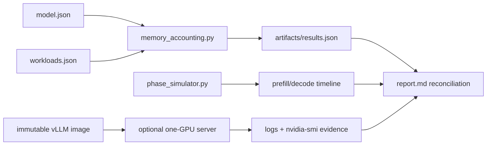

# 17 — Prefill, decode, and memory accounting

**Status:** draft
**Estimated time:** 5–7 hours
**Compute profile:** required `local-cpu`; optional one NVIDIA GPU with at least
16 GiB VRAM (`aws-g5-single` is suitable for the supplied 0.5B model)
**Estimated GPU-minutes:** 0 required; 30–60 optional, with a hard 60-minute
stop for the first run
**Estimated cloud cost:** the CPU mechanism lab is free; the optional path costs
one GPU-node hour at the current price in your Region plus existing EKS,
storage, NAT, or public-address charges. Calculate the price immediately before
starting; this repository deliberately does not freeze a currency amount.
**Prerequisites:** lessons 00–16; Python 3.9+; optional Docker, NVIDIA Container
Toolkit, a compatible driver, and the learner's reviewed vLLM image digest
**Last validated:** 2026-10-21
**Validated with:** Python 3.9 and 3.12 syntax/static checks and the
dependency-free CPU lab; model architecture fields reviewed against the pinned
Qwen repository commit; vLLM tag `v0.28.0` selected as the course pin and must
be resolved to a digest. The Docker/GPU path has not been executed in this
workspace and remains a learner validation task.

## Why this matters

“The weights fit” is not the same as “the workload fits.” A serving process also
needs a CUDA context, allocator pools, activations, temporary workspaces,
captured-graph memory, request metadata, and—usually the largest
workload-dependent term—the key/value (KV) cache.

This lesson connects three questions that operators often answer separately:

1. **What calculation is happening?** Prefill processes many prompt positions
   together; decode processes one new position per active sequence.
2. **What persists?** Every layer retains keys and values for tokens the model
   may attend to later.
3. **What fits?** Model, runtime, workspace, transient activation, and allocated
   KV blocks must remain below the engine's usable VRAM budget.

Without this model, a long-context or high-concurrency deployment appears to
“randomly” fail even though the same model starts with one short request.

## Learning outcomes

By the end, you can:

- draw the prefill and autoregressive decode paths with tensor shapes;
- distinguish parameter, activation, workspace, allocator, graph, and KV memory;
- derive KV bytes from layers, KV heads, head dimension, dtype, sequence count,
  and token count;
- explain why grouped-query attention (GQA) reduces KV memory;
- calculate block rounding and last-page internal fragmentation;
- distinguish analytical prediction, structural simulation, engine-reported
  allocation, and measured peak memory;
- identify whether prompt length, output length, or concurrency crosses a memory
  boundary first;
- trigger a **safe arithmetic rejection** rather than deliberately crashing a
  shared GPU; and
- reconcile a prediction with engine logs and telemetry without hiding omitted
  terms in an unexplained constant.

## What you will build

You will run two free tools and, optionally, one real engine:



The calculator labels its output
`analytical_prediction_not_measurement`. The phase simulator uses abstract
structure, not milliseconds. Only the optional GPU path may produce hardware
measurements.

## Files in this lesson

```text
17-prefill-decode-memory-accounting/
├── README.md
├── report-template.md
├── results.schema.json
├── configs/
│   ├── model.json
│   └── workloads.json
├── scripts/
│   ├── preflight.sh
│   ├── resolve-vllm-image.sh
│   ├── run-cpu-lab.sh
│   ├── start-vllm.sh
│   ├── stop-vllm.sh
│   └── verify-results.py
├── solutions/
│   └── SOLUTIONS.md
└── src/
    ├── memory_accounting.py
    └── phase_simulator.py
```

Generated evidence belongs in ignored `artifacts/`. Copy
`report-template.md` to `artifacts/report.md`.

## Concepts and mental model

### A request has two computational phases

Suppose tokenization returns `input_ids` with shape
`[batch, prompt_tokens]`. For one request with 512 prompt tokens and hidden
width 896, the hidden state entering a transformer layer has shape:

```text
prefill: [1, 512, 896]
decode:  [1,   1, 896] once for each generated token
```

During **prefill**, all prompt positions can be processed in parallel within a
layer. The causal mask still prevents a position from seeing future positions.
During **decode**, the model produces one next-token distribution, selects one
token, appends it, and repeats.

Do not say “decode processes the whole context again.” It normally reuses cached
K and V tensors. It still attends over the growing cache and applies every
layer's weights for each generated step.

### KV tensors and GQA

At one layer, a simplified KV shape is:

```text
K: [batch, kv_heads, cached_tokens, head_dim]
V: [batch, kv_heads, cached_tokens, head_dim]
```

The factor of two below is K plus V:

```math
KV\ bytes =
2 \times layers \times sequences \times cached\ tokens
\times kv\ heads \times head\ dimension \times bytes\ per\ element
```

For the pinned teaching model:

```text
layers = 24
KV heads = 2
head dimension = 64
FP16 KV element = 2 bytes

bytes per cached token per sequence
= 2 × 24 × 2 × 64 × 2
= 12,288 bytes
```

The model has 14 query/attention heads but only two KV heads. Seven query heads
share each KV head. If it used 14 KV heads, the payload would be seven times
larger. This is the memory advantage of GQA; it does not remove query heads.

### Logical tokens versus allocated blocks

Paged engines allocate KV capacity in fixed token blocks. With block size 16:

```text
logical length 1       -> 1 block  -> 16 token slots
logical length 16      -> 1 block  -> 16 token slots
logical length 17      -> 2 blocks -> 32 token slots
logical length 32      -> 2 blocks -> 32 token slots
```

The unused part of the final block is internal fragmentation. Paging avoids
requiring one contiguous maximum-length allocation for each sequence; it does
not make rounding or metadata free.

### A useful budget decomposition

```math
usable\ VRAM = physical\ VRAM \times engine\ utilization\ target
```

```math
predicted\ total =
stored\ weights + runtime\ fixed + workspace
+ transient\ activation\ estimate + allocated\ KV
```

The supplied activation term is deliberately approximate. Real peak activation
depends on attention backend, prefill chunking, batch composition, dtype,
compilation, and temporary buffers. An honest estimate exposes that uncertainty.

### Compute-bound prefill, bandwidth-sensitive decode

A lower-bound model-forward estimate is about:

```math
2 \times parameters \times processed\ tokens
```

Prefill uses matrix shapes with many token rows and can reuse weights across
them, often reaching higher arithmetic intensity. A small decode batch has thin
matrices and repeatedly streams weights and KV data, so memory bandwidth and
launch overhead are often more visible. “Often” is not “always”: profile the
actual model, batch, kernels, and device.

## Under the hood

For a prompt of `S` tokens and `N` generated tokens:

```text
tokenize -> embeddings [B,S,H]
    |
    +-- layer 0:
    |     Q [B,A,S,D]
    |     K,V [B,K,S,D] -> append to layer-0 cache
    |     attention + MLP -> [B,S,H]
    |
    +-- repeat through L layers
    |
logits at final prompt position -> choose token S+1
    |
decode step 1:
    Q [B,A,1,D]
    new K,V [B,K,1,D] -> append to every layer cache
    attend Q over cached positions 0..S
    |
repeat N times
```

Where `B` is active sequences, `S` prompt positions, `H` hidden width, `A`
query heads, `K` KV heads, `D` head dimension, and `L` layers.

The cache is per layer because each layer projects different keys and values.
An engine's block table maps each sequence's logical block number to a physical
KV block. The scheduler grows that mapping as tokens are admitted. Completed or
evicted sequences return blocks to the allocator.

Memory telemetry has layers:

- `nvidia-smi` reports device/process-level use;
- the CUDA allocator distinguishes allocated from reserved pools;
- the engine reports planned model/KV allocations;
- a profiler sees operation lifetimes;
- an OOM names the allocation that failed, not necessarily the root
  configuration error.

The difference between prediction and measurement may include CUDA context,
tokenizer/transfer buffers, allocator rounding, graph pools, kernel workspace,
model padding, or a cache dtype different from your assumption.

## Prerequisites and preflight

Run from:

```bash
cd lessons/phase-03-optimization/17-prefill-decode-memory-accounting
chmod +x scripts/*.sh
./scripts/preflight.sh
```

Expected:

```text
python: 3.x.y
lesson 17 preflight passed
```

The required path uses only the Python standard library.

For the optional GPU path:

```bash
export RUN_GPU_TRACK=1
./scripts/preflight.sh
docker info --format '{{json .Runtimes}}'
nvidia-smi
mkdir -p artifacts
export VLLM_IMAGE_TAG=vllm/vllm-openai:v0.28.0
export VLLM_IMAGE="$(./scripts/resolve-vllm-image.sh)"
printf 'VLLM_IMAGE=%s\n' "$VLLM_IMAGE" | tee artifacts/image-digest.txt
```

The tag selects a course version; the digest records exact registry bytes.
Inspect the release and container provenance before running it.

## Cost and safety

The safe OOM exercise only performs arithmetic. Do not “validate” it by filling
VRAM until a shared process crashes.

Optional GPU guardrails:

- one GPU, one container, one public model, maximum 60 GPU-minutes;
- bind only `127.0.0.1:8000`;
- use an immutable image digest and exact model commit;
- record starting GPU processes and memory;
- stop if another user's process is visible or free memory is unexpectedly low;
- set an external timer;
- keep the cache only if you understand its disk cost;
- on EKS, record the node group's starting size and scale-down command first.

No Hugging Face token is required for this public model. Never add a token to a
manifest, command line, report, or Git-tracked file.

## Predict before running

Write answers in `artifacts/report.md` before execution:

1. Why does doubling concurrency approximately double KV payload?
2. Why does changing 16-bit weights to 4-bit not quarter the entire process?
3. Which tensor has sequence length one during decode?
4. Will 17 cached tokens consume 17 or 32 slots with 16-token blocks?
5. Why does GQA change `kv_heads` but not `attention_heads`?
6. Which supplied scenario should cross the 24 GiB budget?
7. Which measurement distinguishes allocator reservation from live tensors?

## Lab outline

1. Establish the pinned architecture and four workload shapes.
2. Generate a component-by-component prediction.
3. Inspect a structural prefill/decode timeline.
4. Change only concurrency, then only block size.
5. Trigger the safe simulated OOM and interpret exit status.
6. Optionally start the immutable one-GPU engine and reconcile evidence.
7. Verify labels and clean up compute/cache.

## Step-by-step lab

### 1. Inspect immutable and assumed fields

```bash
python3 -m json.tool configs/model.json
python3 -m json.tool configs/workloads.json
```

Model ID/revision and architecture are artifact facts. Runtime overhead,
workspace, and activation coefficients are teaching assumptions. VRAM,
utilization, block size, concurrency, and lengths are experiment inputs.

### 2. Run the complete CPU lab

```bash
mkdir -p artifacts
cp report-template.md artifacts/report.md
./scripts/run-cpu-lab.sh
```

Abbreviated output:

```text
interactive-short      total=... GiB headroom=... GiB fit=yes
interactive-long       total=... GiB headroom=... GiB fit=yes
concurrent-medium      total=... GiB headroom=... GiB fit=yes
safe-simulated-oom     total=... GiB headroom=-... GiB fit=NO
verified memory monotonicity, labels, baseline fit, and safe OOM boundary
```

These values come from committed inputs. They are not GPU evidence.

### 3. Inspect one scenario

```bash
python3 - <<'PY'
import json
data = json.load(open("artifacts/results.json", encoding="utf-8"))
scenario = next(s for s in data["scenarios"] if s["name"] == "concurrent-medium")
print(json.dumps(scenario, indent=2))
PY
```

Recompute `payload_bytes_per_token` by hand. Verify allocated KV is at least
logical KV, the components sum to total, and headroom equals usable minus total.

### 4. Read the timeline

```bash
python3 -m json.tool artifacts/prefill-decode-timeline.json | sed -n '1,120p'
```

The prefill row consumes 512 new positions. Every decode row consumes one new
position and grows the cache by one.

### 5. Controlled concurrency experiment

```bash
cp configs/workloads.json artifacts/workloads-concurrency.json
python3 - <<'PY'
import json
path = "artifacts/workloads-concurrency.json"
data = json.load(open(path, encoding="utf-8"))
scenario = next(s for s in data["scenarios"] if s["name"] == "interactive-long")
scenario["concurrency"] = 8
json.dump(data, open(path, "w", encoding="utf-8"), indent=2)
PY
python3 src/memory_accounting.py \
  --model configs/model.json \
  --workloads artifacts/workloads-concurrency.json \
  --vram-gib 24 \
  --utilization 0.80 \
  --block-size 16 \
  --output artifacts/concurrency-results.json
```

Only concurrency changed. Weight/fixed terms remain identical; KV scales.

### 6. Controlled page-size experiment

```bash
for block in 8 16 32; do
  python3 src/memory_accounting.py \
    --model configs/model.json \
    --workloads configs/workloads.json \
    --vram-gib 24 \
    --utilization 0.80 \
    --block-size "$block" \
    --output "artifacts/block-${block}.json"
done
```

Payload is unchanged. Allocated slots and final-block fragmentation may change.
The calculator does not model block-table metadata or kernel support.

### 7. Optional real engine

After recording the digest, timer, and starting memory:

```bash
nvidia-smi | tee artifacts/nvidia-smi-before.txt
./scripts/start-vllm.sh
docker logs -f oms-l17-vllm
```

In another shell:

```bash
until curl --fail --silent http://127.0.0.1:8000/health; do sleep 5; done
curl --fail --silent http://127.0.0.1:8000/v1/models |
  python3 -m json.tool
curl --fail --silent http://127.0.0.1:8000/v1/chat/completions \
  -H 'Content-Type: application/json' \
  -d '{
    "model":"oms-model",
    "messages":[{"role":"user","content":"Reply with only: memory-ok"}],
    "temperature":0,
    "max_tokens":16
  }' | tee artifacts/smoke-response.json | python3 -m json.tool
nvidia-smi | tee artifacts/nvidia-smi-after-load.txt
docker logs oms-l17-vllm > artifacts/vllm-startup.log 2>&1
```

Text can vary. HTTP 200, response schema, pinned model, startup allocation, and
GPU process memory are evidence.

## Inspect what happened

```bash
python3 - <<'PY'
import json
d = json.load(open("artifacts/results.json", encoding="utf-8"))
print(d["result_kind"])
for s in d["scenarios"]:
    print(s["name"], s["kv"], s["memory_gib"]["predicted_headroom"])
PY
```

Optional engine:

```bash
grep -Ei 'model|revision|memory|cache|block|cuda|graph' \
  artifacts/vllm-startup.log | sed -n '1,160p'
nvidia-smi --query-compute-apps=pid,process_name,used_memory --format=csv
```

Ask whether the engine's model memory resembles the weight prediction, which
cache capacity it chose, whether graph capture reserved memory, and whether
reserved memory remains after requests complete.

## Deliberate failure

```bash
set +e
python3 src/memory_accounting.py \
  --model configs/model.json \
  --workloads configs/workloads.json \
  --vram-gib 24 \
  --utilization 0.80 \
  --block-size 16 \
  --output artifacts/oom-boundary.json \
  --fail-on-infeasible
status=$?
set -e
printf 'exit status=%s\n' "$status"
test "$status" -eq 2
```

Diagnosis:

```text
prediction says no fit
├─ weights dominate -> smaller/lower-precision model or supported sharding
├─ KV dominates -> reduce concurrency/length, use supported KV dtype
├─ workspace/graphs dominate -> inspect backend/capture configuration
└─ prediction says fit but runtime OOMs
   ├─ wrong architecture/dtype
   ├─ omitted allocator/graph/workspace
   ├─ another process occupies VRAM
   └─ engine rounded/reserved more than modeled
```

Repair an ignored workload copy by reducing only the simulated OOM scenario's
concurrency. Record largest passing and smallest failing values.

## Controlled experiment

| Run | Only changed variable | Constants | Expected mechanism |
|---|---|---|---|
| A | concurrency = 1 | model, lengths, dtype, blocks | baseline KV |
| B | concurrency = 8 | same | about 8× logical KV |
| C | block size = 32 | same as B | payload fixed; rounding changes |

Optional GPU: keep digest, revision, flags, workload, and warmup fixed; change
only `--max-model-len` or `--max-num-seqs`, not both.

## Verification

```bash
python3 scripts/verify-results.py artifacts/results.json
```

It checks labels, long/short and concurrency monotonicity, baseline fit, and safe
OOM rejection.

Optional behavioral gate:

```bash
test "$(python3 - <<'PY'
import json
d=json.load(open("artifacts/smoke-response.json", encoding="utf-8"))
print(d.get("object"))
PY
)" = "chat.completion"
```

Health alone does not prove generation works.

## Expected result

You should have a JSON prediction with every term, a structural timeline, safe
exit-code-2 failure, controlled concurrency/page comparison, and optionally a
real completion plus raw memory evidence. Timings, memory, block counts, GPU
names, and text differ by environment.

## Troubleshooting

| Symptom | Layer | Evidence | Action |
|---|---|---|---|
| JSON/key error | input | `python3 -m json.tool` | restore required fields |
| Small scenario fails | assumptions | inspect total/usable | undo hidden edits |
| no device driver | runtime | `docker info`, `nvidia-smi` | repair runtime |
| engine rejects flag | version | digest, `--help` | use pinned CLI docs |
| model access error | artifact | startup log, revision | verify network/cache |
| startup OOM | GPU | PIDs, log, prediction | stop; resolve occupancy |
| health works, request fails | API | response/server log | check model/schema |
| prediction differs | boundary | component evidence | identify omitted terms |

Do not blindly set utilization to `1.0`.

## Evidence to collect

- `artifacts/results.json`
- `artifacts/prefill-decode-timeline.json`
- `artifacts/concurrency-results.json`
- `artifacts/block-8.json`, `block-16.json`, `block-32.json`
- `artifacts/report.md`
- optional digest, `nvidia-smi`, startup log, smoke response, exact flags
- optional EKS node-group before/after evidence

Review evidence before sharing; it can contain internal identifiers.

## Knowledge check

1. Why is KV memory linear in layers while score work grows with context?
2. Why can 24 GiB fail with 15 GiB of stored weights?
3. What changes with FP8 KV? What does not?
4. Why can decode be bandwidth-sensitive?
5. What distinguishes no KV blocks from weight-load OOM?
6. Why is max length times max sequences only an upper bound?
7. What is final-block fragmentation for a one-token sequence?

## Exercises

Guided:

1. Derive bytes/token for MHA with 14 KV heads and compare with GQA's two.
2. Make an ignored 8-bit-KV model copy; predict and verify the ratio.
3. Find the long scenario's concurrency boundary with binary search.
4. Explain every component without using “overhead” as a catch-all.

Independent challenge: create a pinned architecture JSON for a licensed model,
cite its `config.json`, predict three workloads, and reconcile with a supported
engine while preserving raw prediction and observation.

See [solutions/SOLUTIONS.md](solutions/SOLUTIONS.md).

## Completion gate

- CPU preflight and verifier pass from a clean checkout.
- You derive 12,288 bytes/token for the supplied architecture.
- You explain prefill/decode shapes and GQA without notes.
- The arithmetic failure returns 2 and is repaired by one variable.
- Controlled constants are documented.
- `results.json` and `report.md` separate prediction/simulation/measurement.
- GPU claims have raw evidence or are marked not run.
- Containers/resources are stopped and paid capacity is restored.

## Cleanup

CPU evidence may be retained. To remove it after reviewing the exact list:

```bash
find artifacts -mindepth 1 -maxdepth 1 -print
find artifacts -mindepth 1 -maxdepth 1 -exec rm -rf -- {} +
```

Optional container:

```bash
./scripts/stop-vllm.sh
docker ps --filter name=oms-l17-vllm
```

Delete cache only explicitly:

```bash
DELETE_MODEL_CACHE=1 ./scripts/stop-vllm.sh
docker volume inspect oms-l17-model-cache
```

The final inspect should fail. On AWS, restore node-group capacity and prove no
lesson Pods, public Services, load balancers, PVCs, or volumes remain.

## Primary references

Required, reviewed 2026-10-21:

- [Qwen2.5-0.5B-Instruct pinned repository](https://huggingface.co/Qwen/Qwen2.5-0.5B-Instruct/tree/7ae557604adf67be50417f59c2c2f167def9a775)
- [vLLM v0.28.0 source tag](https://github.com/vllm-project/vllm/tree/v0.28.0)
- [vLLM engine arguments](https://docs.vllm.ai/en/latest/configuration/engine_args/)
- [PagedAttention/vLLM paper](https://arxiv.org/abs/2309.06180)
- [GQA paper](https://arxiv.org/abs/2305.13245)

Optional:

- [CUDA memory API](https://docs.nvidia.com/cuda/cuda-runtime-api/group__CUDART__MEMORY.html)
- [FlashAttention paper](https://arxiv.org/abs/2205.14135)

The version pin is intentional, not a claim it remains newest. Recheck CLI,
dtypes, model compatibility, and image provenance before each run.
