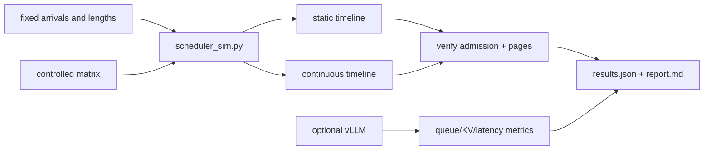

# 18 — Batching, scheduling, and paged attention

**Status:** draft
**Estimated time:** 6–8 hours
**Compute profile:** required `local-cpu`; optional one NVIDIA GPU with Docker
or the private one-GPU service from lesson 13
**Estimated GPU-minutes:** 0 required; 45–90 optional, stop at 90
**Estimated cloud cost:** no required cost. The optional comparison uses at most
one GPU node for 1.5 hours; add existing cluster, storage, and network costs
using current Regional prices.
**Prerequisites:** lessons 12, 13, and 17; Python 3.9+; optional immutable vLLM
`v0.28.0` image digest
**Last validated:** 2026-10-21
**Validated with:** dependency-free discrete-event CPU simulation and static
validation. The vLLM/GPU path is supplied but was not run in this workspace;
engine metrics and timings must be captured by the learner.

## Why this matters

An LLM server does not execute one complete request, then the next. It repeatedly
decides which sequences receive work in the next model iteration. That decision
couples four resources:

- token work admitted this iteration;
- sequence slots;
- physical KV-cache blocks;
- time already spent waiting.

A larger batch can reuse weights and improve throughput while making a short
interactive request wait behind long prompts. A memory-efficient allocator can
serve more sequences, yet poor admission or fairness can still produce terrible
tail latency. This lesson turns “the scheduler did something” into an observable
timeline.

## Learning outcomes

By the end, you can:

- distinguish offline/static, dynamic request, and continuous iteration-level
  batching;
- trace request arrival, admission, prefill, decode, completion, and KV release;
- explain head-of-line blocking with a concrete late short request;
- distinguish `max_num_seqs` from `max_num_batched_tokens`;
- map logical sequence blocks to reusable physical KV pages;
- calculate page count and last-block fragmentation;
- explain preemption, recomputation, swap/eviction, fairness, and starvation;
- perform a one-variable scheduler experiment; and
- connect queue/TTFT/throughput results to scheduler evidence rather than
  guessing from GPU utilization alone.

## What you will build



Ticks in the CPU simulation are abstract scheduler opportunities, not
milliseconds. The optional engine path is the only latency measurement.

## Files in this lesson

```text
18-batching-scheduling-paged-attention/
├── README.md
├── report-template.md
├── results.schema.json
├── configs/
│   ├── experiment-matrix.json
│   ├── workload.json
│   ├── vllm-baseline.args
│   └── vllm-large-batch.args
├── scripts/
│   ├── preflight.sh
│   ├── run-cpu-lab.sh
│   ├── start-vllm.sh
│   ├── stop-vllm.sh
│   └── verify-results.py
├── solutions/SOLUTIONS.md
└── src/
    ├── render_timeline.py
    └── scheduler_sim.py
```

## Concepts and mental model

### Three batching models

**Static/offline batching** forms a fixed batch, pads or processes it, and waits
for the group to finish before admitting another batch. It is simple and useful
for offline jobs, but one long sequence can hold the gate.

**Dynamic batching** waits briefly to combine requests arriving near one
another, then often treats that group as a batch.

**Continuous batching** revisits membership at iteration/token boundaries.
Finished sequences leave and waiting sequences enter without draining the whole
original group.

```text
static:
time -> [ A A A A A A ]
        [ B B B       ]  short C waits until both drain
        [       C C   ]

continuous:
time -> [ A A A A A A ]
        [ B B B       ]
        [     C C     ]  C enters when B releases a slot
```

### Two independent limits

`max_num_seqs` limits active sequence slots. `max_num_batched_tokens` limits
token positions processed in one scheduler step. A prefill can consume many
token units; each decode-ready sequence usually consumes one.

With a 256-token budget:

```text
one 256-token prefill                -> budget full
128-token prefill + 128 decode rows  -> budget full
eight decode rows                    -> much budget unused
```

Actual engine scheduling is more nuanced, but the distinction is essential.

### Paged KV memory

For block size `P` and current logical length `T`:

```math
blocks(T) = \lceil T/P \rceil
```

Logical block numbers `[0,1,2]` can map to physical blocks `[17,4,29]`. Attention
kernels use the block table to find K/V. Physical contiguity is no longer a
requirement, so blocks freed by one sequence can be reused by another.

Paging addresses external fragmentation and over-reservation. It still has:

- a partially filled final page;
- page/block-table metadata;
- allocation bookkeeping;
- kernel layout constraints;
- a finite pool that can be exhausted.

### Latency vocabulary

```text
arrival
  |--- queue/admission wait ---|
                                first schedule
                                |--- prefill ---| first token
                                               |-- decode gaps --| finish
```

- **TTFT** includes queue plus prefill plus transport to the first streamed token.
- **ITL/TPOT** reflects gaps during decode.
- **end-to-end** includes the entire response.
- **throughput** measures completed requests or tokens per wall time.

An engine may increase total token throughput while queueing pushes p95 TTFT
past the application's SLO.

## Under the hood

Each scheduler iteration conceptually performs:

```text
1. discover newly arrived requests
2. decide whether admission is allowed
3. check sequence-slot and KV-block capacity
4. assign the token budget:
   - prefill chunks: many token positions
   - decode: usually one per active sequence
5. run model kernels for the constructed batch
6. sample next tokens
7. grow KV block tables
8. finish sequences and free blocks
9. export queue/cache/preemption metrics
```

If no blocks are available, an engine may defer admission, preempt lower-priority
work, recompute evicted KV later, or use a configured swap path. Each choice has
different latency and storage/network consequences.

The simulator explicitly uses oldest-arrival-first order and frees pages at
completion. Its static policy admits only when the active group is empty; its
continuous policy admits when a slot opens. These simplifications make the
mechanism inspectable and are not a claim about every vLLM implementation detail.

Fairness must be demonstrated over opportunities:

```text
request waiting + capacity repeatedly given to others + no progress
```

One slow request is not proof of starvation. It may simply require more work.

## Prerequisites and preflight

```bash
cd lessons/phase-03-optimization/18-batching-scheduling-paged-attention
chmod +x scripts/*.sh
./scripts/preflight.sh
mkdir -p artifacts
cp report-template.md artifacts/report.md
```

Expected:

```text
stdlib-only Python: 3.x.y
lesson 18 CPU preflight passed
```

Optional GPU:

```bash
command -v docker
nvidia-smi
docker info >/dev/null
export VLLM_IMAGE_TAG=vllm/vllm-openai:v0.28.0
export VLLM_IMAGE="$(
  docker buildx imagetools inspect "$VLLM_IMAGE_TAG" |
    sed -n 's/^Digest:[[:space:]]*//p' |
    head -1 |
    sed "s#^#vllm/vllm-openai@#"
)"
case "$VLLM_IMAGE" in *@sha256:*) ;; *) echo "digest resolution failed"; exit 1;; esac
printf '%s\n' "$VLLM_IMAGE" | tee artifacts/image-digest.txt
```

Before using the optional configs, confirm their flags exist:

```bash
docker run --rm "$VLLM_IMAGE" --help |
  tee artifacts/vllm-help.txt |
  grep -E 'max-num-seqs|max-num-batched-tokens'
```

## Cost and safety

- The required scheduler failure is a CPU simulation.
- Optional run: one GPU/container at a time, maximum 90 GPU-minutes.
- Both configs bind to loopback only.
- Resolve the image to a digest and retain the exact model revision.
- Do not run baseline and candidate simultaneously on one GPU.
- Stop if another process occupies the GPU or the engine enters repeated OOM.
- Do not expose unauthenticated vLLM through `LoadBalancer` or `0.0.0.0`.
- Record the EKS node-group before state before scaling; restore it after.

## Predict before running

1. Which request suffers most under static admission?
2. Does a larger batched-token budget necessarily improve its TTFT?
3. When are blocks returned to the pool?
4. Can two sequences have adjacent logical blocks stored non-contiguously?
5. What metric would reveal capacity pressure before an OOM?
6. Why can high GPU utilization coexist with bad p95 latency?

## Lab outline

1. Freeze four request arrivals and two scheduler limits.
2. Simulate static and continuous admission.
3. Render per-tick queue, active set, scheduled work, and page occupancy.
4. Increase only the token budget.
5. Diagnose the late-short head-of-line failure.
6. Optionally repeat two vLLM configurations with a fixed workload.
7. Verify allocator cleanup and report the latency/throughput trade-off.

## Step-by-step lab

### 1. Read the workload as a timeline

```bash
python3 -m json.tool configs/workload.json
python3 -m json.tool configs/experiment-matrix.json
```

`long-a` and `long-b` arrive at tick 0. `short-late` arrives at tick 2.
Predict which static-batch member prevents its admission.

### 2. Run all CPU experiments

```bash
./scripts/run-cpu-lab.sh
```

Expected shape:

```text
static-baseline                    drain=... ticks short-late ttft=... ticks
continuous-controlled              drain=... ticks short-late ttft=... ticks
continuous-larger-token-budget     drain=... ticks short-late ttft=... ticks
verified admission effect, page accounting, and allocator cleanup
```

Do not translate ticks into latency. Compare ordering and scheduler decisions.

### 3. Inspect the scheduler timeline

```bash
sed -n '1,220p' artifacts/scheduler-timeline.md
```

Find:

- the tick where `short-late` arrives;
- the tick where it first becomes active;
- whether work is prefill or decode;
- page occupancy before and after a sequence finishes;
- the final zero-used-page state.

### 4. Inspect request-level results

```bash
python3 - <<'PY'
import json
d=json.load(open("artifacts/results.json", encoding="utf-8"))
for e in d["experiments"]:
    print("\n", e["name"])
    for r in e["requests"]:
        print(r["id"], "queue", r["queue_ticks"], "ttft", r["ttft_ticks"],
              "e2e", r["e2e_ticks"], "peak_pages", r["peak_blocks"])
PY
```

Queue time is arrival to first scheduling. TTFT additionally includes prefill
and the first decode step.

### 5. Change only page size

Create an ignored matrix copy:

```bash
cp configs/experiment-matrix.json artifacts/block-matrix.json
python3 - <<'PY'
import json
p="artifacts/block-matrix.json"
d=json.load(open(p, encoding="utf-8"))
d["controlled_variables"]["block_size_tokens"]=8
json.dump(d, open(p, "w", encoding="utf-8"), indent=2)
PY
python3 src/scheduler_sim.py \
  --workload configs/workload.json \
  --matrix artifacts/block-matrix.json \
  --output artifacts/block-8-results.json
```

Admission policy and token budget did not change. Compare peak pages and
fragmentation tokens—not simulated timing claims.

### 6. Optional engine baseline

Start only after recording the image digest and GPU state:

```bash
nvidia-smi | tee artifacts/gpu-before.txt
./scripts/start-vllm.sh configs/vllm-baseline.args
docker logs -f oms-l18-vllm
```

Smoke test:

```bash
until curl --fail --silent http://127.0.0.1:8000/health; do sleep 5; done
curl --fail --silent http://127.0.0.1:8000/v1/chat/completions \
  -H 'Content-Type: application/json' \
  -d '{"model":"oms-model","messages":[{"role":"user","content":"Return OK"}],
       "temperature":0,"max_tokens":8}' |
  tee artifacts/baseline-smoke.json |
  python3 -m json.tool
```

Use the exact workload and benchmark client from lesson 12. Save raw
`oms-benchmark/v1` output, engine metrics, logs, and GPU snapshot. Stop the
server before changing configuration:

```bash
./scripts/stop-vllm.sh
./scripts/start-vllm.sh configs/vllm-large-batch.args
```

Repeat identical warmup, measured requests, prompts, sampling, and arrival mode.

## Inspect what happened

CPU timeline:

```bash
grep -n 'short-late' artifacts/scheduler-timeline.md
```

Optional vLLM metrics:

```bash
curl --fail --silent http://127.0.0.1:8000/metrics \
  > artifacts/vllm-metrics.txt
grep -Ei 'queue|running|waiting|cache|preempt|token' \
  artifacts/vllm-metrics.txt | sed -n '1,160p'
docker logs oms-l18-vllm > artifacts/vllm.log 2>&1
```

Metric names can change by version; archive the complete scrape before filtering.
Correlate client timestamps with queue/cache occupancy. A final aggregate p95
without a timeline cannot explain the scheduler.

## Deliberate failure

The static policy creates head-of-line blocking:

```bash
python3 - <<'PY'
import json
d=json.load(open("artifacts/results.json", encoding="utf-8"))
for e in d["experiments"][:2]:
    r=next(x for x in e["requests"] if x["id"]=="short-late")
    print(e["name"], r)
PY
```

Prediction: continuous admission gives the late short request a slot after an
earlier sequence finishes instead of waiting for the entire static group.

Diagnosis tree:

```text
high TTFT
├─ queue ticks high -> admission/capacity/offered-load problem
├─ queue low, prefill high -> prompt/kernel/compute problem
├─ preemption/recompute high -> KV capacity pressure
├─ server low, client high -> network/client backpressure
└─ errors/timeouts hidden -> invalid throughput comparison
```

Repair: use continuous policy while keeping slots, token budget, blocks, and
workload fixed. The verifier enforces the expected admission effect.

## Controlled experiment

The committed matrix has:

| Experiment | Policy | Seqs | Token budget | Purpose |
|---|---|---:|---:|---|
| static baseline | static | 2 | 32 | expose group drain |
| continuous controlled | continuous | 2 | 32 | change policy only |
| larger token budget | continuous | 2 | 64 | change budget only |

For GPU measurements, do not compare a closed-loop baseline to an open-loop
candidate. Freeze arrival mode, prompt/output distribution, concurrency,
warmup, request count, model revision, image digest, and GPU.

## Verification

```bash
python3 scripts/verify-results.py artifacts/results.json
```

It proves:

- continuous admission improves the supplied late-short TTFT;
- no experiment leaks physical pages;
- fragmentation is non-negative.

For the engine, require HTTP 200, response schema, fixed output-token work,
success rate, quality gate, and complete raw requests. A throughput gain with
timeouts excluded is a failure.

## Expected result

You will have a scheduler timeline that explains when each request enters,
which token work it receives, and when pages are freed. The supplied continuous
policy should help the late short request. A larger token budget may change
drain time and tail behavior; the result must be explained, not assumed.

No GPU latency or throughput value is pre-filled because hardware execution was
not available during authoring.

## Troubleshooting

| Symptom | Layer | Check |
|---|---|---|
| simulator never converges | config | positive budgets/pages; workload size |
| late request unchanged | experiment | confirm policy actually changed |
| negative fragmentation | model bug | preserve result and open an issue |
| engine flag rejected | version | digest plus archived `--help` |
| engine OOMs only with large config | KV/scheduler | cache blocks, preemption, PIDs |
| client throughput rises, quality falls | workload | output tokens and quality gate |
| p95 jumps but mean improves | queue/fairness | raw request timeline |
| metrics grep empty | observability | inspect complete `/metrics` file |

## Evidence to collect

- `artifacts/results.json`
- `artifacts/scheduler-timeline.md`
- `artifacts/block-8-results.json`
- `artifacts/report.md`
- optional image digest, help, engine logs, complete metrics scrape
- optional raw benchmark results for both configs and GPU snapshots
- cleanup/node-group before-and-after proof

## Knowledge check

1. Why can continuous batching reduce head-of-line blocking?
2. Why are sequence slots and token budget separate?
3. What causes the final KV page to be partly empty?
4. How does a block table enable physical reuse?
5. What evidence proves preemption?
6. Why can throughput improve while p95 TTFT regresses?
7. When is static batching still a reasonable choice?

## Exercises

Guided:

1. Add a one-token request at tick 3 and predict both policies.
2. Reduce total blocks until one request cannot progress; diagnose it.
3. Compare block sizes 4, 8, 16, and 32.
4. Change only `max_num_seqs` and explain admission versus token work.

Independent challenge: implement a fairness rule (for example, capped prefill
chunks or age priority) in an ignored copy of the simulator. Construct a
workload where FIFO and your policy differ, state a fairness metric before
running, and show no page leak.

See [solutions/SOLUTIONS.md](solutions/SOLUTIONS.md).

## Completion gate

- CPU preflight/run/verifier pass.
- You explain every `short-late` timeline transition.
- You distinguish static/dynamic/continuous batching.
- You calculate block count and fragmentation by hand.
- The deliberate head-of-line failure is diagnosed and repaired one variable.
- GPU claims, if any, include raw results, metrics, digest, and quality gate.
- All containers and optional GPU capacity are removed/restored.

## Cleanup

```bash
./scripts/stop-vllm.sh
docker ps --filter name=oms-l18-vllm
find artifacts -mindepth 1 -maxdepth 2 -print
```

Delete the optional cache only when intended:

```bash
DELETE_MODEL_CACHE=1 ./scripts/stop-vllm.sh
docker volume inspect oms-l18-model-cache
```

Remove ignored evidence only after review. If you used EKS, restore the recorded
node-group size and verify no lesson namespace, Pod, Service, load balancer,
PVC, or volume remains.

## Primary references

Required, reviewed 2026-10-21:

- [Orca iteration-level scheduling paper](https://www.usenix.org/conference/osdi22/presentation/yu)
- [PagedAttention/vLLM paper](https://arxiv.org/abs/2309.06180)
- [vLLM v0.28.0 source](https://github.com/vllm-project/vllm/tree/v0.28.0)
- [vLLM engine arguments](https://docs.vllm.ai/en/latest/configuration/engine_args/)
- [vLLM metrics documentation](https://docs.vllm.ai/en/latest/design/metrics/)

Optional:

- [Sarathi-Serve chunked-prefill paper](https://arxiv.org/abs/2403.02310)

Metric names and CLI defaults are versioned. Retain the digest and `--help`
output used for each experiment.
