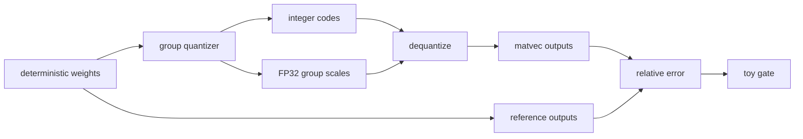

# 19 — Quantization as a systems trade-off

**Status:** draft
**Estimated time:** 7–10 hours
**Compute profile:** required `local-cpu`; optional one NVIDIA GPU for an
engine-supported baseline/quantized comparison
**Estimated GPU-minutes:** 0 required; 60–120 optional, hard cap 120
**Estimated cloud cost:** free for the deterministic toy layer. Optional cost
is one GPU node for at most two hours plus model storage/download and existing
cluster/network charges; use current Regional pricing.
**Prerequisites:** lessons 12, 13, 17, and 18; Python 3.9+; optional exact,
licensed quantized artifact revision known to work with pinned vLLM `v0.28.0`
**Last validated:** 2026-10-21
**Validated with:** dependency-free grouped symmetric quantizer and quality-gate
tests. No real quantized checkpoint/kernel/GPU benchmark was executed here; the
lesson requires learners to record their chosen artifact, commit, method, and
engine compatibility rather than teaching a mutable “latest model.”

## Why this matters

“Four-bit” describes too little. Two 4-bit checkpoints may use different group
sizes, scales, zero points, outlier treatment, packing layouts, calibration
data, and kernels. One may be smaller and faster; another may fall back to slow
dequantization or fail the application's quality floor.

Quantization is a pipeline:

```text
source weights -> calibration/optimization -> codes + metadata
-> artifact format -> loader -> supported kernel -> accumulation
-> output quality and serving behavior
```

Optimizing only file size ignores startup time, VRAM, KV cache, kernel support,
TTFT, token rate, quality, and operational compatibility.

## Learning outcomes

By the end, you can:

- explain exponent, mantissa, dynamic range, and precision without equating all
  lower-bit representations;
- derive symmetric grouped quantization and dequantization equations;
- distinguish per-tensor, per-channel, and per-group scales;
- account for codes, scales, zero points, padding, and higher-precision layers;
- distinguish weight-only, weight-and-activation, and KV-cache quantization;
- explain the goals of GPTQ, AWQ, SmoothQuant, and GGUF without treating them as
  interchangeable;
- run a deterministic numeric-error/compression experiment;
- freeze a real quality gate before performance measurement;
- identify a kernel fallback or unsupported format; and
- choose a Pareto point for a stated hardware/application budget.

## What you will build

The required lab creates a matrix with deterministic outliers, quantizes real
numeric values into integer codes, stores group scales, dequantizes them, runs
matrix-vector outputs, and evaluates error:



The optional track compares a full-precision checkpoint with a separately
reviewed quantized artifact using identical prompts and an actual engine kernel.

## Files in this lesson

```text
19-quantization-systems-tradeoffs/
├── README.md
├── report-template.md
├── results.schema.json
├── configs/
│   ├── experiment-matrix.json
│   └── quality-gate.json
├── scripts/
│   ├── cleanup.sh
│   ├── inspect-container.sh
│   ├── preflight.sh
│   ├── run-cpu-lab.sh
│   ├── start-comparison.sh
│   └── verify-results.py
├── solutions/SOLUTIONS.md
└── src/quantization_lab.py
```

`start-comparison.sh` intentionally refuses to run without an immutable engine
digest and an exact 40-character quantized-model commit.

## Concepts and mental model

### Representation versus arithmetic

Storage dtype, input dtype, multiplication dtype, and accumulator dtype can
differ. A weight-only 4-bit kernel might:

```text
load packed 4-bit codes + scales
dequantize or fuse scaling during multiplication
multiply with FP16/BF16 activations
accumulate in FP16/FP32 or another supported type
write a wider output tensor
```

“The model runs in 4-bit” does not imply every tensor or arithmetic operation is
4-bit.

### Symmetric quantization

For signed `b`-bit codes:

```math
q_{max} = 2^{b-1}-1
```

For a group of real weights `w`:

```math
s = max(|w|) / q_{max}
```

```math
q = clamp(round(w/s), -q_{max}, q_{max})
```

```math
\hat{w} = q \times s
```

The code stores `q` plus scale `s`. Values usually change because many real
numbers map to the same code.

Asymmetric quantization also stores a zero point:

```math
q = clamp(round(w/s) + z)
```

It can represent an offset range more efficiently but adds metadata and kernel
requirements.

### Granularity

- **Per-tensor:** one scale for a tensor; tiny metadata, outliers dominate.
- **Per-channel/row:** a scale per output channel; better range fit.
- **Per-group:** a scale for every group of `G` weights; flexible trade-off.

For `N` weights, `b` code bits, group size `G`, and four-byte scales:

```math
ideal\ bytes \approx \lceil Nb/8 \rceil + \lceil N/G \rceil \times 4
```

Real formats may align/pad groups, store zero points, keep selected tensors in a
wider dtype, and add headers. “Ideal bitpacked bytes” is not actual file size.

### Outliers and calibration

One large value expands a group's range, making steps coarser for ordinary
values. Smaller groups isolate an outlier but add scales. Calibration-based
methods use representative activations or statistics to decide what error
matters.

Calibration data must match real usage: language, chat template, domains,
lengths, and distributions. Accidentally evaluating on calibration data can
make quality appear better than it generalizes.

### Method families

- **GPTQ:** post-training weight quantization using approximate second-order
  information to reduce reconstruction error while quantizing weights.
- **AWQ:** activation-aware weight quantization; protects salient weight
  channels identified from activation behavior.
- **SmoothQuant:** moves activation outlier difficulty into weights through an
  offline equivalent transformation, enabling weight-and-activation INT8.
- **GGUF:** a file/container ecosystem used heavily by llama.cpp; it can contain
  many tensor quantization types. “GGUF” alone is not a bit-width/method.
- **KV quantization:** reduces persistent cache bytes, a separate decision from
  weight quantization with its own quality and kernel support.

Read the original method and engine compatibility matrix for the exact artifact.

## Under the hood

Consider a linear layer:

```text
X [tokens, in_features]
W [out_features, in_features]
Y = X @ W^T -> [tokens, out_features]
```

Grouped weight quantization partitions rows of `W`. At inference:

```text
packed codes [out_features, in_features * bits/8]
scales       [out_features, ceil(in_features/group_size)]
```

A fast kernel loads a tile of codes and corresponding scales, reconstructs or
scales fragments in registers/shared memory, multiplies with activation tiles,
and accumulates outputs. A slow path may unpack into a temporary wide tensor or
launch separate dequantization and matrix-multiply kernels, increasing memory
traffic and launches.

Quality propagates nonlinearly through many layers. The CPU lab measures one
linear layer's relative output error to expose mechanics. It explicitly does
**not** claim language-model quality, perplexity, or GPU speed.

System accounting should include:

```text
disk artifact
host memory while loading/converting
GPU codes + scale/zero metadata + padding
temporary workspace
unquantized embeddings/norms/output head
KV cache (possibly a different dtype)
kernel support and compile/capture behavior
```

## Prerequisites and preflight

```bash
cd lessons/phase-03-optimization/19-quantization-systems-tradeoffs
chmod +x scripts/*.sh
./scripts/preflight.sh
mkdir -p artifacts
cp report-template.md artifacts/report.md
```

Expected:

```text
stdlib-only Python: 3.x.y
lesson 19 preflight passed
```

Optional engine prerequisites:

```bash
nvidia-smi
docker info >/dev/null
export VLLM_IMAGE_TAG=vllm/vllm-openai:v0.28.0
# Resolve with the registry workflow from lesson 17; never use the tag alone.
export VLLM_IMAGE='vllm/vllm-openai@sha256:REPLACE_WITH_RESOLVED_DIGEST'
export QUANT_MODEL_ID='organization/reviewed-quantized-model'
export QUANT_MODEL_REVISION='40-character-reviewed-commit'
```

Inspect the selected model card, license, base-model revision, quantization
configuration, calibration disclosure, and engine support before download.
These are non-secret identifiers; credentials remain in supported credential
stores and must not enter shell history or Git.

## Cost and safety

- Required lab allocates only a small Python matrix.
- Optional path runs one container/GPU at a time for at most 120 GPU-minutes.
- Stop on repeated kernel errors, fallback you cannot identify, OOM, or another
  user's GPU process.
- Bind APIs only to loopback or use a private `ClusterIP`.
- Quantized artifacts are not automatically safer or license-compatible.
- Model caches can consume disk/EBS after GPU scale-down; inventory them.
- Do not convert/distribute weights unless the source license permits it.
- Do not call a comparison fair if output lengths, prompts, sampling, tokenizer,
  or quality criteria differ.

## Predict before running

1. Which has more metadata: group size 8 or 128?
2. Which is more affected by one outlier?
3. Does 4-bit storage force 4-bit accumulation?
4. Why can 4-bit use less VRAM but generate slower?
5. Which quality set must be frozen before benchmarking?
6. Can weight quantization change KV-cache bytes?
7. Why is a model repository name insufficient provenance?

## Lab outline

1. Generate deterministic weights, outliers, and evaluation vectors.
2. Establish idealized FP16 storage/reference outputs.
3. Quantize with INT8 and multiple 4/3-bit group sizes.
4. Measure code/scale bytes and numeric output error.
5. Trigger a strict quality-gate failure.
6. Optionally compare reviewed full/quantized model artifacts.
7. Inspect kernel/fallback evidence and select a Pareto point.

## Step-by-step lab

### 1. Inspect the matrix and gate

```bash
python3 -m json.tool configs/experiment-matrix.json
python3 -m json.tool configs/quality-gate.json
```

The random seed, matrix shape, vectors, formats, metric, compression minimum,
and error maximum are frozen before execution.

### 2. Run real toy quantization

```bash
./scripts/run-cpu-lab.sh
```

Abbreviated output:

```text
experiment             bytes   ratio  mean output error
fp16-storage-reference ...
int8-per-row            ...
int4-group-32           ...
int4-group-8            ...
int3-group-32           ...
toy gate passed by: ...
warning: passing this gate says nothing about LLM task quality or kernels
```

Open `src/quantization_lab.py`. Trace one group's `maximum -> scale -> codes ->
reconstructed values`. This is actual numeric conversion, not a storage-only
calculator.

### 3. Inspect codes and scales

```bash
python3 - <<'PY'
import json
d=json.load(open("artifacts/results.json", encoding="utf-8"))
for x in d["experiments"]:
    if "first_eight_codes" in x["storage"]:
        print(x["name"], x["storage"]["first_eight_codes"],
              x["storage"]["first_scale"])
PY
```

Compare `int4-group-8` with `int4-group-32`: more scales consume bytes but the
fixed outlier fixture should produce lower mean output error for group 8.

### 4. Recalculate storage

For 64 × 128 = 8192 weights at 4 bits:

```text
packed code payload = 8192 × 4 / 8 = 4096 bytes
group-32 scales      = 8192 / 32 × 4 = 1024 bytes
ideal total          = 5120 bytes
```

Confirm in JSON. Python's in-memory integer objects are much larger; the report
models a packed artifact/kernel layout.

### 5. Deliberately tighten the toy gate

```bash
cp configs/quality-gate.json artifacts/strict-gate.json
python3 - <<'PY'
import json
p="artifacts/strict-gate.json"
d=json.load(open(p, encoding="utf-8"))
d["maximum"]=0.000001
json.dump(d, open(p, "w", encoding="utf-8"), indent=2)
PY
set +e
python3 scripts/verify-results.py artifacts/results.json artifacts/strict-gate.json
status=$?
set -e
printf 'strict gate status=%s\n' "$status"
test "$status" -ne 0
```

The failure proves the gate is active. Repair by restoring the reviewed gate,
not by deleting examples or relabeling error.

### 6. Optional real artifact comparison

Run the full-precision baseline using lesson 13's immutable model and engine
contract. Then stop it. Start the reviewed quantized artifact:

```bash
PORT=8001 CONTAINER_NAME=oms-l19-quantized \
  ./scripts/start-comparison.sh
docker logs -f oms-l19-quantized
```

Health and behavior:

```bash
until curl --fail --silent http://127.0.0.1:8001/health; do sleep 5; done
curl --fail --silent http://127.0.0.1:8001/v1/models |
  tee artifacts/quantized-models.json |
  python3 -m json.tool
```

Use lesson 12's same prompt set and `oms-benchmark/v1` schema. Freeze tokenizer,
chat template, temperature, max output, arrival mode, concurrency, and warmup.
Collect startup time, disk bytes, process/engine memory, TTFT, TPOT, output
throughput, success rate, and application quality.

### 7. Inspect implementation/kernel evidence

```bash
CONTAINER_NAME=oms-l19-quantized ./scripts/inspect-container.sh
grep -Ei 'quant|kernel|fallback|dtype|marlin|gptq|awq|error' \
  artifacts/engine-startup.log | sed -n '1,200p'
```

Absence of a fallback line is not proof of a preferred kernel. Combine engine
logs/version, profiler evidence where available, and measured behavior.

## Inspect what happened

Required JSON:

```bash
python3 - <<'PY'
import json
d=json.load(open("artifacts/results.json", encoding="utf-8"))
for x in d["experiments"]:
    print(x["name"], {
      "bytes": x["storage"]["estimated_total_bytes"],
      "ratio": x["compression_ratio_vs_fp16"],
      "error": x["numeric_error"]["mean_relative_l2_output_error"],
    })
PY
```

For a real model, answer:

- Were weights loaded in the expected format or converted at startup?
- Which tensors remain wider?
- Does engine memory agree with artifact-size expectations?
- Which kernel/backend handled quantized linear layers?
- Is KV dtype unchanged?
- Did output tokens or quality change?
- Is speedup present in prefill, decode, both, or neither?

## Deliberate failure

The required failure is the strict toy gate above. Optional real failure:
attempt no incompatible artifact. Instead, inspect compatibility first and
record a **refused configuration**:

```text
artifact method + GPU capability + engine version + unsupported kernel
-> do not deploy -> cite compatibility evidence -> choose supported candidate
```

If a real server fails naturally:

```text
load error
├─ artifact/revision missing -> provenance/access
├─ quant config unrecognized -> engine-format incompatibility
├─ capability/kernel error -> GPU/backend incompatibility
├─ OOM while converting -> hidden wide temporary/load path
└─ starts but slow -> fallback/dequantization/batch-shape evidence
```

Preserve the error and repair one layer.

## Controlled experiment

Required matrix changes one representation/group size at a time over identical
weights/vectors.

Real comparison constants:

- base model lineage and tokenizer/chat template;
- evaluation prompts and expected checks;
- engine image digest;
- GPU, driver, model length, scheduler limits;
- warmup/measured request counts;
- sampling and output length;
- cache state policy.

Changed variable: quantized artifact/method. If a method requires a different
kernel flag, record it as a coupled treatment rather than pretending it is one
independent variable.

## Verification

```bash
python3 scripts/verify-results.py \
  artifacts/results.json configs/quality-gate.json
```

It verifies schema, the expected group-size error direction in this fixture,
and at least one compressed candidate passing the predeclared toy gate.

Real gate must check:

```text
HTTP success + non-empty/valid schema
+ fixed workload/output limits
+ application quality floor
+ no hidden error exclusion
+ measured memory/performance with provenance
```

## Expected result

The toy Pareto table should show that lower bits reduce ideal code bytes while
numeric error generally rises, and smaller groups trade metadata for lower error
in the fixed outlier fixture. Exact deterministic values come from the script.

There is no promised GPU winner. A supported 4-bit kernel may win memory and
speed; another format may only save storage or may fail quality. Report the
actual result.

## Troubleshooting

| Symptom | Layer | Evidence/action |
|---|---|---|
| toy values change | reproducibility | seed, source diff, Python version |
| group-8 not lower error | fixture/code | retain output; inspect outlier grouping |
| no candidate passes | gate | do not weaken silently; report infeasible |
| model revision rejected | artifact | verify exact commit/access/license |
| unknown quantization method | engine | compatibility docs and config |
| illegal instruction/kernel error | GPU | capability, driver, compiled targets |
| peak VRAM unexpectedly high | loader | conversion/temp tensors/fallback |
| smaller but slower | kernel | profiler/logs/batch shapes |
| apparent speedup, shorter answers | workload | output-token and quality gates |

## Evidence to collect

- `artifacts/results.json`
- strict-gate file and failure status
- `artifacts/report.md`
- real artifact IDs, commits, licenses, quant configs, sizes
- engine image digest/version and GPU/driver
- startup logs, GPU memory, raw benchmark JSON
- quality records and Pareto table
- cleanup proof

## Knowledge check

1. Why is a scale needed?
2. How does group size affect error and metadata?
3. Why is ideal 4-bit payload not full runtime memory?
4. What is accumulated in a weight-only kernel?
5. How do AWQ and GPTQ differ conceptually?
6. What problem does SmoothQuant target?
7. Why does GGUF not identify one quantization?
8. When could KV quantization matter more than weight quantization?

## Exercises

Guided:

1. Remove deterministic outliers and explain how group-size results change.
2. Change scale storage from FP32 to hypothetical FP16 in an ignored copy.
3. Add an asymmetric zero-point byte per group to storage accounting.
4. Plot or tabulate compression against error and mark dominated points.

Independent challenge: choose two licensed artifacts with the same base
lineage, pin commits, define an application quality set before download, run a
single-GPU comparison, and defend one format using quality, memory, TTFT, TPOT,
throughput, startup, compatibility, and rollback evidence.

See [solutions/SOLUTIONS.md](solutions/SOLUTIONS.md).

## Completion gate

- CPU preflight and deterministic gate pass.
- You derive grouped quantization and storage by hand.
- You explain codes/scales/dequantization/accumulation.
- The strict gate fails and the reviewed gate repairs it.
- Any real comparison pins artifacts/image and freezes quality/workload.
- Kernel compatibility/fallback is evidenced, not assumed.
- Selection uses a Pareto budget, not file size alone.
- All containers, caches chosen for deletion, and GPU capacity are cleaned.

## Cleanup

```bash
./scripts/cleanup.sh
docker ps --filter name=oms-l19
find artifacts -mindepth 1 -maxdepth 2 -print
```

Delete the lesson cache only by explicit choice:

```bash
DELETE_MODEL_CACHE=1 ./scripts/cleanup.sh
docker volume inspect oms-l19-model-cache
```

Remove converted artifacts only after confirming they are lesson-local and not
the sole copy. Restore EKS GPU capacity and inventory PVC/EBS/cache costs.

## Primary references

Required, reviewed 2026-10-21:

- [GPTQ paper](https://arxiv.org/abs/2210.17323)
- [AWQ paper](https://arxiv.org/abs/2306.00978)
- [SmoothQuant paper](https://arxiv.org/abs/2211.10438)
- [vLLM quantization documentation](https://docs.vllm.ai/en/latest/features/quantization/)
- [vLLM v0.28.0 source](https://github.com/vllm-project/vllm/tree/v0.28.0)
- [llama.cpp repository and GGUF ecosystem](https://github.com/ggml-org/llama.cpp)

Optional:

- [Hugging Face Transformers quantization overview](https://huggingface.co/docs/transformers/main/en/quantization/overview)

Engine/hardware compatibility changes. Verify the pinned version's matrix and
the chosen model commit on the execution date.
