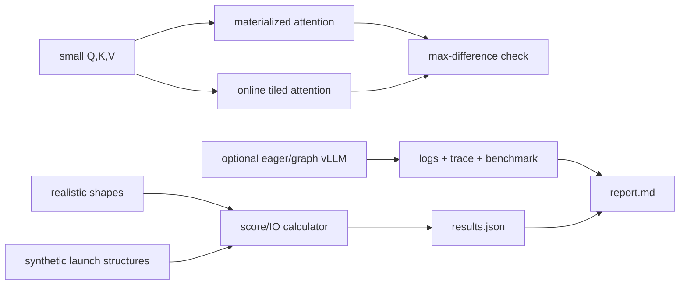

# 20 — Attention kernels, compilation, and CUDA graphs

**Status:** draft
**Estimated time:** 7–10 hours
**Compute profile:** required `local-cpu`; optional one CUDA-capable NVIDIA GPU
with vLLM and, for kernel traces, a compatible Nsight Systems installation
**Estimated GPU-minutes:** 0 required; 60–120 optional, hard cap 120
**Estimated cloud cost:** required path is free. Optional path uses one GPU node
for at most two hours plus existing cluster/storage/network charges; calculate
using current Regional prices.
**Prerequisites:** lessons 12, 13, 17–19; Python 3.9+; optional immutable vLLM
`v0.28.0` image and profiler compatible with the host driver/CUDA stack
**Last validated:** 2026-10-21
**Validated with:** dependency-free online-softmax correctness reference,
shape/IO arithmetic, synthetic launch-structure fixtures, and static checks.
No CUDA profile was captured in this workspace; supplied GPU commands create
evidence but do not claim a measured speedup.

## Why this matters

“Enable the fast kernel” hides several different optimizations:

- a fused attention algorithm can reduce high-bandwidth-memory traffic;
- compiler fusion can combine surrounding elementwise operations;
- autotuning can choose a kernel/tile for a particular shape;
- CUDA Graphs can reduce repeated CPU launch overhead;
- quantized or specialized kernels can change representation and arithmetic.

Each attacks a different bottleneck and has a different compatibility boundary.
A graph cannot fix a memory-inefficient kernel. FlashAttention does not remove
the model's matrix multiplications. Compilation can cost more than it saves for
a short process. Dynamic shapes may cause fallback, recompilation, or another
graph capture.

## Learning outcomes

By the end, you can:

- derive Q/K/V and attention-score tensor shapes;
- explain why materializing `[B,H,Sq,Sk]` is expensive;
- implement stable online softmax and show it matches materialized attention;
- explain FlashAttention's IO-aware tiling without calling it approximate;
- distinguish operator fusion, kernel fusion, graph compilation, autotuning,
  and CUDA Graph capture/replay;
- separate cold start, warmup/capture, and steady-state samples;
- read a launch timeline and identify removed launches/CPU gaps;
- test fixed and changing shapes for fallback/recapture; and
- accept an optimization only when output correctness and the target workload
  both pass.

## What you will build



The synthetic trace files contain event names only and are explicitly labelled
illustrative. They teach what to look for; they are not substituted for a
profiler trace.

## Files in this lesson

```text
20-attention-kernels-compilation-cuda-graphs/
├── README.md
├── report-template.md
├── results.schema.json
├── configs/
│   ├── shapes.json
│   ├── vllm-eager.args
│   └── vllm-graph.args
├── fixtures/
│   ├── cuda-graph.synthetic.json
│   ├── eager.synthetic.json
│   └── fused.synthetic.json
├── scripts/
│   ├── cleanup.sh
│   ├── collect-gpu-evidence.sh
│   ├── preflight.sh
│   ├── run-cpu-lab.sh
│   ├── start-vllm.sh
│   └── verify-results.py
├── solutions/SOLUTIONS.md
└── src/
    ├── attention_reference.py
    └── mechanism_report.py
```

## Concepts and mental model

### Attention shapes

For batch `B`, query heads `H`, query length `Sq`, key length `Sk`, head
dimension `D`, and value dimension `Dv`:

```text
Q       [B,H,Sq,D]
K       [B,H,Sk,D]
V       [B,H,Sk,Dv]
scores  [B,H,Sq,Sk] = Q @ K^T / sqrt(D)
P       [B,H,Sq,Sk] = softmax(scores)
output  [B,H,Sq,Dv] = P @ V
```

With GQA, query heads share fewer KV heads; the kernel maps groups accordingly.

The materialized score tensor has:

```math
B \times H \times S_q \times S_k
```

elements. At FP16, long prefill with `B=1`, `H=14`, and `S=4096` would make the
score tensor alone about:

```text
1 × 14 × 4096 × 4096 × 2 bytes ≈ 448 MiB
```

That is before softmax intermediates and does not represent total layer memory.

### Stable and online softmax

Naive `exp(x)` can overflow. Stable softmax subtracts the row maximum:

```math
p_i = exp(x_i-m) / \sum_j exp(x_j-m), \quad m=max_j(x_j)
```

Online softmax processes tiles. It keeps a running maximum `m`, denominator
`l`, and weighted numerator `o`. When a tile has a larger maximum `m_new`, old
partial sums are rescaled by `exp(m_old-m_new)`. The final `o/l` equals ordinary
attention subject to floating-point order/rounding.

FlashAttention-style algorithms exploit this recurrence to tile Q/K/V through
on-chip storage without writing the complete score/probability matrices to HBM.
The gain is reduced memory traffic, not skipped mathematical attention.

### Fusion

Unfused sequence:

```text
kernel 1: QK^T
kernel 2: scale
kernel 3: mask
kernel 4..n: softmax pieces
kernel n+1: P@V
```

Fused attention performs more work per launch and keeps intermediates close to
compute. Fusion can reduce launch overhead and HBM round trips but may require
supported dtype, head dimension, mask, architecture, and shape.

### Compilation versus CUDA Graphs

**Compilation** transforms a program/graph: fusing, specializing, generating,
and selecting kernels. First-run cost can include tracing and code generation.

**CUDA Graph capture** records a sequence of GPU operations and dependencies,
then replays it with a low-overhead graph launch. Capture generally needs stable
memory addresses and compatible control flow/shapes. Engines may maintain graph
pools for selected batch sizes and fall back for other shapes.

They can be combined:

```text
compile/select kernels -> warm allocations -> capture sequence -> replay
```

Graph replay reduces host launch work; it does not reduce kernel device work by
definition.

## Under the hood

### IO-aware tiled attention

Conceptual loop for one query tile:

```text
load Q tile into on-chip memory
initialize running max/denominator/output
for each K,V tile:
    load K,V tile
    compute local QK scores
    update running stable softmax statistics
    update weighted V numerator
write final normalized output tile
```

The actual implementation maps warps, shared memory, registers, tensor cores,
and causal masking carefully. The CPU reference teaches the recurrence, not GPU
layout or speed.

### Framework-to-GPU timeline

```text
Python/engine scheduler
  -> framework operator dispatch
    -> kernel launch queued by CPU
      -> GPU kernel executes
        -> synchronization/result dependency
```

Many tiny launches can leave CPU gaps. Fusion reduces the number of launches.
Graph replay reduces repeated dispatch/launch work. A profiler distinguishes
CPU API time, device kernels, memory copies, synchronization, and idle gaps.

### Dynamic shapes

Shape changes can affect:

- kernel eligibility;
- selected tile/autotuned implementation;
- compiled graph specialization;
- graph capture bucket;
- workspace and memory;
- performance without a visible error.

Therefore benchmark a shape matrix, not a single 128-token request.

## Prerequisites and preflight

```bash
cd lessons/phase-03-optimization/20-attention-kernels-compilation-cuda-graphs
chmod +x scripts/*.sh
./scripts/preflight.sh
mkdir -p artifacts
cp report-template.md artifacts/report.md
```

Expected:

```text
stdlib-only Python: 3.x.y
lesson 20 preflight passed
```

Optional:

```bash
nvidia-smi
docker info >/dev/null
command -v nsys || echo "Nsight Systems absent; do not claim kernel traces"
export VLLM_IMAGE='vllm/vllm-openai@sha256:RESOLVED_DIGEST'
case "$VLLM_IMAGE" in *@sha256:*) ;; *) exit 1;; esac
```

Resolve `vllm/vllm-openai:v0.28.0` through the workflow in lesson 17 and archive
the digest and `docker run --rm "$VLLM_IMAGE" --help`.

## Cost and safety

- CPU reference is free and tiny.
- Optional maximum is one GPU and 120 GPU-minutes.
- Run eager and graph configurations sequentially.
- Profile only workloads and systems you are authorized to inspect.
- Profiler traces can contain process paths, arguments, hostnames, and symbols;
  sanitize before sharing.
- Bind the API to `127.0.0.1`.
- Do not disable safety limits to force an unsupported kernel.
- Stop on repeated compile/capture loops, OOM, thermal/power anomaly, or unknown
  competing GPU process.

## Predict before running

1. How many score elements does long prefill create?
2. Why is subtracting the maximum numerically important?
3. Will tiled online attention produce approximate output?
4. Which optimization reduces visible CPU launches?
5. Which optimization reduces score-matrix HBM traffic?
6. Why might the first graph-enabled request be slower?
7. What happens when a request shape has no captured graph?

## Lab outline

1. Compute attention score sizes for prefill and decode shapes.
2. Run materialized and online tiled CPU attention and verify equality.
3. Compare illustrative eager/fused/graph launch structures.
4. Trigger a shape/tile validation failure and repair it.
5. Optionally benchmark pinned eager and graph engine configs.
6. Vary one shape to inspect fallback/recapture.
7. Save trace/log/correctness evidence and clean up.

## Step-by-step lab

### 1. Run the free mechanism lab

```bash
./scripts/run-cpu-lab.sh
```

It executes real attention arithmetic on a small matrix, then shape arithmetic
for realistic cases.

Expected:

```text
"passed": true
short-prefill          score elements=...
long-prefill           score elements=...
single-token-decode    score elements=...
eager                  visible launches=14
fused_attention        visible launches=3
cuda_graph_replay      visible launches=1
verified online-softmax correctness and mechanism-report invariants
```

The launch counts describe committed synthetic structures, not measured kernels.

### 2. Read the online recurrence

```bash
sed -n '35,125p' src/attention_reference.py
python3 -m json.tool artifacts/attention-correctness.json
```

Identify where old numerator/denominator values are rescaled when a new maximum
appears. Explain why not rescaling would change the answer.

### 3. Inspect score arithmetic

```bash
python3 - <<'PY'
import json
d=json.load(open("artifacts/results.json", encoding="utf-8"))
for s in d["shapes"]:
    print(s["name"], s["materialized_score_elements"],
          s["materialized_score_bytes_fp16"],
          s["illustrative_tile_score_elements"])
PY
```

Decode has `query_tokens=1`: its score row is long, but it does not construct a
full `S × S` prefill score matrix for that step.

### 4. Controlled tile experiment

```bash
for tile in 1 2 3 11; do
  python3 src/attention_reference.py \
    --query-tokens 8 --kv-tokens 11 --head-dim 4 \
    --tile-k "$tile" \
    --output "artifacts/tile-${tile}.json"
done
```

All should pass correctness. Floating-point order may change the tiny difference.
This does not compare performance because Python loop cost is irrelevant to GPU
kernels.

### 5. Optional eager baseline

```bash
nvidia-smi | tee artifacts/gpu-before.txt
./scripts/start-vllm.sh configs/vllm-eager.args
docker logs -f oms-l20-vllm
```

Wait and smoke test:

```bash
until curl --fail --silent http://127.0.0.1:8000/health; do sleep 5; done
curl --fail --silent http://127.0.0.1:8000/v1/chat/completions \
  -H 'Content-Type: application/json' \
  -d '{"model":"oms-model","messages":[{"role":"user","content":"Say kernel-ok"}],
       "temperature":0,"max_tokens":16}' \
  > artifacts/eager-smoke.json
./scripts/collect-gpu-evidence.sh
```

Use lesson 12's fixed shape workload. Save cold startup separately, perform
declared warmup, and save steady-state raw results.

### 6. Graph-enabled comparison

```bash
./scripts/cleanup.sh
./scripts/start-vllm.sh configs/vllm-graph.args
docker logs -f oms-l20-vllm
```

Repeat the identical workload. Record capture messages, graph memory, startup
duration, TTFT/TPOT, CPU gaps, device kernel time, and correctness.

If `nsys` and a reviewed profile setup are available, capture the serving
process/container using the official Nsight workflow appropriate to your host.
Do not invent a command that attaches to an inaccessible PID. Record exact
`nsys --version`, capture command, and trace path.

### 7. Shape-boundary study

Keep concurrency and output fixed; run prompt lengths 128, 512, 2048, and 4096.
Look for new capture/compile messages, eager fallback, different attention
backend, or latency discontinuity. One request per length is insufficient:
warm and repeat each bucket.

## Inspect what happened

Synthetic structures:

```bash
for file in fixtures/*.json; do
  echo "$file"
  python3 -m json.tool "$file"
done
```

Real engine:

```bash
grep -Ei 'attention|flash|compile|capture|graph|eager|fallback|kernel' \
  artifacts/vllm-startup.log | sed -n '1,240p'
nvidia-smi --query-gpu=name,driver_version,memory.total,memory.used \
  --format=csv
```

In a trace, inspect:

- count/duration of attention and elementwise kernels;
- CPU launch gaps;
- HtoD/DtoH copies;
- synchronization calls;
- graph launch APIs;
- whether the same shape reuses a captured sequence;
- whether output hashes/quality stay valid.

## Deliberate failure

Safe input failure:

```bash
set +e
python3 src/attention_reference.py \
  --query-tokens 8 --kv-tokens 11 --head-dim 4 --tile-k 0 \
  --output artifacts/invalid.json
status=$?
set -e
printf 'status=%s\n' "$status"
test "$status" -ne 0
```

Diagnosis: configuration validation fails before arithmetic. Repair only
`--tile-k` to a positive value.

Optional natural runtime diagnosis:

```text
graph/compiled candidate regresses
├─ startup included in steady state -> separate phases
├─ shape not captured/specialized -> logs + trace
├─ memory pressure/graph pool -> VRAM evidence
├─ kernel fallback -> backend logs and kernel names
├─ CPU was not bottleneck -> device time dominates
└─ workload/correctness changed -> reject comparison
```

Do not force graph capture for an unsupported shape.

## Controlled experiment

Required: tile size changes while Q/K/V/seed remain fixed. Correctness is the
gate; no CPU performance conclusion is allowed.

Optional:

| Run | Changed variable | Frozen |
|---|---|---|
| E | `--enforce-eager` present | model, image, workload, GPU, scheduler |
| G | `--enforce-eager` absent | same |
| G-shape | prompt length only | graph config and everything else |

Report cold-start/capture separately from warmed replay.

## Verification

```bash
python3 scripts/verify-results.py
```

It checks online/materialized agreement, labels, score growth, and the
illustrative launch ordering.

For GPU runs, require:

- identical model/output correctness;
- archived engine logs and image digest;
- warmup excluded by a predeclared rule;
- raw per-request results;
- profiler trace or explicit “not captured”;
- shape/config provenance.

## Expected result

The CPU online implementation should match materialized attention within
`1e-12` for the supplied tiny input. The long-prefill score tensor should dwarf
the short case. Illustrative fusion/graph structures should expose fewer visible
launches.

GPU results are hardware/workload dependent. No exact latency or speedup is
promised.

## Troubleshooting

| Symptom | Layer | Evidence/action |
|---|---|---|
| CPU correctness fails | algorithm | seed, recurrence, max rescaling |
| overflow | numerics | stable maximum subtraction |
| unsupported attention backend | kernel | dtype/head dim/GPU/version logs |
| compilation repeats | shapes | specialization/cache messages |
| graph capture OOM | memory | graph pools and pre/post VRAM |
| first run slow | lifecycle | separate compile/capture/warmup |
| no GPU speed change | bottleneck | CPU/device timeline |
| profiler cannot attach | permissions/runtime | use supported launch mode |
| trace contains secrets | evidence | sanitize before sharing |

## Evidence to collect

- `artifacts/attention-correctness.json`
- `artifacts/results.json`
- tile experiment JSON
- `artifacts/report.md`
- optional image digest/help, startup log, GPU snapshots
- optional raw eager/graph benchmarks and profiler trace
- output correctness hashes and shape matrix
- cleanup proof

## Knowledge check

1. Why is attention score storage quadratic in equal prefill length?
2. How does online softmax preserve exact attention?
3. Which memory movement does tiling avoid?
4. What is the difference between fusion and graph replay?
5. Why can graph capture increase memory?
6. Why must warmup be separate?
7. What evidence proves fallback?

## Exercises

Guided:

1. Derive the long-prefill score bytes manually.
2. Remove the running rescale in an ignored code copy and explain failure.
3. Compare tile sizes while enforcing correctness.
4. Add a causal mask to the tiny reference and test it.

Independent challenge: capture two real, sanitized profiler traces for the same
frozen workload, annotate eliminated launches/changed kernels/CPU gaps, and
explain the result from device and host evidence. Include a shape that falls
outside the winning path.

See [solutions/SOLUTIONS.md](solutions/SOLUTIONS.md).

## Completion gate

- CPU preflight and verifier pass.
- You derive all attention tensor shapes.
- You explain online softmax and IO reduction.
- You distinguish eager/fused/compiled/graph behavior.
- Safe failure is diagnosed and repaired.
- GPU claims include correctness, lifecycle separation, logs/digest, raw data,
  and trace—or explicitly say no trace.
- Resources and paid GPU capacity are cleaned.

## Cleanup

```bash
./scripts/cleanup.sh
docker ps --filter name=oms-l20-vllm
find artifacts -mindepth 1 -maxdepth 2 -print
```

Optional cache deletion:

```bash
DELETE_MODEL_CACHE=1 ./scripts/cleanup.sh
docker volume inspect oms-l20-model-cache
```

Remove profiler traces only after retaining the report or sanitized evidence.
Restore EKS capacity and verify no workload/public endpoint remains.

## Primary references

Required, reviewed 2026-10-21:

- [FlashAttention paper](https://arxiv.org/abs/2205.14135)
- [FlashAttention-2 paper](https://arxiv.org/abs/2307.08691)
- [CUDA Graphs programming guide](https://docs.nvidia.com/cuda/cuda-c-programming-guide/index.html#cuda-graphs)
- [Nsight Systems documentation](https://docs.nvidia.com/nsight-systems/)
- [vLLM v0.28.0 source](https://github.com/vllm-project/vllm/tree/v0.28.0)
- [vLLM engine arguments](https://docs.vllm.ai/en/latest/configuration/engine_args/)

Optional:

- [PyTorch `torch.compile` documentation](https://pytorch.org/docs/stable/generated/torch.compile.html)

Kernel eligibility, compiler behavior, and profiler compatibility change with
versions and GPU architecture. Pin and record the complete stack.
