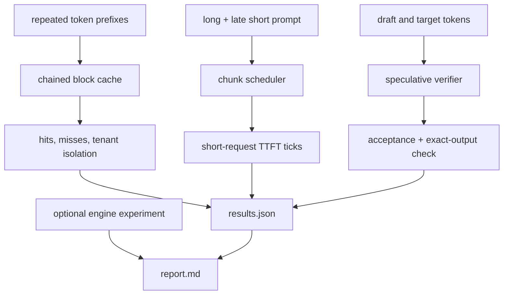

# 21 — Prefix caching, chunked prefill, and speculative decoding

**Status:** draft
**Estimated time:** 8–11 hours
**Compute profile:** required `local-cpu`; optional one NVIDIA GPU with an
immutable vLLM `v0.28.0` image
**Estimated GPU-minutes:** 0 required; 75–150 optional, hard cap 150
**Estimated cloud cost:** CPU simulations are free. Optional track uses one GPU
for no more than 2.5 hours plus existing cluster/storage/network costs. Resolve
the current Regional price before starting.
**Prerequisites:** lessons 12, 13, 17, 18, and 20; Python 3.9+
**Last validated:** 2026-10-21
**Validated with:** deterministic prefix-cache, chunk-scheduling, and greedy
speculation simulations plus static checks. Prefix/chunked vLLM flags are
provided for the pinned course version; speculative CLI is deliberately not
pre-filled because method/model compatibility must be selected and pinned from
that version's documentation. No GPU result is claimed.

## Why this matters

These optimizations exploit workload structure rather than merely faster
arithmetic:

- **prefix caching** reuses prefill work when token prefixes repeat;
- **chunked prefill** breaks long prompt work into schedulable pieces;
- **speculative decoding** asks a cheaper proposer to look ahead, then has the
  target verify several positions together.

Each can be transformative on the right distribution and harmful on the wrong
one. Unique prefixes give no reuse. Tiny chunks add overhead. A poor draft burns
compute with low acceptance. Cross-tenant cache reuse can become a security
concern. The correct question is not “is the flag faster?” but “which workload
property makes the mechanism pay?”

## Learning outcomes

By the end, you can:

- explain a chained KV-prefix block key and why token IDs/model revision matter;
- distinguish cached blocks from cached generated text;
- calculate reusable complete blocks and uncacheable tails;
- reason about capacity, LRU eviction, invalidation, and isolation domains;
- trace long prefill chunks interleaved with decode-sensitive work;
- explain draft proposal, target verification, accepted prefix, rejection, and
  exact target output;
- calculate acceptance rate without equating it to speedup;
- construct favorable and unfavorable workloads for all three techniques;
- inspect engine metrics/logs and enforce a correctness gate; and
- avoid teaching an unpinned speculative model/CLI combination.

## What you will build



The simulations use token IDs and abstract ticks to reveal mechanisms. They do
not predict real latency.

## Files in this lesson

```text
21-prefix-cache-chunked-prefill-speculative/
├── README.md
├── report-template.md
├── results.schema.json
├── configs/
│   ├── chunking-cases.json
│   ├── prefix-workload.json
│   ├── speculation-cases.json
│   ├── speculative-config.example.json
│   └── vllm-prefix-chunked.args
├── scripts/
│   ├── check-speculative-support.sh
│   ├── cleanup.sh
│   ├── preflight.sh
│   ├── run-cpu-lab.sh
│   ├── start-vllm.sh
│   └── verify-results.py
├── solutions/SOLUTIONS.md
└── src/reuse_lookahead_lab.py
```

The speculative example JSON is intentionally invalid and says so. Turning a
mutable example into an apparently runnable command would be less educational
and unsafe.

## Concepts and mental model

### Prefix caching reuses KV blocks

If two requests begin with identical token IDs under compatible model/cache
settings, their layer KV values for that prefix are identical. The engine can
reuse existing blocks instead of recomputing prefill.

Conceptual chained key:

```text
hash(parent_block_hash,
     block_token_ids,
     model_revision,
     adapter_or_cache_salt,
     isolation_domain)
```

Chaining prevents block two from matching unless block one also matches. A
different tokenizer/chat template can produce different token IDs from similar
text. A different model or adapter produces different K/V even for identical
IDs.

The simulator caches only complete blocks:

```text
block size 4; 10-token prompt -> 2 reusable blocks + 2-token tail
```

Real engine rules are version-specific. Inspect them rather than assuming this
teaching simplification is exact.

### Cache hit is not free

A hit saves model prefill work for reused tokens, but the request still needs:

- hashing and block-table operations;
- capacity for unique suffix/new decode tokens;
- scheduling;
- output decode;
- cache lookup/isolation policy.

Capacity is finite. LRU eviction can turn a once-hot prefix cold. Cache metrics
must be interpreted with request distributions and block/token weights.

### Chunked prefill

Without chunking, a long prefill may consume a large iteration:

```text
tick 0: long prompt positions 0..4095
tick 1: waiting decode/short work finally runs
```

With chunks:

```text
tick 0: long prompt 0..511
tick 1: decode-ready work + short prefill + long prompt 512.....
```

Chunking can improve scheduling responsiveness and batch composition. It can
increase launches/scheduler work, and it does not reduce total prompt tokens.

### Speculative decoding

For proposal width `k`:

```text
draft proposes d1,d2,...,dk
target verifies the proposed positions together
accept matching/corrected prefix according to the algorithm
on rejection, discard invalid suffix and emit target-consistent token
repeat
```

Greedy teaching case accepts tokens while draft equals target. Sampling
algorithms require probability correction to preserve the target distribution;
simple token equality is not a complete sampling implementation.

Acceptance rate:

```math
accepted\ draft\ tokens / proposed\ draft\ tokens
```

The simulator counts the entire generated proposal slice in the denominator,
including suffix tokens discarded after the first mismatch. Counting only the
prefix inspected through the mismatch would hide wasted draft work.

Speed depends on more:

```text
draft cost + target verification efficiency + accepted length
+ batch/scheduler interaction + memory + communication
```

High acceptance from an expensive draft may still lose. Low acceptance can add
work while preserving exact output.

## Under the hood

### Prefix request path

```text
tokenize/chat template
-> divide token IDs into blocks
-> build chained hashes
-> look up physical KV blocks
-> mark longest reusable prefix
-> schedule only uncached suffix prefill
-> attach new block table entries
-> retain/evict according to capacity policy
```

Security note: shared cache timing can reveal that another request used a
prefix. Isolation may require cache salts or separate engine/tenant domains.
Never assume cache content isolation from an API route alone.

### Chunk scheduler path

The token budget is shared by:

```math
scheduled\ prefill\ tokens + scheduled\ decode\ tokens \le budget
```

Chunk size bounds how much one prompt can claim in an opportunity. Scheduler
policy decides whether decode is prioritized, how waiting age matters, and
whether chunking is automatic.

### Target/draft path

A draft checkpoint adds weights/KV/runtime memory. A model-free technique such
as prompt lookup has different costs and applicability. The target remains the
authority. Correct algorithms do not silently replace target output with
unverified draft output.

The supplied simulator counts target verification rounds, not GPU time. One
round may process several proposed positions, but its cost is not equal to one
ordinary one-token step.

## Prerequisites and preflight

```bash
cd lessons/phase-03-optimization/21-prefix-cache-chunked-prefill-speculative
chmod +x scripts/*.sh
./scripts/preflight.sh
mkdir -p artifacts
cp report-template.md artifacts/report.md
```

Expected:

```text
stdlib-only Python: 3.x.y
lesson 21 preflight passed
```

Optional:

```bash
nvidia-smi
docker info >/dev/null
export VLLM_IMAGE='vllm/vllm-openai@sha256:RESOLVED_V0280_DIGEST'
case "$VLLM_IMAGE" in *@sha256:*) ;; *) exit 1;; esac
docker run --rm "$VLLM_IMAGE" --help > artifacts/vllm-help.txt
grep -Ei 'prefix|chunk|speculative' artifacts/vllm-help.txt
```

Resolve the tag through lesson 17's registry workflow. For speculative decoding:

```bash
./scripts/check-speculative-support.sh
python3 -m json.tool configs/speculative-config.example.json
```

Select an officially supported `v0.28.0` method. If it uses a draft model, pin
its ID, exact commit, license, tokenizer compatibility, and memory budget before
constructing the actual argument.

## Cost and safety

- Required simulation is free.
- Optional maximum: one GPU, one server, 150 GPU-minutes.
- Run one technique/configuration at a time.
- Bind to loopback or private `ClusterIP`.
- Prefix-cache sharing is a security/isolation decision.
- A draft model adds memory/download/license surface.
- Stop on OOM, repeated fallback/error, unknown GPU process, or budget timer.
- Do not weaken output correctness to improve acceptance or throughput.
- Cache directories persist after container stop; inspect disk/EBS.

## Predict before running

1. How many complete 4-token blocks are reusable in ten tokens?
2. Will the same token IDs hit across different tenants in this lab?
3. Does a prefix hit skip suffix prefill?
4. Does chunking reduce total prompt FLOPs?
5. Which chunk size should help the supplied late short request?
6. Will a completely wrong draft change target output in the simulator?
7. Why is acceptance rate not speedup?

## Lab outline

1. Hash repeated prefixes into complete chained blocks.
2. Observe same-tenant hits and cross-tenant isolation.
3. Compare unchunked and chunked long-prefill schedules.
4. Verify useful and poor drafts against one target.
5. Deliberately remove isolation in an ignored config/code copy and diagnose.
6. Optionally measure prefix/chunk behavior in vLLM.
7. Select and pin a speculative method only after version help/docs review.

## Step-by-step lab

### 1. Inspect fixed cases

```bash
python3 -m json.tool configs/prefix-workload.json
python3 -m json.tool configs/chunking-cases.json
python3 -m json.tool configs/speculation-cases.json
```

Write expected block hits, short TTFT direction, and useful/poor acceptance.

### 2. Run all mechanism simulations

```bash
./scripts/run-cpu-lab.sh
```

Expected shape:

```text
prefix tenant-a-first       hit_blocks=0 reused_tokens=0
prefix tenant-a-repeat      hit_blocks=2 reused_tokens=8
prefix tenant-b-same-text   hit_blocks=0 reused_tokens=0
chunk=...
spec useful-draft   acceptance=... target_steps=...
spec poor-draft     acceptance=... target_steps=...
verified cache isolation, exact speculative output, and acceptance effect
```

Exact deterministic values are in `artifacts/results.json`.

### 3. Trace the chained cache

```bash
python3 - <<'PY'
import json
d=json.load(open("artifacts/results.json", encoding="utf-8"))
print(json.dumps(d["prefix_cache"], indent=2))
PY
```

The repeated same-tenant request shares two complete blocks. Its unique suffix
does not hit. Tenant B's text/token IDs are the same but the isolation field
changes the hash domain.

### 4. Inspect chunk timelines

```bash
python3 - <<'PY'
import json
d=json.load(open("artifacts/results.json", encoding="utf-8"))
for case in d["chunked_prefill"]:
    print("\nchunk", case["chunk_size"], "short TTFT", case["short_ttft_ticks"])
    for tick in case["timeline"]:
        print(tick)
PY
```

The simulator prioritizes available short work once it arrives and constrains
long work to the chunk size. Explain where your engine's actual policy differs.

### 5. Trace speculative rejection

```bash
python3 - <<'PY'
import json
d=json.load(open("artifacts/results.json", encoding="utf-8"))
for case in d["speculative_decoding"]:
    print("\n", case["name"])
    for r in case["rounds"]:
        print(r)
    assert case["emitted_tokens"] == case["target_tokens"]
PY
```

On mismatch, the invalid draft suffix is not emitted. The next round starts at
the target-consistent position.

### 6. Optional prefix/chunk engine

```bash
nvidia-smi | tee artifacts/gpu-before.txt
./scripts/start-vllm.sh
docker logs -f oms-l21-vllm
```

Smoke test, then use lesson 12's fixed benchmark. Create two prompt sets:

- 80% share a long exact system prefix;
- 0% share a complete prefix beyond ordinary formatting.

Hold total prompt/output distributions constant. Run cache cold, then warm, and
capture complete metrics/logs:

```bash
curl --fail --silent http://127.0.0.1:8000/metrics \
  > artifacts/metrics-after-workload.txt
docker logs oms-l21-vllm > artifacts/vllm.log 2>&1
```

Do not infer a hit solely from lower TTFT; locate version-appropriate cache
metrics or engine logs.

### 7. Optional speculative run

First archive support evidence:

```bash
./scripts/check-speculative-support.sh
```

Then document the method, target/draft commits, tokenizer relation, proposal
width, extra VRAM, CLI argument, and official reference in `report.md`.
Construct and review the command manually. Run target-only baseline first, stop,
then speculative candidate with identical workload and quality checks.

## Inspect what happened

Required:

```bash
python3 - <<'PY'
import json
d=json.load(open("artifacts/results.json", encoding="utf-8"))
print("prefix keys include:", d["prefix_cache"]["key_fields"])
for x in d["speculative_decoding"]:
    print(x["name"], x["acceptance_rate"],
          x["target_verification_steps"], x["output_exact_match"])
PY
```

Engine evidence should answer:

- Are prefix metrics reported in blocks, tokens, or requests?
- Was the first request cold and later request warm?
- Which suffix remained uncached?
- Were cache entries evicted between tests?
- How were prefills chunked/scheduled with decode?
- What is speculative acceptance and proposed-token count?
- What extra target/draft memory was allocated?
- Did output quality/distribution remain valid?

## Deliberate failure

Required security reasoning drill: copy `src/reuse_lookahead_lab.py` into ignored
`artifacts/unsafe_lab.py`, remove `tenant` from `cache_key`, and run it.

```bash
cp src/reuse_lookahead_lab.py artifacts/unsafe_lab.py
# Edit only the ignored copy, removing tenant from the hashed payload.
set +e
python3 artifacts/unsafe_lab.py \
  --prefix configs/prefix-workload.json \
  --chunking configs/chunking-cases.json \
  --speculation configs/speculation-cases.json \
  --output artifacts/unsafe-results.json
python3 scripts/verify-results.py artifacts/unsafe-results.json
status=$?
set -e
printf 'unsafe verification status=%s\n' "$status"
test "$status" -ne 0
```

The verifier should reject a cross-tenant hit. Repair by restoring the isolation
field, not by deleting the tenant-B request.

Runtime diagnosis:

```text
optimization loses
├─ prefix: low exact-block reuse / eviction / hashing overhead
├─ chunking: no competing decode / chunks too small / launch overhead
├─ speculation: low acceptance / draft too costly / added memory pressure
├─ apparent win: output/workload/quality changed
└─ security failure: cache domain broader than approved tenancy
```

## Controlled experiment

| Technique | Favorable controlled variable | Unfavorable case |
|---|---|---|
| prefix cache | repeated exact token prefix | unique prefixes |
| chunked prefill | long prefill competing with decode | lone prompt |
| speculation | useful inexpensive proposer | poor/expensive draft |

Freeze model/image/GPU, total prompt/output distributions, arrival mode,
concurrency, warmup, and quality. For cache experiments, explicitly define
cold/warm state.

## Verification

```bash
python3 scripts/verify-results.py artifacts/results.json
```

It proves two same-tenant block hits, zero cross-tenant hits, exact target output
for both draft cases, and better acceptance/fewer verification rounds for the
useful fixture.

GPU verification requires raw outputs/quality plus version-specific cache and
acceptance metrics. Throughput alone is insufficient.

## Expected result

The same-tenant repeated request should reuse eight tokens; cross-tenant reuse
should be zero. The useful draft should accept more proposals and use fewer
target verification rounds than the poor draft while both emit exact target
tokens. Chunk size should change the late-short scheduling timeline.

No GPU win is promised.

## Troubleshooting

| Symptom | Layer | Evidence/action |
|---|---|---|
| expected prefix misses | tokens/key | dump token IDs, template, revision, salt |
| hits vanish over time | capacity | eviction/cache occupancy |
| chunk flag rejected | version | image digest and archived help |
| TTFT worsens | scheduler | chunks, launches, queue timeline |
| speculative method rejected | compatibility | pinned docs/help/model |
| low acceptance | algorithm/workload | proposed/accepted by slice |
| high acceptance but slow | system | draft cost, VRAM, target batch trace |
| output differs | correctness | stop; reject candidate |
| cross-tenant hit | security | narrow isolation domain immediately |

## Evidence to collect

- `artifacts/results.json`
- `artifacts/report.md`
- unsafe result and failed verification
- optional engine digest/help/logs/metrics
- cold/warm workload hashes and raw benchmark JSON
- speculative method/config, target/draft commits, acceptance, memory
- quality/correctness records
- cleanup proof

## Knowledge check

1. Why hash token IDs instead of raw text?
2. Why include parent hash and model revision?
3. What happens to a partial final block?
4. Does prefix caching save decode work?
5. Why can chunking improve TTFT without reducing FLOPs?
6. How is a rejected proposal repaired?
7. Why is draft acceptance workload-dependent?
8. What cache isolation decision is required in multi-tenant service?

## Exercises

Guided:

1. Lower cache capacity until LRU eviction changes a later hit.
2. Change one token in the first block versus suffix and compare reuse.
3. Add proposal widths 1, 2, and 8 to both draft cases.
4. Create a no-competition chunk workload and explain overhead risk.

Independent challenge: measure all three techniques on favorable and unfavorable
real workloads. Pin every artifact, preserve correctness, include cold/warm
state and cache isolation, and explain each win/loss from mechanism metrics.

See [solutions/SOLUTIONS.md](solutions/SOLUTIONS.md).

## Completion gate

- CPU lab and verifier pass.
- You explain chained block keys and tenant isolation.
- You trace chunk scheduling and draft rejection.
- Unsafe cache drill fails verification and is repaired.
- Favorable/unfavorable distributions are both tested or planned.
- Any speculative command is derived from pinned docs/help with exact artifacts.
- GPU claims include metrics, raw outputs, quality, memory, and provenance.
- All server/cache resources and paid nodes are cleaned.

## Cleanup

```bash
./scripts/cleanup.sh
docker ps --filter name=oms-l21-vllm
find artifacts -mindepth 1 -maxdepth 2 -print
```

Optional cache deletion:

```bash
DELETE_MODEL_CACHE=1 ./scripts/cleanup.sh
docker volume inspect oms-l21-model-cache
```

Clear server-side prefix state by stopping/removing the engine. Restore EKS node
capacity and verify no public endpoint, Pod, PVC, volume, or draft-model cache
remains unintentionally.

## Primary references

Required, reviewed 2026-10-21:

- [vLLM automatic prefix caching design](https://docs.vllm.ai/en/latest/design/prefix_caching/)
- [vLLM chunked prefill feature](https://docs.vllm.ai/en/latest/configuration/optimization/)
- [vLLM speculative decoding documentation](https://docs.vllm.ai/en/latest/features/spec_decode/)
- [vLLM v0.28.0 source](https://github.com/vllm-project/vllm/tree/v0.28.0)
- [Speculative decoding paper](https://arxiv.org/abs/2211.17192)
- [Speculative sampling paper](https://arxiv.org/abs/2302.01318)
- [Sarathi-Serve chunked-prefill paper](https://arxiv.org/abs/2403.02310)

CLI schemas and supported speculative methods change. The saved image digest,
versioned help, and exact target/draft revisions are part of the result.
