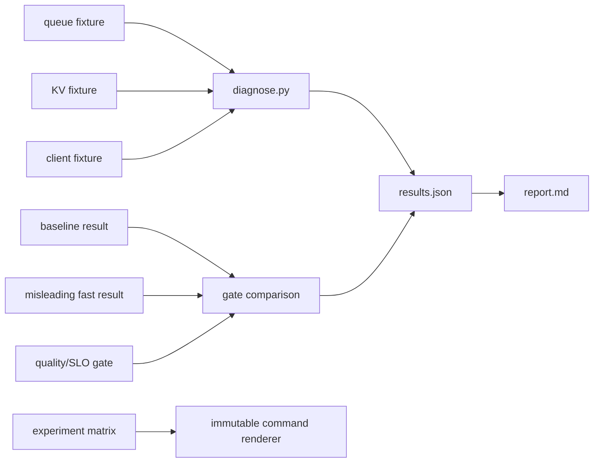

# 22 — A disciplined tuning workflow

**Status:** draft
**Estimated time:** 7–9 hours
**Compute profile:** required `local-cpu`; optional one NVIDIA GPU running one
candidate at a time
**Estimated GPU-minutes:** 0 required; 60–120 optional, hard cap 120
**Estimated cloud cost:** supplied diagnosis fixtures are free. Optional work
uses one GPU for at most two hours plus existing EKS/storage/network costs;
calculate current Regional pricing before scaling.
**Prerequisites:** lessons 12 and 17–21; Python 3.9+; an optional immutable vLLM
`v0.28.0` image digest and frozen workload
**Last validated:** 2026-10-21
**Validated with:** dependency-free diagnosis/comparison tool, five explicitly
synthetic fixtures, static checks, and CPU verification. No GPU tuning result is
claimed; the learner must replace fixtures with raw measurements.

## Why this matters

Inference flags interact. Randomly changing batch size, memory utilization,
quantization, graphs, caching, and prompt lengths until a dashboard improves
produces anecdotes—not knowledge.

A defensible optimization has an evidence chain:

```text
user-visible symptom
-> layer-specific metric
-> timeline/trace/log evidence
-> mechanism hypothesis
-> one-variable intervention
-> quality and SLO gate
-> repeat/ablation
-> accept, reject, or investigate
```

This workflow prevents common false wins: shorter outputs, dropped failures,
different prompt mixes, warmup contamination, coordinated omission, hidden
quality loss, and selecting the luckiest sample from a large sweep.

## Learning outcomes

By the end, you can:

- translate “slow” into queue, TTFT, TPOT/ITL, end-to-end, or startup symptoms;
- classify compute, memory/KV, scheduler, CPU, storage, network, and client
  bottlenecks;
- select evidence that can falsify a hypothesis;
- freeze model, workload, quality, arrival mode, and environment;
- run baseline repeats before tuning;
- distinguish one-factor experiments from intentional interaction studies;
- reject a faster but invalid comparison automatically;
- record negative results and uncertainty;
- render an exact immutable engine command from a candidate row; and
- recommend the smallest mechanism-backed change with rollback criteria.

## What you will build



Fixtures are training cases, not observations. They carry the label
`synthetic_training_fixture_not_measurement`.

## Files in this lesson

```text
22-disciplined-tuning-workflow/
├── README.md
├── hypothesis-log.csv
├── report-template.md
├── results.schema.json
├── cases/
│   ├── baseline-run.json
│   ├── client-bound.json
│   ├── kv-bound.json
│   ├── misleading-fast-run.json
│   └── queue-bound.json
├── configs/
│   ├── experiment-matrix.json
│   └── quality-slo-gate.json
├── scripts/
│   ├── cleanup.sh
│   ├── preflight.sh
│   ├── render-engine-command.py
│   ├── run-cpu-lab.sh
│   └── verify-results.py
├── solutions/SOLUTIONS.md
└── src/diagnose.py
```

## Concepts and mental model

### Start with a service objective

Examples:

```text
interactive: p95 TTFT <= 1.0 s, p95 TPOT <= 40 ms, quality >= 95%
batch:       maximize valid output tokens/s under a completion deadline
```

An objective contains:

- workload population;
- metric and percentile;
- quality/correctness floor;
- hardware/cost boundary;
- error/success definition;
- measurement window.

“Maximize tokens/s” alone can choose a system that fails interactive users.

### Bottleneck signatures are hypotheses

| Layer | Possible evidence | Do not conclude from |
|---|---|---|
| queue/scheduler | arrival > completion, waiting count, queue time | GPU use alone |
| KV memory | high cache occupancy, preemption/recompute | total VRAM alone |
| compute/kernel | device time, occupancy, kernel trace | one wall-clock sample |
| memory bandwidth | counters/roofline pattern, decode scaling | peak FLOPS spec |
| CPU/launch | CPU gaps, graph/fusion evidence | low GPU average alone |
| storage/startup | file throughput, page cache, load timeline | first request only |
| network/client | server vs client timestamps, retransmits/backpressure | e2e only |

Signatures guide the next measurement; they are not universal proofs.

### Open versus closed loop

Closed-loop clients wait for a response before sending another. When the server
slows, the offered rate drops, hiding queue growth. This is coordinated
omission. Open-loop generation schedules arrivals independently at a declared
rate and records late/failed requests.

Both are useful when chosen intentionally:

- closed loop answers “what does fixed concurrency experience?”;
- open loop answers “what happens at this offered arrival process?”

Never compare one mode to the other as if only an engine flag changed.

### Controls, treatments, and interactions

A one-factor experiment changes one item while holding all else fixed. It
isolates a mechanism. Some treatments are inherently coupled—a quantized
artifact plus its required kernel, for example. Name that coupled treatment.

After one-factor evidence, a small factorial study can test interactions:

```text
prefix cache off/on × scheduler token budget low/high
```

Avoid an enormous blind sweep: multiple comparisons can select noise.

### Gates before ranking

Apply in this order:

```text
same workload/provenance?
-> requests valid and successes counted?
-> quality floor?
-> latency/memory/cost limits?
-> rank feasible candidates by objective
```

A 2× request-rate row with one-quarter output length is not an optimization of
the same workload.

## Under the hood

The supplied diagnosis rules inspect explicit evidence:

- queue case: offered arrival rate exceeds completion and queue dominates TPOT;
- KV case: cache reaches 99%, preemption and recomputed tokens appear;
- client case: GPU/queue are low while client time exceeds server time and think
  time is present.

`compare()` checks workload/output comparability and hard gates before accepting
throughput. It rejects the supplied “fast” run because quality and output length
changed.

A real investigation should preserve timestamps across:

```text
load generator send
-> ingress/service
-> engine queue admission
-> prefill
-> first streamed token
-> decode iterations
-> final chunk
-> client receive
```

Use monotonic clocks within a process; synchronize hosts when comparing clocks;
avoid pretending unsynchronized wall times provide sub-millisecond truth.

## Prerequisites and preflight

```bash
cd lessons/phase-03-optimization/22-disciplined-tuning-workflow
chmod +x scripts/*.sh
./scripts/preflight.sh
mkdir -p artifacts
cp report-template.md artifacts/report.md
cp hypothesis-log.csv artifacts/hypothesis-log.csv
```

Expected:

```text
stdlib-only Python: 3.x.y
lesson 22 preflight passed
```

Optional GPU:

```bash
nvidia-smi
docker info >/dev/null
export VLLM_IMAGE='vllm/vllm-openai@sha256:RESOLVED_V0280_DIGEST'
case "$VLLM_IMAGE" in *@sha256:*) ;; *) exit 1;; esac
sha256sum configs/experiment-matrix.json configs/quality-slo-gate.json
```

On macOS use `shasum -a 256` if `sha256sum` is unavailable. Record the exact
command and hash implementation.

## Cost and safety

- CPU case analysis costs nothing.
- Optional plan is bounded to one GPU, three candidates, baseline repeats, and
  120 GPU-minutes.
- Estimate GPU-minutes before every run: replicas × GPUs × wall minutes.
- Bind to loopback or private `ClusterIP`.
- Stop on unknown GPU occupancy, errors excluded from metrics, or budget breach.
- Do not put account IDs, cluster endpoints, tokens, or credentials in evidence.
- A sweep must have a predeclared maximum; do not let a script create unlimited
  paid jobs.
- Negative results are retained. Deleting them creates selection bias.

## Predict before running

For each fixture, write:

1. the primary suspected layer;
2. three supporting fields;
3. one falsification test;
4. one tempting but unjustified flag change.

Also predict why the faster candidate must be rejected before reading the gate.

## Lab outline

1. Diagnose queue, KV, and client pathologies from supplied evidence.
2. Reject a confounded speedup with frozen gates.
3. Write hypotheses before configuration.
4. Render three immutable engine commands without executing them.
5. Trigger a workload-comparability failure and repair it.
6. Optionally run bounded baseline/candidates with exact evidence.
7. Repeat the winner and perform one ablation.

## Step-by-step lab

### 1. Inspect, do not trust, fixtures

```bash
for file in cases/*.json; do
  echo "$file"
  python3 -m json.tool "$file"
done
```

Every fixture says it is synthetic. Preserve that label in derived output.

### 2. Run diagnosis and gating

```bash
./scripts/run-cpu-lab.sh
```

Expected:

```text
queue-bound    -> admission_queue_saturation
kv-bound       -> kv_capacity_and_preemption
client-bound   -> client_pacing_or_backpressure
candidate accepted: False; reasons: mean output length changed, quality gate failed
verified three diagnoses and rejection of a confounded speedup
```

### 3. Read the evidence chain

```bash
python3 - <<'PY'
import json
d=json.load(open("artifacts/results.json", encoding="utf-8"))
for x in d["diagnoses"]:
    print("\n", x["case_id"])
    print("hypothesis:", x["primary_hypothesis"])
    print("evidence:", *x["supporting_evidence"], sep="\n- ")
    print("falsify:", x["falsification_test"])
PY
```

For each rule, identify data that would contradict it.

### 4. Inspect the misleading improvement

```bash
python3 - <<'PY'
import json
for p in ("cases/baseline-run.json","cases/misleading-fast-run.json"):
    d=json.load(open(p, encoding="utf-8"))
    print(p, d["changed_variable"], d["summary"])
PY
```

The candidate does less work and fails quality. Its higher request throughput
is not comparable.

### 5. Render exact candidate commands

The renderer prints but does not execute:

```bash
for experiment in b0 e1 e2; do
  python3 scripts/render-engine-command.py \
    --experiment "$experiment" \
    --image "$VLLM_IMAGE" |
    tee "artifacts/${experiment}-command.txt"
done
```

Review differences:

```bash
diff -u artifacts/b0-command.txt artifacts/e1-command.txt || true
diff -u artifacts/b0-command.txt artifacts/e2-command.txt || true
```

`e1` changes token budget; `e2` changes memory utilization. If another field
differs, the control is broken.

### 6. Complete hypotheses before runs

Edit `artifacts/hypothesis-log.csv`, not the committed template. Each row needs:

- symptom;
- mechanism hypothesis;
- predicted metric direction;
- exactly one changed variable;
- constants;
- evidence path;
- outcome and decision after execution.

### 7. Optional bounded GPU study

Use lesson 12's benchmark client/schema and lesson 13's deployment pattern.
For each experiment:

1. record GPU/driver and image/model revision;
2. start from a declared cache state;
3. warm exactly the declared requests;
4. run at least two baseline repetitions before tuning;
5. collect client raw records, complete engine metrics/logs, and GPU telemetry;
6. stop the container before the next config;
7. update the hypothesis log.

Never execute a generated command blindly. Read and verify the container name,
loopback bind, GPU count, image digest, and every engine flag.

## Inspect what happened

For each real run, inspect by layer:

```text
client: offered arrivals, errors, TTFT/e2e, output lengths
server: queue/running/waiting, prefill/decode tokens, cache/preemption
GPU:    utilization, memory, power/clocks if relevant
trace:  kernels, launches, copies, idle gaps
host:   CPU, RAM, disk/network if suspected
quality: per-example pass/fail and failure slices
```

Commands:

```bash
curl --fail --silent http://127.0.0.1:8000/metrics \
  > artifacts/current-metrics.txt
nvidia-smi \
  --query-gpu=timestamp,name,driver_version,memory.used,utilization.gpu \
  --format=csv |
  tee artifacts/current-gpu.csv
```

A snapshot can miss spikes; use time-series collection for real conclusions.

## Deliberate failure

Create an ignored candidate with a changed workload hash:

```bash
cp cases/misleading-fast-run.json artifacts/wrong-workload.json
python3 - <<'PY'
import json
p="artifacts/wrong-workload.json"
d=json.load(open(p, encoding="utf-8"))
d["controlled_workload_hash"]="different-workload"
json.dump(d, open(p, "w", encoding="utf-8"), indent=2)
PY
python3 src/diagnose.py \
  --case cases/queue-bound.json \
  --baseline cases/baseline-run.json \
  --candidate artifacts/wrong-workload.json \
  --gate configs/quality-slo-gate.json \
  --output artifacts/wrong-comparison.json
```

Inspect `rejection_reasons`; it must include workload hash, output length, and
quality. Repair by rerunning the actual frozen workload—never editing a measured
hash to match.

Diagnosis tree:

```text
apparent improvement
├─ workload/model/hardware differs -> reject
├─ output length or quality differs -> reject
├─ failures/timeouts omitted -> reject
├─ warmup/cache state differs -> rerun controlled
├─ effect smaller than run variance -> inconclusive
└─ valid and repeatable -> connect to mechanism evidence
```

## Controlled experiment

The matrix intentionally contains:

| ID | Changed variable | Mechanism |
|---|---|---|
| b0 | none | repeatable baseline |
| e1 | max batched tokens | scheduler work budget |
| e2 | GPU memory utilization | potential KV capacity |

An interaction study may follow only after each individual effect is measured.
For example, test `e1+e2` and compare against both single-factor runs.

## Verification

```bash
python3 scripts/verify-results.py artifacts/results.json
```

It checks all three training diagnoses and ensures the confounded speedup is
rejected for both quality and output-length reasons.

For real runs, add automated checks for:

- identical workload/model/image/hardware identifiers;
- declared request count including failures;
- minimum success and quality;
- stable output-token distribution;
- raw-record count;
- SLO and cost limit;
- no NaN/missing percentile.

## Expected result

The CPU tool should produce three correct evidence-chain diagnoses and reject
the enticing fast row. Real tuning has no predetermined winner. “No candidate
meets the SLO” and “effect is smaller than variance” are valid results.

## Troubleshooting

| Symptom | Likely issue | Action |
|---|---|---|
| diagnosis mismatch | edited fixture/rule | preserve diff, inspect evidence |
| renderer rejects image | mutable tag | resolve digest |
| candidate cannot start | config/version | archived help and startup log |
| p95 unstable | too few samples/nonstationary | repeat, plot timeline |
| GPU low and queue empty | client/offered load | inspect generator mode |
| KV full/preemption | capacity | controlled memory/concurrency test |
| throughput rises with errors | accounting | include every request |
| “win” only once | noise/cache/warmup | repeat and ablate |

## Evidence to collect

- `artifacts/results.json`
- completed `artifacts/hypothesis-log.csv`
- exact rendered command per run
- workload/gate/matrix hashes
- raw `oms-benchmark/v1` records and complete metrics/logs
- GPU/driver/image/model provenance
- quality results, baseline repeats, ablations, negative runs
- `artifacts/report.md`
- cleanup/cost proof

## Knowledge check

1. Why is high GPU utilization not a diagnosis?
2. What is coordinated omission?
3. When should open-loop and closed-loop tests be used?
4. Why run baseline repeats first?
5. What makes a hypothesis falsifiable?
6. Why are hard gates applied before ranking?
7. When is a coupled treatment honest?
8. How do you decide an effect is inconclusive?

## Exercises

Guided:

1. Add a storage-bound fixture with startup evidence and diagnosis rule.
2. Make a candidate fail success rate while improving p95; verify rejection.
3. Compute baseline coefficient of variation across three supplied mock runs.
4. Design a two-factor interaction matrix without a blind sweep.

Independent challenge: diagnose one real service pathology. Before changing
configuration, freeze the objective/workload and write a falsifiable hypothesis.
Collect evidence across client, scheduler, GPU, and quality; run an ablation;
publish accepted and rejected runs.

See [solutions/SOLUTIONS.md](solutions/SOLUTIONS.md).

## Completion gate

- CPU preflight and verifier pass.
- You diagnose each fixture from evidence, not its filename.
- The misleading run is rejected automatically.
- Hypothesis log is completed before optional runs.
- Every candidate differs exactly as declared.
- A winner is repeated and ablated, or result is honestly inconclusive.
- GPU claims include raw data, provenance, quality, errors, and cost.
- Containers/namespaces/caches and paid capacity are cleaned.

## Cleanup

```bash
./scripts/cleanup.sh
docker ps --filter name=oms-l22
find artifacts -mindepth 1 -maxdepth 2 -print
```

Remove ignored evidence only after preserving the report. On EKS, delete the
lesson workload, verify no `LoadBalancer`/PVC remains, restore node-group
capacity, and record final GPU-minutes.

## Primary references

Required, reviewed 2026-10-21:

- [vLLM benchmark documentation](https://docs.vllm.ai/en/latest/contributing/benchmarks/)
- [vLLM metrics documentation](https://docs.vllm.ai/en/latest/design/metrics/)
- [vLLM v0.28.0 source](https://github.com/vllm-project/vllm/tree/v0.28.0)
- [The Tail at Scale](https://research.google/pubs/the-tail-at-scale/)
- [Coordinated omission explanation in HdrHistogram](https://github.com/HdrHistogram/HdrHistogram)

Optional:

- [Nsight Systems documentation](https://docs.nvidia.com/nsight-systems/)

Archive versioned CLI/help and complete raw results. Documentation and metric
names can change after the validation date.
