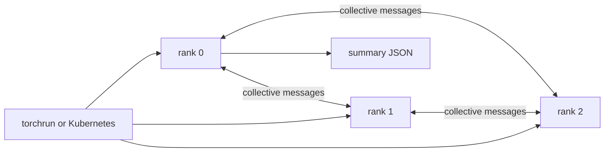

# 24 — Distributed-process fundamentals

**Status:** draft
**Estimated time:** 6–8 hours
**Compute profile:** local CPU for the required path; optional three separate
one-GPU EKS nodes
**Estimated GPU-minutes:** 0 required; 45–90 optional, including startup
**Estimated cloud cost:** three GPU-node instance-hours rounded up to the
provider billing granularity, plus standing EKS and network charges; retrieve
the current Regional price before scaling and multiply by the planned wall time
**Prerequisites:** lessons 05–10 and 17; Python 3.9–3.12; basic tensor knowledge
**Last validated:** 2026-10-21
**Validated with:** Python 3.9 static syntax, Bash syntax, JSON parsing, and
arithmetic unit tests; local PyTorch execution and live EKS/NCCL execution have
not been performed in this authoring environment

## Why this matters

An inference engine may print `rank 2`, `world size 3`, or `NCCL timeout` and
then appear frozen. Those terms are not engine-specific. They describe a group
of operating-system processes that must discover one another, agree on an
ordering, and enter communication operations in compatible order.

Without this model, a distributed hang looks random. With it, you can ask:

- Did every expected process join the rendezvous?
- Do all processes agree that the world contains three ranks?
- Did rank 0 enter `all_reduce` while rank 1 entered `broadcast`?
- Is one process waiting at a barrier because another crashed?
- Is slow progress computation, communication, or synchronization?

This lesson uses tiny tensors so correctness is visible. It first runs on one
computer with the CPU `gloo` backend. The same program can then run one process
per Kubernetes Pod, one Pod per one-GPU node, with the `nccl` backend. Starting
on CPU prevents expensive cluster startup from becoming part of basic
debugging.

## Learning outcomes

By the end, you can:

- define global rank, local rank, world size, process group, backend,
  rendezvous, store, barrier, collective, and point-to-point operation;
- launch three local ranks with `torchrun`;
- initialize a process group from `MASTER_ADDR`, `MASTER_PORT`, `RANK`, and
  `WORLD_SIZE`;
- predict and verify broadcast, all-gather, all-reduce, reduce-scatter, and
  send/receive results;
- explain why every rank must call collectives in the same order;
- distinguish payload bytes from physical network bytes;
- deploy exactly one NCCL rank on each of three nodes;
- use logs and Kubernetes placement evidence to locate a missing rank;
- preserve machine-readable results; and
- remove the namespace and restore the node-group baseline.

## What you will build



The CPU result is `artifacts/local/summary.json`. The GPU path prints one
structured `RESULT_JSON` line per Pod, which `collect-results.py` converts to a
single JSON document. Correctness is checked before timings are accepted.

## Files in this lesson

```text
24-distributed-process-fundamentals/
├── README.md
├── requirements.txt
├── src/
│   ├── collectives_lab.py       # real torch.distributed operations
│   └── collect_results.py       # combines structured Pod logs
├── k8s/
│   └── collectives.yaml.tpl     # headless Service and three-rank StatefulSet
└── scripts/
    ├── preflight-local.sh
    ├── run-local.sh
    ├── render-k8s.py
    ├── deploy-k8s.sh
    ├── observe-k8s.sh
    └── verify-local.py
```

Shared helpers live in `../common/scripts/`. Run all commands from this lesson
directory.

## Concepts and mental model

A **rank** is an integer identity within one process group. With world size
three, valid global ranks are `0`, `1`, and `2`. Rank 0 is often used for
coordination and reporting, but it is not inherently a controller.

**Local rank** identifies a process relative to one host. Three processes on one
host have global ranks 0–2 and local ranks 0–2. In this phase, each host runs
one process, so every process has local rank 0 while global ranks differ.

The **world size** is the number of expected participants. Initialization cannot
finish if two processes expect world size three and the third never arrives.

A **rendezvous** is the initial meeting. Processes use a shared endpoint to
exchange enough information to form a group. The rendezvous does not make later
collectives optional; it only gets everyone introduced.

A **backend** implements transport operations. This lab uses Gloo for CPU
tensors and NCCL for NVIDIA CUDA tensors. A process group is the logical group
plus its backend state.

Point-to-point operations name a sender and receiver. Collectives involve the
group:

| Operation | Plain-language effect | Common use |
|---|---|---|
| broadcast | one rank's tensor becomes every rank's tensor | configuration or weights |
| all-gather | every rank obtains every rank's piece | reconstruct shards |
| all-reduce | values are reduced, then result reaches every rank | replicated sums/gradients |
| reduce-scatter | reduce values and leave one result shard per rank | sharded reductions |
| barrier | no rank leaves until all ranks enter | synchronization/debugging |

The dinner-table analogy—everyone must reach the same course before continuing—
helps with collective ordering. It stops being accurate when discussing the
algorithm: libraries may pipeline chunks and overlap links rather than sending
one whole tensor around a literal table.

## Under the hood

`torchrun --nproc-per-node 3` creates three child processes and assigns
environment variables. Each child executes the same Python file:

```text
process 0: RANK=0 LOCAL_RANK=0 WORLD_SIZE=3
process 1: RANK=1 LOCAL_RANK=1 WORLD_SIZE=3
process 2: RANK=2 LOCAL_RANK=2 WORLD_SIZE=3
```

The program calls `init_process_group`. With `env://`, PyTorch reads the rank
and rendezvous variables. For NCCL, each process first selects
`cuda:LOCAL_RANK`; in the Kubernetes path that is always `cuda:0` because each
Pod receives exactly one visible device.

For an all-reduce sum, the lab starts rank `r` with a tensor filled with `r+1`.
With three ranks, each output element must be:

```text
1 + 2 + 3 = 6
```

The API contract describes the result, not the physical algorithm. NCCL can
choose ring, tree, or another algorithm and divide a tensor into chunks. The
lab's `payload_bytes` is only `elements × bytes_per_element`. It is not a claim
about wire bytes. Protocol headers, retransmissions, algorithm steps, and
copies can make physical traffic different.

Collective ordering is a distributed contract:

```text
correct:
rank 0: broadcast -> all_reduce -> barrier
rank 1: broadcast -> all_reduce -> barrier

incorrect:
rank 0: broadcast -> all_reduce
rank 1: all_reduce -> broadcast
```

The incorrect version can wait until the process-group timeout because the
operations cannot pair. A timeout is a symptom; logs from every rank are needed
to find the first divergence.

On Kubernetes, a headless Service gives stable DNS for
`collectives-0.collectives.<namespace>.svc`. The StatefulSet ordinal becomes
the global rank. Required Pod anti-affinity on `kubernetes.io/hostname` makes a
fourth truth visible: a three-rank job needs three eligible nodes. It will not
silently place two ranks on one node.

## Prerequisites and preflight

### Required CPU path

```bash
cd lessons/phase-04-distributed/24-distributed-process-fundamentals
chmod +x scripts/*.sh scripts/*.py src/*.py
./scripts/preflight-local.sh
python3 -m venv .venv
source .venv/bin/activate
python -m pip install --upgrade pip
python -m pip install -r requirements.txt
```

`requirements.txt` pins the teaching version. If your platform needs a
different official PyTorch wheel, create a second environment and record
`python -m pip freeze`; do not silently change the committed lock.

### Optional EKS path

Set non-secret identifiers:

```bash
export AWS_REGION='REPLACE_WITH_REGION'
export EKS_CLUSTER='REPLACE_WITH_CLUSTER'
export GPU_NODEGROUP='REPLACE_WITH_LAB_GPU_NODEGROUP'
export CONFIRM_GPU_NODEGROUP="$GPU_NODEGROUP"
export LAB_NAMESPACE='oms-distributed-24'
```

Then run the read-only target check:

```bash
../common/scripts/assert-eks-target.sh
```

Resolve a reviewed PyTorch CUDA image to an immutable multi-architecture digest
and export the complete reference:

```bash
export PYTORCH_IMAGE='registry/repository@sha256:64_lowercase_hex_characters'
```

Do not copy that placeholder. `render-k8s.py` rejects tags and malformed
digests. Confirm that the image architecture and bundled PyTorch/CUDA/NCCL
versions match the GPU node's driver contract.

## Cost and safety

The CPU path is free except for your computer. The optional path uses three
billable nodes. Before scaling, write down:

```text
current instance type:
current Regional hourly price:
planned minutes:
three-node estimated cost:
saved cleanup owner:
```

The StatefulSet uses no Service of type `LoadBalancer`, no host networking, no
host paths, and no privileged containers. The headless `ClusterIP` Service is
reachable only inside the cluster network. Kubernetes network scope is not
authentication; run this in a dedicated lab namespace.

The shared scaler refuses a non-idle node group and requires
`I_UNDERSTAND_GPU_COSTS=yes`. Stop if the active endpoint, node-group name,
image digest, or expected three-node topology is wrong. Do not turn a shared
production node group into lesson capacity.

## Predict before running

Record answers in `artifacts/predictions.md`:

1. What values will three-rank all-gather produce?
2. If rank 2 never starts, where will ranks 0 and 1 wait?
3. Does `LOCAL_RANK=0` on all three nodes imply a duplicate global rank?
4. Which operation leaves every rank with the sum?
5. Can “the Pod is Running” prove its process joined the group?
6. Why is one timing sample after process startup misleading?

## Lab outline

1. Run a correct three-rank Gloo baseline.
2. Inspect per-rank identities and collective results.
3. Sweep payload element count while holding everything else constant.
4. Introduce an ordering mismatch with a short timeout.
5. Repair and verify.
6. Optionally repeat with one NCCL rank per GPU node.
7. Capture evidence and clean up.

## Step-by-step lab

### 1. Establish the local baseline

After activating the environment:

```bash
./scripts/run-local.sh all-reduce 1024
python -m json.tool artifacts/local/summary.json
```

Abbreviated output:

```text
{"event": "rank_environment", "rank": 0, "world_size": 3, ...}
{"event": "summary_written", "passed": true, ...}
lesson-24 local distributed contract: PASS
```

The meaningful evidence is `world_size: 3`, three unique ranks, and
`correctness.passed: true`. Your host name and timing differ.

Run every operation:

```bash
for operation in broadcast all-gather all-reduce reduce-scatter send-recv; do
  ./scripts/run-local.sh "$operation" 1024
  cp artifacts/local/summary.json \
    "artifacts/local/${operation}.json"
done
```

### 2. Inspect identities

```bash
python3 - <<'PY'
import json
from pathlib import Path

result = json.loads(Path("artifacts/local/all-reduce.json").read_text())
for rank in result["ranks"]:
    print(rank["rank"], rank["local_rank"], rank["hostname"], rank["device"])
PY
```

On one machine you expect one host name and three local ranks. On Kubernetes
you expect three host names and local rank zero in every record.

### 3. Controlled payload experiment

Run `all-reduce` with one controlled variable:

```bash
mkdir -p artifacts/payload-sweep
for elements in 1 1024 1048576; do
  ./scripts/run-local.sh all-reduce "$elements"
  cp artifacts/local/summary.json \
    "artifacts/payload-sweep/elements-${elements}.json"
done
```

Do not conclude that the largest payload is “network bandwidth.” On one host,
Gloo may use shared-memory or loopback paths. The sweep teaches fixed startup
cost versus payload-dependent cost; lesson 27 isolates inter-node networking.

### 4. Prepare three GPU nodes

Only after price review:

```bash
export I_UNDERSTAND_GPU_COSTS=yes
../common/scripts/scale-three-nodes.sh up
```

Wait, then verify:

```bash
kubectl get nodes -o json |
  ../common/scripts/verify-three-gpu-nodes.py \
    --nodegroup "$GPU_NODEGROUP"
../common/scripts/capture-topology.sh
```

If only two nodes are Ready, stop. Do not weaken anti-affinity.

### 5. Render and deploy

```bash
./scripts/render-k8s.py
./scripts/deploy-k8s.sh
kubectl -n "$LAB_NAMESPACE" get pods -o wide
```

Expected placement:

```text
collectives-0   1/1   Running   ...   node-a
collectives-1   1/1   Running   ...   node-b
collectives-2   1/1   Running   ...   node-c
```

The script creates source as a ConfigMap, applies the rendered manifest, and
waits for every rank to write a passing result marker before its container
enters an idle sleep. It does not claim success merely because Pods were
scheduled.

### 6. Observe and combine results

```bash
./scripts/observe-k8s.sh
python src/collect_results.py \
  --logs artifacts/k8s/logs \
  --output artifacts/k8s/results.json
python -m json.tool artifacts/k8s/results.json
```

Check `correctness.passed`, rank uniqueness, host uniqueness, and backend
`nccl`. Retain `pod-placement.txt`, events, and each raw log.

## Inspect what happened

Use Kubernetes and process evidence together:

```bash
kubectl -n "$LAB_NAMESPACE" get statefulset,pods -o wide
kubectl -n "$LAB_NAMESPACE" describe pods
kubectl -n "$LAB_NAMESPACE" get endpoints collectives
kubectl -n "$LAB_NAMESPACE" logs collectives-0
kubectl -n "$LAB_NAMESPACE" logs collectives-1
kubectl -n "$LAB_NAMESPACE" logs collectives-2
```

Scheduler events answer whether Pods reached nodes. Program logs answer whether
ranks reached rendezvous and completed the same operation. NCCL diagnostics can
be enabled for a bounded rerun by changing `NCCL_DEBUG` from `WARN` to `INFO`
in the rendered copy and preserving logs; never infer transport from timing
alone.

## Deliberate failure

The local program supports an ordering mismatch:

```bash
set +e
torchrun --standalone --nproc-per-node=3 \
  src/collectives_lab.py \
  --operation all-reduce \
  --elements 16 \
  --iterations 1 \
  --timeout-seconds 8 \
  --mismatch-rank 1 \
  --output-dir artifacts/failure
status=$?
set -e
printf 'exit=%s (nonzero expected)\n' "$status"
```

Rank 1 enters broadcast while the others enter all-reduce. Predict the first
log line that differs. Capture all stderr, not only rank 0. Diagnostic tree:

```text
process never logged initialization
  -> launch/environment/rendezvous
all ranks initialized, operations differ
  -> application ordering bug
same operation, one rank disappeared
  -> process/GPU/OOM/node failure
all ranks progress, but slowly
  -> measure transport and synchronization; do not call it a deadlock yet
```

Repair by removing `--mismatch-rank`, rerun, and require a passing summary.

## Controlled experiment

The payload sweep changes only `--elements`. Use median duration from each
summary and graph it later. Keep world size, backend, dtype, iterations, host,
and process count fixed. A valid interpretation separates:

- correctness;
- launch/warm-up effects;
- small-message latency region;
- payload-dominated region; and
- local-host versus cross-node transport.

Do not compare local Gloo numbers directly with cross-node NCCL numbers as if
only the backend changed; hardware and topology also changed.

## Verification

CPU:

```bash
./scripts/run-local.sh all-reduce 1024
./scripts/verify-local.py artifacts/local/summary.json
```

GPU:

```bash
python src/collect_results.py \
  --logs artifacts/k8s/logs \
  --output artifacts/k8s/results.json
python3 - <<'PY'
import json
from pathlib import Path

data = json.loads(Path("artifacts/k8s/results.json").read_text())
assert data["correctness"]["passed"] is True
assert {item["rank"] for item in data["ranks"]} == {0, 1, 2}
assert len({item["hostname"] for item in data["ranks"]}) == 3
assert data["environment"]["distinct_pod_hostnames"] == 3
assert {item["backend"] for item in data["ranks"]} == {"nccl"}
print("distributed GPU contract: PASS")
PY
```

## Expected result

For three-rank all-reduce, each element is `6.0`. For broadcast, every rank
gets `42.0`. All-gather produces rank markers `[1.0, 2.0, 3.0]`.
Reduce-scatter produces one equally sized reduced shard per rank. Send/receive
delivers rank 0's marker to rank 2.

Those three hostnames identify Pods, not EC2 hosts. Confirm separately that
`artifacts/k8s/pod-placement.txt` maps the Pods to three different Kubernetes
node names. Durations, addresses, process IDs, and hostnames vary. Correctness
must not.
The optional GPU path may be much slower than expected on ordinary networking;
that is evidence for later strategy selection, not permission to hide the run.

## Troubleshooting

| Layer | Symptom | Evidence and next step |
|---|---|---|
| Python | `No module named torch` | activate `.venv`; inspect `python -m pip show torch` |
| launch | duplicate/missing rank | print all rank variables; ensure StatefulSet ordinals 0–2 |
| rendezvous | connection timeout | Service endpoints, DNS from a Pod, port 29500 |
| scheduler | Pod Pending | events; GPU capacity, node-group affinity, taints, anti-affinity |
| CUDA | `no GPUs found` | allocated resource, device plugin, `nvidia-smi`, image/driver contract |
| collective | timeout after init | compare last operation log from every rank |
| network | progress is slow | NCCL logs and lesson 27; do not increase timeout as diagnosis |
| result | values differ | seed/input formula, dtype, operation semantics, all rank logs |

## Evidence to collect

- `artifacts/predictions.md`
- `artifacts/local/*.json`
- `artifacts/k8s/results.json`
- `artifacts/k8s/logs/*.log`
- `artifacts/k8s/pod-placement.txt`
- `artifacts/k8s/events.txt`
- shared topology capture
- `artifacts/report.md` explaining one success and one failure

Review artifacts for hostnames, internal IPs, account-derived registry names,
and cluster identifiers before publishing.

## Knowledge check

1. Why can every Pod have local rank 0 without conflict?
2. What evidence separates scheduler failure from rendezvous failure?
3. Why is a barrier often useful for measurement but dangerous as a “fix”?
4. Which collective reconstructs all shards on all ranks?
5. Why does the tensor payload size not equal physical wire traffic?
6. What happens when one rank calls collectives in a different order?

## Exercises

Guided: add a `max` reduction mode. Initialize each rank with `rank+1`, predict
the output, implement it, and add a correctness assertion.

Independent: add a subgroup containing ranks 0 and 2. Run an all-reduce only in
that subgroup while rank 1 follows a safe compatible path. Document which world
size applies to the subgroup.

<details>
<summary>Solution outline</summary>

For max, pass `op=dist.ReduceOp.MAX` and expect `world_size`. For the subgroup,
all ranks must call `dist.new_group(ranks=[0, 2])` in the same global order.
Only member ranks call the subgroup collective; rank 1 can wait at a global
barrier. Destroy groups cleanly.

</details>

## Completion gate

You are complete when you can explain every rank variable, produce a passing
three-rank CPU result, diagnose the mismatch from all-rank evidence, complete
the payload sweep, and—if using AWS—prove three distinct one-GPU nodes ran one
NCCL rank each. `results.json` must be parseable, limitations recorded, the
namespace absent, and node-group scaling restored.

## Cleanup

CPU processes exit after each run. Remove only recreatable local evidence if
you choose.

GPU path:

```bash
../common/scripts/cleanup-namespace.sh
../common/scripts/scale-three-nodes.sh down
```

Verify:

```bash
kubectl get namespace "$LAB_NAMESPACE" --ignore-not-found
aws eks describe-nodegroup \
  --region "$AWS_REGION" \
  --cluster-name "$EKS_CLUSTER" \
  --nodegroup-name "$GPU_NODEGROUP" \
  --query 'nodegroup.scalingConfig' \
  --output table
kubectl get nodes \
  -l "eks.amazonaws.com/nodegroup=$GPU_NODEGROUP"
```

Expected: no namespace, restored idle scaling, and eventually no selected Node
objects. Inspect for Services, PVCs, and load balancers even though this lesson
does not request them.

## Primary references

Required, reviewed 2026-10-21:

- [PyTorch distributed overview](https://docs.pytorch.org/docs/stable/distributed.html)
- [PyTorch `torchrun`](https://docs.pytorch.org/docs/stable/elastic/run.html)
- [PyTorch distributed collectives](https://docs.pytorch.org/docs/stable/distributed.html#collective-functions)
- [Kubernetes StatefulSets](https://kubernetes.io/docs/concepts/workloads/controllers/statefulset/)
- [Kubernetes assign Pods to nodes](https://kubernetes.io/docs/concepts/scheduling-eviction/assign-pod-node/)

Optional depth:

- [NCCL user guide](https://docs.nvidia.com/deeplearning/nccl/user-guide/docs/)
- [PyTorch distributed tutorial](https://docs.pytorch.org/tutorials/intermediate/dist_tuto.html)
