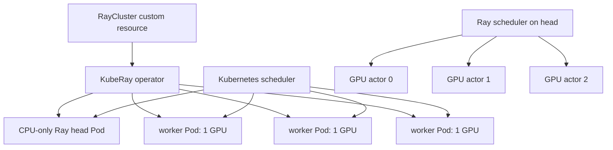

# 26 — Ray and KubeRay orchestration

**Status:** draft
**Estimated time:** 7–10 hours
**Compute profile:** local CPU orientation; three separate one-GPU EKS nodes
for the practical placement lab
**Estimated GPU-minutes:** 60–120
**Estimated cloud cost:** three GPU nodes for the measured wall time, plus
standing EKS/network charges; the KubeRay operator itself needs only CPU
**Prerequisites:** lessons 07, 09, 24, and 25; Helm and cluster-admin assistance
if KubeRay is not already installed
**Last validated:** 2026-10-21
**Validated with:** Python 3.9 syntax, Bash syntax, JSON parsing, and static
manifest review; Ray 2.59.0 and KubeRay chart 1.7.0 are exact teaching pins;
live operator installation and GPU placement remain unvalidated

## Why this matters

Kubernetes can schedule Pods, but a distributed inference engine also needs to
discover resources inside those Pods, place long-lived workers together, start
tasks in a useful order, and report failures. Ray supplies that application
scheduler. KubeRay translates a Kubernetes custom resource into Ray head and
worker Pods.

That means two schedulers make decisions:

```text
Kubernetes scheduler: Which Node runs this Pod?
Ray scheduler:        Which Ray node runs this task or actor?
```

A Ray placement group can remain pending even though all Kubernetes Pods are
Running. Conversely, Ray cannot use a GPU that the Kubernetes Pod did not
request and receive. This lesson makes both layers visible and proves one actor
runs on each of three distinct one-GPU nodes.

## Learning outcomes

By the end, you can:

- explain Ray head nodes, worker nodes, tasks, actors, logical resources,
  placement groups, bundles, and scheduling strategies;
- explain what the KubeRay operator reconciles;
- trace a `RayCluster` into Pods, Services, Ray nodes, and GPU actors;
- distinguish Kubernetes GPU allocation from Ray's logical `GPU` resource;
- use `STRICT_SPREAD` to request one actor on each Ray node;
- verify actor host, Ray node ID, assigned GPU IDs, Kubernetes Pod, and EC2
  node placement;
- diagnose an impossible four-bundle request on three GPUs;
- explain why a generic Ray head can remain CPU-only;
- understand why a particular engine integration may require a GPU-visible
  head; and
- cleanly remove the cluster and optional operator.

## What you will build



The output `artifacts/placement.json` contains three actor records and a
correctness gate requiring three unique hosts, three unique Ray node IDs, and
one assigned GPU ID per actor.

## Files in this lesson

```text
26-ray-kuberay-orchestration/
├── README.md
├── requirements.txt
├── src/
│   ├── local_ray_basics.py
│   └── gpu_placement.py
├── k8s/
│   └── raycluster.yaml.tpl
└── scripts/
    ├── install-operator.sh
    ├── render.py
    ├── deploy.sh
    ├── run-placement.sh
    ├── run-impossible-placement.sh
    └── observe.sh
```

Shared EKS and cleanup scripts are in `../common/scripts/`.

## Concepts and mental model

The **head node** runs cluster coordination services and usually also exposes
the client entry point. A **worker node** registers its logical CPU, GPU, memory,
and custom resources with the cluster.

A Ray **task** is a remote function call. An **actor** is a stateful worker
process that handles multiple method calls. Inference engines often use actors
for persistent model shards.

A **placement group** reserves a list of resource bundles. This lab asks for:

```python
[{"GPU": 1}, {"GPU": 1}, {"GPU": 1}]
```

with `STRICT_SPREAD`, meaning bundles must land on distinct Ray nodes. The
placement group reserves logical resources; each actor must also be explicitly
scheduled into its bundle.

Ray's `GPU: 1` is scheduling metadata. Kubernetes' `nvidia.com/gpu: 1` is the
device-allocation contract at the Pod boundary. KubeRay configures each worker
Pod to request one physical GPU and starts Ray so the worker advertises one
logical GPU. If those disagree, one scheduler may think capacity exists while
the other does not.

## Under the hood

Applying the custom resource triggers this sequence:

```text
API stores RayCluster
  -> KubeRay operator watches it
  -> operator creates head Service and head/worker Pods
  -> Kubernetes schedules worker Pods onto three eligible Nodes
  -> device plugin allocates one GPU to each worker container
  -> raylet in each worker registers with the head
  -> placement group reserves three GPU bundles
  -> three actors start, one in each bundle
```

The manifest has required Pod anti-affinity by hostname. That prevents
Kubernetes from putting two workers on one multi-GPU node or on a mistakenly
selected pool. The exact node group is selected with required node affinity.
The Pod security context also sets `fsGroup: 1000`: KubeRay and Ray may mount
writable `emptyDir` volumes, and `runAsUser: 1000` alone does not guarantee that
new volume roots are writable by the non-root process.

The head is CPU-only because this generic placement exercise runs only the
driver and Ray control components there. Some engine orchestration patterns
start a model-execution rank in the head Pod. In that case, the head must request
a GPU and participate in the one-rank-per-node topology. Do not copy a generic
Ray topology into an engine deployment without reading that integration's
current contract.

Actors report `ray.get_runtime_context().get_node_id()` and
`ray.get_gpu_ids()`. CUDA visibility inside an actor is expected to contain one
logical device. The actor does not assume its logical ID equals the host's
physical PCI index.

## Prerequisites and preflight

### Local orientation

```bash
cd lessons/phase-04-distributed/26-ray-kuberay-orchestration
python3 -m venv .venv
source .venv/bin/activate
python -m pip install --upgrade pip
python -m pip install -r requirements.txt
python src/local_ray_basics.py --output artifacts/local-ray.json
```

This starts an in-process CPU Ray runtime and demonstrates tasks versus actors.
It does not simulate three networked hosts.

### Cluster path

```bash
export AWS_REGION='REPLACE_WITH_REGION'
export EKS_CLUSTER='REPLACE_WITH_CLUSTER'
export GPU_NODEGROUP='REPLACE_WITH_LAB_GPU_NODEGROUP'
export CONFIRM_GPU_NODEGROUP="$GPU_NODEGROUP"
export LAB_NAMESPACE='oms-distributed-26'
../common/scripts/assert-eks-target.sh
```

Verify whether the CRD/operator already exists:

```bash
kubectl get crd rayclusters.ray.io
kubectl get deployment --all-namespaces \
  -l app.kubernetes.io/name=kuberay-operator
```

Installing CRDs and an operator is a cluster-wide administrative change. Use
the supplied pinned installer only if authorized:

```bash
export KUBERAY_CHART_VERSION='1.7.0'
export KUBERAY_OPERATOR_IMAGE='quay.io/kuberay/operator:v1.7.0@sha256:64_lowercase_hex_characters'
export CONFIRM_KUBERAY_INSTALL="kuberay-operator-${KUBERAY_CHART_VERSION}"
./scripts/install-operator.sh
```

The script pulls the exact chart version, saves its package and rendered
manifest under ignored `artifacts/`, overrides the operator image with the
reviewed tag-plus-digest reference, rechecks cluster-wide permissions and the
EKS target, and refuses mutable rendered images, an unexpected chart version,
or missing explicit confirmation. Resolve the tag with
`docker buildx imagetools inspect` before setting the variable, then confirm
the running Pod's `imageID`. Chart pinning fixes templates; the digest fixes
the deployed image content.

Resolve a reviewed Ray 2.59.0 image:

```bash
export RAY_IMAGE='registry/ray-image@sha256:64_lowercase_hex_characters'
```

The image must contain Ray 2.59.0 and Python dependencies used by
`gpu_placement.py`. `render.py` rejects a tag-only image.

## Cost and safety

Do the CPU orientation and operator check before scaling GPUs. KubeRay's head
Service remains `ClusterIP`; the manifest disables dashboard ingress and
creates no cloud load balancer. The Ray dashboard and client port still have no
application authentication suitable for public exposure, so never change this
lesson to a public Service.

Set a hard 120 GPU-minute budget. Stop if:

- the node group was not idle before the lab;
- fewer or more than three selected nodes appear;
- a worker receives zero or multiple GPUs;
- the operator manages a shared production namespace;
- the rendered image is not digest-pinned; or
- an impossible placement is left pending after evidence capture.

## Predict before running

1. Can three `STRICT_SPREAD` GPU bundles fit on two Ray workers that advertise
   two GPUs each?
2. Does a Running worker Pod prove it registered with Ray?
3. Which scheduler reports a Pod anti-affinity failure?
4. Which scheduler reports an infeasible placement group?
5. Why can the generic head remain CPU-only?
6. What changes if the engine's driver is also pipeline rank zero?

## Lab outline

1. Run a local task/actor orientation.
2. Install or verify the pinned KubeRay operator.
3. create three one-GPU worker Pods on three nodes.
4. inspect Kubernetes and Ray resource views.
5. reserve three strict-spread bundles and start actors.
6. request an impossible fourth GPU bundle.
7. capture evidence, repair, and clean up.

## Step-by-step lab

### 1. Understand task and actor state locally

```bash
mkdir -p artifacts
python src/local_ray_basics.py --output artifacts/local-ray.json
python -m json.tool artifacts/local-ray.json
```

The remote function returns independent values. The counter actor retains state
across calls. This is the reason a model shard naturally maps to an actor rather
than a stateless task.

### 2. Start and verify capacity

After price review:

```bash
export I_UNDERSTAND_GPU_COSTS=yes
../common/scripts/scale-three-nodes.sh up
kubectl get nodes -o json |
  ../common/scripts/verify-three-gpu-nodes.py \
  --nodegroup "$GPU_NODEGROUP"
```

### 3. Render and deploy RayCluster

```bash
./scripts/render.py
./scripts/deploy.sh
```

Abbreviated expected state:

```text
NAME                READY   STATUS
ray-head-...        1/1     Running
ray-worker-...      1/1     Running
ray-worker-...      1/1     Running
ray-worker-...      1/1     Running
```

The worker Pods, not the head, should show `nvidia.com/gpu: 1` requests.

### 4. Inspect both schedulers

```bash
kubectl -n "$LAB_NAMESPACE" get raycluster,pods,services -o wide
head_pod="$(
  kubectl -n "$LAB_NAMESPACE" get pod \
    -l ray.io/node-type=head \
    -o jsonpath='{.items[0].metadata.name}'
)"
kubectl -n "$LAB_NAMESPACE" exec "$head_pod" -- ray status
```

Expect three GPU resources in the Ray cluster. If Kubernetes has three worker
Pods but Ray reports fewer nodes, inspect worker logs and head connectivity.

### 5. Run the placement proof

```bash
./scripts/run-placement.sh
python -m json.tool artifacts/placement.json
```

The driver is copied from the lesson ConfigMap mounted in the head. It creates
three strict-spread bundles, starts one actor per bundle, and writes a
base64-safe JSON payload to stdout. The script extracts that payload.

Required result:

```text
correctness.passed: true
measurements.actor_count: 3
environment.distinct_hosts: 3
environment.distinct_ray_nodes: 3
```

### 6. Map actors to Pods and Nodes

```bash
./scripts/observe.sh
```

Compare `artifacts/placement.json`,
`artifacts/kubernetes-placement.txt`, and `artifacts/ray-status.txt`. An actor
host name should match a worker Pod host name, and each worker Pod should have a
different Kubernetes `NODE`.

## Inspect what happened

Useful evidence:

```bash
kubectl -n "$LAB_NAMESPACE" describe raycluster teaching-ray
kubectl -n "$LAB_NAMESPACE" get events \
  --sort-by=.metadata.creationTimestamp
kubectl -n "$LAB_NAMESPACE" logs \
  -l ray.io/node-type=head --tail=200
kubectl -n "$LAB_NAMESPACE" logs \
  -l ray.io/node-type=worker --prefix --tail=200
```

Separate these states:

```text
worker Pod Pending       -> Kubernetes scheduler/resources
worker Pod Running,
Ray node absent          -> Ray startup/registration/network
Ray node present,
placement group pending  -> Ray logical-resource/constraint issue
actor starts,
CUDA unavailable         -> Pod allocation/image/driver contract
```

## Deliberate failure

Ask Ray for four one-GPU bundles when only three exist:

```bash
./scripts/run-impossible-placement.sh
python -m json.tool artifacts/impossible-placement.json
```

The program waits for a bounded period, records `expected_infeasible: true`, and
cancels the placement group. It must not hang indefinitely. Inspect:

```bash
kubectl -n "$LAB_NAMESPACE" exec "$head_pod" -- ray status
```

Diagnosis should mention Ray logical resources, not Kubernetes Pod Pending.
Repair by returning to three bundles.

## Controlled experiment

Change only placement strategy from `STRICT_SPREAD` to `PACK` in an ignored
copy of the script. With one GPU per worker, both strategies still need three
workers because each bundle consumes one GPU. Then repeat using CPU-only
bundles; `PACK` can place them together while `STRICT_SPREAD` needs distinct Ray
nodes. This shows that strategy interacts with bundle resources.

## Verification

```bash
python3 - <<'PY'
import json
from pathlib import Path

d = json.loads(Path("artifacts/placement.json").read_text())
assert d["correctness"]["passed"] is True
assert len(d["actors"]) == 3
assert len({a["hostname"] for a in d["actors"]}) == 3
assert len({a["ray_node_id"] for a in d["actors"]}) == 3
assert all(len(a["ray_gpu_ids"]) == 1 for a in d["actors"])
print("one actor per one-GPU node: PASS")
PY
```

## Expected result

Three actors run on three distinct Ray workers backed by three distinct
Kubernetes nodes. Each actor reports one Ray GPU ID and CUDA visibility if the
image/driver contract is healthy. The impossible four-bundle group is reported
as infeasible within the configured timeout. Pod names, node IDs, host names,
addresses, and timing differ.

## Troubleshooting

| Layer | Symptom | Evidence |
|---|---|---|
| CRD | server has no `RayCluster` kind | `kubectl get crd`; operator install |
| operator | CR exists, no Pods | operator logs and RayCluster conditions |
| Kubernetes | worker Pending | events, GPU allocatable, affinity, taints |
| Ray startup | workers Running, absent in `ray status` | worker/head logs and Service DNS |
| placement | group not ready | `ray status`, requested bundles, logical resources |
| CUDA | actor has empty CUDA visibility | Pod GPU request, device plugin, image |
| extraction | missing `PLACEMENT_RESULT=` | head exec output and Python traceback |

## Evidence to collect

- `artifacts/chart/` package, rendered operator manifest, and image references
- `artifacts/local-ray.json`
- `artifacts/placement.json`
- `artifacts/impossible-placement.json`
- `artifacts/kubernetes-placement.txt`
- `artifacts/ray-status.txt`
- RayCluster YAML, conditions, events, and sanitized logs
- `artifacts/report.md` mapping each scheduler decision

Sanitize node names, internal IPs, cluster names, and private registry paths.

## Knowledge check

1. Why are Kubernetes and Ray GPU resources both necessary?
2. What does a placement group reserve?
3. Why is creating actors outside their bundles a correctness bug?
4. What evidence proves distinct physical hosts?
5. Why can a four-bundle request remain pending with all Pods Running?
6. When would a Ray head need a GPU?

## Exercises

Guided: add a custom logical resource named `accelerator_generation` to worker
Ray start parameters and require it in each placement bundle.

Independent: delete one worker Pod after a successful run. Record the
Kubernetes replacement, Ray node loss, actor fate, and whether your application
recreates actors automatically.

<details>
<summary>Solution outline</summary>

Add the custom resource consistently to each worker and placement bundle. For
the failure exercise, expect Kubernetes to recreate the desired worker Pod, but
do not assume a user-created actor is recreated unless the actor/retry policy or
driver does so. Time-stamp every transition.

</details>

## Completion gate

You pass when you can explain both scheduling layers, produce a valid
three-actor result, diagnose the four-bundle failure at the Ray layer, map every
actor to a distinct Kubernetes node, record exact chart/Ray image evidence, and
remove all resources without leaving GPU capacity.

## Cleanup

```bash
../common/scripts/cleanup-namespace.sh
../common/scripts/scale-three-nodes.sh down
```

If you installed a lesson-owned operator and have confirmed no other
`RayCluster`, `RayJob`, or `RayService` depends on it:

```bash
helm uninstall kuberay-operator --namespace kuberay-system
kubectl delete namespace kuberay-system --ignore-not-found --wait=true
```

Do not remove shared CRDs casually. Verify namespaced resources, Services,
PVCs, and selected nodes are gone.

## Primary references

Required, reviewed 2026-10-21:

- [Ray architecture](https://docs.ray.io/en/latest/ray-core/scheduling/index.html)
- [Ray placement groups](https://docs.ray.io/en/latest/ray-core/scheduling/placement-group.html)
- [KubeRay quickstart](https://docs.ray.io/en/latest/cluster/kubernetes/getting-started/kuberay-operator-installation.html)
- [KubeRay RayCluster configuration](https://docs.ray.io/en/latest/cluster/kubernetes/user-guides/config.html)
- [Kubernetes custom resources](https://kubernetes.io/docs/concepts/extend-kubernetes/api-extension/custom-resources/)

Pins used by this draft:

- Ray Python package `2.59.0`
- KubeRay Helm chart `kuberay-operator` version `1.7.0`

Re-resolve container digests and review release notes before an intentional
upgrade.
