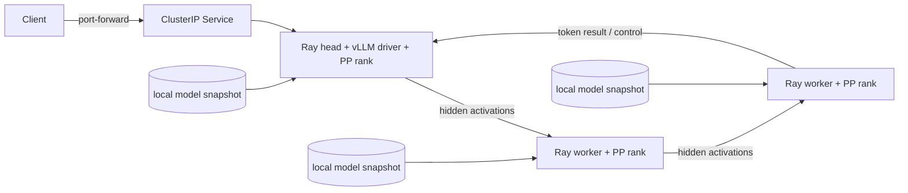

# 29 — Pipeline-parallel large-model inference

**Status:** draft
**Estimated time:** 1–2 days, including model review and downloads
**Compute profile:** three separate one-GPU EKS nodes; `TP=1`, `PP=3`
**Estimated GPU-minutes:** 120–300 under an explicitly approved budget
**Estimated cloud cost:** three GPU-node hours for startup, three model
downloads to node-local ephemeral storage, standing EKS/network costs, and
registry/model egress if applicable; calculate with current prices before use
**Prerequisites:** lessons 13, 17–19, and 24–28; a working KubeRay operator
**Last validated:** 2026-10-21
**Validated with:** Python 3.9/Bash syntax and static manifest/profile checks;
vLLM `0.28.0`, Ray `2.59.0`, and KubeRay chart `1.7.0` are the teaching
versions; no model or live three-node service was run by the authors

## Why this matters

Pipeline parallelism is often the first strategy worth testing when a model no
longer fits one affordable GPU but you have separate one-GPU nodes. Each stage
holds a contiguous set of transformer layers. Instead of tensor-parallel
collectives inside many layers, activations move between stage boundaries.

That does not make pipeline parallelism automatically fast. A request must
traverse all stages. Uneven stages create backpressure. Low concurrency leaves
bubbles. Autoregressive decode repeats the pipeline for each token. Ordinary
networking and engine coordination remain visible.

This lesson builds a real OpenAI-compatible vLLM service with one Ray/vLLM rank
per node. It starts with a tiny smoke profile to prove orchestration. Only then
does the learner select a reviewed quantized model whose stored bytes exceed a
single GPU's safe budget but whose per-stage estimate fits.

## Learning outcomes

By the end, you can:

- explain a `TP=1, PP=3` process and layer layout;
- distinguish stage weight memory, boundary activations, KV cache, and runtime
  overhead;
- explain pipeline fill, steady state, drain, bubble, and backpressure;
- resolve a model repository HEAD to an immutable commit and record it;
- inspect the exact model configuration, license, quantization, and file bytes;
- reject a large profile that lacks safe per-stage headroom;
- deploy one GPU-visible Ray head plus two one-GPU Ray workers on three nodes;
- stage the same immutable model snapshot independently on every node;
- start vLLM with a Ray distributed executor and pipeline size three;
- send and benchmark deterministic completion requests;
- diagnose worker loss and restart the complete distributed engine; and
- remove model caches and restore GPU capacity.

## What you will build



The head participates in model execution, so it requests one GPU. Required
anti-affinity places the head and both workers on distinct nodes. The API is a
private `ClusterIP`; access is through authenticated `kubectl port-forward`.

## Files in this lesson

```text
29-pipeline-parallel-large-model/
├── README.md
├── profiles/
│   ├── smoke.env.example
│   └── large.env.example
├── requests/
│   └── completion.json
├── src/
│   ├── download_model.py
│   ├── resolve_model_revision.py
│   ├── validate_profile.py
│   └── request_benchmark.py
├── k8s/
│   └── vllm-pp-raycluster.yaml.tpl
└── scripts/
    ├── render.py
    ├── deploy.sh
    ├── start-server.sh
    ├── test-api.sh
    ├── benchmark.sh
    ├── observe.sh
    └── failure-worker-loss.sh
```

## Concepts and mental model

Suppose a decoder has 80 layers. A simple balanced three-stage split is:

```text
80 // 3 = 26, remainder 2
stage counts = [27, 27, 26]
```

Layer count is only a first approximation. Embeddings, final normalization,
language-model head, MoE layers, and unequal tensor shapes can make stages use
different memory or compute.

For one request, stage 0 cannot finish the whole model. It produces a hidden
activation and sends it to stage 1, which sends its result to stage 2. With
multiple sequences or microbatches, different stages can work concurrently:

```text
time ->   1   2   3   4   5
stage 0:  A   B   C
stage 1:      A   B   C
stage 2:          A   B   C
```

Empty cells during fill and drain are bubbles. More work in flight can improve
stage occupancy but consumes KV-cache memory and can hurt request latency.

## Under the hood

The deployment has three Ray nodes and three GPU resources:

```text
head Pod:   raylet + vLLM API/driver + GPU 0
worker 0:   raylet + model worker + GPU 0
worker 1:   raylet + model worker + GPU 0
```

Running:

```text
vllm serve MODEL_PATH
  --tensor-parallel-size 1
  --pipeline-parallel-size 3
  --distributed-executor-backend ray
```

causes vLLM to ask Ray for a placement group matching the parallel world. The
exact actor and layer assignment is engine/version specific; preserve startup
logs instead of assuming equal ranges.

Every Pod's init container calls `snapshot_download` with an exact revision.
The revision is verified against the resolved snapshot commit and a provenance
marker is written. This node-local approach is intentionally simple and
expensive in bytes: it downloads and stores the model three times. Later
production work should compare pre-baked images, object storage, EFS/shared
filesystems, local NVMe warming, and cache operators.

The containers run as non-root UID/GID 1000. `fsGroup: 1000` makes the mounted
`emptyDir` cache writable; without it, a healthy-looking Pod specification can
fail during model staging with `PermissionError` before vLLM starts.

### Memory gate

Before the large profile:

```text
estimated per-stage weights
+ estimated per-stage KV cache
+ quantization metadata/padding
+ measured engine/runtime overhead
< configured usable VRAM
```

`validate_profile.py` requires the learner to state total stored weight GiB,
per-node VRAM, runtime overhead, and reserve fraction. Stored file bytes are not
runtime weight bytes, so the result is a screening gate, not proof.

### Slow network behavior

PP avoids TP's repeated intra-layer all-reduces, but each stage boundary still
moves activations and synchronizes progress. If stage 1 is slower, stages 0 and
2 wait. A low overall GPU utilization can therefore mean pipeline bubbles or
backpressure, not insufficient requests alone.

## Prerequisites and preflight

Set the EKS guard variables:

```bash
cd lessons/phase-04-distributed/29-pipeline-parallel-large-model
export AWS_REGION='REPLACE_WITH_REGION'
export EKS_CLUSTER='REPLACE_WITH_CLUSTER'
export GPU_NODEGROUP='REPLACE_WITH_LAB_GPU_NODEGROUP'
export CONFIRM_GPU_NODEGROUP="$GPU_NODEGROUP"
export LAB_NAMESPACE='oms-distributed-29'
../common/scripts/assert-eks-target.sh
kubectl get crd rayclusters.ray.io
```

Resolve the reviewed vLLM image by immutable digest:

```bash
export VLLM_IMAGE='vllm/vllm-openai@sha256:64_lowercase_hex_characters'
```

The container must report vLLM 0.28.0 and Ray 2.59.0. If you intentionally use
other versions, create a new profile and revalidate flags; do not edit evidence
after the run.

Start with the smoke profile:

```bash
source profiles/smoke.env.example
python3 src/validate_profile.py --output artifacts/profile-smoke.json
```

For a large model, resolve an immutable revision:

```bash
python3 src/resolve_model_revision.py \
  --model "$MODEL_ID" \
  --output artifacts/model-resolution.json
export MODEL_REVISION="$(
  python3 -c \
  'import json; print(json.load(open("artifacts/model-resolution.json"))["resolved_revision"])'
)"
```

Read the exact revision's model card, license, `config.json`, quantization
configuration, and file list. Model availability and usage terms can change;
resolution is not license approval.

## Cost and safety

Use On-Demand capacity while learning so Spot interruption is not mistaken for
a pipeline bug. The large profile can spend most of its time downloading and
loading. Budget those minutes, not only benchmark time.

The manifest uses three local `emptyDir` model caches with explicit size limits.
Deletion removes them. It creates no PVC, external load balancer, ingress, or
public Ray dashboard.

Stop before scaling if:

- `MODEL_REVISION` is not an exact hexadecimal commit;
- license/access review is incomplete;
- total file bytes or disk budget are unknown;
- the planner does not show safe per-stage headroom;
- the node group does not provide exactly three one-GPU nodes; or
- the vLLM image is tag-only.

During the run, stop on OOM, repeated Pod restarts, failed output correctness,
or budget exhaustion. Do not “fix” OOM by removing the reserve without evidence.

## Predict before running

1. Which Pod must request a GPU in this topology, and why?
2. Why is a tiny model still useful for a PP smoke test?
3. What is stored three times in the default cache design?
4. Does equal layer count guarantee equal stage time?
5. How does increased concurrency affect bubbles and KV cache?
6. What happens to the API if one model actor dies?

## Lab outline

1. Validate the smoke profile.
2. create exactly three GPU nodes.
3. deploy GPU-visible Ray head plus two workers.
4. wait for exact-revision model staging.
5. start `TP=1, PP=3` vLLM and verify the API.
6. benchmark a bounded deterministic workload.
7. lose one worker, diagnose the whole-engine failure, and restart.
8. repeat with an approved model larger than one safe GPU budget.
9. capture evidence and clean up.

## Step-by-step lab

### 1. Smoke profile

```bash
source profiles/smoke.env.example
python3 src/validate_profile.py --output artifacts/profile.json
python3 -m json.tool artifacts/profile.json
```

The smoke profile uses a tiny public model only to test orchestration and PP
support. It is not evidence that the large profile fits.

### 2. Start capacity and render

```bash
export I_UNDERSTAND_GPU_COSTS=yes
../common/scripts/scale-three-nodes.sh up
kubectl get nodes -o json |
  ../common/scripts/verify-three-gpu-nodes.py \
    --nodegroup "$GPU_NODEGROUP"
./scripts/render.py
```

Inspect before apply:

```bash
grep -nE 'image:|nvidia.com/gpu|replicas:|MODEL_' \
  artifacts/vllm-pp-raycluster.yaml
```

Expect three digest-pinned image references and three total GPU requests.

### 3. Deploy and stage model

```bash
./scripts/deploy.sh
kubectl -n "$LAB_NAMESPACE" get pods -o wide --watch
```

Init containers can take minutes. Inspect one:

```bash
kubectl -n "$LAB_NAMESPACE" logs \
  -l ray.io/node-type=head \
  -c stage-model --tail=100
```

Do not proceed until all three Pods have matching provenance:

```bash
for pod in $(
  kubectl -n "$LAB_NAMESPACE" get pod \
    -l ray.io/cluster=vllm-pp -o name
); do
  kubectl -n "$LAB_NAMESPACE" exec "${pod#pod/}" -- \
    cat /models/.model-provenance.json
done
```

### 4. Start the server

```bash
./scripts/start-server.sh
kubectl -n "$LAB_NAMESPACE" get endpoints vllm-pp-api
```

The script refuses if Ray does not report exactly three GPUs. It also reads the
installed `vllm` and `ray` versions from the head Pod, requires the profile's
exact expected versions, records them with the launch command, and starts vLLM.
Watch:

```bash
kubectl -n "$LAB_NAMESPACE" exec \
  "$(kubectl -n "$LAB_NAMESPACE" get pod -l ray.io/node-type=head \
  -o jsonpath='{.items[0].metadata.name}')" -- \
  tail -f /tmp/vllm-server.log
```

Look for three pipeline ranks and successful model load. Exact log wording is
version-dependent.

### 5. Verify behavior

```bash
./scripts/test-api.sh
python3 -m json.tool artifacts/completion-response.json
```

The test port-forwards the private Service, calls `/v1/models`, sends
`requests/completion.json`, and requires a nonempty completion with a usage
object.

### 6. Run a bounded workload

```bash
./scripts/benchmark.sh
python3 -m json.tool artifacts/benchmark.json
```

The standard-library client sends a small fixed request set and reports success
count, wall time, requests/second, and latency percentiles. It does not measure
streaming TTFT or token-level TPOT; those fields are explicitly absent rather
than guessed.

### 7. Move to the large profile

Clean the smoke deployment first so its node-local caches do not consume the
disk budget. Load `profiles/large.env.example`, choose and resolve an exact
revision, fill the measured byte/memory assumptions, and run:

```bash
python3 src/validate_profile.py --output artifacts/profile-large.json
```

Proceed only when:

- `larger_than_one_safe_gpu` is true;
- `estimated_per_stage_fits` is true;
- model architecture is supported by the exact vLLM version;
- PP=3 is supported for that architecture/quantization; and
- the planned context/concurrency remain deliberately small.

Run the same deploy/test/benchmark path. A failed large profile is valid
evidence if you preserve why it failed and clean up.

## Inspect what happened

```bash
./scripts/observe.sh
```

The evidence bundle contains:

- RayCluster status and worker placement;
- image IDs;
- init/model provenance;
- Ray resource status;
- vLLM startup/runtime logs;
- API response and benchmark output;
- GPU process/memory snapshots; and
- Kubernetes events.

Connect stage stalls to evidence. If one GPU is busy while two wait, inspect
stage assignment, per-stage memory, request phase, and network traces before
declaring a hardware problem.

## Deliberate failure

Delete exactly one worker Pod:

```bash
./scripts/failure-worker-loss.sh
```

The script records the victim, deletes only that Pod, observes the API and
RayCluster, waits for KubeRay to replace the worker, and saves a timestamped
timeline. The original vLLM server may exit or remain unhealthy because a model
actor disappeared. Kubernetes repairing the worker Pod does not necessarily
repair application-level distributed state.

Repair:

```bash
./scripts/start-server.sh
./scripts/test-api.sh
```

Explain why restarting the whole engine is safer than reusing an unknown
partially failed process group for this lesson.

## Controlled experiment

Change only `MAX_NUM_SEQS` from 1 to 4 on the smoke model:

```bash
export MAX_NUM_SEQS=4
python3 src/validate_profile.py --output artifacts/profile-concurrency-4.json
./scripts/render.py
```

Redeploy from a clean namespace, run the same request fixture, and compare
benchmark distributions and GPU memory. More concurrency may reduce bubbles,
but no outcome is promised. Report correctness, memory, and tail latency.

## Verification

```bash
python3 - <<'PY'
import json
from pathlib import Path

response = json.loads(Path("artifacts/completion-response.json").read_text())
bench = json.loads(Path("artifacts/benchmark.json").read_text())
assert response["object"] == "text_completion"
assert response["choices"][0]["text"]
assert response["usage"]["completion_tokens"] > 0
assert bench["correctness"]["passed"] is True
assert bench["measurements"]["successful_requests"] > 0
print("PP=3 API behavior: PASS")
PY
```

Also require three distinct Kubernetes nodes and matching model revisions.

## Expected result

The smoke model serves a deterministic completion through a three-stage
pipeline. A valid large experiment uses a model whose screened weight footprint
exceeds one safe GPU budget and whose three-stage estimate fits. Performance is
not predetermined. On ordinary networking and low concurrency, pipeline bubbles
and activation transfer may make the service slower than expected.

## Troubleshooting

| Layer | Symptom | Evidence |
|---|---|---|
| profile | validator rejects | exact missing/unsafe input field |
| download | init container retries | revision, access, disk, DNS, model logs |
| scheduling | head/worker Pending | GPU count, affinity, anti-affinity, taints |
| Ray | three Pods but fewer resources | `ray status`, worker logs, Service DNS |
| placement | vLLM waits for bundles | Ray logical GPUs and actor constraints |
| model | load error | architecture, quantization, revision, file integrity |
| memory | rank OOM | per-rank process memory, stage map, KV settings |
| network | slow/hung startup | NCCL/Ray logs and lesson-27 baseline |
| API | endpoint absent | head process/log, Service selector/endpoints |
| recovery | worker replaced but API dead | restart distributed engine |

## Evidence to collect

- exact profile and resolution JSON
- model card/license review note
- rendered manifest and image IDs
- per-Pod model provenance
- Ray status and Pod-to-node map
- complete vLLM startup logs
- request and benchmark JSON
- per-stage `nvidia-smi` samples
- worker-loss timeline and repaired verification
- `artifacts/report.md` with fit, performance, cost, and limitations

Sanitize account, cluster, node, internal IP, and private registry values.

## Knowledge check

1. Why does the head request a GPU here but not in lesson 26?
2. What is a pipeline bubble?
3. Why can equal layer count still be imbalanced?
4. Why are three node-local model copies used?
5. Which proof shows the model is larger than one safe GPU budget?
6. Why may replacing a Ray worker not restore the API?

## Exercises

Guided: calculate layer ranges for 32 layers over three stages and identify the
two larger stages.

Independent: design a cache alternative using EFS or pre-warmed local disks.
Include consistency, throughput, lifecycle, permissions, cost, and failure
trade-offs; do not deploy it without a separate safety review.

<details>
<summary>Solution outline</summary>

Thirty-two layers split as `[11, 11, 10]`. An EFS design avoids three downloads
but adds shared filesystem throughput/latency and mount/security concerns.
Pre-warmed local disks improve startup but couple artifacts to node lifecycle.
Use immutable revision directories and provenance in either design.

</details>

## Completion gate

You pass when the smoke API works with `TP=1, PP=3`, three ranks map to three
nodes, every model snapshot has the same immutable revision, the benchmark is
machine-readable, and worker loss is diagnosed and repaired. For the full
lesson, run or honestly reject a model screened as larger than one safe GPU
budget. Report the actual limit instead of claiming success.

## Cleanup

```bash
../common/scripts/cleanup-namespace.sh
../common/scripts/scale-three-nodes.sh down
```

Namespace deletion removes all three `emptyDir` caches. Verify the namespace,
Pods, Services, endpoints, and selected nodes are gone and the saved node-group
baseline is restored. Check for unexpected load balancers and volumes even
though the supplied manifest creates neither.

## Primary references

Required, reviewed 2026-10-21:

- [vLLM parallelism and scaling](https://docs.vllm.ai/en/latest/serving/parallelism_scaling/)
- [vLLM distributed serving](https://docs.vllm.ai/en/latest/serving/distributed_serving/)
- [vLLM OpenAI-compatible server](https://docs.vllm.ai/en/latest/serving/openai_compatible_server/)
- [Ray clusters on Kubernetes](https://docs.ray.io/en/latest/cluster/kubernetes/index.html)
- [Hugging Face Hub download guide](https://huggingface.co/docs/huggingface_hub/guides/download)
- [GPipe paper](https://arxiv.org/abs/1811.06965)

Teaching pins:

- vLLM `0.28.0`
- Ray `2.59.0`
- KubeRay chart `1.7.0`

Model revisions and container images are independently resolved to immutable
identifiers at execution time.
