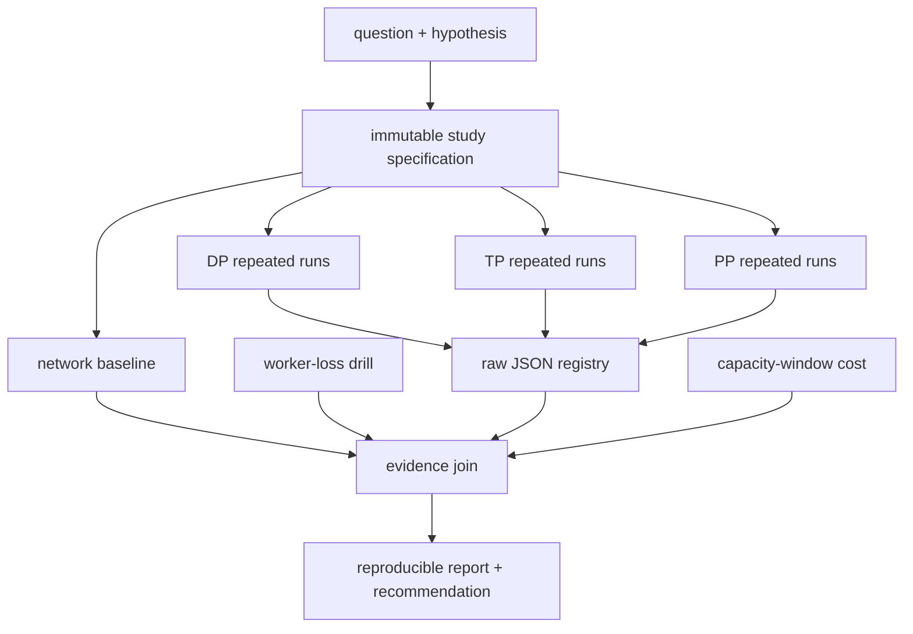

# 31 — Capstone: a reproducible distributed-inference study

**Status:** draft
**Estimated time:** 2–4 days
**Compute profile:** local CPU for protocol/tool validation; three separate
one-GPU EKS nodes for repeated DP, TP, and PP experiments
**Estimated GPU-minutes:** 300–720 with an approved stop time
**Estimated cloud cost:** three GPU nodes across the recorded capacity window,
standing EKS/network charges, repeated model staging, and storage/egress terms;
the supplied calculator uses the learner's current per-node hourly price
**Prerequisites:** lessons 00–30
**Last validated:** 2026-10-21
**Validated with:** Python 3.9 offline fixture tests, JSON parsing, and Bash
syntax; no live Kubernetes, Ray, NCCL, vLLM, or GPU experiment was executed

## Why this matters

One successful command is a demo. A useful engineering study has frozen inputs,
repeatable procedures, correctness gates, raw evidence, failures, cost, and
limitations. Another person must be able to challenge the conclusion from the
record rather than trust a screenshot.

This capstone combines:

- rank and collective evidence from lesson 24;
- feasibility arithmetic from lesson 25;
- Ray/Kubernetes placement from lesson 26;
- network curves and transport logs from lesson 27;
- reference correctness from lesson 28;
- large-model pipeline mechanics from lesson 29; and
- controlled DP/TP/PP comparison from lesson 30.

The expected outcome is not “distributed is faster.” Ordinary G-series
networking may make TP slow. PP may fit a model but have bubbles. DP may provide
the best aggregate request throughput but cannot fit the target model. A
defensible negative result is better than a fabricated win.

## Learning outcomes

By the end, you can:

- turn a question into a falsifiable distributed-systems hypothesis;
- freeze model, image, workload, topology, engine, and parallel factors;
- use correctness as a prerequisite for reporting performance;
- execute multiple repetitions in randomized or counterbalanced order;
- preserve raw per-run JSON instead of only averages;
- connect NCCL, Ray, Kubernetes, vLLM, GPU, and request evidence;
- distinguish benchmark time from the full billable capacity window;
- kill a participant and build a timestamped failure/recovery timeline;
- explain application recovery separately from Pod replacement;
- report missing runs and incomparable configurations honestly;
- calculate GPU-hours and cost assumptions; and
- produce a research-style report another learner can reproduce.

## What you will build



The final deliverables are:

- `artifacts/study-spec.json`;
- `artifacts/runs/*.json`;
- `artifacts/failure/timeline.ndjson`;
- `artifacts/cost.json`;
- `artifacts/summary.json`; and
- a completed `report-template.md`.

## Files in this lesson

```text
31-capstone-distributed-inference-study/
├── README.md
├── report-template.md
├── reproducibility-checklist.md
├── workloads/completions.ndjson
├── fixtures/
│   ├── study-spec.json
│   ├── runs.json
│   ├── cost.json
│   └── failure.ndjson
├── src/
│   ├── create_study_spec.py
│   ├── validate_study.py
│   ├── workload_runner.py
│   ├── summarize_study.py
│   ├── cost_report.py
│   └── timeline_report.py
└── scripts/
    ├── test-offline.sh
    ├── run-strategy.sh
    ├── failure-drill.sh
    ├── capture-cluster-evidence.sh
    └── cleanup.sh
```

`run-strategy.sh` intentionally reuses the already tested deployment mechanics
from lesson 30 while keeping this lesson's workload and results local.

## Concepts and mental model

### Ask a narrow question

Bad:

> Which distributed strategy is best?

Testable:

> On these three one-GPU nodes, with this exact model revision, image digest,
> non-streaming workload, context limit, and concurrency, how do correct DP=3,
> TP=3, and PP=3 runs differ in aggregate request rate, end-to-end latency,
> memory, communication evidence, and response to one worker loss?

The conclusion applies only to that scope.

### Experimental unit and repetition

One **run** is one deployed strategy, warm-up, measured workload pass, evidence
capture, and result JSON. Repeat each strategy at least twice; three is better
for this teaching capstone. Repetition exposes startup residue, noisy neighbors,
and transient network effects.

Counterbalance order to reduce time drift:

```text
round 1: DP -> TP -> PP
round 2: PP -> TP -> DP
round 3: TP -> DP -> PP
```

Delete the prior layout before the next. Keep the three underlying nodes fixed
within a capacity window when possible.

### Correctness before speed

Every measured response must satisfy the API schema and contain a nonempty
completion. Also compare a small deterministic prompt across strategies.
Generated text can differ across kernels or scheduling even with temperature
zero, so define acceptable semantic/numeric checks in advance. A crash or bad
response produces a failed run, not a latency value to discard silently.

### Evidence chain

```text
Kubernetes says where Pods ran
Ray says where actors/resources ran
NCCL says which transport/collectives initialized
vLLM says model/rank/stage startup
nvidia-smi/DCGM says device memory/utilization
client says response correctness and timing
cloud/nodegroup timestamps say billable window
```

No single source answers the whole question.

## Under the hood

`create_study_spec.py` parses and hashes the exact workload bytes and records
the immutable model revision, image digest, and runtime capacity controls.
`validate_study.py` rejects mutable or inconsistent identifiers, unsafe repeat
counts, missing strategy factors, and oversized teaching limits.

`workload_runner.py` reads NDJSON cases. Each line has a case name and request
body. It performs warm-up calls that are excluded, then measured repetitions.
For each response it records elapsed end-to-end seconds, completion tokens, and
correctness. It does not claim TTFT or TPOT because responses are non-streaming.

`summarize_study.py` refuses to combine runs unless these match:

- study ID;
- model ID and revision;
- image digest;
- workload SHA-256;
- request count and concurrency;
- node instance type; and
- software target and live-observed versions; and
- max model length, max concurrent sequences, and model-cache size.

It reports per-run values plus median and range by strategy. The small sample
does not justify confidence intervals or broad statistical claims.

`cost_report.py` uses full capacity timestamps:

```text
GPU-hours = wall_seconds / 3600 × node_count × GPUs_per_node
estimated node cost = wall_hours × node_count × price_per_node_hour
```

This is an estimate. It omits EKS control-plane, storage, data transfer, taxes,
discounts, commitments, and pricing granularity unless you add them.

## Prerequisites and preflight

First test the entire reporting pipeline without cloud resources:

```bash
cd lessons/phase-04-distributed/31-capstone-distributed-inference-study
chmod +x scripts/*.sh scripts/*.py src/*.py
./scripts/test-offline.sh
python3 -m json.tool artifacts/offline-summary.json
```

Then export study inputs:

```bash
export STUDY_ID='g-series-three-node-study-01'
export MODEL_ID='facebook/opt-125m'
export MODEL_REVISION='27dcfa74d334bc871f3234de431e71c6eeba5dd6'
export SERVED_MODEL_NAME='lesson-31-model'
export VLLM_IMAGE='vllm/vllm-openai@sha256:64_lowercase_hex_characters'
export NODE_INSTANCE_TYPE='REPLACE_WITH_INSTANCE_TYPE'
export VLLM_EXPECTED_VERSION='0.28.0'
export RAY_EXPECTED_VERSION='2.59.0'
export KUBERAY_CHART_VERSION='1.7.0'
export REPEATS='3'
export BENCHMARK_CONCURRENCY='3'
export MAX_MODEL_LEN='512'
export MAX_NUM_SEQS='4'
export MODEL_CACHE_GIB='10'
export PRICE_PER_NODE_HOUR='REPLACE_WITH_CURRENT_PRICE'
export PRICE_CURRENCY='USD'
```

Create and validate:

```bash
python3 src/create_study_spec.py \
  --workload workloads/completions.ndjson \
  --output artifacts/study-spec.json
python3 src/validate_study.py artifacts/study-spec.json
```

Infrastructure:

```bash
export AWS_REGION='REPLACE_WITH_REGION'
export EKS_CLUSTER='REPLACE_WITH_CLUSTER'
export GPU_NODEGROUP='REPLACE_WITH_LAB_GPU_NODEGROUP'
export CONFIRM_GPU_NODEGROUP="$GPU_NODEGROUP"
export LAB_NAMESPACE='oms-distributed-31-preflight'
../common/scripts/assert-eks-target.sh
```

Also confirm the exact model's TP divisibility, vLLM architecture/quantization
support, license, stored bytes, and fit. Use PP for a larger-than-single-GPU
model only after lesson 29's gate.

## Cost and safety

Write a budget approval before scaling:

```text
node count: 3
GPU per node: 1
price per node-hour:
maximum capacity hours:
maximum estimated node cost:
capacity start deadline:
capacity stop deadline:
cleanup owner:
```

The shared scaler requires an idle starting state and saves its baseline.
Record capacity start/end timestamps around the entire window. Do not use
benchmark process time as the bill.

All APIs remain ClusterIP. Never publish Ray dashboard, Ray Client, or vLLM
without an authentication and network-security design outside this lesson.

Stop conditions:

- wrong AWS identity, endpoint, node group, or namespace;
- anything other than three Ready one-GPU nodes;
- mutable image or model identifier;
- correctness failure;
- transport differs from experiment label;
- uncontrolled configuration difference;
- model license/access uncertainty;
- capacity deadline or cost limit reached; or
- cleanup cannot prove chargeable resources are gone.

## Predict before running

Write predictions before seeing results:

1. Which strategy will have the best aggregate request rate for a model that
   fits one GPU?
2. Which will show the most collective traffic?
3. Which will have the largest low-concurrency bubble?
4. Which survives one participant loss with reduced capacity?
5. Which strategy can serve a model larger than one GPU?
6. What result would falsify your preferred architecture?

## Lab outline

1. Freeze and validate study inputs.
2. record capacity start and verify topology.
3. run the lesson-27 network baseline.
4. execute counterbalanced repeated DP/TP/PP runs.
5. capture raw results and layer-by-layer evidence.
6. perform one worker-loss drill per architecture class.
7. record capacity end, calculate cost, and scale down.
8. compile the report and challenge the conclusion.

## Step-by-step lab

### 1. Create the immutable protocol

```bash
mkdir -p artifacts/runs artifacts/failure
python3 src/create_study_spec.py \
  --workload workloads/completions.ndjson \
  --output artifacts/study-spec.json
python3 src/validate_study.py artifacts/study-spec.json
sha256sum artifacts/study-spec.json >artifacts/study-spec.sha256
```

On macOS, use `shasum -a 256` if `sha256sum` is unavailable. Once measured runs
begin, changing the spec creates a new study ID.

### 2. Start and timestamp capacity

```bash
date -u +%FT%TZ | tee artifacts/capacity-start.txt
export I_UNDERSTAND_GPU_COSTS=yes
export LAB_NAMESPACE='oms-distributed-31'
../common/scripts/scale-three-nodes.sh up
kubectl get nodes -o json |
  ../common/scripts/verify-three-gpu-nodes.py \
    --nodegroup "$GPU_NODEGROUP"
../common/scripts/capture-topology.sh
./scripts/capture-cluster-evidence.sh pre-run
```

Preserve the selected node names and zones. If a node is replaced mid-study,
mark subsequent runs as a new environment or restart the study.

### 3. Run network baseline

Execute lesson 27 on these same nodes and copy its sanitized
`results.json` plus transport log into:

```text
artifacts/network/results.json
artifacts/network/transport.txt
```

Do not reuse a baseline from different instance types, zones, or software.

### 4. Execute repeated strategies

Follow the counterbalanced order. For example:

```bash
RUN_REPETITION=1 ./scripts/run-strategy.sh data-parallel
RUN_REPETITION=1 ./scripts/run-strategy.sh tensor-parallel
RUN_REPETITION=1 ./scripts/run-strategy.sh pipeline-parallel

RUN_REPETITION=2 ./scripts/run-strategy.sh pipeline-parallel
RUN_REPETITION=2 ./scripts/run-strategy.sh tensor-parallel
RUN_REPETITION=2 ./scripts/run-strategy.sh data-parallel
```

For a third round:

```bash
RUN_REPETITION=3 ./scripts/run-strategy.sh tensor-parallel
RUN_REPETITION=3 ./scripts/run-strategy.sh data-parallel
RUN_REPETITION=3 ./scripts/run-strategy.sh pipeline-parallel
```

The wrapper renders/deploys lesson 30's known layout, starts model-parallel
servers when needed, port-forwards the private Service, runs this lesson's
workload, captures evidence, copies a run JSON into this lesson, and deletes
the strategy namespace before returning. It takes runtime limits from the
frozen spec and verifies the installed `vllm` and `ray` package versions before
recording a run. Read the wrapper before use.

### 5. Inspect run registry

```bash
python3 -m json.tool artifacts/runs/data-parallel-1.json
python3 src/summarize_study.py \
  --spec artifacts/study-spec.json \
  --runs-dir artifacts/runs \
  --output artifacts/summary-pre-failure.json \
  --report artifacts/summary-pre-failure.md
```

Missing repetitions cause failure. Do not duplicate one file under a new name.

### 6. Failure and recovery

Deploy DP and run:

```bash
FAILURE_STRATEGY=data-parallel \
  ./scripts/failure-drill.sh
```

Then deploy PP or TP and repeat:

```bash
FAILURE_STRATEGY=pipeline-parallel \
  ./scripts/failure-drill.sh
```

The script deletes one selected participant and records Pod state plus API
health to NDJSON. It does not drain a Kubernetes node because that can affect
unrelated DaemonSets and workloads. If you separately test node drain, require
cluster-owner approval, exact node confirmation, and an explicit uncordon.

Compile:

```bash
python3 src/timeline_report.py \
  --input artifacts/failure/timeline.ndjson \
  --output artifacts/failure/timeline.md
```

Compare DP capacity degradation with model-parallel whole-service failure.

### 7. Stop capacity before analysis

```bash
./scripts/cleanup.sh
date -u +%FT%TZ | tee artifacts/capacity-end.txt
python3 src/cost_report.py \
  --start "$(cat artifacts/capacity-start.txt)" \
  --end "$(cat artifacts/capacity-end.txt)" \
  --nodes 3 \
  --gpus-per-node 1 \
  --price-per-node-hour "$PRICE_PER_NODE_HOUR" \
  --currency "$PRICE_CURRENCY" \
  --output artifacts/cost.json
```

Analysis is CPU work. Never leave GPUs running while writing the report.

### 8. Final compilation

```bash
python3 src/summarize_study.py \
  --spec artifacts/study-spec.json \
  --runs-dir artifacts/runs \
  --cost artifacts/cost.json \
  --output artifacts/summary.json \
  --report artifacts/summary.md
```

Complete `report-template.md` in a sanitized publication branch or copy.

## Inspect what happened

Join evidence by run ID:

```text
run JSON
  -> artifacts/evidence/<run-id>/objects.txt
  -> image/node map
  -> model provenance
  -> Ray status (TP/PP)
  -> vLLM and NCCL logs
  -> nvidia-smi/DCGM samples
```

Ask for each anomaly:

1. Did the workload and topology match?
2. Was every response correct?
3. Was a rank waiting or computing?
4. Did the chosen transport match the label?
5. Was one stage or replica different?
6. Did a restart or model cache state contaminate the run?

## Deliberate failure

The worker-loss drill is the deliberate failure. Predict before deleting:

- DP: remaining endpoints may continue; capacity/tail latency can change.
- TP/PP: loss of one required rank usually invalidates the engine.
- Kubernetes/KubeRay: desired Pods are recreated.
- application: the vLLM process may require coordinated restart.

Diagnosis tree:

```text
Pod not replaced
  -> controller/operator desired-state problem
Pod replaced, Ray resource absent
  -> registration/startup/network
Ray resource restored, API unhealthy
  -> distributed engine/process group not rebuilt
API healthy, responses invalid
  -> correctness failure; stop performance reporting
```

## Controlled experiment

The primary variable is strategy. Everything else must remain frozen. Repeated
order is counterbalanced. A secondary experiment may vary concurrency, but it
must use a new study ID because workload configuration changes.

Do not combine a quantized PP large model with an unquantized DP small model in
one strategy comparison. Those answer different questions and belong in
separate report sections.

## Verification

Offline:

```bash
./scripts/test-offline.sh
```

Real study:

```bash
python3 src/validate_study.py artifacts/study-spec.json
python3 src/summarize_study.py \
  --spec artifacts/study-spec.json \
  --runs-dir artifacts/runs \
  --cost artifacts/cost.json \
  --output artifacts/summary.json \
  --report artifacts/summary.md
python3 - <<'PY'
import json
from pathlib import Path

d = json.loads(Path("artifacts/summary.json").read_text())
assert d["correctness"]["passed"] is True
assert d["measurements"]["repetitions_per_strategy"] >= 2
assert set(d["measurements"]["strategies"]) == {
    "data-parallel", "tensor-parallel", "pipeline-parallel"
}
assert d["cost"]["gpu_hours"] > 0
print("capstone evidence gate: PASS")
PY
```

## Expected result

The summary contains at least two correct runs per strategy, matched immutable
inputs and runtime limits, live version evidence, raw distributions, a
capacity-window GPU-hour estimate, and a worker-loss timeline. No strategy
ordering is promised. A valid report may
recommend DP for a fitting throughput workload, PP for an oversized model on
slow links, TP only on a better interconnect, or different hardware entirely.

## Troubleshooting

| Layer | Symptom | Action |
|---|---|---|
| protocol | spec rejected | fix immutable IDs, limits, or required fields before scaling |
| topology | node identity changes | stop or start a new environment block |
| run registry | duplicate/missing run | use unique strategy/repetition IDs; never clone data |
| correctness | one bad response | mark run failed and diagnose before rerun |
| comparison | fingerprint mismatch | restore exact workload; new inputs need new study ID |
| network | unexplained TP outlier | join NCCL transport logs and lesson-27 curve |
| failure | Pod replaced, API dead | restart the distributed engine and record recovery |
| cost | GPU-hours look too small | use full capacity timestamps, not benchmark duration |
| cleanup | nodes remain | inspect EKS update/status before ending session |

## Evidence to collect

- immutable study specification and its hash
- exact model/image/software provenance
- pre/post topology and selected node identities
- same-topology NCCL network baseline
- every raw run JSON and full evidence directory
- response correctness records
- worker-loss timeline and recovery verification
- capacity start/end and cost JSON
- summary JSON/Markdown
- completed report and reproducibility checklist

Before publication, sanitize account numbers, cluster/node names, internal IPs,
registry paths, IAM identities, and signed URLs. Do not remove hashes, versions,
instance types, topology class, or experimental limitations.

## Knowledge check

1. Why is counterbalanced order better than always DP→TP→PP?
2. Why can Pod recovery differ from application recovery?
3. Which timestamp interval belongs in GPU cost?
4. Why does a workload hash matter?
5. What evidence links a latency outlier to communication?
6. When is “incomparable” the correct conclusion?

## Exercises

Guided: add a second concurrency level under a new study ID and predict how DP
replica utilization and PP bubbles change.

Independent: design a production recommendation for two workloads: interactive
low-concurrency chat and offline batch generation. Use the same measured
evidence but allow different strategy decisions.

<details>
<summary>Solution outline</summary>

Treat concurrency as a new independent variable, not an edit to the completed
study. Interactive work emphasizes tail latency and failure recovery. Batch
work may tolerate latency while valuing aggregate tokens or requests per cost.
Recommendations must also respect whether the model fits one GPU.

</details>

## Completion gate

The capstone is complete only when:

- the spec is immutable and validated;
- every strategy has at least two correct, comparable runs;
- raw evidence and software/topology provenance exist;
- network behavior is connected to strategy results;
- one participant-loss timeline is diagnosed and repaired;
- GPU-hours use the complete capacity window;
- cleanup is proven;
- limitations and failed runs are disclosed; and
- another learner can reproduce or challenge the recommendation.

## Cleanup

```bash
./scripts/cleanup.sh
```

The wrapper removes the current lesson namespace and restores the saved
node-group baseline. Then verify manually:

```bash
kubectl get namespaces -l app.kubernetes.io/part-of=oms-distributed-course
kubectl get rayclusters --all-namespaces
kubectl get services --all-namespaces \
  -l app.kubernetes.io/part-of=oms-distributed-course
aws eks describe-nodegroup \
  --region "$AWS_REGION" \
  --cluster-name "$EKS_CLUSTER" \
  --nodegroup-name "$GPU_NODEGROUP" \
  --query nodegroup.scalingConfig \
  --output table
```

Also check load balancers, PVC/PVs, snapshots, model caches, and registry images.
The supplied layouts create no LoadBalancer or PVC, but verification is still
required.

## Primary references

Required, reviewed 2026-10-21:

- [vLLM benchmark documentation](https://docs.vllm.ai/en/latest/contributing/benchmarks/)
- [vLLM distributed serving](https://docs.vllm.ai/en/latest/serving/distributed_serving/)
- [Ray fault tolerance](https://docs.ray.io/en/latest/ray-core/fault_tolerance/index.html)
- [Kubernetes debug running Pods](https://kubernetes.io/docs/tasks/debug/debug-application/debug-running-pod/)
- [NCCL troubleshooting](https://docs.nvidia.com/deeplearning/nccl/user-guide/docs/troubleshooting.html)
- [MLPerf inference methodology](https://github.com/mlcommons/inference)

Optional depth:

- [The Tail at Scale](https://research.google/pubs/the-tail-at-scale/)
- [Coordinated omission discussion in HdrHistogram](https://github.com/HdrHistogram/HdrHistogram)

The study records exact execution versions. The teaching baseline is vLLM
0.28.0, Ray 2.59.0, and KubeRay 1.7.0, but release changes require a new
environment record rather than silently reusing results.
