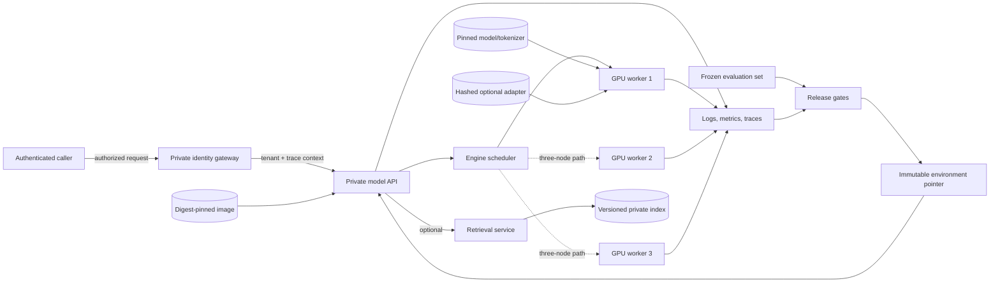

# Reference architecture

This is a logical architecture. Replace product names only after recording the
decision in the ADR and keeping the same trust and evidence boundaries.

The one-GPU path removes GPU workers 2 and 3 and all collectives. The
three-node path retains the same public API and release contract, but adds
rank/world-size configuration, rendezvous, topology evidence, collective
health, and worker-loss recovery.

The gateway is a trust boundary, not a label. The model Service remains
`ClusterIP`; an implementation must prove anonymous denial, authenticated but
unauthorized denial, and one authorized action before attaching restricted
content. NetworkPolicy narrows connectivity but does not replace caller
authentication or tenant authorization.

The telemetry path intentionally reaches every gate. A release cannot claim a
latency objective without raw workload evidence, recovery without a timestamped
failure timeline, or cleanup without an after-inventory.
