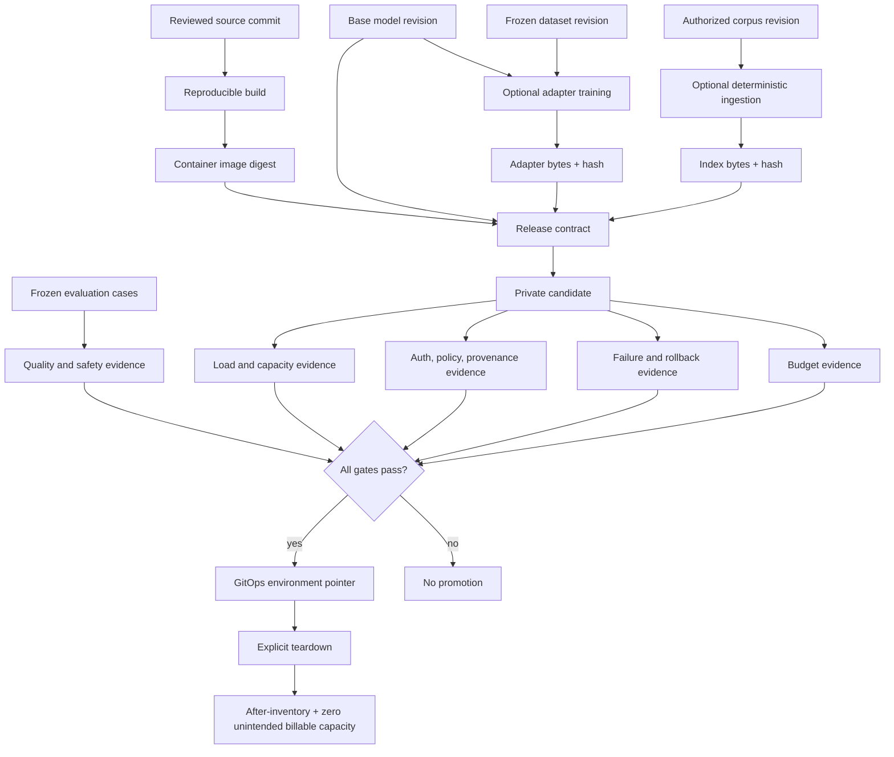

# Data and artifact flow

Dataset permissions and deletion requirements must follow derived adapters,
indexes, caches, snapshots, logs, and backups. A SHA-256 hash identifies bytes;
it does not grant a license, prove authorship, or establish authorization.

Prompts and retrieved documents are untrusted input. Do not place raw prompts,
credentials, personal data, or restricted document text in unrestricted logs.
Record bounded identifiers, timings, token counts, policy decisions, and
redacted failure context.
