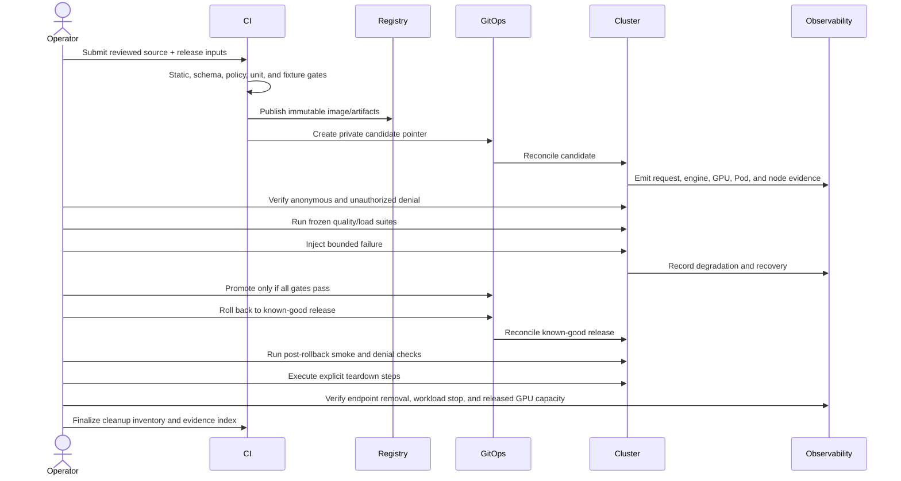

# Promotion, recovery, and teardown sequence

A production promotion should be a pointer change to an already verified
immutable release. Rebuilding during rollback creates a new artifact and is not
a rollback. The rollback target must be known before the failure drill.

Teardown is also a controlled change. Capture an inventory before removal, run
scoped cleanup commands, wait for asynchronous cloud deletion, capture the
after-inventory, and investigate every residual resource. “`kubectl delete`
returned zero” is not sufficient evidence that node groups, volumes, load
balancers, object versions, or log-retention costs are gone.
